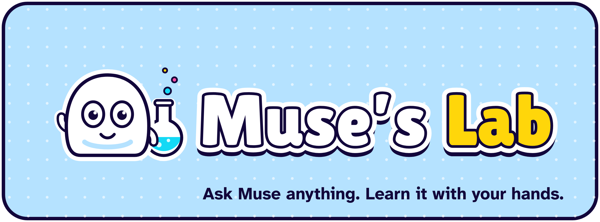
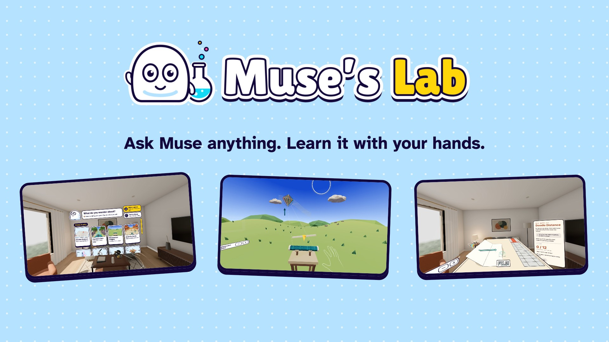
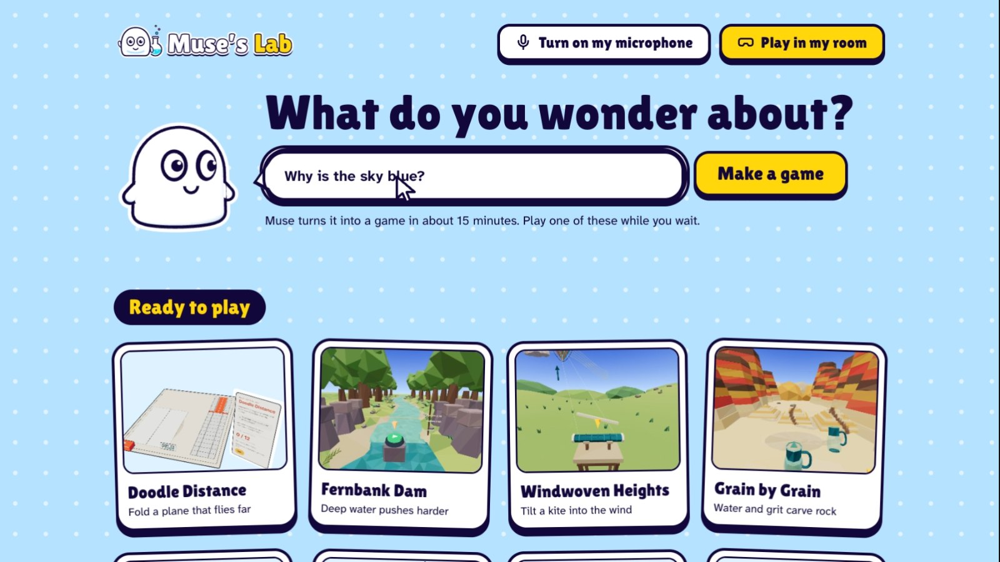
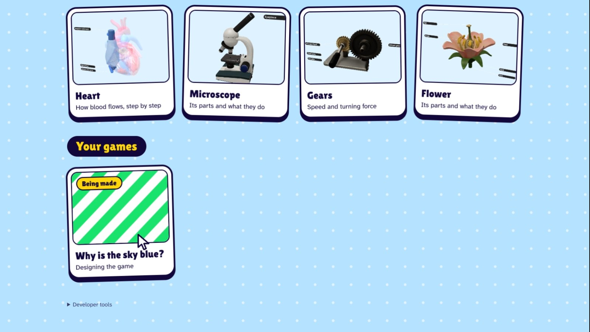
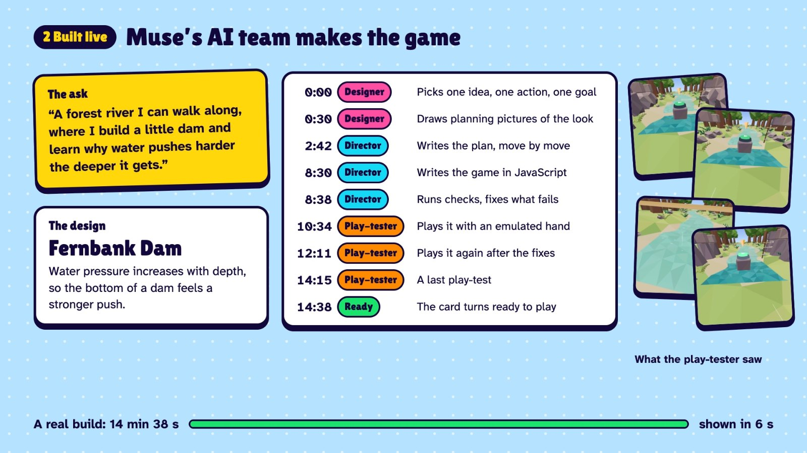
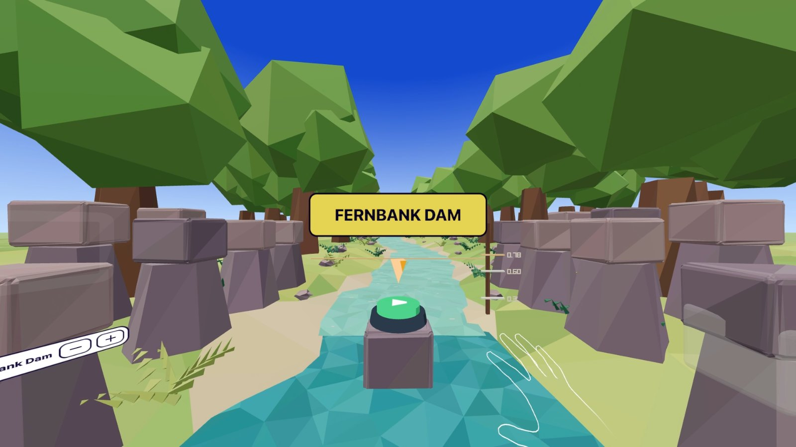
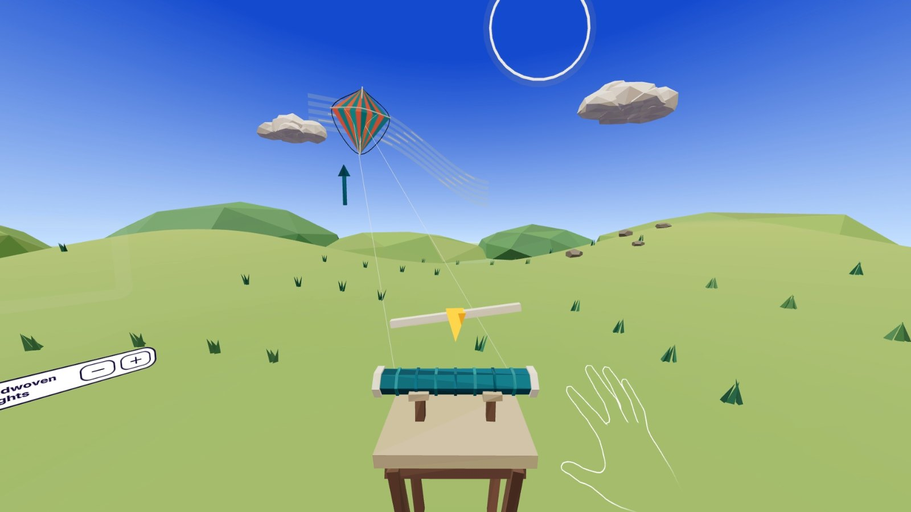
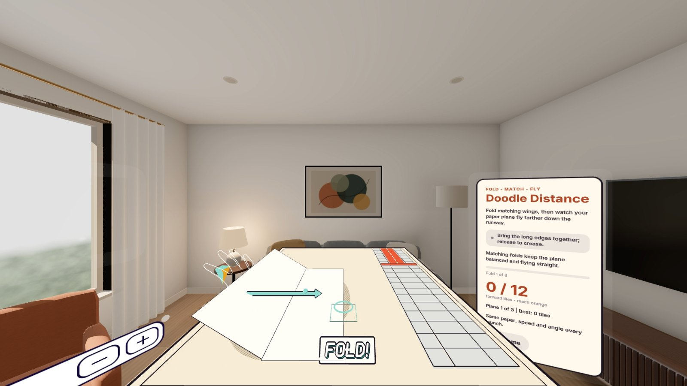
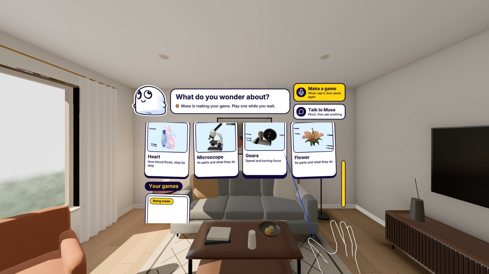
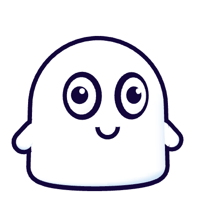

<p align="center">
  
</p>

<p align="center"><b>Hands-on learning games, made live by a team of AI agents, played in your room with your hands on Meta Quest.</b></p>

<p align="center"></p>

Ask Muse a question, by voice or by typing. Muse's team of AI agents designs a game that answers it, writes the
code, plays it to test it, and checks it, in about 15 minutes. Then you play it in your room: a river you dam
with stones, a hilltop where you steer a kite through the wind, a paper plane you fold on your own table. Every
game teaches one real idea by doing it.

Built for the Meta VR Start Developer Competition 2026 ([docs/competition.md](docs/competition.md)).

## Gallery

<table>
  <tr>
    <td width="50%"><br><b>Ask Muse anything.</b> Type a question on the start page, or say it in the headset.</td>
    <td width="50%"><br><b>Its card appears at once.</b> It shows the game being made, and turns ready when it is.</td>
  </tr>
  <tr>
    <td><br><b>Built live.</b> The real record of one build: a designer, a director that writes the code, and a play-tester that plays it with an emulated hand.</td>
    <td><br><b>Your room is the lab.</b> The dashboard floats over your room with no background. Pinch and drag to scroll, pinch a card to play.</td>
  </tr>
  <tr>
    <td><br><b>Fernbank Dam.</b> Stack stones across a river: deep water pushes harder, so the base must be thicker.</td>
    <td><br><b>Windwoven Heights.</b> Tilt the handle and the kite turns. Ribbons show the air bending around it, and an arrow shows its lift.</td>
  </tr>
  <tr>
    <td><br><b>Doodle Distance.</b> On your own table, in passthrough: fold a plane with matching folds, then watch it fly straighter.</td>
    <td><br><b>Your games.</b> Everything you asked for is a card, next to the ready-made ones.</td>
  </tr>
</table>

## Inspiration

Kids ask why all day. Why does a dam need a thick bottom? Why does a kite go up? Books and videos answer with
words, but these are things you understand by doing them: you feel the water push, you tilt the kite and watch it
climb. Our bar was a paper plane: fold it, throw it, and see why it flies farther.

Mixed reality can put that kind of experiment in any room, and AI agents can now write real interactive software.
So we asked: what if every question could become its own small game you play with your hands, made for you while
you wait?

## What it does

- **Ask anything.** Type a question on the start page, or pinch **Make a game** in the headset and say it. A card
  appears at once and shows the game being made.
- **Muse's team builds it.** A designer picks one idea, one action and a goal, and draws two planning pictures. A
  coding agent writes the game, plays it in the real headset app to test it, and fixes what it finds. A grader
  checks it against the request, and a gate runs it locked down before the headset ever loads it.
- **Play it in your room.** Desk games sit on your real table in passthrough. World games put you in a place you
  walk around: a forest river, a windy hilltop, a desert canyon. Everything is hands-first: pinch, poke and grab,
  with no controllers needed.
- **Learn by doing.** Each game teaches one real idea through its main action, with visible feedback: pressure
  arrows that grow with depth, airflow ribbons and a lift arrow, ink trails that show a straight flight or a curl.
- **Talk to Muse.** Muse is also a voice tutor. It answers questions about the game that is open, quizzes you out
  loud when you ask, and can plan a course of levels.
- **A dashboard over your room.** In the headset the home screen floats in front of you with no background, like a
  store front. Opening a game folds it into a small bar with **Home**, and **Home** brings it back.

## How we built it

<p align="center"></p>

- **The headset app** ([`apps/xr`](apps/xr)) is WebXR on Meta's Immersive Web SDK (IWSDK) with three.js and uikit
  panels. Its host mounts each generated game as an ES module, gives it a kit for hands, panels and sound, and
  places it on your desk or as a world. The start page and the dashboard share one card model, so the 2D page
  and the headset show the same games.
- **The server** ([`apps/api`](apps/api)) is Python with FastAPI. Each flow is a LangGraph graph with checkpoints,
  so a restart picks up where it stopped. The coder is a Deep Agent in a Modal sandbox (one per run, network
  blocked, no secrets) with [skills](skills) for learning games, looks, game patterns, sound and panels.
- **Seeing its own game.** The sandbox runs the real headset app headless, so the agent can open its game, move an
  emulated hand, take screenshots and fix what looks wrong. Two planning pictures (the first view and the main
  object) keep the look on target.
- **The gate** ([`apps/gate`](apps/gate)) checks every module before it reaches a headset: static validation, a dry
  run with the headset's own three.js and kit, and a layout check (nothing hidden, out of reach, or in the
  player's face).
- **The Studio** keeps a record of every run: the design, the planning pictures, every agent step, the play-test
  screenshots and the grader's verdicts.
- **Muse** is our own mascot, built in code as a small 3D toy ([`muse3d.ts`](apps/xr/src/genui/muse3d.ts)) with
  flat colours and an ink outline. It stands beside its question in the headset and on the start page, watches
  you, waves when pinched, thinks while a game is being made and hops when one is ready.

## Challenges we ran into

- **Trusting generated code in a headset.** A game written a minute ago runs on someone's face. The gate runs every
  module locked down first and checks that nothing is hidden, out of reach or too close.
- **An agent that cannot see its game writes broken games.** Early games looked fine in code and were unplayable.
  Running the real headset app inside the sandbox, with play-tests and a grader, made the difference.
- **Memory in the headset.** After many games the Quest lagged: about 13 MB stayed alive after each one, held by the
  panels' layout callbacks and the ECS registries. We measured it on the device and now release both when a game
  closes.
- **Scrolling with hands.** On the headset, dragging a list stopped after a few pixels. The headset input reuses
  one event object every frame, and the panel library marks that object as already scrolled. We clear the mark each
  frame: in the emulator the same drag now scrolls 230 pixels instead of 13.
- **Designing for kids in a headset.** Our first look was too faded and our second too blue. The one that worked has
  no background in the headset, puts every word on its own solid shape, and uses big, bold type.

## Accomplishments that we're proud of

- A sentence becomes a playable, hands-first mixed-reality game in about 15 minutes, with no person in the loop.
- The four ready-made games were made this way, from one sentence each, and teach real ideas: water pressure, lift,
  erosion, and how symmetry keeps a plane flying straight.
- Every build is open to inspect, step by step, in the Studio.
- We measured what makes the games good instead of guessing (see [Results](#results)).

## What we learned

- The model is the biggest factor in game quality, then the pipeline around it.
- Checks beat instructions: a gate and a play-test catch what no prompt rule prevents.
- Testing in the real runtime matters. The agent's own play-tests, and our emulator tests, found problems that
  reading the code never would.
- For young players in a headset, readable beats clever: bold colours, big text, and every word on a solid shape.

## What's next

- Faster builds, so a first playable version arrives in a few minutes and improves while you play.
- Sharing: send a game you made to a friend or a classroom.
- Progress across a course of levels, with Muse remembering what you have learned.
- Playing together in the same room.

## Built with

IWSDK (WebXR), three.js, uikit, TypeScript, Vite, Python, FastAPI, LangGraph, Deep Agents, Modal, Deepgram Voice
Agent, OpenAI-compatible models.

## How a game is made, in the code

| Stage | Code | What it does |
|---|---|---|
| Design | [`apps/api/app/pipeline/design.py`](apps/api/app/pipeline/design.py) | One call designs the game; two reference pictures (the first view, and a front/side/top sheet of the main thing) guide the coder and are never shown in the game. |
| Code | [`apps/api/app/pipeline/coder/`](apps/api/app/pipeline/coder) | The coder agent edits `/work/game.js` with the [skills](skills), runs the check, and play-tests the game in the real headset app run headless in its sandbox. |
| Grade | [`apps/api/app/pipeline/grader.py`](apps/api/app/pipeline/grader.py) | Grades the game against a rubric made for the request and the planning pictures. |
| Check | [`apps/gate`](apps/gate) | Static validation, a dry run with the headset's own three.js and kit, and a layout check (nothing hidden, out of reach, or in the player's face). |

Lessons follow the same path: the router picks library models, then the writer, the gate and repairs
([`apps/api/app/pipeline/lesson.py`](apps/api/app/pipeline/lesson.py)). See
[`apps/api/app/pipeline/README.md`](apps/api/app/pipeline/README.md) for the details.

## Repository layout

```
apps/
  xr/          the headset app: WebXR on Meta's IWSDK. The start page, the headset dashboard, the voice tutor, and
               the host that mounts generated games (src/genui/)
  api/         the server (Python, FastAPI, LangGraph, Deep Agents)
    app/core/       settings, database, model calls, spending limits
    app/pipeline/   design, the coder agent, the grader, the lesson, game and course graphs
    app/library/    the 3D model library: catalogue, model routing, real sizes
    app/services/   courses, saved games, live previews, voice, generated media, the Studio
  gate/        the module checker (TypeScript): validation, sandboxed dry run, layout check, the kit
skills/        the agent's skills: the learning game, looks, game patterns, sound, panels (mounted at /skills)
data/library/  the 3D model library and the sound library (credits in data/library/CREDITS.md)
bench/         benchmark prompts and results
docs/          the project spec, the competition brief, related work, the brand (docs/brand) and the README's pictures
```

## Getting started

Requirements: Node 22.12+, Python 3.12 with [uv](https://docs.astral.sh/uv/), a [Modal](https://modal.com)
account (the coder's sandbox), and an OpenAI-compatible API key.

```bash
cp .env.example .env                  # then fill in LLM_API_KEY and the keys you use (see Configuration)
cd apps/api && uv sync && uv run modal setup
cd ../gate && npm install
cd ../xr && npm install
```

Run the server and the headset app:

```bash
# Terminal 1: the API on :8787
cd apps/api && uv run uvicorn app.main:app --host 0.0.0.0 --port 8787

# Terminal 2: the headset app and the emulator browser on https://localhost:8081
cd apps/xr && npm run dev
```

On a Quest, connect it by USB, run `adb reverse tcp:8081 tcp:8081` and open `https://localhost:8081` in the
headset browser (accept the local certificate warning). On the start page, tap **Turn on my microphone** first,
then **Play in my room**.

## Tests

```bash
cd apps/api && uv run pytest                      # the server, the pipeline and the skills' scripts
cd apps/gate && npm test && npm run typecheck     # the checker
cd apps/xr && npm run typecheck && npm run build  # the headset app
```

The headset app's smoke tests run in the IWSDK emulator while the dev server is up, for example
`cd apps/xr && npx @iwsdk/cli browser run tests/dashboard-smoke.mjs`.

## Configuration

Settings come from `.env` at the repo root ([`.env.example`](.env.example)).

| Setting | Default | What it does |
|---|---|---|
| `LLM_BASE_URL`, `LLM_API_KEY`, `LLM_MODEL` | OpenAI, `gpt-6.1-sol` | The model for design, coding and lessons. Any OpenAI-compatible endpoint; models and prices are in [`apps/api/models.json`](apps/api/models.json). |
| `META_API_KEY` | | Meta's Muse models, and speech to text when there is no Deepgram key. |
| `DEEPGRAM_API_KEY` | | The voice tutor. |
| `MEDIA_BASE_URL`, `MEDIA_API_KEY` | | Planning pictures and generated sounds. Without them, games use the sound library and no pictures. |
| `PLAN_PICTURES` | on | `0` turns the planning pictures off. |
| `CODER_BUDGET_USD` | 3 | The most one coder attempt may spend. |
| `DAILY_BUDGET_USD`, `RATE_LIMIT_PER_10_MIN` | 15, 6 | Per-day spending cap and per-visitor rate limit. |
| `COURSE_PLANNER`, `MODERATION_MODEL` | `LLM_MODEL` | The course planner's and the request screen's model. |

## Results

[`bench/results/play-factors`](bench/results/play-factors) measures what made the games good: 35 games from 11
setups, judged blind from the same opening view, with a layout check and a hands probe. The model was the largest
factor, then the pipeline and the layout checker; the games built with planning pictures were the ones preferred in
headset play. Earlier results (model comparisons, 3D pipelines, the paper's research questions) are in
[`bench/`](bench).

## Documentation

- [docs/spec.md](docs/spec.md): the project spec and its phases
- [docs/paper/prior-art.md](docs/paper/prior-art.md): related work
- [apps/api/app/pipeline/README.md](apps/api/app/pipeline/README.md): how lessons and games are made
- [skills/README.md](skills/README.md): the agent's skills
- [apps/gate/README.md](apps/gate/README.md): what the checker tests
- [docs/brand](docs/brand): the logo and icon, drawn by [`apps/xr/scripts/render-brand.mjs`](apps/xr/scripts/render-brand.mjs)
