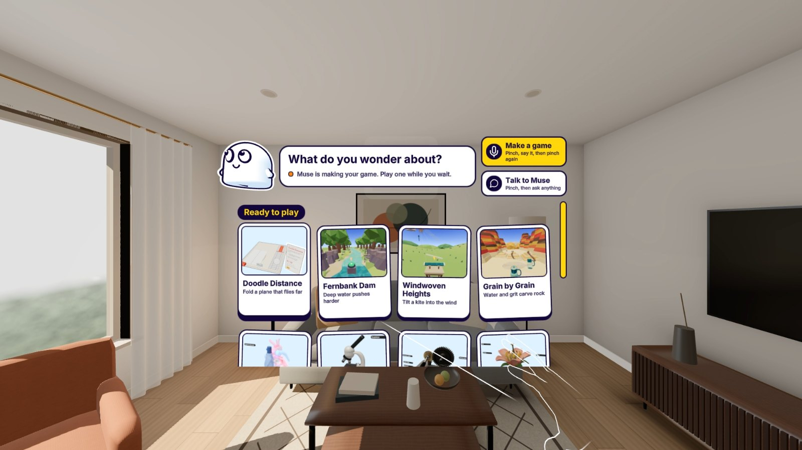
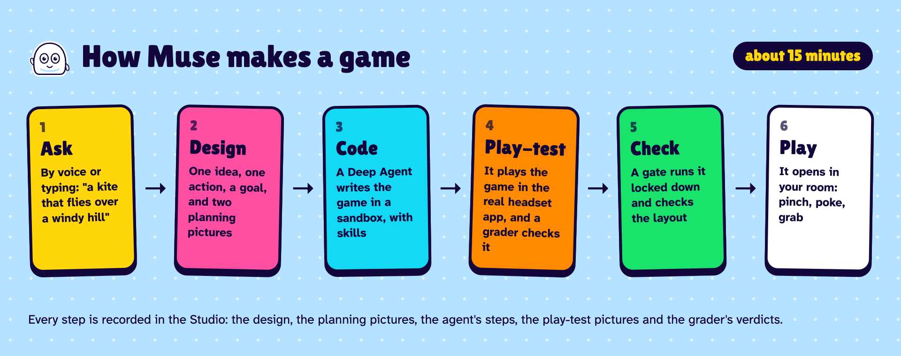

<h1 align="center">
Muse's Lab
</h1>

<p align="center">
  <a href="paper/muses-lab-paper.pdf"></a>
  <a href="LICENSE"></a>
  <a href="https://github.com/facebook/immersive-web-sdk"></a>
  
  
  
</p>

Muse's Lab turns a question into a hands-on mixed-reality learning game for Meta Quest. A pipeline of AI agents
designs the game, writes it as a WebXR module, play-tests it in the real headset runtime and checks it before it
loads, in about 15 minutes; the player then plays it in their own room, with their hands.

The system and its evaluation are described in the paper [*Muse's Lab: Generating Hands-On Learning Games at
Runtime for Seated Mixed Reality and Walkable Virtual Worlds*](paper/muses-lab-paper.pdf) (PDF, 18 pages).

<p align="center">
  
</p>

## Features

- **Any question becomes a game.** Type it on the start page or say it in the headset; a card appears at once and
  shows the game being made.
- **Built and tested by agents.** A designer, a coding agent that play-tests its own game in the headset runtime, a
  grader, and a gate that runs every module locked down before a headset loads it.
- **Desk or world.** Desk games sit on the player's real table in passthrough; world games are places to walk around.
  Every game is hands-first: pinch, poke and grab, no controllers needed.
- **One idea per game.** Each game teaches one real idea through its hand actions (one gesture per move, at most
  three kinds), with visible feedback such as pressure arrows, airflow ribbons or flight trails.
- **Voice tutor.** Muse answers questions about the open game, quizzes the player out loud and can plan a course of
  levels.
- **The Studio.** Every build is recorded: the design, the planning pictures, each agent step, the play-test
  screenshots and the grader's verdicts.

## Example games

The four ready-made games were each generated by the pipeline from a one-sentence request.

| Game | What it teaches | Mode | Definition |
|---|---|---|---|
| Doodle Distance | Matching folds keep a paper plane flying straight and far. | Desk | [`paper-plane.json`](headset/public/games/paper-plane.json) |
| Fernbank Dam | Deep water pushes harder, so a dam needs a thicker base. | World | [`river-dam.json`](headset/public/games/river-dam.json) |
| Windwoven Heights | Tilting a kite into the wind turns and lifts it. | World | [`kite-hill.json`](headset/public/games/kite-hill.json) |
| Grain by Grain | Flowing water and grit carve rock into a canyon. | World | [`desert-canyon.json`](headset/public/games/desert-canyon.json) |

<table>
  <tr>
    <td width="50%"><br>The headset dashboard over the player's room.</td>
    <td width="50%"><br>The Studio record of one build.</td>
  </tr>
  <tr>
    <td><br>Fernbank Dam, a world game.</td>
    <td><br>Doodle Distance, a desk game in passthrough.</td>
  </tr>
</table>

## Quickstart

Requirements: Node 22.12+, Python 3.12 with [uv](https://docs.astral.sh/uv/), a [Modal](https://modal.com) account
for the coding agent's sandbox, and a Meta Model API key for the Muse models (`META_API_KEY`).

```bash
git clone https://github.com/pramodthe/spatial-genui.git && cd spatial-genui
cp .env.example .env                       # fill in LLM_API_KEY and the keys you use (see Configuration)
(cd server && uv sync && uv run modal setup)
(cd gate && npm install)
(cd headset && npm install)
```

Start the API and the headset app in two terminals:

```bash
cd server && uv run uvicorn app.main:app --host 0.0.0.0 --port 8787
cd headset && npm run dev                  # https://localhost:8081, with the IWSDK emulator
```

To play on a Quest, connect it by USB, run `adb reverse tcp:8081 tcp:8081` and open `https://localhost:8081` in the
headset browser, accepting the local certificate. On the start page, tap **Turn on my microphone**, then
**Play in my room**.

## How it works

<p align="center">
  
</p>

| Stage | Code | What it does |
|---|---|---|
| Design | [`pipeline/design.py`](server/app/pipeline/design.py) | One model call designs the game: one idea, one gesture per move and at most three hand actions, a goal, desk or world. Two planning pictures (the first view and a front/side/top sheet of the main object) guide the coder and are never shown in the game. |
| Code | [`pipeline/coder/`](server/app/pipeline/coder) | A Deep Agent in a Modal sandbox (one per run, network blocked, no secrets) writes the game with the [skills](agent_skills), runs the checks, and play-tests it in the real headset app run headless, with an emulated hand. |
| Grade | [`pipeline/grader.py`](server/app/pipeline/grader.py) | Grades the game against a rubric made for the request and the planning pictures, and can send it back once. |
| Gate | [`gate`](gate) | Static validation, a dry run with the headset's own three.js and kit, a layout check (nothing hidden, out of reach, or in the player's face), and a play-through: a simulated hand plays the game by its own description, and every move must register and the round must end with a result. |
| Play | [`headset`](headset) | The headset host mounts the module, gives it a kit for hands, panels and sound, and places it on the desk or as a world. |

Each flow is a LangGraph graph with checkpoints, so a restarted server resumes where it stopped. Lessons follow the
same path, with library models chosen by a router ([`pipeline/lesson.py`](server/app/pipeline/lesson.py)). The
[pipeline README](server/app/pipeline/README.md) has the details.

## Configuration

Settings are read from `.env` at the repository root; see [`.env.example`](.env.example).

| Setting | Default | Description |
|---|---|---|
| `LLM_BASE_URL`, `LLM_API_KEY`, `LLM_MODEL` | Meta, `muse-ember-1.0` | The model for design, coding and lessons: Muse Ember, or Muse Spark (`muse-spark-1.3-contributor`). Another OpenAI-compatible endpoint works too; models and prices are listed in [`server/models.json`](server/models.json). |
| `META_API_KEY` | | Meta's Muse models (the app's model), and speech to text when there is no Deepgram key. |
| `DEEPGRAM_API_KEY` | | The voice tutor. |
| `MEDIA_BASE_URL`, `MEDIA_API_KEY`, `MEDIA_IMAGE_MODEL` | Meta, `muse-image-1.0` | Planning pictures from Meta's Muse Image (the key is the Meta key). Meta makes no sounds, so games use the sound library. Without these, games get no pictures. |
| `PLAN_PICTURES` | `1` | `0` turns the planning pictures off. |
| `CODER_BUDGET_USD` | `3` | The most one coder attempt may spend. |
| `DAILY_BUDGET_USD`, `RATE_LIMIT_PER_10_MIN` | `15`, `6` | The server's daily spending cap and the per-visitor rate limit. |
| `COURSE_PLANNER`, `MODERATION_MODEL` | `LLM_MODEL` | The course planner's and the request screen's models. |

## Repository layout

```text
spatial-genui/
├── headset/             WebXR app on Meta's IWSDK: start page, headset dashboard, voice tutor
│   ├── src/genui/       the host that mounts generated games: cards, panels, hands, sound
│   └── public/games/    the four ready-made games
├── server/              Python server: FastAPI routes, LangGraph flows, the Deep Agents coder
│   ├── app/core/        settings, database, model calls, spending limits
│   ├── app/pipeline/    design, the coding agent, the grader, the lesson, game and course graphs
│   ├── app/library/     catalogue lookup, model routing, real-world sizes
│   ├── app/services/    courses, saved games, live previews, voice, generated media, the Studio
│   ├── library/         the 3D model and sound library, with its credits
│   ├── sandbox/         the coding agent's Modal image
│   └── tests/           the pytest suite
├── gate/                module checker (TypeScript): validation, sandboxed dry run, layout check, the kit
├── agent_skills/        the coding agent's skills: learning games, looks, game patterns, sound, panels
├── benchmark/           evaluation prompts and results
├── paper/               the research paper (PDF)
├── LICENSE
└── README.md
```

The server writes its runtime files (database, checkpoints, Studio runs, generated media) to `server/data/`, which
is not tracked.

## Evaluation

[`benchmark/results/play-factors`](benchmark/results/play-factors) measures what makes the games good: 35 games from 11
setups, judged blind from the same opening view, with a layout check and a hands probe. The model was the largest
factor, followed by the pipeline and the layout checker. [`benchmark/`](benchmark) also holds the earlier model comparisons,
3D pipelines and the paper's research questions; the [paper](paper/muses-lab-paper.pdf) reports them in full.

## Development

```bash
cd server && uv run pytest                         # server, pipeline and skill scripts
cd gate && npm test && npm run typecheck           # module checker
cd headset && npm run typecheck && npm run build   # headset app
```

The headset app's smoke tests run in the IWSDK emulator while the dev server is up, for example
`cd headset && npx @iwsdk/cli browser run tests/dashboard-smoke.mjs`.

Further documentation:

- [`server/app/pipeline/README.md`](server/app/pipeline/README.md): how lessons and games are made
- [`agent_skills/README.md`](agent_skills/README.md): the coding agent's skills
- [`gate/README.md`](gate/README.md): what the checker tests

## Citation

```bibtex
@misc{thebe2026museslab,
  title  = {Muse's Lab: Generating Hands-On Learning Games at Runtime for Seated Mixed Reality and Walkable Virtual Worlds},
  author = {Thebe, Pramod},
  year   = {2026},
  url    = {https://github.com/pramodthe/spatial-genui}
}
```

## License

The code is released under the [MIT License](LICENSE). The 3D models and sounds in [`server/library`](server/library)
keep their own licences, listed in [`server/library/CREDITS.md`](server/library/CREDITS.md).
