# Phase 3 gallery

Each cell is the model a pipeline delivers under that condition, seen from above at three-quarters, with the judge's score (claude-opus-5-5). Four-view renders are in each job folder.

## saturn (astronomy)

“Saturn with its rings and its largest moon, Titan” · parts: planet, inner_ring, outer_ring, titan · [reference image](gallery/ref__saturn.jpg)

| Pipeline | none | critic (M2) | reference image (M1) | reference + critic |
|---|---|---|---|---|
| p1-threejs | 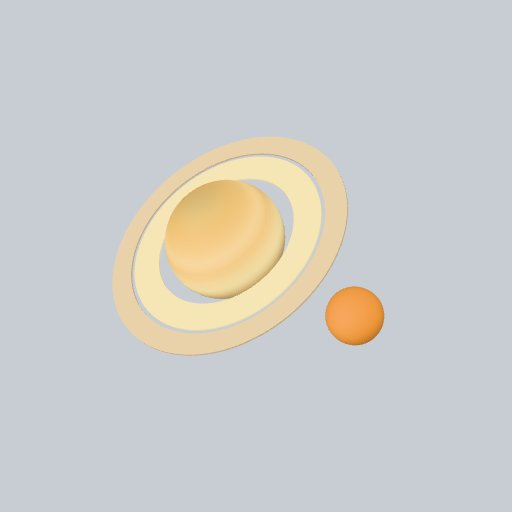 **4/5** · round 0 · 8,728 tris · all parts named |  **4/5** · round 0 · 8,728 tris · all parts named |  **4/5** · round 0 · 16,496 tris · all parts named | 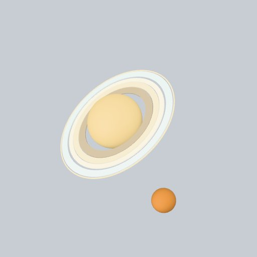 **4/5** · round 0 · 16,496 tris · all parts named |
| p2-cadquery | 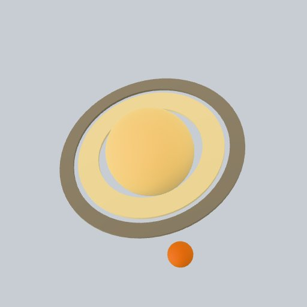 **4/5** · round 0 · 5,052 tris · all parts named |  **4/5** · round 0 · 5,052 tris · all parts named |  **4/5** · round 0 · 8,610 tris · all parts named |  **4/5** · round 0 · 8,610 tris · all parts named |
| p3-blender |  **4/5** · round 0 · 5,984 tris · all parts named | 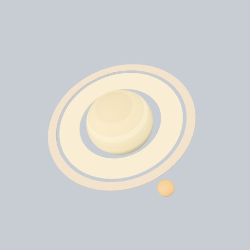 **4/5** · round 0 · 5,984 tris · all parts named | 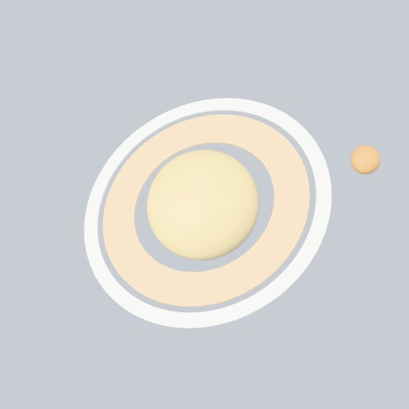 **4/5** · round 0 · 5,984 tris · all parts named |  **4/5** · round 0 · 5,984 tris · all parts named |

## lunar-lander (astronomy)

“An Apollo-style lunar lander standing on its legs” · parts: descent_stage, ascent_stage, leg, footpad, engine_nozzle, ladder · [reference image](gallery/ref__lunar-lander.jpg)

| Pipeline | none | critic (M2) | reference image (M1) | reference + critic |
|---|---|---|---|---|
| p1-threejs |  **3/5** · round 0 · 2,616 tris · all parts named | 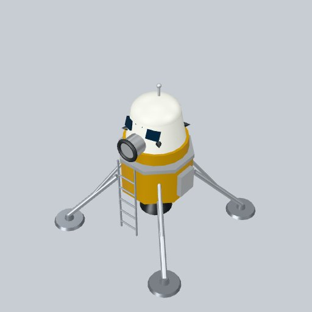 **3/5** · round 0 · 2,616 tris · all parts named | 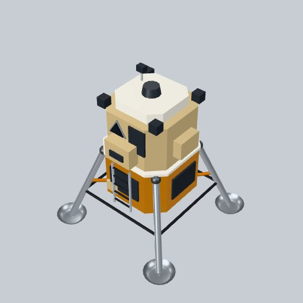 **4/5** · round 0 · 2,632 tris · all parts named | 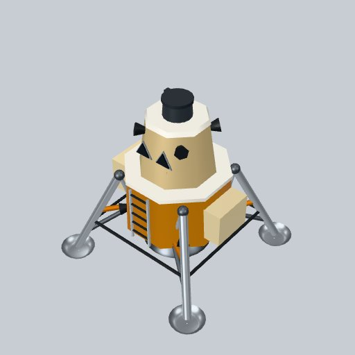 **4/5** · round 2 · 3,184 tris · all parts named |
| p2-cadquery |  **3/5** · round 0 · 15,480 tris · all parts named |  **4/5** · round 1 · 21,410 tris · all parts named | 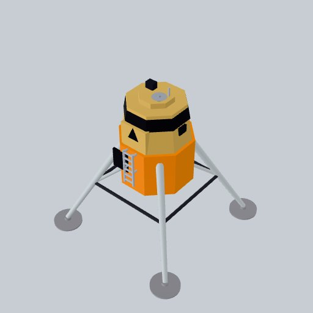 **3/5** · round 0 · 20,378 tris · all parts named | 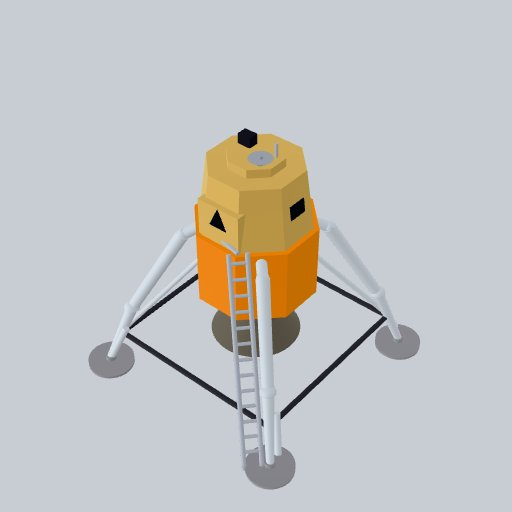 **3/5** · round 3 · 33,514 tris · all parts named |
| p3-blender | 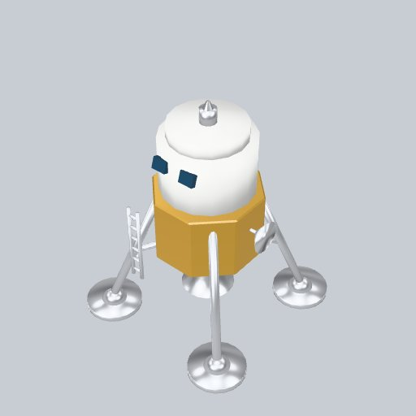 **3/5** · round 0 · 2,002 tris · all parts named | 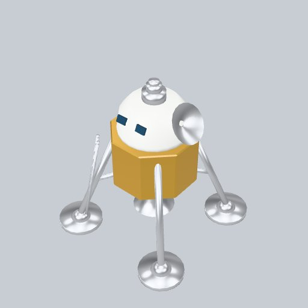 **4/5** · round 1 · 2,326 tris · all parts named | 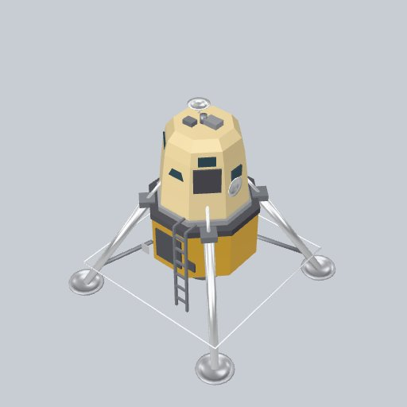 **3/5** · round 0 · 3,400 tris · all parts named | 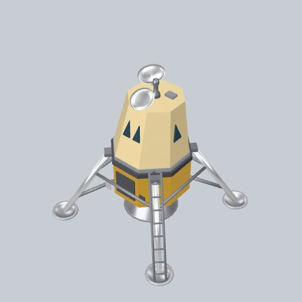 **4/5** · round 2 · 3,868 tris · all parts named |

## heart (biology)

“A human heart showing its four chambers and the main blood vessels” · parts: left_ventricle, right_ventricle, left_atrium, right_atrium, aorta, pulmonary_artery · [reference image](gallery/ref__heart.jpg)

| Pipeline | none | critic (M2) | reference image (M1) | reference + critic |
|---|---|---|---|---|
| p1-threejs | 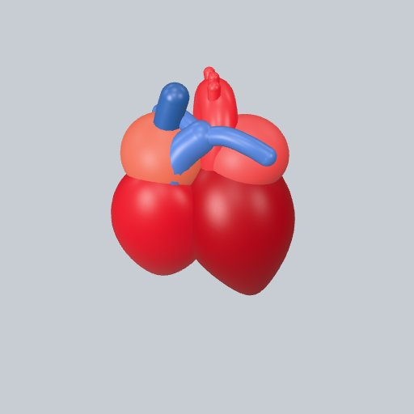 **3/5** · round 0 · 17,152 tris · all parts named | 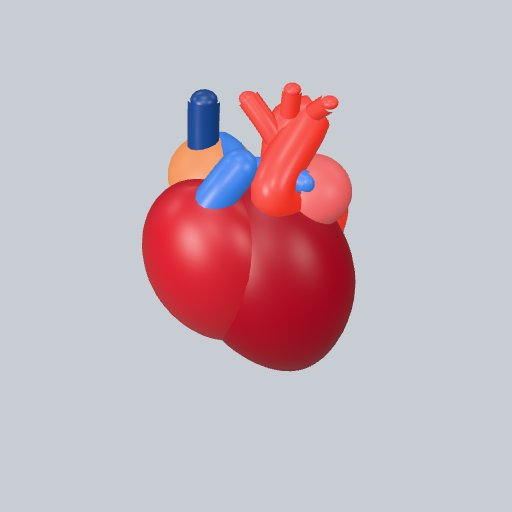 **3/5** · round 3 · 15,692 tris · all parts named | 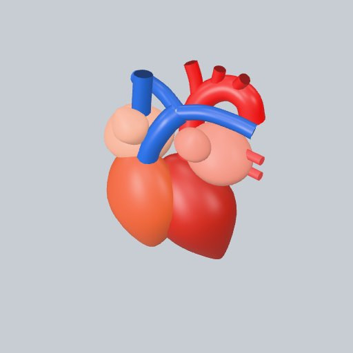 **3/5** · round 0 · 11,832 tris · all parts named | 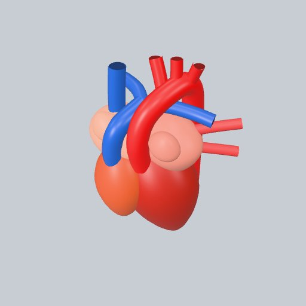 **3/5** · round 2 · 13,480 tris · all parts named |
| p2-cadquery | 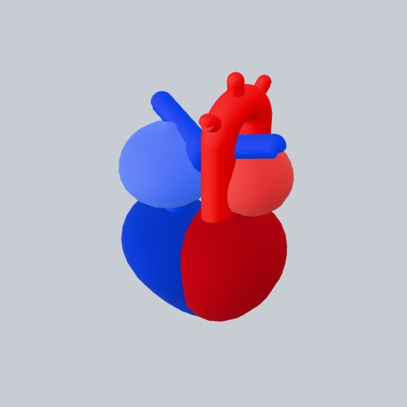 **3/5** · round 0 · 18,536 tris · all parts named | 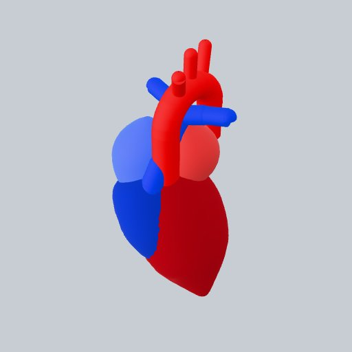 **3/5** · round 2 · 17,126 tris · all parts named | 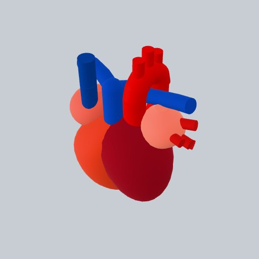 **3/5** · round 0 · 16,217 tris · all parts named | 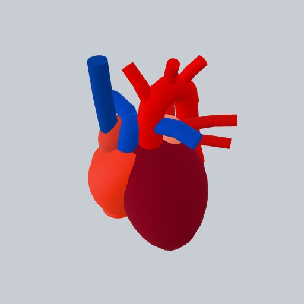 **4/5** · round 1 · 15,165 tris · all parts named |
| p3-blender | 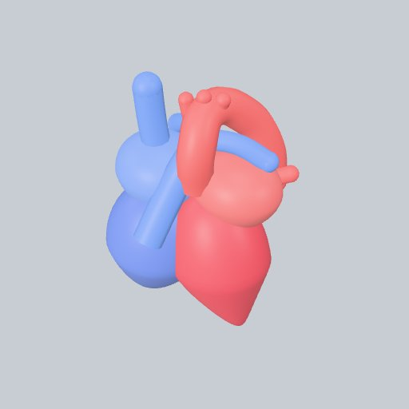 **3/5** · round 0 · 16,360 tris · all parts named | 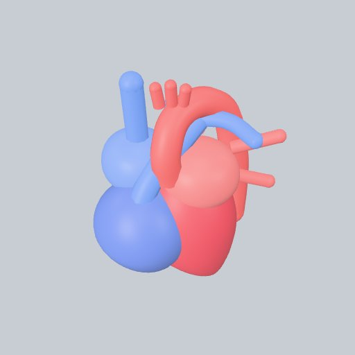 **3/5** · round 1 · 18,624 tris · all parts named | 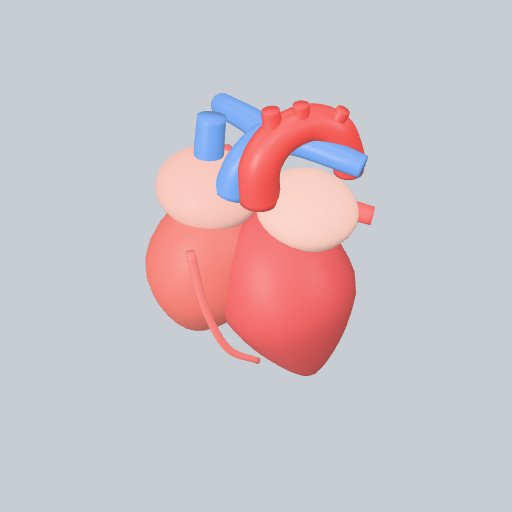 **3/5** · round 0 · 10,626 tris · all parts named | 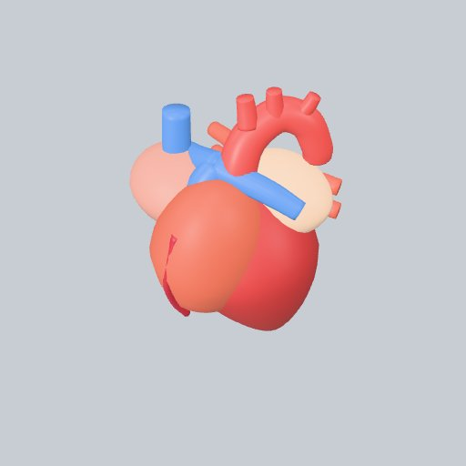 **3/5** · round 3 · 12,268 tris · all parts named |

## plant-cell (biology)

“A plant cell cut open to show the organelles inside” · parts: cell_wall, cell_membrane, nucleus, chloroplast, vacuole, mitochondrion · [reference image](gallery/ref__plant-cell.jpg)

| Pipeline | none | critic (M2) | reference image (M1) | reference + critic |
|---|---|---|---|---|
| p1-threejs | 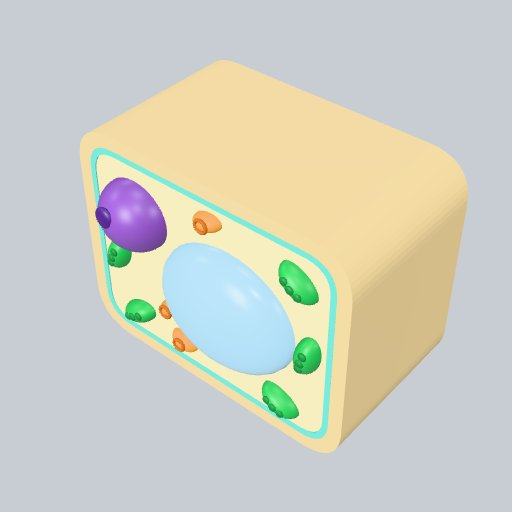 **4/5** · round 0 · 25,472 tris · all parts named |  **4/5** · round 0 · 25,472 tris · all parts named | 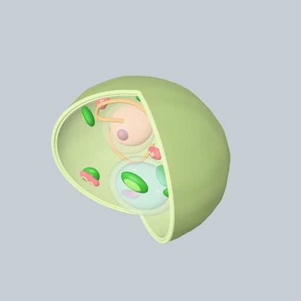 **3/5** · round 0 · 28,528 tris · all parts named |  **4/5** · round 1 · 28,240 tris · all parts named |
| p2-cadquery | 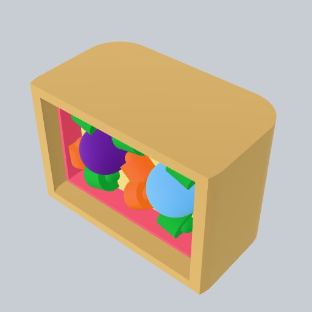 **2/5** · round 0 · 24,744 tris · all parts named | 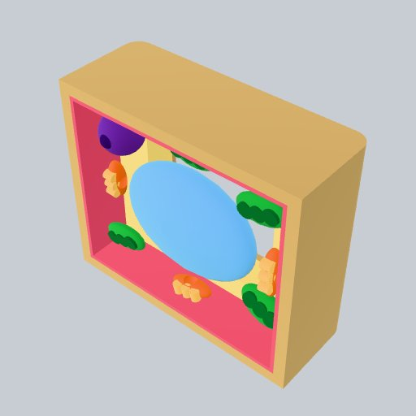 **3/5** · round 2 · 22,165 tris · all parts named |  **2/5** · round 0 · 24,222 tris · all parts named | 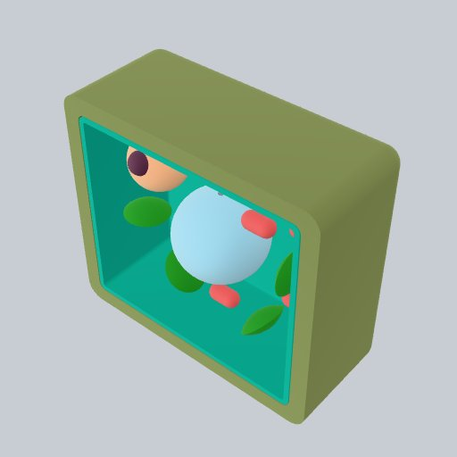 **3/5** · round 2 · 25,568 tris · all parts named |
| p3-blender | 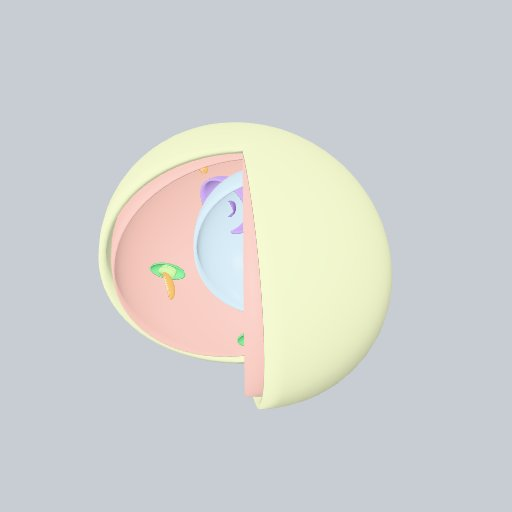 **3/5** · round 0 · 31,276 tris · all parts named | 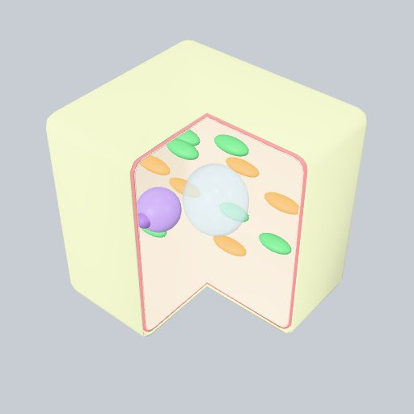 **3/5** · round 3 · 19,180 tris · all parts named | 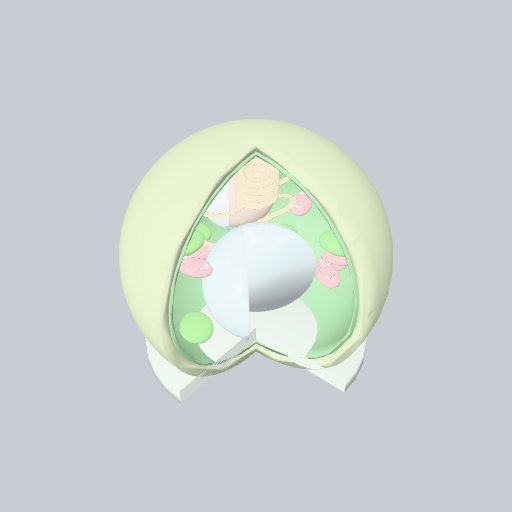 **3/5** · round 0 · 32,004 tris · all parts named | 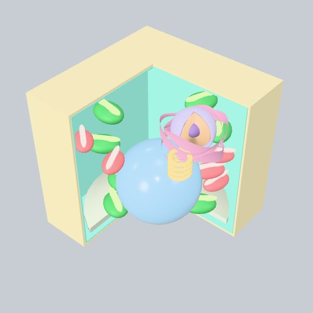 **4/5** · round 3 · 20,142 tris · all parts named |

## flower (biology)

“A flower with the parts a biology class labels” · parts: petal, sepal, stem, leaf, stamen, pistil · [reference image](gallery/ref__flower.jpg)

| Pipeline | none | critic (M2) | reference image (M1) | reference + critic |
|---|---|---|---|---|
| p1-threejs |  **4/5** · round 0 · 3,808 tris · all parts named |  **4/5** · round 0 · 3,808 tris · all parts named |  **4/5** · round 0 · 8,496 tris · all parts named |  **4/5** · round 0 · 8,496 tris · all parts named |
| p2-cadquery |  **4/5** · round 0 · 25,990 tris · all parts named |  **4/5** · round 0 · 25,990 tris · all parts named |  **3/5** · round 0 · 149,435 tris · all parts named |  **3/5** · round 3 · 155,235 tris · all parts named |
| p3-blender |  **4/5** · round 0 · 7,268 tris · all parts named |  **4/5** · round 0 · 7,268 tris · all parts named | 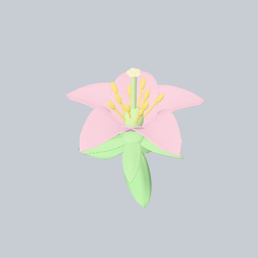 **3/5** · round 0 · 8,156 tris · all parts named |  **4/5** · round 1 · 8,288 tris · all parts named |

## gear-train (mechanical)

“A simple gear train: a hand crank turning a small gear that drives a larger gear, on a base plate” · parts: base_plate, crank_handle, drive_gear, driven_gear, axle · [reference image](gallery/ref__gear-train.jpg)

| Pipeline | none | critic (M2) | reference image (M1) | reference + critic |
|---|---|---|---|---|
| p1-threejs |  **4/5** · round 0 · 6,152 tris · all parts named | 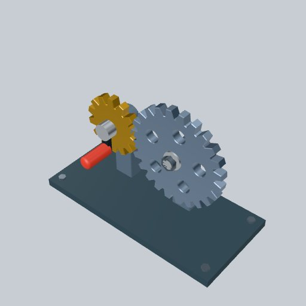 **4/5** · round 0 · 6,152 tris · all parts named | 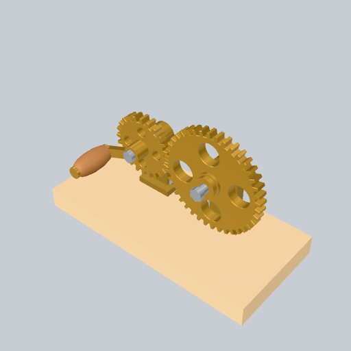 **4/5** · round 0 · 7,280 tris · all parts named |  **4/5** · round 0 · 7,280 tris · all parts named |
| p2-cadquery |  **5/5** · round 0 · 4,362 tris · all parts named |  **5/5** · round 0 · 4,362 tris · all parts named | 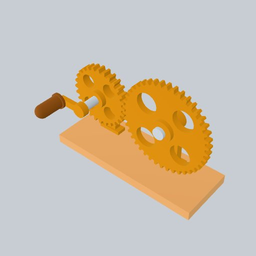 **4/5** · round 0 · 7,700 tris · all parts named | 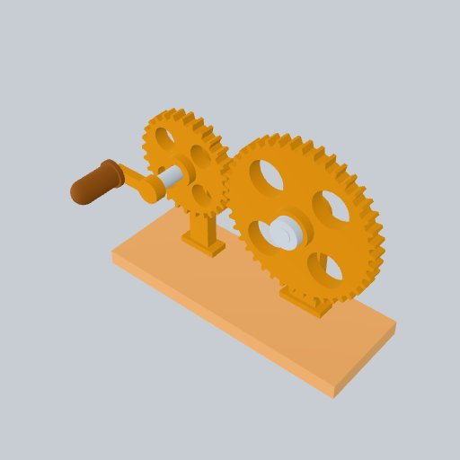 **4/5** · round 1 · 7,800 tris · all parts named |
| p3-blender | 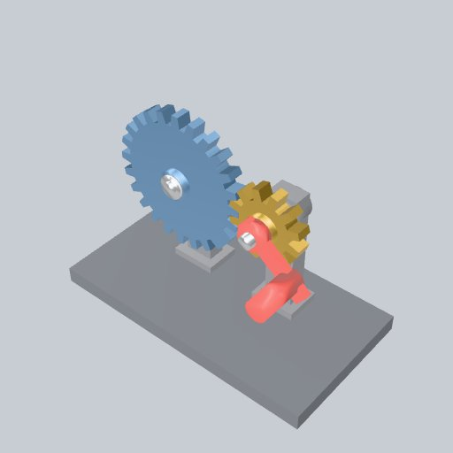 **5/5** · round 0 · 1,764 tris · all parts named |  **5/5** · round 0 · 1,764 tris · all parts named |  **5/5** · round 0 · 3,644 tris · all parts named | 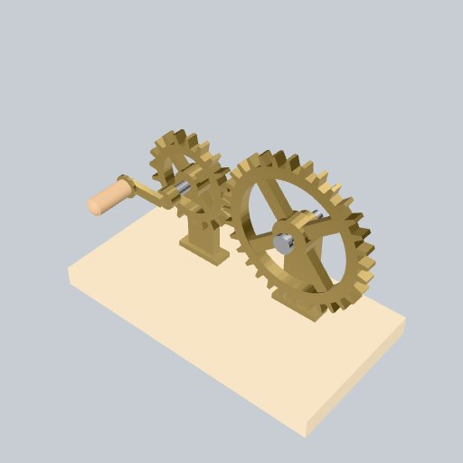 **5/5** · round 0 · 3,644 tris · all parts named |

## bicycle (mechanical)

“A bicycle” · parts: frame, front_wheel, rear_wheel, handlebar, saddle, pedal, chain · [reference image](gallery/ref__bicycle.jpg)

| Pipeline | none | critic (M2) | reference image (M1) | reference + critic |
|---|---|---|---|---|
| p1-threejs | 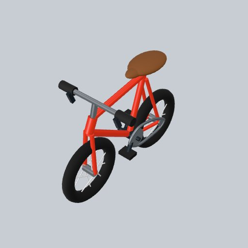 **4/5** · round 0 · 5,992 tris · all parts named |  **4/5** · round 0 · 5,992 tris · all parts named |  **4/5** · round 0 · 6,988 tris · all parts named | 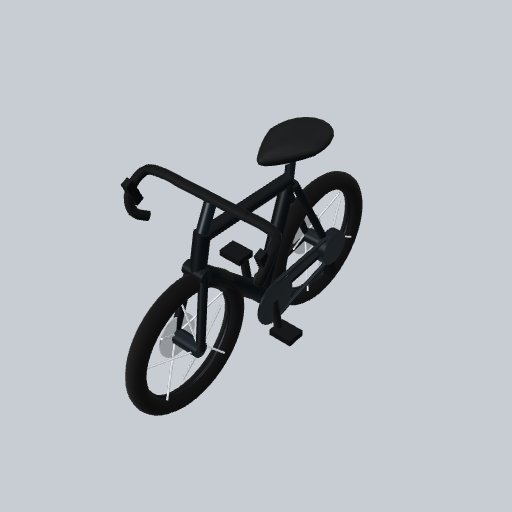 **4/5** · round 0 · 6,988 tris · all parts named |
| p2-cadquery | 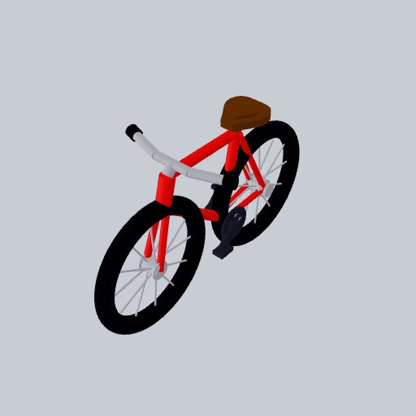 **4/5** · round 0 · 34,456 tris · all parts named | 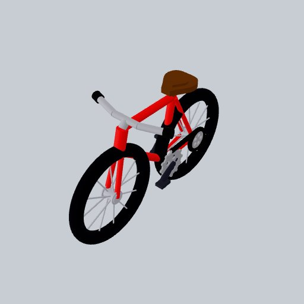 **4/5** · round 1 · 49,328 tris · all parts named |  **3/5** · round 0 · 78,285 tris · all parts named | 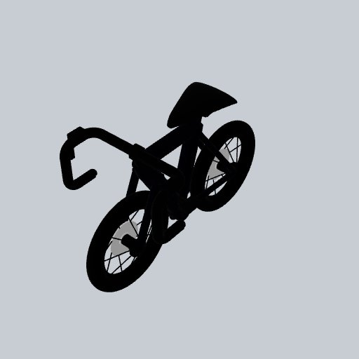 **3/5** · round 0 · 78,285 tris · all parts named |
| p3-blender | 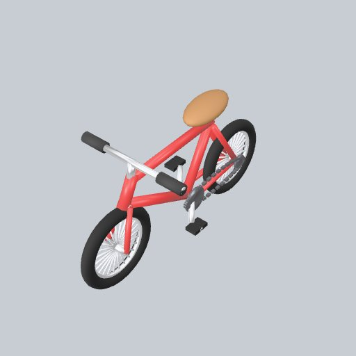 **4/5** · round 0 · 6,992 tris · all parts named | 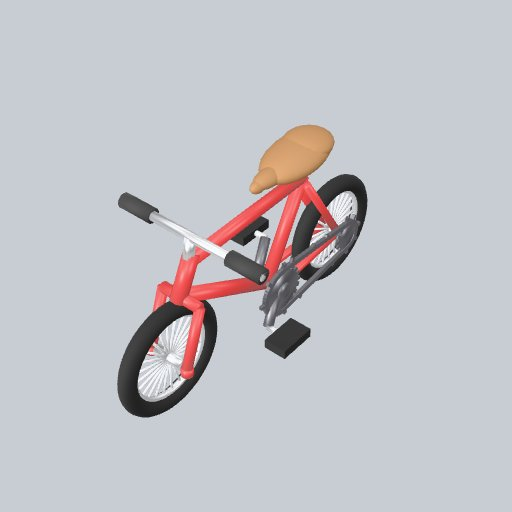 **4/5** · round 1 · 9,308 tris · all parts named | 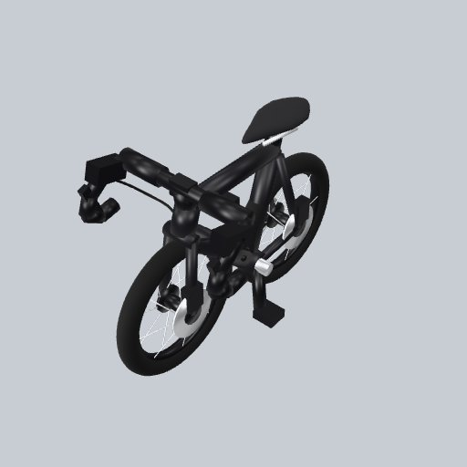 **3/5** · round 0 · 11,024 tris · all parts named |  **3/5** · round 1 · 11,376 tris · all parts named |

## engine-cylinder (mechanical)

“A cut-away of one cylinder of a car engine” · parts: cylinder, piston, connecting_rod, crankshaft, spark_plug, intake_valve, exhaust_valve · [reference image](gallery/ref__engine-cylinder.jpg)

| Pipeline | none | critic (M2) | reference image (M1) | reference + critic |
|---|---|---|---|---|
| p1-threejs |  **4/5** · round 0 · 4,316 tris · all parts named |  **4/5** · round 0 · 4,316 tris · all parts named |  **3/5** · round 0 · 6,552 tris · all parts named |  **4/5** · round 3 · 9,024 tris · all parts named |
| p2-cadquery |  **3/5** · round 0 · 45,198 tris · all parts named |  **3/5** · round 2 · 47,710 tris · all parts named |  **3/5** · round 0 · 94,462 tris · all parts named |  **3/5** · round 1 · 13,478 tris · all parts named |
| p3-blender |  **3/5** · round 0 · 6,836 tris · all parts named |  **3/5** · round 3 · 8,996 tris · all parts named |  **4/5** · round 0 · 13,834 tris · all parts named |  **3/5** · round 3 · 17,676 tris · all parts named |

## guitar (everyday)

“An acoustic guitar” · parts: body, sound_hole, neck, headstock, bridge, string, tuning_peg · [reference image](gallery/ref__guitar.jpg)

| Pipeline | none | critic (M2) | reference image (M1) | reference + critic |
|---|---|---|---|---|
| p1-threejs |  **3/5** · round 0 · 5,720 tris · all parts named |  **3/5** · round 0 · 5,720 tris · all parts named |  **4/5** · round 0 · 8,012 tris · all parts named |  **4/5** · round 0 · 8,012 tris · all parts named |
| p2-cadquery |  **3/5** · round 0 · 11,834 tris · all parts named |  **4/5** · round 2 · 12,260 tris · all parts named |  **3/5** · round 0 · 23,014 tris · all parts named |  **4/5** · round 1 · 23,030 tris · all parts named |
| p3-blender |  **3/5** · round 0 · 4,208 tris · all parts named |  **3/5** · round 0 · 4,208 tris · all parts named |  **3/5** · round 0 · 5,476 tris · all parts named |  **3/5** · round 3 · 3,732 tris · all parts named |

## office-chair (everyday)

“An office chair on wheels” · parts: seat, backrest, armrest, gas_lift, star_base, caster · [reference image](gallery/ref__office-chair.jpg)

| Pipeline | none | critic (M2) | reference image (M1) | reference + critic |
|---|---|---|---|---|
| p1-threejs |  **4/5** · round 0 · 2,808 tris · all parts named |  **4/5** · round 1 · 2,820 tris · all parts named |  **4/5** · round 0 · 5,284 tris · all parts named |  **4/5** · round 0 · 5,284 tris · all parts named |
| p2-cadquery |  **3/5** · round 0 · 35,246 tris · all parts named |  **3/5** · round 0 · 35,246 tris · all parts named |  **4/5** · round 0 · 5,864 tris · all parts named |  **4/5** · round 0 · 5,864 tris · all parts named |
| p3-blender |  **4/5** · round 0 · 4,668 tris · all parts named |  **4/5** · round 0 · 4,668 tris · all parts named |  **3/5** · round 0 · 7,604 tris · all parts named |  **3/5** · round 0 · 7,604 tris · all parts named |

## greek-temple (architecture)

“An ancient Greek temple like the Parthenon” · parts: stylobate, column, entablature, pediment, roof · [reference image](gallery/ref__greek-temple.jpg)

| Pipeline | none | critic (M2) | reference image (M1) | reference + critic |
|---|---|---|---|---|
| p1-threejs |  **4/5** · round 0 · 18,536 tris · all parts named |  **4/5** · round 1 · 30,176 tris · all parts named |  **4/5** · round 0 · 30,160 tris · all parts named |  **4/5** · round 0 · 30,160 tris · all parts named |
| p2-cadquery |  **4/5** · round 0 · 65,428 tris · all parts named |  **4/5** · round 0 · 65,428 tris · all parts named |  **4/5** · round 0 · 29,344 tris · all parts named |  **4/5** · round 0 · 29,344 tris · all parts named |
| p3-blender |  **4/5** · round 0 · 7,096 tris · all parts named |  **4/5** · round 0 · 7,096 tris · all parts named |  **4/5** · round 0 · 30,884 tris · all parts named |  **4/5** · round 0 · 30,884 tris · all parts named |

## volcano (earth-science)

“A volcano cut in half to show what is inside” · parts: magma_chamber, main_vent, crater, lava_flow, rock_layer, ash_cloud · [reference image](gallery/ref__volcano.jpg)

| Pipeline | none | critic (M2) | reference image (M1) | reference + critic |
|---|---|---|---|---|
| p1-threejs |  **4/5** · round 0 · 9,665 tris · all parts named |  **4/5** · round 3 · 31,477 tris · all parts named |  **4/5** · round 0 · 6,446 tris · all parts named |  **4/5** · round 2 · 6,631 tris · all parts named |
| p2-cadquery |  **3/5** · round 0 · 14,470 tris · all parts named |  **3/5** · round 3 · 34,908 tris · all parts named |  **3/5** · round 0 · 12,666 tris · all parts named |  **3/5** · round 2 · 11,687 tris · all parts named |
| p3-blender |  **3/5** · round 0 · 3,296 tris · all parts named |  **3/5** · round 2 · 3,512 tris · all parts named |  **3/5** · round 0 · 6,510 tris · all parts named |  **4/5** · round 2 · 6,504 tris · all parts named |
