# Which model built what: compare-all

**Columns 1-4 used the original system (same prompt and checks). The last column is Ember with the improved system (plain-text rule, panel width and text-size checks, 23-degree turn limit, 64k output), so it is not a like-for-like comparison with the others.**

Each column is one model; each row is one request from the held-out test set. Every model saw the same
system prompt and the same checks, and each scene was mounted in Meta's Quest emulator (the living room is the
emulator's simulated room; the toolbars are emulator controls, not part of the scene). Click a picture for full size.

- ✅ passed all checks (first try, or after the agent repaired its own code) · time to a working scene
- grab / press: an emulated hand tried to pick up one grabbable object and press one pressable object
- **score**: quality 1-5 from claude-opus-5-5, an independent judge that is not a contestant, averaging fidelity, clarity, correctness and hands-on; its one-line reason is under each score. Scenes that failed or crashed count as 1/5 in the overall averages

| Model | Quality | Median time |
|---|---|---|
| claude-sonnet-5-5 | 4.18 | 40 s |
| muse-spark-1.3 | 4.13 | 98 s |
| deepseek-v4.1-flash | 3.84 | 47 s |
| kimi-k3.1-pro-fw | 4.05 | 149 s |
| muse-ember-1.0-max (improved system) | 4.30 | 28 s |

Full numbers: [summary.md](summary.md).

## Repetition 1

| Request | claude-sonnet-5-5 | muse-spark-1.3 | deepseek-v4.1-flash | kimi-k3.1-pro-fw | muse-ember-1.0-max (improved system) |
|---|---|---|---|---|---|
| **T1** · color-button “A glowing button that changes to a new color each time I press it” | <a href="../run-1/gallery/claude-sonnet-5-5__color-button__0.jpg">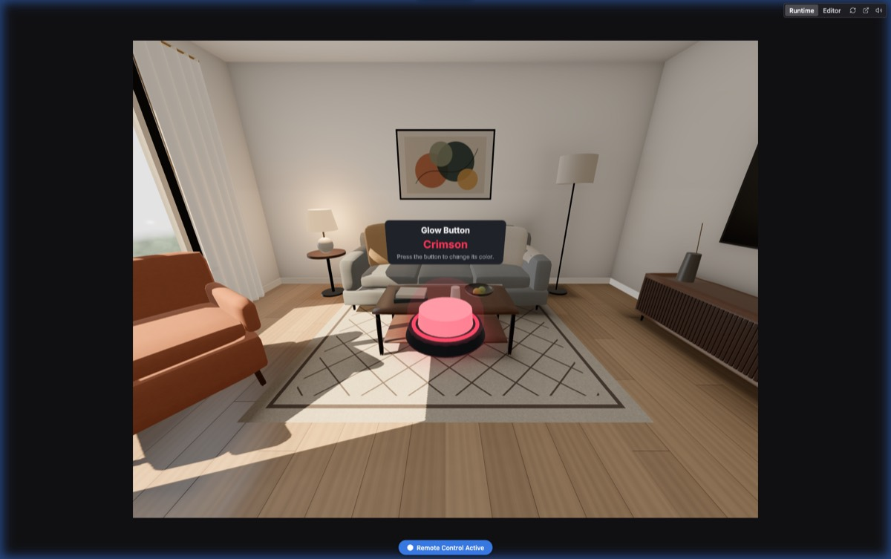</a> ✅ first try · 24 s · press ✓ · **4.5/5** A big glowing 3D push-button with a labeled panel naming the current color (Crimson) and a clear 'press the button' instruction fits the request well, though the button cap reads more pink than crimson and the panel slightly overlaps the sofa backdrop. | <a href="../run-1/gallery/muse-spark-1.3__color-button__0.jpg">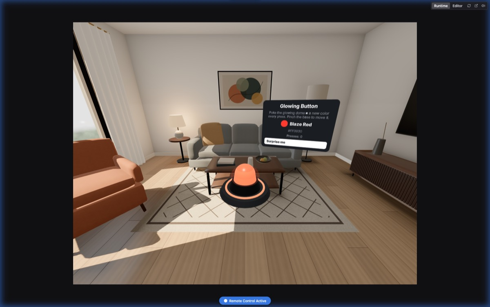</a> ✅ first try · 59 s · grab ✓ · press ✓ · **4.0/5** A clear glowing dome button sits on a base, with an info panel naming the current color, its hex code and a press count, plus a 'Surprise me' button; however, the instruction text shows a missing-glyph box, the panel's description text is small and tilted, and the dome reads salmon-orange rather tha | <a href="../run-1/gallery/deepseek-v4.1-flash__color-button__0.jpg">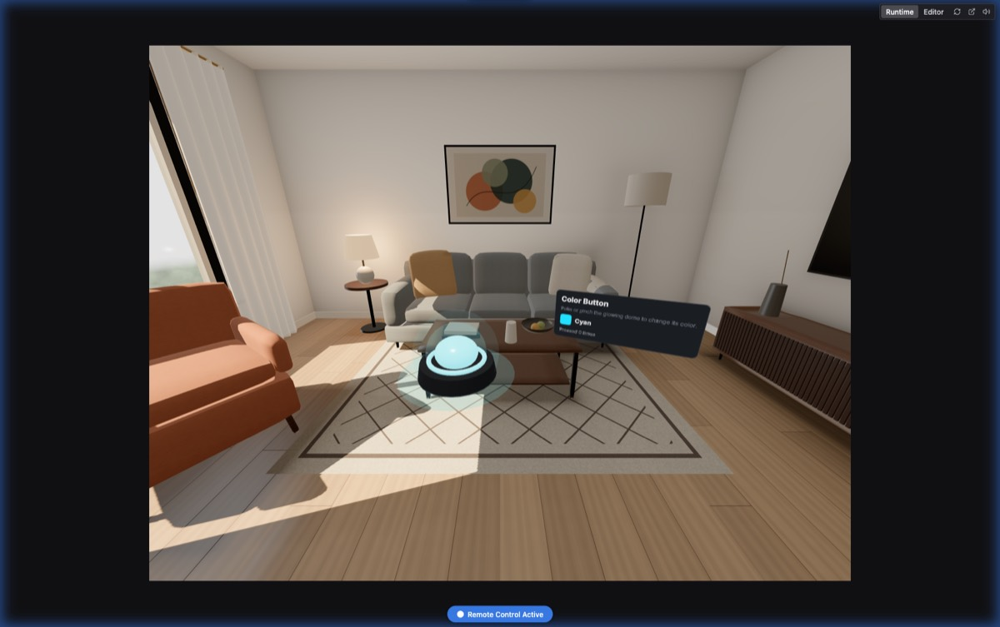</a> ✅ first try · 21 s · press ✓ · **4.0/5** A glowing cyan dome button on a dark base with a soft halo sits beside a 'Color Button' panel showing the current color and a press count, but the panel's small subtitle and 'Pressed 0 times' text are tilted and hard to read, and the panel is angled away from the user. | <a href="../run-2-kimi/gallery/kimi-k3.1-pro-fw__color-button__0.jpg">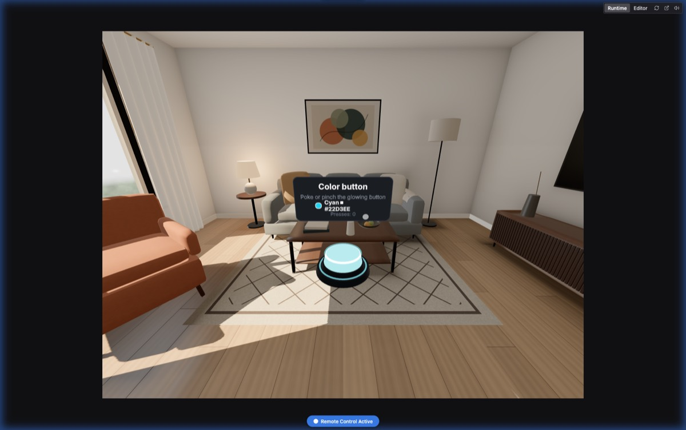</a> ✅ first try · 94 s · press ✓ · **4.0/5** A large cyan button with a glowing ring sits clearly in front of the user beside a 'Color button' panel showing the current color name, hex code and press count, but the panel's text lines are cramped and the 'Cyan', hex and 'Presses' lines crowd together with a stray square glyph and a floating gre | <a href="../run-3-ember-max/gallery/muse-ember-1.0-max__color-button__0.jpg">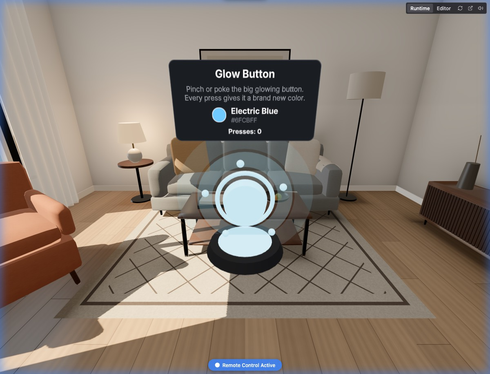</a> ✅ first try · 22 s · press ✓ · **4.0/5** A large pressable button on a dark base, with a halo, orbiting dots, and a panel showing the current color name, hex code and press count, fits the request well, though the button looks washed-out pale blue rather than vividly glowing, and the panel slightly overlaps the top of the halo. |
| **T1** · dna-helix “A DNA double helix I can pick up and turn around” | <a href="../run-1/gallery/claude-sonnet-5-5__dna-helix__0.jpg">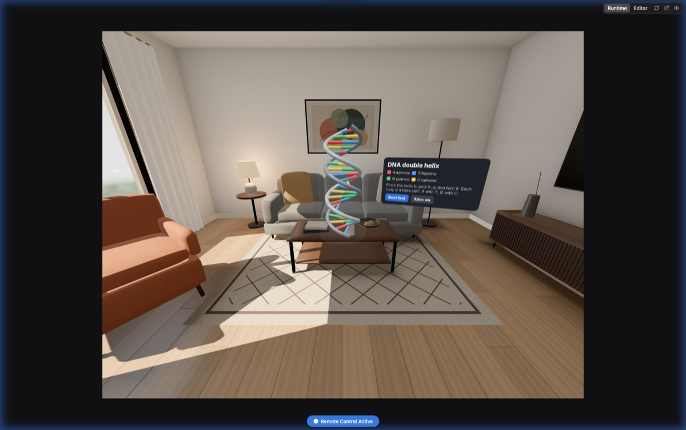</a> ✅ first try · 36 s · grab ✓ · **4.5/5** A clear 3D double helix with color-coded base pairs (A–T, G–C) and a legend panel that says to pinch it to pick it up, plus Next fact and Spin buttons; the panel text is small and slightly skewed, and the helix itself has no visible grab handle or affordance. | <a href="../run-1/gallery/muse-spark-1.3__dna-helix__0.jpg">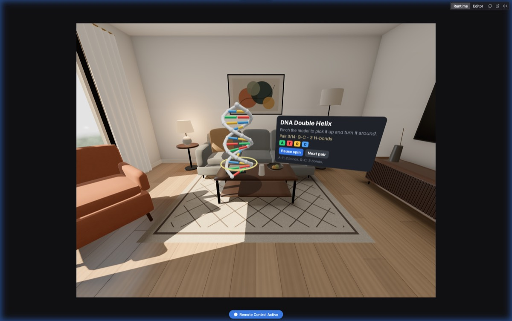</a> ✅ first try · 89 s · grab ✓ · **4.3/5** A clear 3D double helix with colored base pairs, a highlighted pair ring, and an info panel with a pinch hint, Pause spin and Next pair buttons, and correct A-T 2 / G-C 3 bond facts; the panel is slightly skewed with small footer text, and the helix's grab affordance relies mainly on the instruction | <a href="../run-1/gallery/deepseek-v4.1-flash__dna-helix__0.jpg">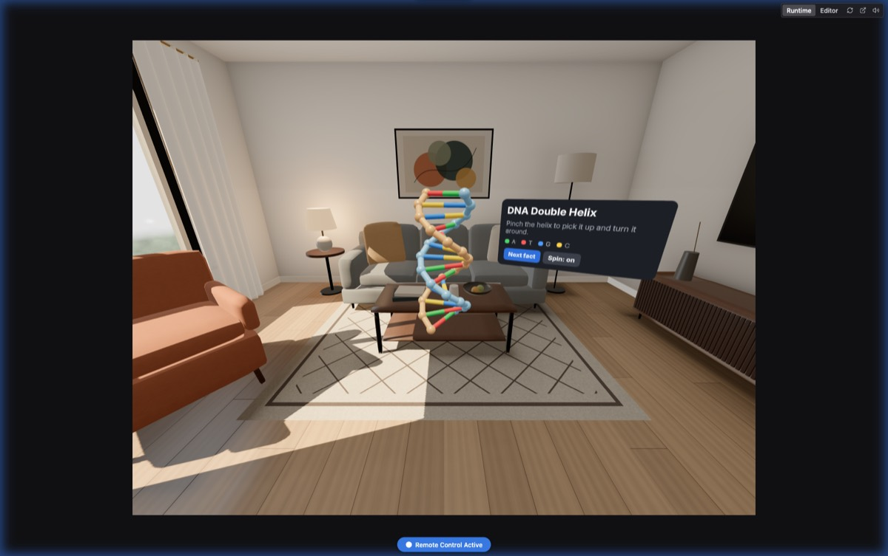</a> ✅ first try · 38 s · grab ✓ · press ✓ · **4.5/5** A well-formed double helix with correctly paired, color-coded bases (A–T green/red, G–C blue/yellow) and a legend, plus an info panel with a pinch hint and Next fact / Spin buttons; the panel is angled and its text small, and the helix itself has no visible grab affordance beyond the instruction tex | <a href="../run-2-kimi/gallery/kimi-k3.1-pro-fw__dna-helix__0.jpg">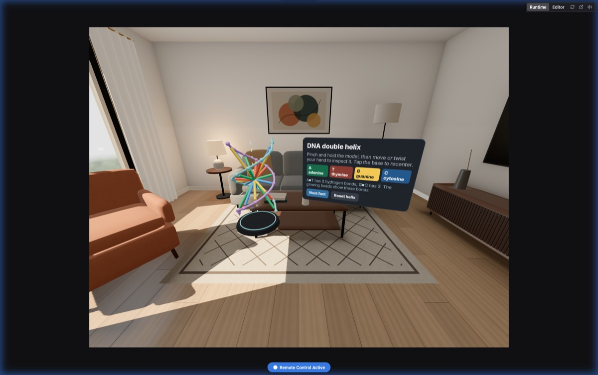</a> ✅ first try · 200 s · grab ✓ · press ✓ · **3.8/5** A colorful grabbable helix sits on a glowing base beside an info panel with a base-pair legend and buttons, but the helix reads as a tangled, jumbled shape rather than a clean double helix, and the panel text has broken glyphs (A■T, G■C) and a fact sentence that is cut off. | <a href="../run-3-ember-max/gallery/muse-ember-1.0-max__dna-helix__0.jpg">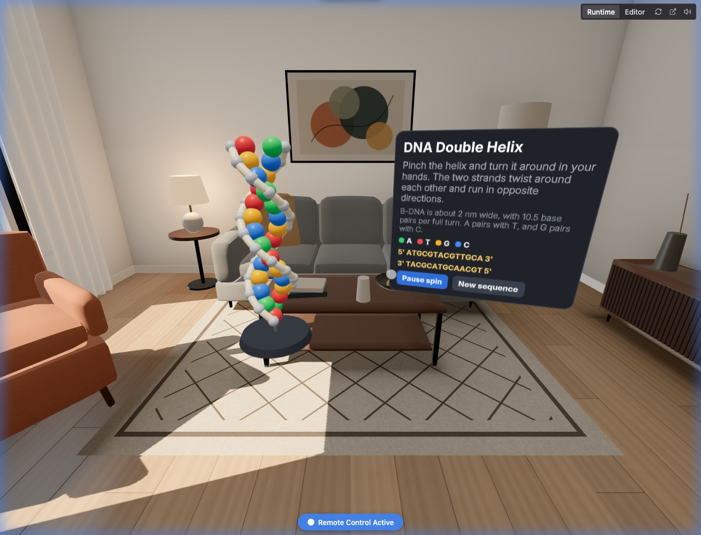</a> ✅ first try · 21 s · grab ✓ · **4.3/5** A recognizable two-strand ball-and-stick helix on a stand, paired with a tidy info panel; the facts are correct (B-DNA ~2 nm wide, 10.5 bp per turn, A–T/G–C pairing, and the antiparallel sequences complement correctly), and the pinch-to-turn instruction plus Pause spin and New sequence buttons invit |
| **T1** · desk-clock “A small desk clock that shows the current hours and minutes” | <a href="../run-1/gallery/claude-sonnet-5-5__desk-clock__0.jpg">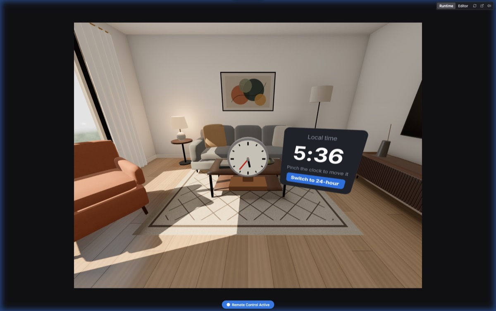</a> ✅ first try · 29 s · grab ✓ · **4.5/5** An analog desk clock on a wooden base with a matching 5:36 digital readout fulfills the request; the companion panel is noticeably skewed and crowds the clock's edge, though its text stays legible, and the pinch hint plus the 24-hour toggle button make the interactions clear. | <a href="../run-1/gallery/muse-spark-1.3__desk-clock__0.jpg">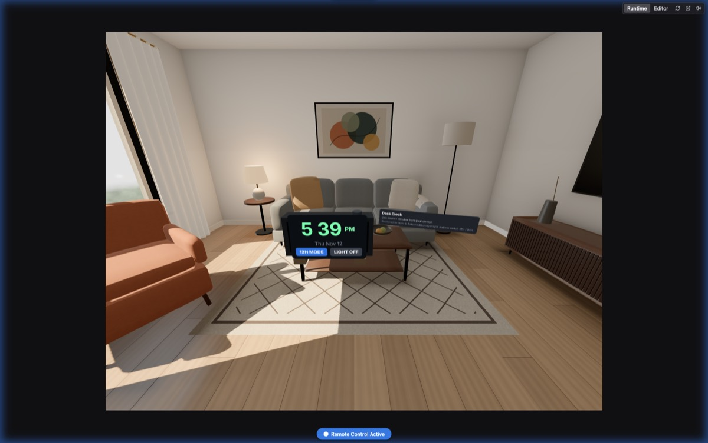</a> ✅ first try · 101 s · grab ✓ · press ✓ · **3.8/5** A compact digital clock shows a clear 5 39 PM with a date and labeled 12H MODE / LIGHT OFF buttons, but the colon between hours and minutes is missing (possibly mid-blink) and the tilted 'Desk Clock' info panel beside it has tiny, skewed text that is hard to read. | <a href="../run-1/gallery/deepseek-v4.1-flash__desk-clock__0.jpg">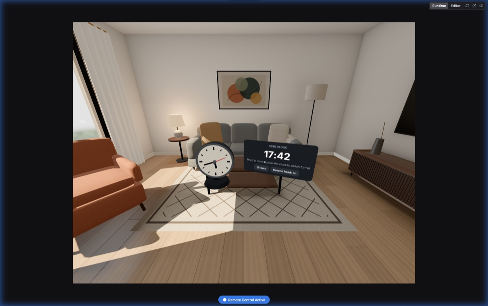</a> ✅ first try · 46 s · grab ✓ · press ✓ · **4.5/5** A clear analog desk clock with a stand sits beside a readable 17:42 digital panel whose hands agree with the readout, and it offers 12-hour and second-hand toggles; however, the panel is tilted and its hint text is small, and the toggles and pinch-to-move instruction are understated affordances. | <a href="../run-2-kimi/gallery/kimi-k3.1-pro-fw__desk-clock__0.jpg">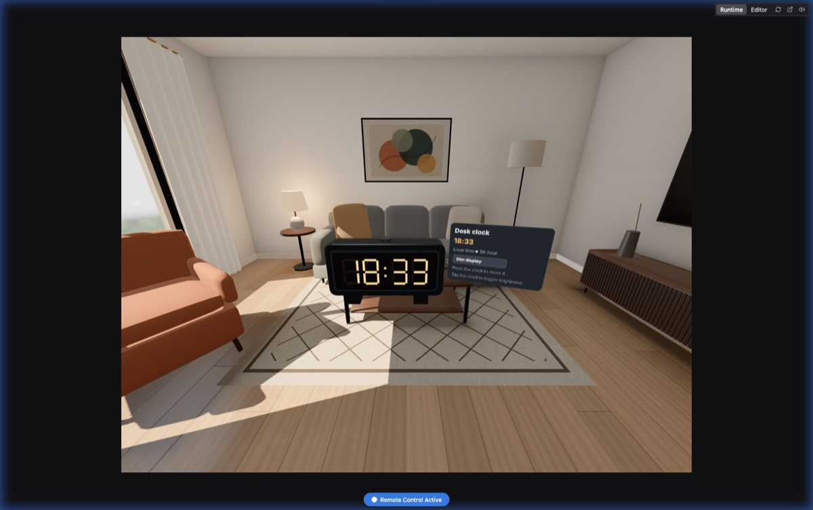</a> ✅ first try · 195 s · grab ✓ · press ✓ · **4.5/5** A clean seven-segment desk clock shows 18:33 with a matching info panel that has a Dim display button and pinch/tap hints; the panel is slightly angled and its small text is a bit hard to read. | <a href="../run-3-ember-max/gallery/muse-ember-1.0-max__desk-clock__0.jpg">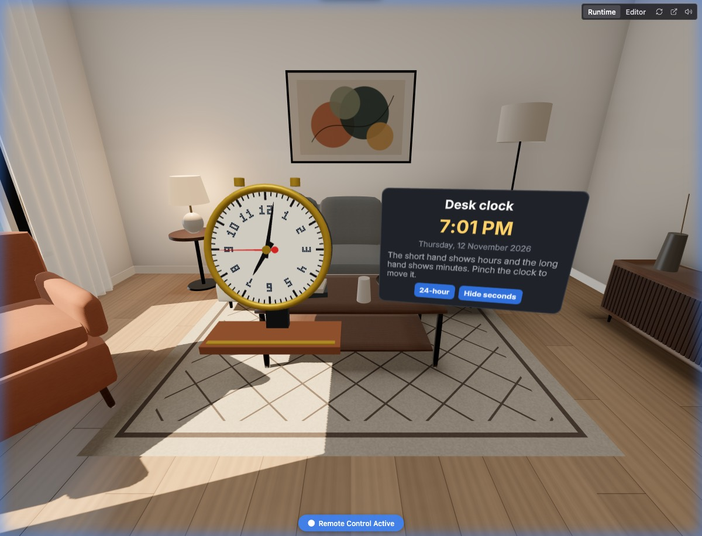</a> ✅ first try · 25 s · grab ✓ · **3.8/5** An analog desk clock on a base with a matching digital readout (7:01 PM, hands agree, and Thursday 12 November 2026 is correct), but the radially rotated numerals are hard to read, with the lower ones upside down, and the info panel crowds the clock. |
| **T1** · desk-lamp “A desk lamp I can switch on and off by pressing it” | <a href="../run-1/gallery/claude-sonnet-5-5__desk-lamp__0.jpg">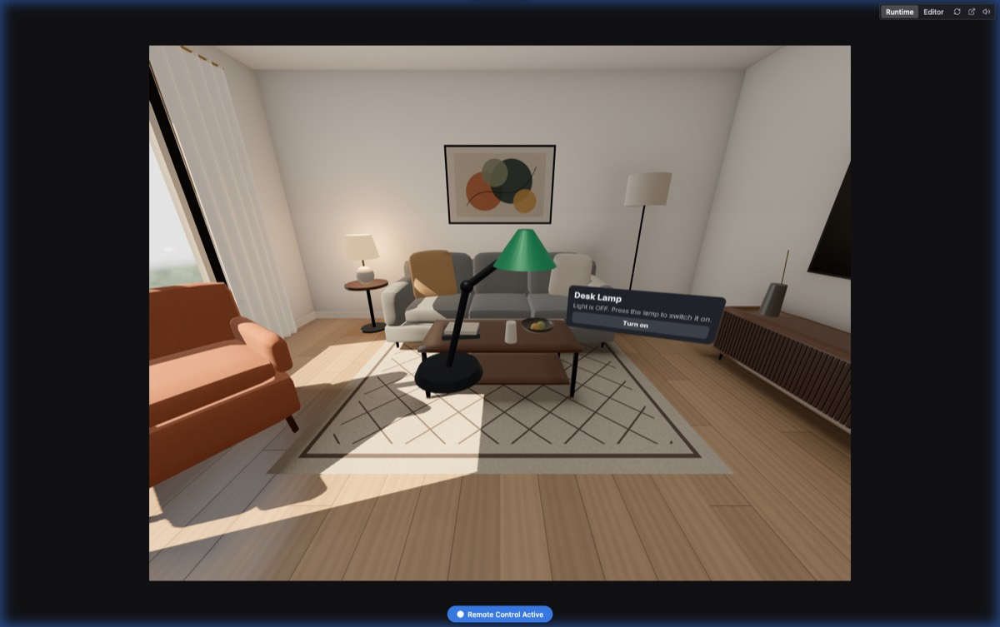</a> ✅ first try · 27 s · grab ✓ · press ✓ · **4.3/5** A recognizable green-shaded desk lamp sits beside a tidy, legible panel that states the OFF state and offers a clear 'Turn on' button, though the lamp floats oddly over the coffee table and the panel is tilted at a slight angle. | <a href="../run-1/gallery/muse-spark-1.3__desk-lamp__0.jpg">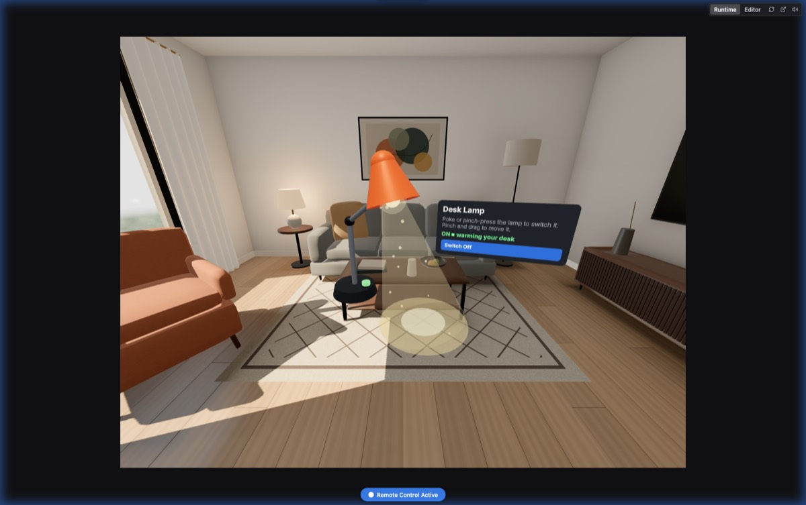</a> ✅ first try · 88 s · grab ✓ · press ✓ · **4.8/5** A clear articulated desk lamp with a glowing green base button, a visible light cone and a pool of light, plus a legible info panel with a status line and a Switch Off button; the panel is slightly tilted, small text and the light cone overlaps the table, but the interaction affordances are obvious. | <a href="../run-1/gallery/deepseek-v4.1-flash__desk-lamp__0.jpg">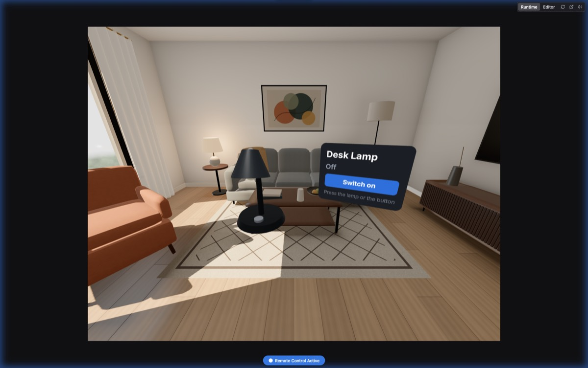</a> ✅ first try · 47 s · press ✓ · **4.3/5** A dark desk lamp with a base switch knob sits beside a tidy, tilted 'Desk Lamp / Off' panel with a clear 'Switch on' button and a hint to press the lamp, though the lamp is a bit plain and partly overlaps the coffee table. | <a href="../run-2-kimi/gallery/kimi-k3.1-pro-fw__desk-lamp__0.jpg">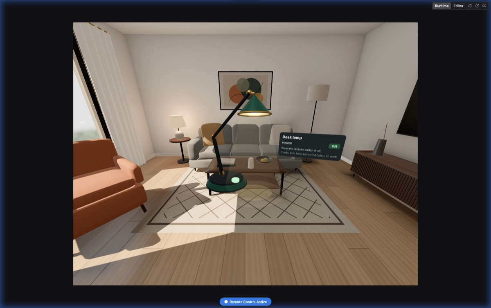</a> ✅ first try · 199 s · press ✓ · **4.8/5** A well-modeled articulated desk lamp with a glowing shade, a light cone, a glowing round button on the base, and a status panel showing ON with clear press instructions; the panel is slightly tilted, its small text is a bit hard to read, and the lamp floats over the coffee table rather than resting  | <a href="../run-3-ember-max/gallery/muse-ember-1.0-max__desk-lamp__0.jpg">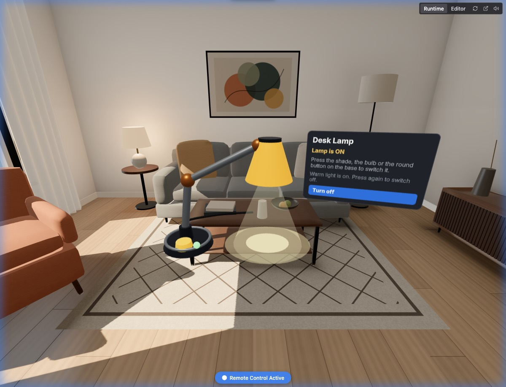</a> ✅ first try · 17 s · press ✓ · **4.0/5** A recognizable articulated desk lamp in its ON state, with a glowing shade, a light cone, a yellow base button and a 'Turn off' panel, though the info panel overlaps the lamp shade, the 'Turn off' button is slightly clipped, and the lamp floats oddly above the coffee table. |
| **T2** · earth-layers “Show the layers of the Earth as a cut-away sphere with a label for each layer” | <a href="../run-1/gallery/claude-sonnet-5-5__earth-layers__0.jpg">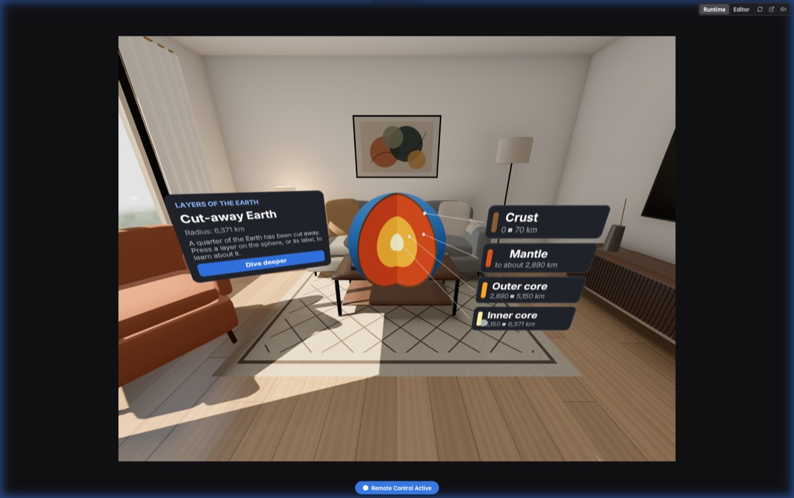</a> ✅ first try · 111 s · press ✓ · **3.8/5** A cut-away sphere with leader-lined labels for crust, mantle, outer core and inner core plus an info panel and a 'Dive deeper' button fulfils the request, but a white dot overlaps the Inner core depth text, the leader lines cross each other, the crust is drawn far too thick for scale, and the range  | <a href="../run-1/gallery/muse-spark-1.3__earth-layers__0.jpg">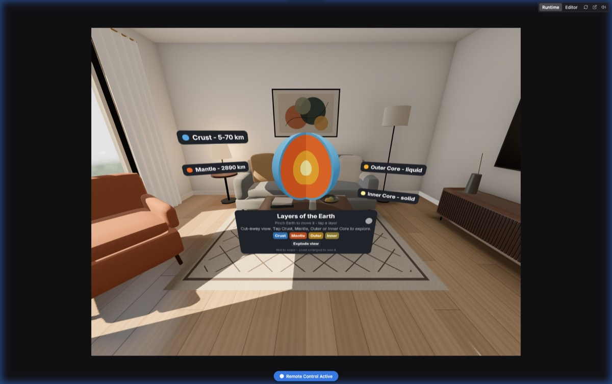</a> ✅ first try · 212 s · grab ✓ · **4.3/5** A clear cut-away Earth with four correctly labeled layers (crust 5–70 km, mantle ~2890 km, liquid outer core, solid inner core) and tappable layer chips plus an Explode button, but the floating labels lack leader lines to their layers, the blue crust reads oddly, and the panel's hint and footer text | <a href="../run-1/gallery/deepseek-v4.1-flash__earth-layers__0.jpg">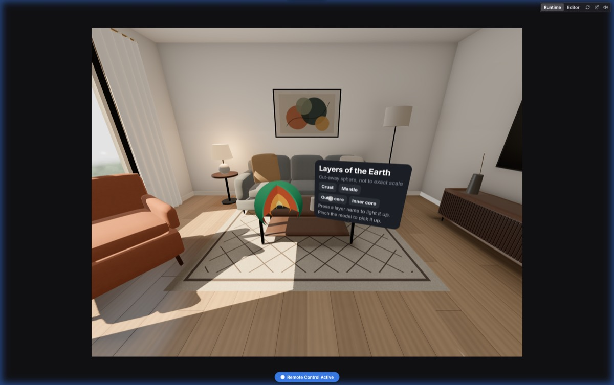</a> ✅ after 1 repair · 174 s · grab ✓ · **3.5/5** A small cut-away globe with visible nested layers sits beside a tilted panel listing Crust, Mantle, Outer core and Inner core as buttons, but the labels are not attached to the layers on the sphere itself. The globe is small and crowds the table, and the pointer dot overlaps the 'Outer core' text. | <a href="../run-2-kimi/gallery/kimi-k3.1-pro-fw__earth-layers__0.jpg">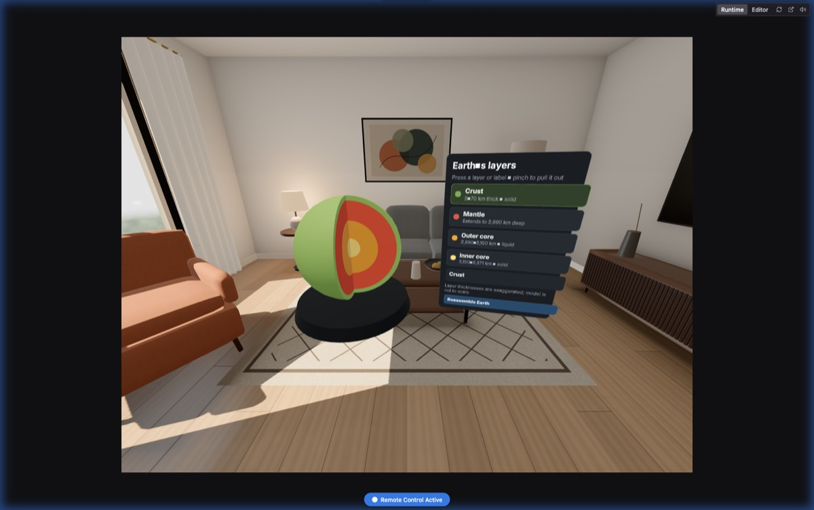</a> ✅ first try · 195 s · grab ✗ · press ✓ · **3.8/5** A cut-away sphere on a pedestal shows crust, mantle, outer and inner core next to a side panel of labelled layer cards with largely accurate depths, but the labels are not attached to the sphere itself, glyph-substitution boxes replace apostrophes, en-dashes and bullets throughout, and the panel bot | <a href="../run-3-ember-max/gallery/muse-ember-1.0-max__earth-layers__0.jpg">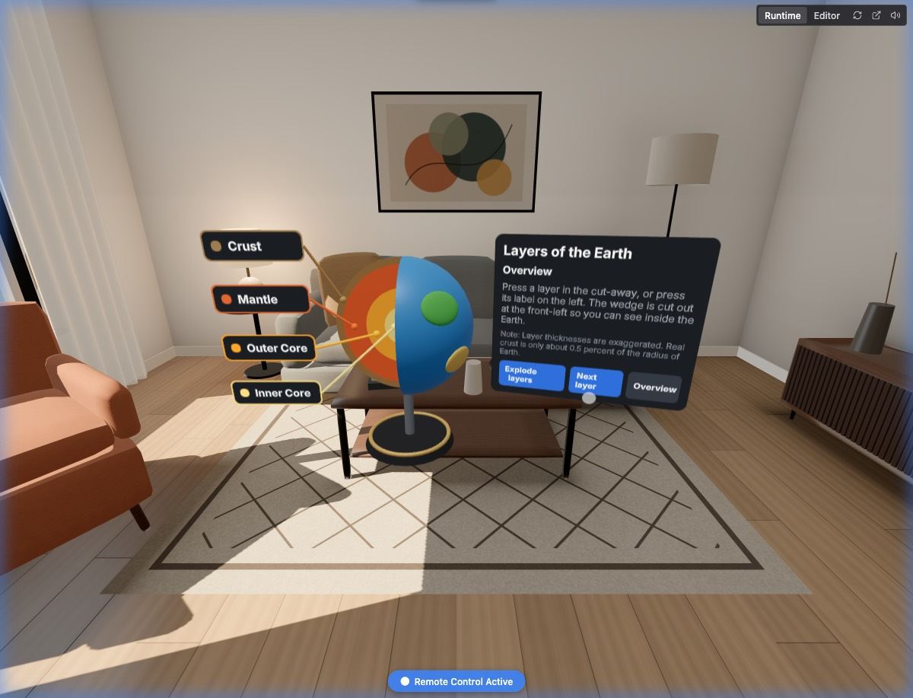</a> ✅ first try · 65 s · press ✓ · **3.8/5** The globe shows a clear cross-section of crust, mantle, outer core and inner core, each with a leader-lined label, though the panel describes a front-left wedge while the model shows a half-sphere cut; the info panel's text is small and tilted, a cursor dot overlaps the 'Next layer' button, and the  |
| **T2** · photosynthesis “Explain photosynthesis with a small plant, the Sun, and labeled arrows for light, water, carbon dioxide and oxygen” | <a href="../run-1/gallery/claude-sonnet-5-5__photosynthesis__0.jpg">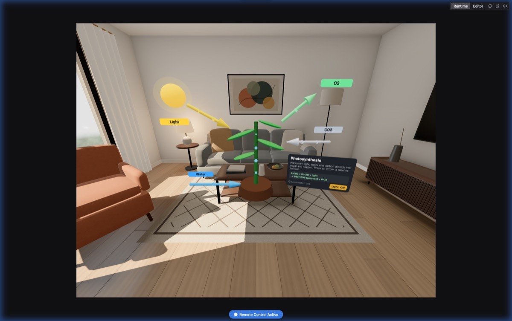</a> ✅ first try · 88 s · press ✓ · **3.8/5** Sun, plant, and colour-coded labeled arrows for light, water, CO2 and O2 are all present with a correct balanced equation, but the info panel text is small and tilted, the water arrow points at the pot from the side rather than coming up through the soil, and the only obvious control is a tiny 'Ligh | <a href="../run-1/gallery/muse-spark-1.3__photosynthesis__0.jpg">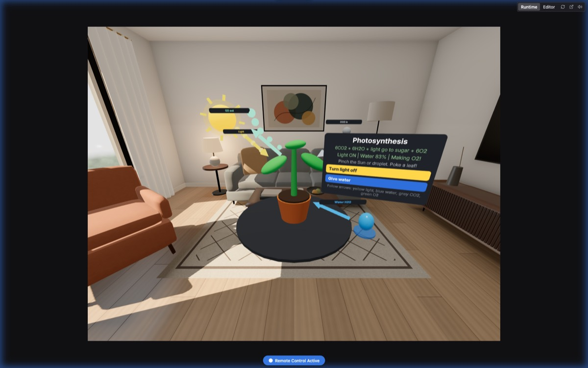</a> ✅ first try · 135 s · grab ✓ · press ✓ · **3.5/5** The plant, Sun, droplet and labeled arrows for light, water, CO2 and O2 are all present, with an equation and Turn light off / Give water buttons, but the info panel covers a leaf and the CO2 arrow, the O2 label sits over the Sun, the arrow labels are tiny, and the panel and buttons are tilted and s | <a href="../run-1/gallery/deepseek-v4.1-flash__photosynthesis__0.jpg">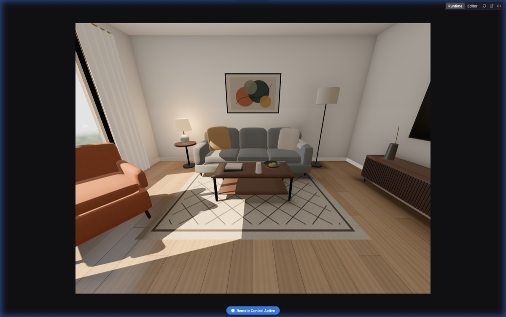</a> 💥 crashed in browser · 109 s | <a href="../run-2-kimi/gallery/kimi-k3.1-pro-fw__photosynthesis__0.jpg">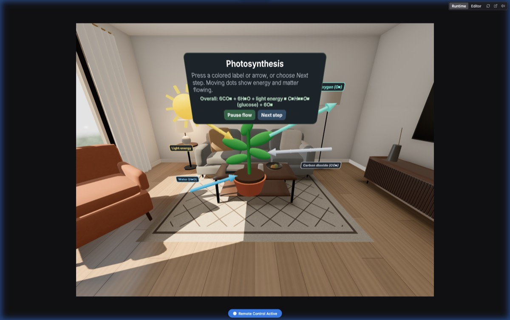</a> ✅ first try · 293 s · press ✓ · **3.3/5** The plant, Sun, and colored labeled arrows for light, water, CO2 and O2 are all present, with clear Pause/Next buttons and instructions. However, the info panel covers the Sun and clips the Oxygen label, the labels are small, and the subscript and arrow glyphs render as boxes, garbling the formulas  | <a href="../run-3-ember-max/gallery/muse-ember-1.0-max__photosynthesis__0.jpg">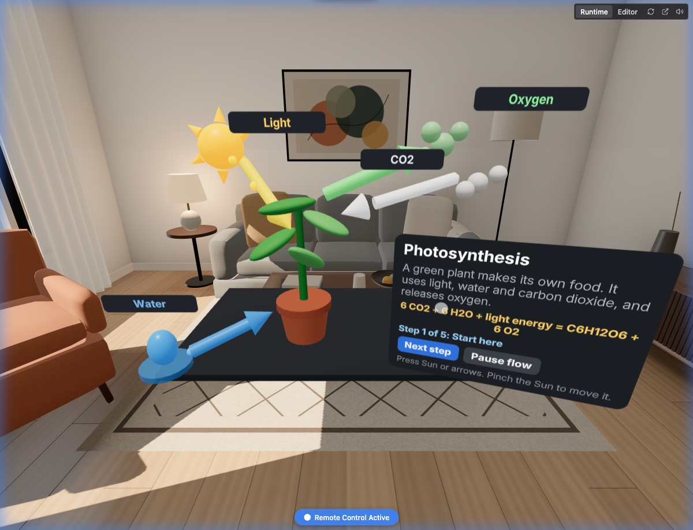</a> ✅ first try · 47 s · grab ✓ · press ✓ · **3.8/5** The plant, Sun and labeled Light, Water, CO2 and Oxygen arrows are all present with a correct equation and clear Next step / Pause flow controls, but the CO2 label sits ambiguously between the green and white arrows and overlaps them, and a stray dot covers part of the equation. |
| **T2** · weather “A weather dashboard for three cities with an icon and the temperature for each” | <a href="../run-1/gallery/claude-sonnet-5-5__weather__0.jpg">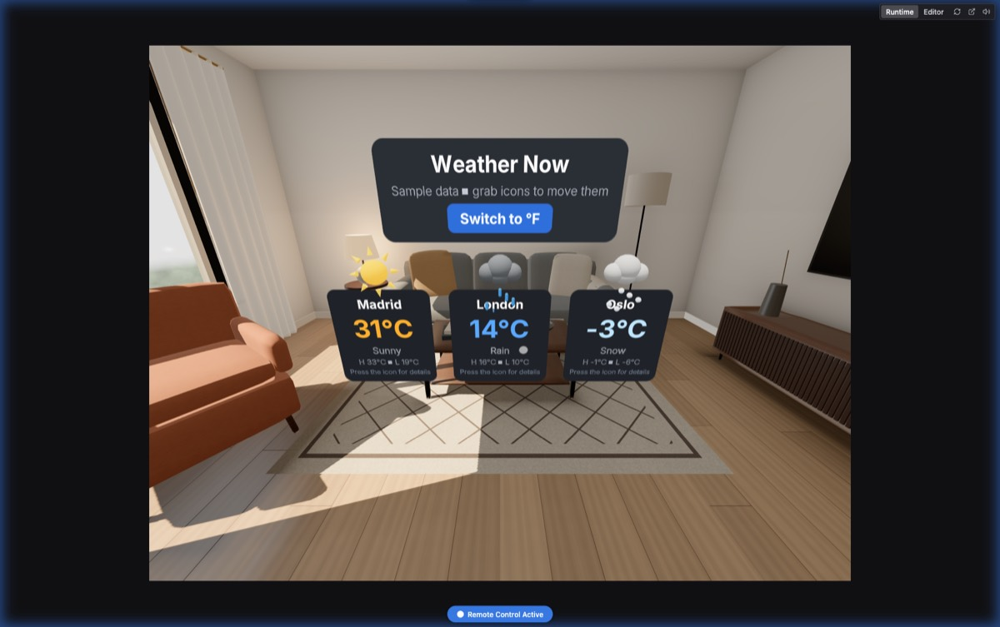</a> ✅ first try · 41 s · grab ✓ · press ✓ · **4.3/5** Three city cards with 3D weather icons, temperatures, conditions and a °F toggle match the request well, but the rain and snow particles overlap the London and Oslo titles, the hint text is tiny, and a stray dot sits beside 'Rain'. | <a href="../run-1/gallery/muse-spark-1.3__weather__0.jpg">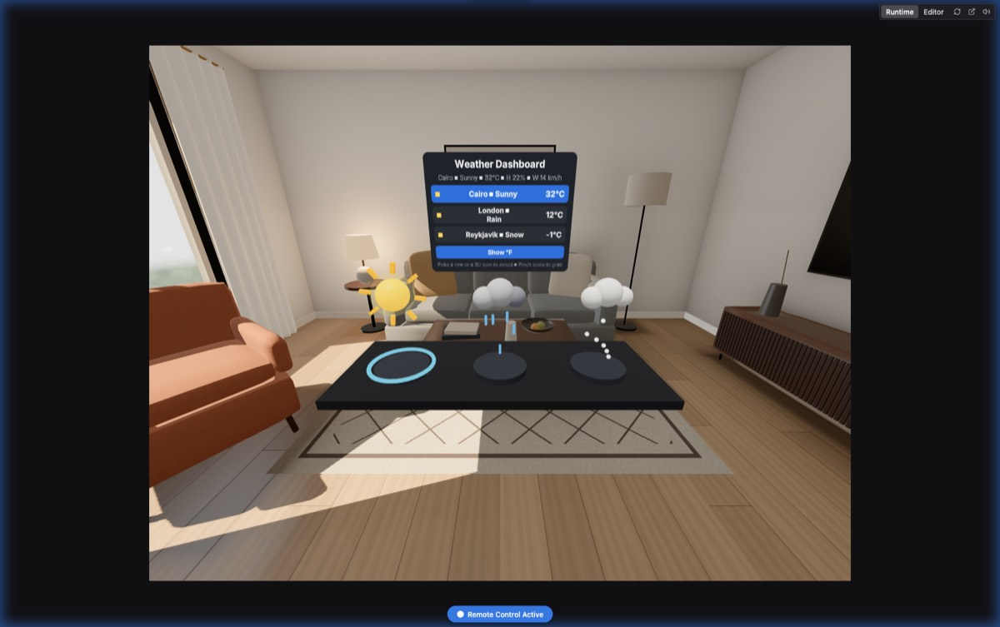</a> ✅ first try · 75 s · grab ✓ · press ✓ · **4.3/5** Three cities with 3D sun, rain and snow icons on pedestals plus a temperature panel meet the request, but the panel text is small, the London row wraps awkwardly, the bullet separators render as boxes, and the floating icons partly obscure the panel and blend into the sofa. | <a href="../run-1/gallery/deepseek-v4.1-flash__weather__0.jpg">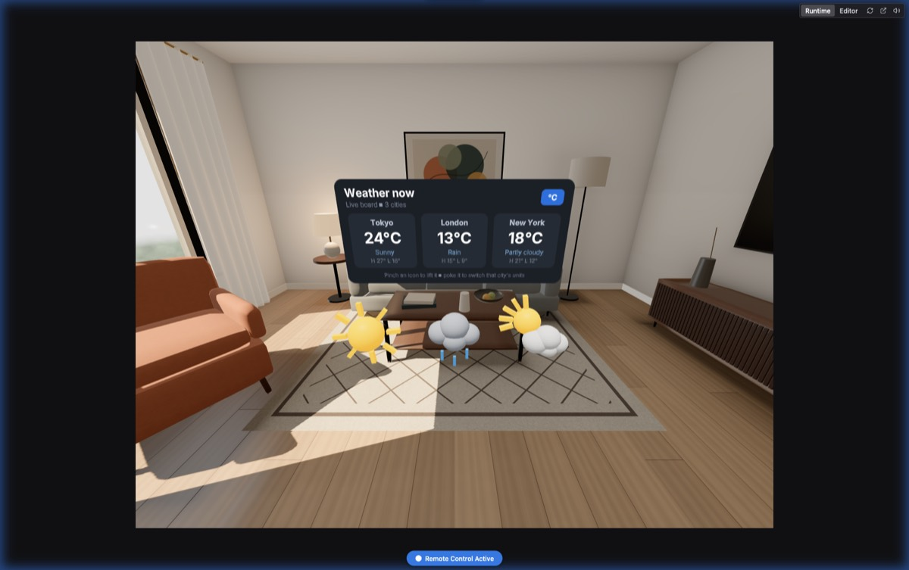</a> ✅ first try · 60 s · grab ✓ · press ✓ · **4.5/5** Three city cards with temperatures, conditions and matching 3D weather icons fully meet the request, but the icons float below the panel over the coffee table rather than sitting with their cards, and the small H/L and hint text is faint; the °C toggle and the pinch/poke hint invite interaction. | <a href="../run-2-kimi/gallery/kimi-k3.1-pro-fw__weather__0.jpg">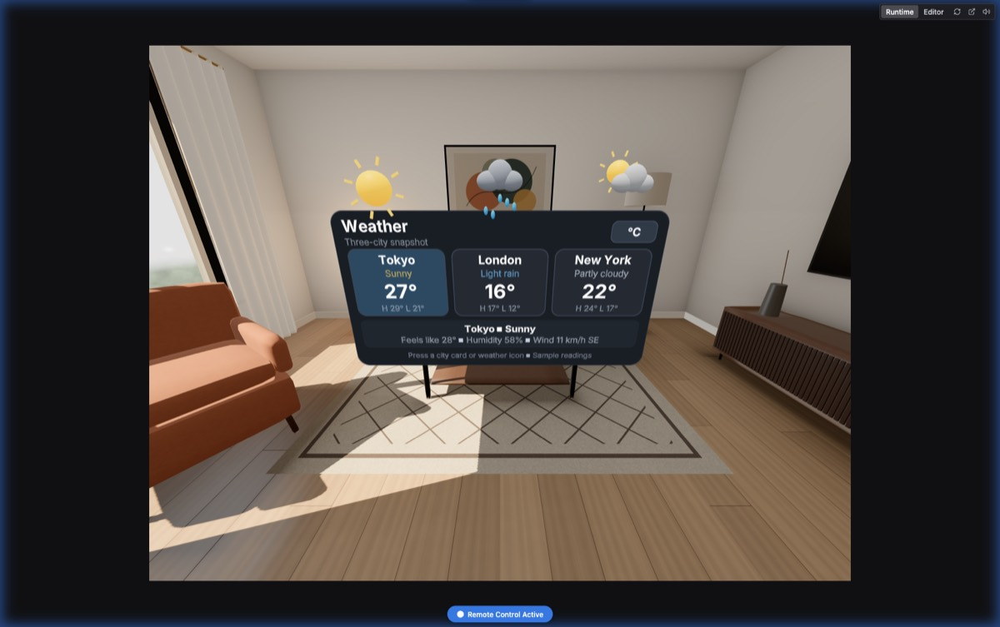</a> ✅ first try · 145 s · press ✓ · **4.5/5** Three city cards show conditions, temperatures and highs/lows with matching 3D weather icons, a selected Tokyo detail strip and a °C toggle; the floating icons slightly crowd the panel's top edge and title, and the footer hint text is small. | <a href="../run-3-ember-max/gallery/muse-ember-1.0-max__weather__0.jpg">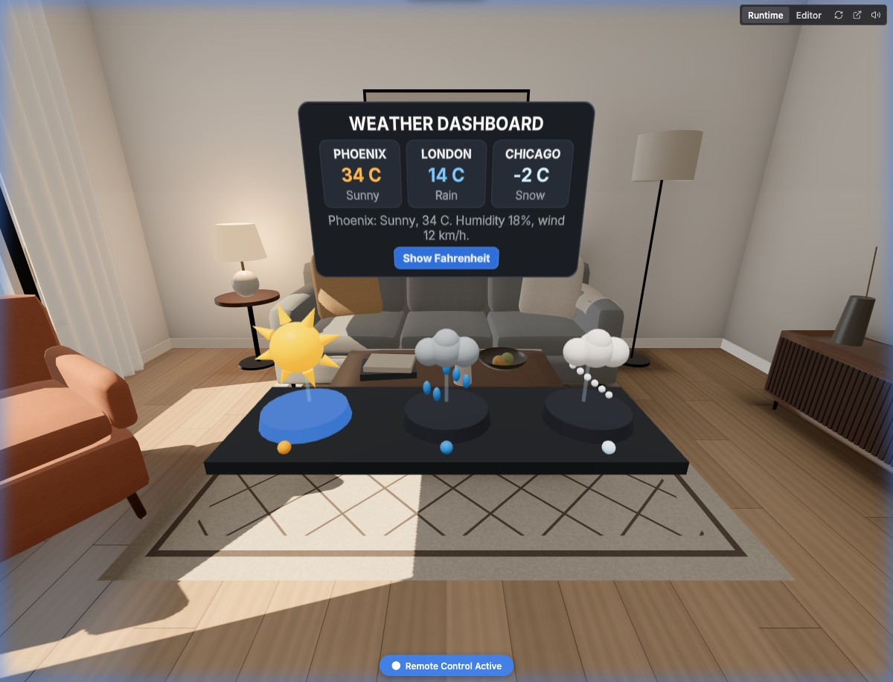</a> ✅ first try · 33 s · press ✓ · **4.5/5** Three cities each get a 3D weather icon on a pedestal and a clear temperature card, with plausible values and a highlighted selected Phoenix pedestal; the temperatures read '34 C' without a degree sign, and the Fahrenheit toggle and selectable pedestals invite interaction, though the small colored d |
| **T2** · coffee-mug “A coffee mug I can pick up, with a card showing its price and what it is made of” |  ✅ first try · 29 s · grab ✓ · **4.3/5** A cream mug sits on a coffee table next to a card showing the $22 price, the stoneware material, glaze, capacity and care, plus glaze buttons; the card is tilted and its small hint text is hard to read, a cursor dot covers part of the capacity line, and the mug looks small and easy to miss beside th | <a href="../run-1/gallery/muse-spark-1.3__coffee-mug__0.jpg">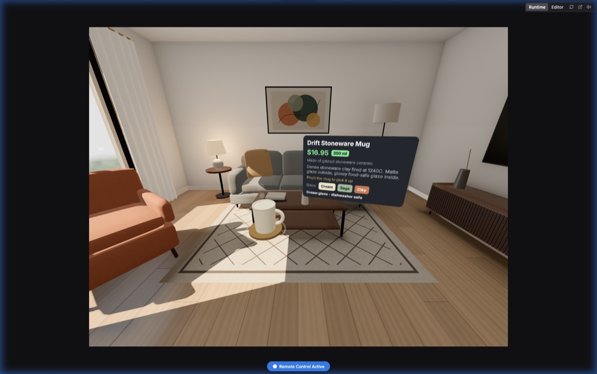</a> ✅ first try · 84 s · grab ✓ · **4.3/5** A cream mug on a coaster sits beside a tidy card showing the name, a $16.95 price, the 350 ml size, the stoneware material, a pick-up hint and glaze buttons, but the card is tilted, its text is small, '1240C' lacks the degree sign, and the mug floats above the table with little grab affordance. | <a href="../run-1/gallery/deepseek-v4.1-flash__coffee-mug__0.jpg">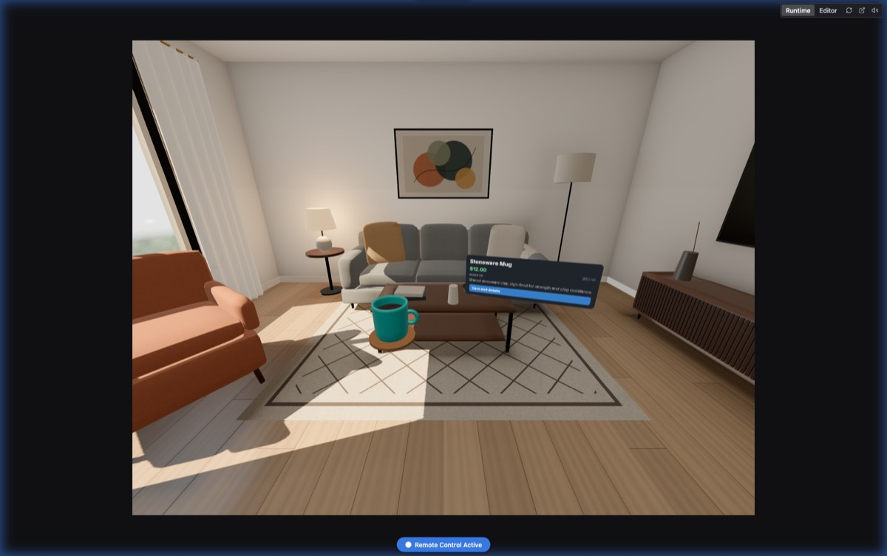</a> ✅ first try · 45 s · grab ✓ · press ✓ · **3.8/5** A teal mug on a coaster and a 'Stoneware Mug' card with $12.00, glazed stoneware material, 350 ml and a 'Care and details' button cover the request, but the card is small, tilted and placed far from the mug, its text is tiny, and nothing signals that the mug can be grabbed. | <a href="../run-2-kimi/gallery/kimi-k3.1-pro-fw__coffee-mug__0.jpg">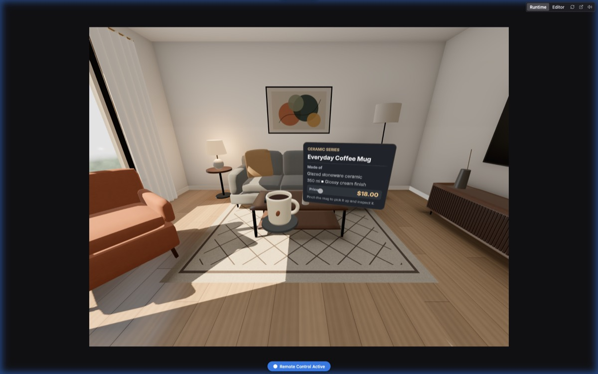</a> ✅ first try · 95 s · grab ✓ · press ✓ · **4.3/5** A clean 3D mug on a dark base sits beside a well-structured card showing the material, capacity and $18.00 price with a pinch hint, but a stray white dot overlaps the 'Price' label and the mug's glossy cream finish is not obviously glossy. | <a href="../run-3-ember-max/gallery/muse-ember-1.0-max__coffee-mug__0.jpg">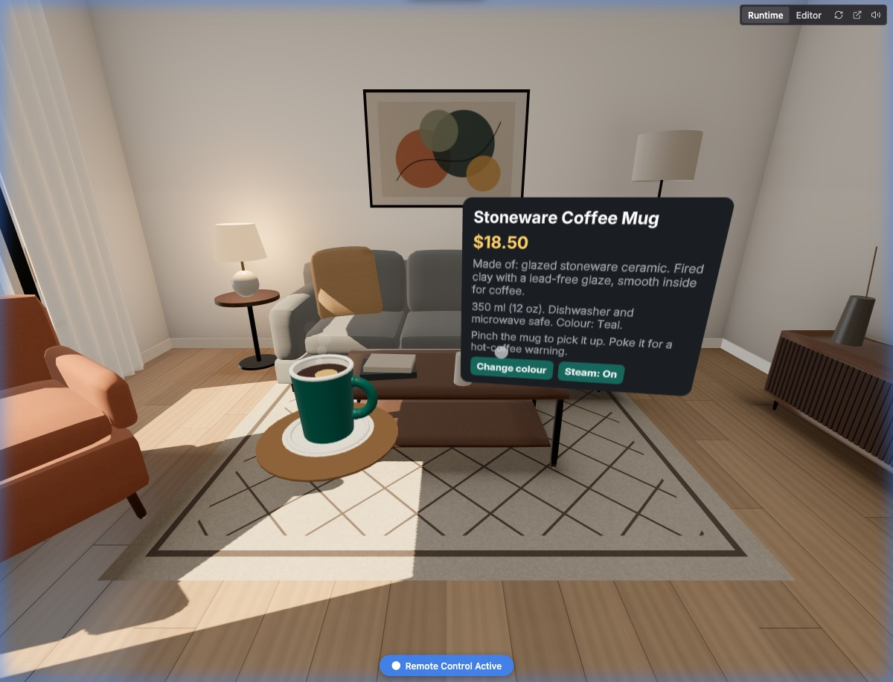</a> ✅ first try · 15 s · grab ✓ · press ✓ · **4.5/5** A teal mug on a saucer comes with a legible info card giving the price, the stoneware material, capacity and pinch-to-pick-up instructions, plus colour and steam buttons; the card is slightly tilted, a pointer dot overlaps its text, and the mug itself has no grab affordance beyond the written hint. |
| **T3** · times-tables “A multiplication quiz with 5 questions, answer buttons, and a running score” | <a href="../run-1/gallery/claude-sonnet-5-5__times-tables__0.jpg">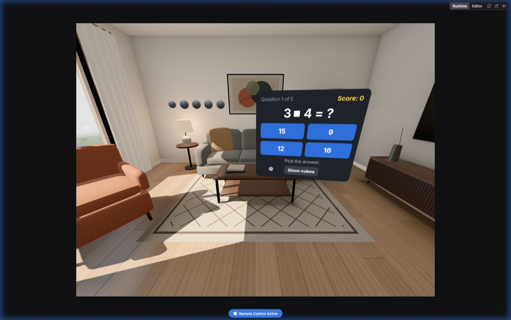</a> ✅ first try · 42 s · grab ✗ · **3.5/5** Shows a clear quiz panel with question counter, running score, four large blue answer buttons including the correct 12, and a row of five progress spheres, but the multiplication sign renders as a missing-glyph box ('3 ■ 4'), and the small unlabeled dot beside 'Show cubes' is unclear. | <a href="../run-1/gallery/muse-spark-1.3__times-tables__0.jpg">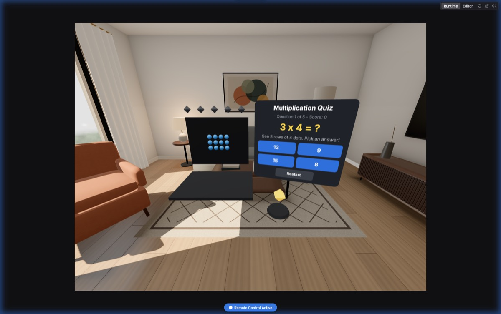</a> ✅ first try · 109 s · grab ✓ · press ✓ · **4.5/5** A complete quiz panel shows Question 1 of 5 with the score, a correct 3x4 dot array beside it, four clear answer buttons including the right answer 12, and a Restart button; but the panel is skewed at an odd angle, five floating diamond progress markers hover awkwardly above the dot board, and a str | <a href="../run-1/gallery/deepseek-v4.1-flash__times-tables__0.jpg">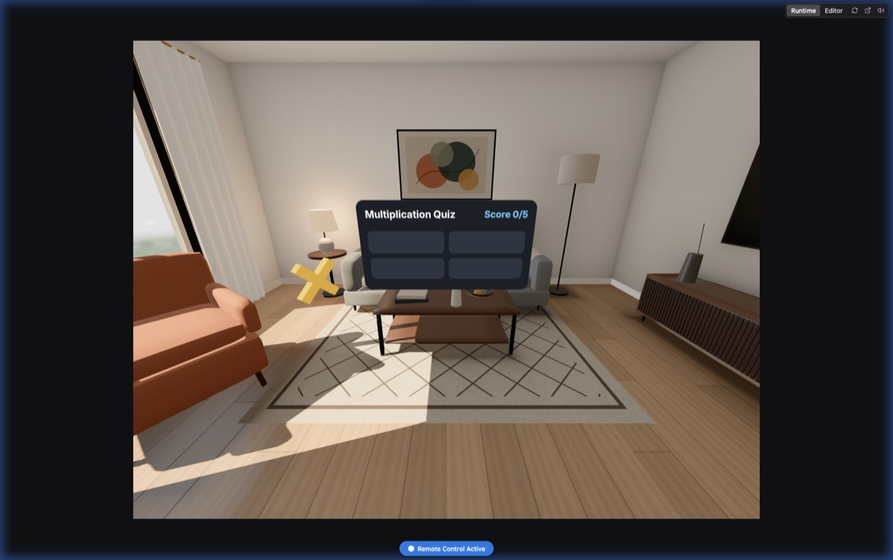</a> ✅ first try · 39 s · grab ✓ · **2.3/5** The panel shows a title and a 'Score 0/5', but no question text is visible and the four answer buttons are blank. A yellow 3D multiplication sign floats off to the side, so the quiz is not usable as rendered. | <a href="../run-2-kimi/gallery/kimi-k3.1-pro-fw__times-tables__0.jpg">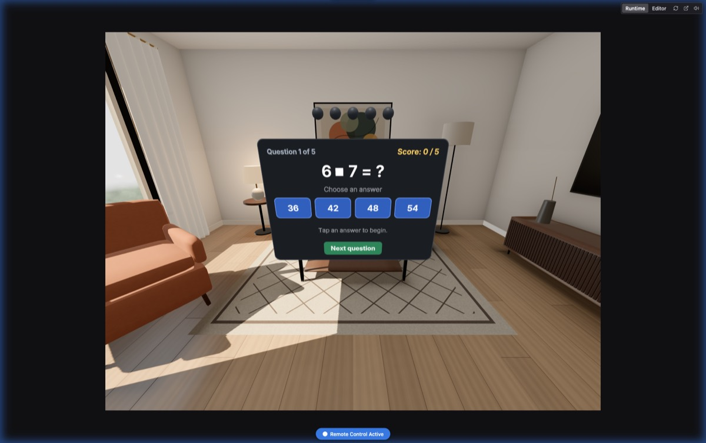</a> ✅ first try · 30 s · **3.5/5** The quiz panel has a question counter, a running score, four clear answer buttons and a Next button, but the multiplication sign renders as a missing-glyph square ('6 ■ 7') and the five dark spheres above the panel are unexplained. | <a href="../run-3-ember-max/gallery/muse-ember-1.0-max__times-tables__0.jpg">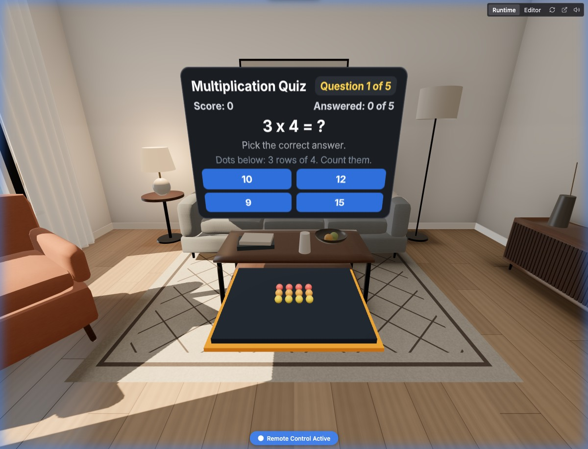</a> ✅ first try · 27 s · grab ✓ · **4.5/5** The quiz panel clearly shows the title, a Question 1 of 5 badge, the score, the question 3 x 4 = ? and four large answer buttons, with a correct 3x4 dot-array aid on the table below; the panel is slightly tilted and the dot tray is detached from the main card, but text is legible and the buttons cle |
| **T3** · habit-tracker “A habit tracker for this week: 3 habits, tap a day to check it off, and show each habit's streak” | <a href="../run-1/gallery/claude-sonnet-5-5__habit-tracker__0.jpg">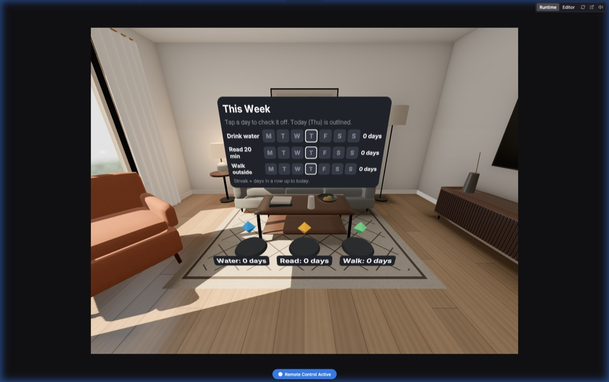</a> ✅ first try · 43 s · grab ✓ · **4.5/5** The panel shows 3 habits with M–S day buttons, today (Thu) outlined, and streak counts, plus 3D pedestals that repeat the streaks; text is legible, though the panel is slightly perspective-skewed, the two-line habit labels are a bit cramped, and unchecked days look muted rather than inviting a tap. | <a href="../run-1/gallery/muse-spark-1.3__habit-tracker__0.jpg">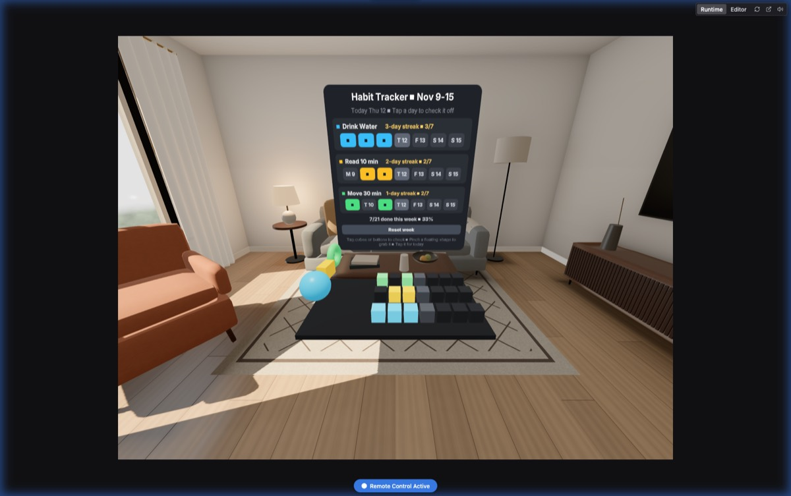</a> ✅ first try · 127 s · grab ✓ · press ✓ · **3.8/5** Shows all three habits with tappable day buttons, correct streak and 7/21 totals, and a matching 3D cube grid. Missing-glyph boxes replace the separators and the checked days' labels, the footer text is tiny, and stray floating shapes clutter the coffee table. | <a href="../run-1/gallery/deepseek-v4.1-flash__habit-tracker__0.jpg">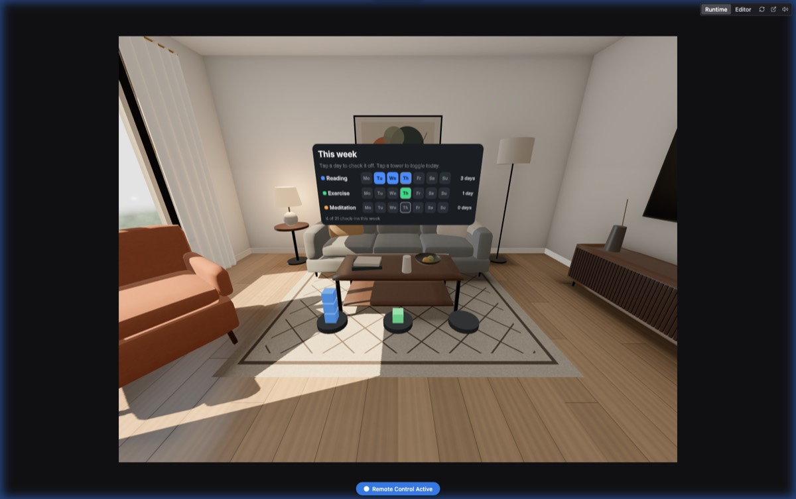</a> ✅ first try · 53 s · press ✓ · **4.5/5** The panel shows all three habits with tappable day buttons for the week and correct streaks (3, 1 and 0 days), and its total of 4 of 21 check-ins matches the checked days; the 3D streak towers sit tangled with the coffee table legs, and the unchecked day labels and footer text are small and low-cont | <a href="../run-2-kimi/gallery/kimi-k3.1-pro-fw__habit-tracker__0.jpg">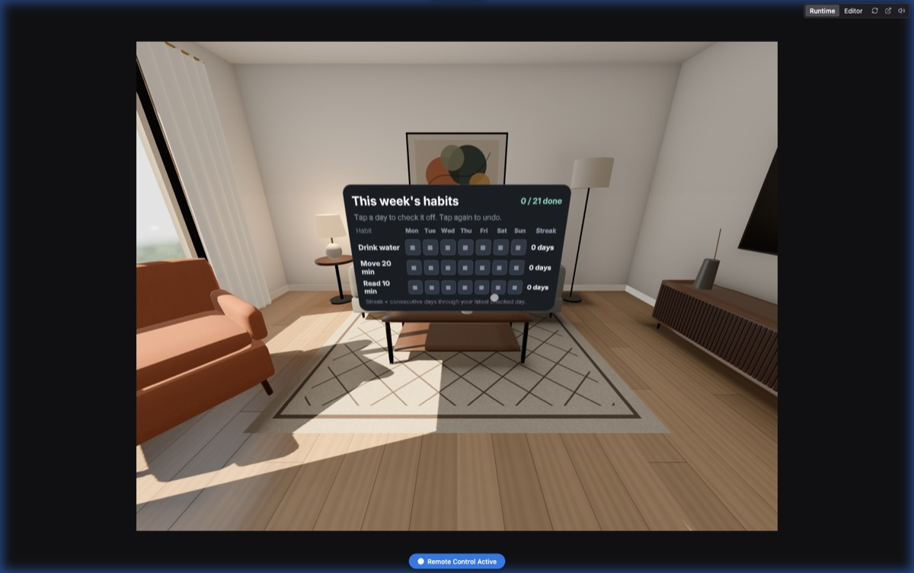</a> ✅ first try · 93 s · **4.5/5** All requested pieces are present: 3 habits, Mon–Sun tappable cells, a streak column per habit and a 0/21 progress counter, and the numbers are consistent; text is small with some habit names wrapping and a slight row skew, and the empty day boxes look fairly subdued as tap targets despite the instru | <a href="../run-3-ember-max/gallery/muse-ember-1.0-max__habit-tracker__0.jpg">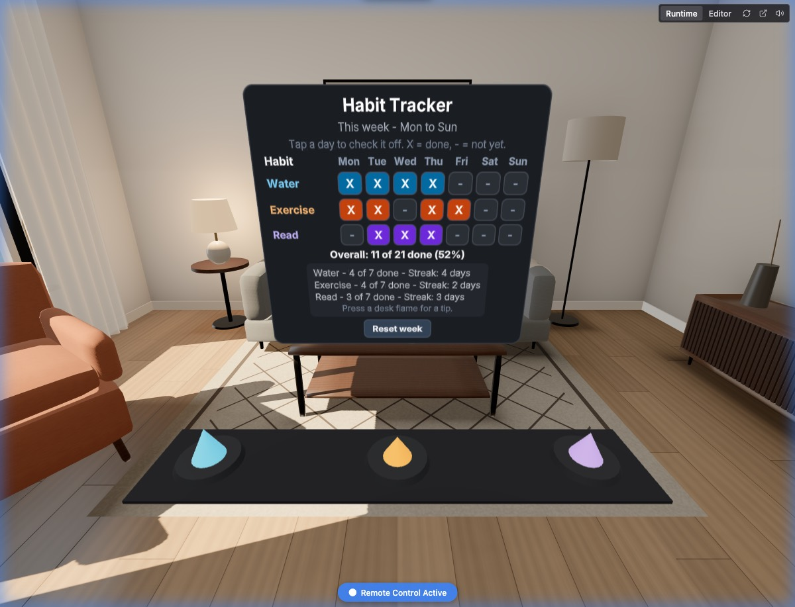</a> ✅ first try · 32 s · press ✓ · **4.5/5** Shows all three habits with a tappable Mon–Sun grid and accurate per-habit counts, streaks and the 11/21 (52%) total, though the summary lines are slightly misaligned and the extra desk 'flame' objects are ambiguous as controls. |
| **T3** · build-water “Build a molecule: hydrogen and oxygen atoms I can grab, and a check button that tells me whether I built water” |  ✅ first try · 47 s · grab ✗ · **4.3/5** Panel with clear instructions, a legend, and Check/Reset buttons sits above a row of red oxygen and white hydrogen spheres; the spheres are small and spread along the coffee table with black stick-like supports, but the atoms read as grabbable and the color legend is correct. | <a href="../run-1/gallery/muse-spark-1.3__build-water__0.jpg">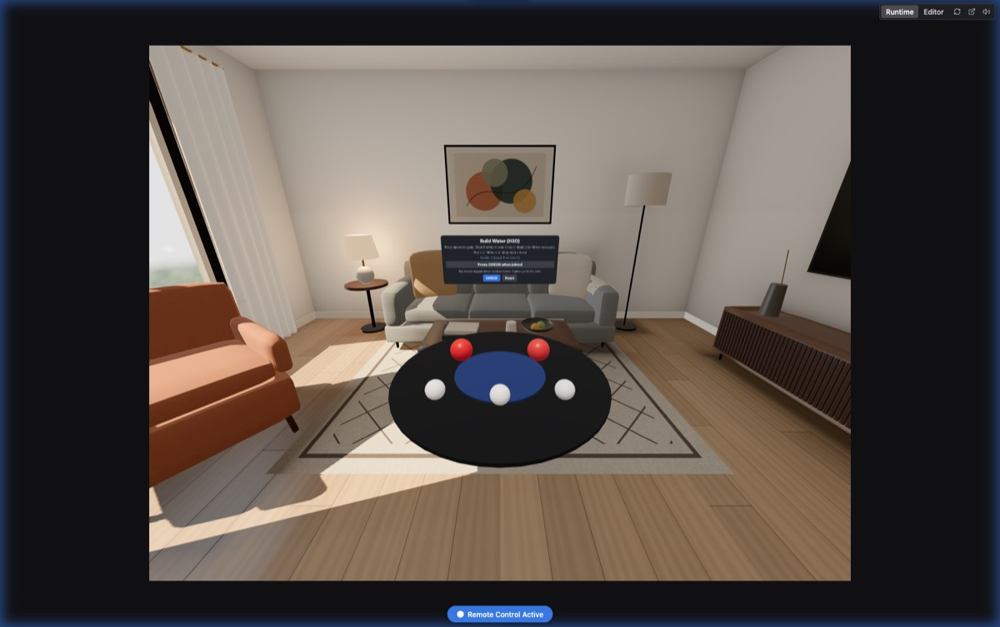</a> ✅ first try · 87 s · grab ✓ · press ✓ · **3.5/5** The request is covered: red oxygen and white hydrogen spheres sit on a dark tray with a blue build zone, and a panel offers CHECK and Reset buttons, but the instruction panel is small and distant, so its text and buttons are barely legible. |  ✅ first try · 41 s · grab ✓ · press ✓ · **3.8/5** The panel shows a title, a correct H₂O explanation, a color legend, and Check/Reset buttons, with three white hydrogen and two red oxygen spheres floating in a row in front of the coffee table; however, the panel text is very small and low-contrast, the subscript in 'H₂O' renders as a glitchy box, a |  ✅ first try · 137 s · grab ✓ · **3.8/5** One red oxygen and two white hydrogen spheres sit near the coffee table beside a panel with Check molecule and Reset buttons, matching the request; however, the panel's small text is hard to read, some symbols render as boxes (e.g. 'H■O■H'), and the panel is tilted and overlaps the table. |  ✅ first try · 23 s · grab ✓ · **3.5/5** Grabbable red oxygen and white hydrogen spheres sit beside a faint target ring with ghost dots, and the panel has Check molecule and Reset atoms buttons, but the intro line is garbled where the colored 'oxygen (O)' / '2 hydrogens (H)' spans overlap the sentence, the atoms float scattered in front of |
| **T3** · fruit-basket “Three fruits I can pick up and drop into a basket, with a running total price of what is in the basket” |  ✅ first try · 55 s · grab ✓ · **4.5/5** Three fruits, a basket, a price list and a running $0.00 total for 0 items are all present and consistent; the panel is legible but small, and the fruits rest on the floor or rug well below the table, while the panel says 'on the table', so they don't strongly read as grabbable. |  ✅ first try · 70 s · grab ✓ · **4.5/5** Shows three distinct fruits on pedestals, a basket with a downward indicator, and a clear priced panel with a $0.00 total and reset button, though the panel is angled and slightly crowded, and the banana model is a crude curved stick. |  ✅ first try · 55 s · grab ✓ · press ✓ · **4.5/5** Three recognizable fruits, a basket and a priced panel with a $0.00 total and an Empty button are all present and legible, though the panel is tilted, the banana is small and thin, and the fruits float near the table with no grab affordance beyond the instruction text. |  ✅ first try · 153 s · grab ✓ · **4.5/5** Apple, banana and orange sit beside a wooden basket under a tidy panel listing prices, pick-and-drop instructions, a $0.00 total and an Empty basket button, though the panel's small text is a bit hard to read and the fruits have no grab cues. |  ✅ first try · 24 s · grab ✓ · **4.5/5** Three recognizable 3D fruits on a tray, an open crate basket, and a panel with prices, basket contents and a $0.00 total match the request well, though the price line wraps awkwardly, the panel partly occludes the sofa area, and the fruits lack per-item price labels or grab affordances beyond the in |

<b>Repetition 2</b> (same requests, run again)

| Request | claude-sonnet-5-5 | muse-spark-1.3 | deepseek-v4.1-flash | kimi-k3.1-pro-fw | muse-ember-1.0-max (improved system) |
|---|---|---|---|---|---|
| **T1** · color-button “A glowing button that changes to a new color each time I press it” |  ✅ first try · 21 s · press ✓ · **4.3/5** A big glowing red-orange push button sits on a dark base with a clear label panel naming the current color and telling the user to press it; the button reads more orange-coral than pure red, and its glow is modest though it casts a light pool on the rug. |  ✅ first try · 73 s · grab ✓ · press ✓ · **4.8/5** A glowing red dome button with a halo and particles sits on a dark base beside a tilted info panel showing the current color name and hex, a press counter and a Next color button, but the panel's small, slanted text is somewhat hard to read. |  ✅ first try · 19 s · press ✓ · **4.3/5** A 3D aqua push-button disc sits below a clear info panel showing the current color name, a swatch and a press count, though the glow effect is subtle and a small stray dot sits at the panel's lower-right corner. |  ✅ first try · 62 s · press ✓ · **4.0/5** A clear cyan 3D push button with a dark base sits over the coffee table, alongside an info panel giving the current color name and a press count, though the glow is subtle, the panel is tilted, and its small text ("Presses: 0") is hard to read. |  ✅ first try · 14 s · press ✓ · **4.8/5** A large, glowing sky-blue dome button with a halo and particles sits in front of the user, with a tidy panel showing the current color, press count and a fallback Change color button; the dome slightly overlaps the coffee table, and the panel's top edge covers part of the wall art. |
| **T1** · dna-helix “A DNA double helix I can pick up and turn around” |  ✅ first try · 38 s · grab ✓ · **3.8/5** A colorful double helix with base-pair rungs and a labeled info panel (A–T, G–C pairing, Next fact and Spin buttons) fits the request; the panel is tilted with small, cramped text, and the helix has no visible grab handle beyond the 'pinch to pick up' instruction. |  ✅ first try · 108 s · grab ✓ · **4.0/5** A clear, colourful double helix with a grab hint, labelled buttons and a base colour legend; the panel is skewed and its body text is slightly cramped, and the base-pair colours are hard to verify against the A–T, G–C legend. |  ✅ first try · 38 s · grab ✓ · press ✓ · **3.8/5** A clear 3D double helix with two backbones and colored base-pair rungs sits beside a panel offering a pinch hint and Spin/Turn 90°/Next fact buttons, but the panel is tilted and its base legend is tiny and hard to read, with an odd fifth swatch. |  ✅ first try · 206 s · grab ✓ · press ✓ · **3.8/5** A colorful double helix on a stand with an info panel, accurate B-DNA facts, and clear grab instructions plus Next pair and Spin model buttons; however, missing-glyph boxes replace arrows and dashes and the base legend overlaps awkwardly, hurting legibility. |  ✅ first try · 28 s · grab ✓ · **4.8/5** A clear double helix with white backbones and colored base-pair rungs sits on a pedestal with a selection ring, and an info panel explains the pinch-to-grab interaction with accurate base-pairing facts and clear buttons; the small text on the angled panel is slightly dense, and the yellow cone on to |
| **T1** · desk-clock “A small desk clock that shows the current hours and minutes” |  ✅ first try · 30 s · grab ✓ · **4.5/5** A desk clock sits on the coffee table, with an analog face whose hands match the digital 17:36 readout and a clear 12h/24h toggle button; the 'Local time' label is tiny and the panel crowds the clock face, and there is no obvious grab affordance. |  ✅ first try · 101 s · grab ✓ · **4.3/5** A wooden analog desk clock sits on the table with a companion panel showing 5:39 PM and the date, plus 24-hour and seconds toggles and a pinch-to-move hint; the panel is tilted and crowds the clock's edge, a stray square glyph appears before 'PM', and the analog hands are hard to confirm against the |  ✅ first try · 46 s · grab ✓ · press ✓ · **4.5/5** A small analog desk clock sits on the coffee table with hands consistent with the digital panel's 17:42 and 20s, and a blue 24-hour format toggle invites a press, though the tilted, floating panel's small secondary text is slightly hard to read. |  ✅ first try · 130 s · press ✓ · **3.8/5** An analog desk clock on a stand, paired with a digital panel reading 18:33 whose hands agree with the readout, fulfils the request, though the clock is fairly large and the side panel's text is tiny with the 12-hour toggle crowding the caption. |  ✅ first try · 18 s · grab ✓ · press ✓ · **4.0/5** A 3D analog desk clock with a matching digital panel (7:01 PM, correct weekday for the date) fulfills the request, though the hour hand is hard to distinguish from the red second hand, the pointer dot slightly covers the button label, and the clock's grabbability relies on the instruction text. |
| **T1** · desk-lamp “A desk lamp I can switch on and off by pressing it” |  ✅ first try · 29 s · press ✓ · **4.3/5** A recognizable green-shaded desk lamp sits in front of the user with a tidy panel showing its OFF state, a 'press the lamp' hint and a clear 'Turn on' button, though the lamp floats oddly large in the room, partly overlaps the coffee table, and the panel's small caption text wraps awkwardly. |  ✅ first try · 138 s · grab ✓ · press ✓ · **4.8/5** A green banker-style desk lamp glows with a visible light cone, and a tilted info panel shows its ON state, poke and pinch instructions, and a prominent 'Turn off' button; the panel's small secondary text is slightly hard to read at its angle, and the lamp floats over the coffee table with its beam  |  ✅ first try · 66 s · press ✓ · **4.3/5** A dark desk lamp with a shade, stem, base and a visible switch nub is paired with a tilted 'Desk lamp / Off' panel that has a clear 'Switch on' button and a hint to press the shade, switch or base; the panel is readable but small and angled, and the lamp floats over the coffee table at a large scale |  ✅ first try · 115 s · press ✓ · **4.3/5** A recognizable green desk lamp with a glowing shade, light cone and a yellow base button is shown, with a tidy side panel giving instructions, ON status and a Turn off button; the lamp floats without a desk and the panel is slightly tilted, but the pressable parts are clear. |  ✅ first try · 23 s · press ✓ · **4.3/5** A recognizable articulated desk lamp sits on a desk with an orange switch button and a clear info panel with Turn on, Turn off and Brightness buttons; the panel slightly overlaps the lamp shade area, and the orange base button reads more like a ball than a switch. |
| **T2** · earth-layers “Show the layers of the Earth as a cut-away sphere with a label for each layer” |  ✅ first try · 95 s · press ✓ · **3.8/5** The cut-away sphere shows four colored layers, each with a leader-lined label and plausible depth figures. However, the en-dashes render as missing-glyph boxes, the Inner core and Outer core labels have cramped, overlapping text lines, and the info panel's body text is too small to read comfortably. |  ✅ first try · 263 s · grab ✗ · press ✓ · **3.8/5** A cut-away Earth on a pedestal shows concentric layers, with leader-lined labels for all five layers and accurate depth ranges, but the tilted info panel's instructions and its Next layer/Reset buttons are tiny and hard to read, and the smaller layer labels are faint. |  ✅ after 1 repair · 152 s · press ✓ · **3.0/5** A cut-away sphere with nested layers is present, but the outer surface is plain green rather than Earth-like and there are no labels on the layers themselves; the layer names appear only as tiny buttons on a sharply tilted side panel that is hard to read, though the panel does invite pressing layers |  ✅ first try · 291 s · grab ✗ · press ✓ · **3.5/5** The model reads more as a flat concentric disc than a cut-away sphere, and its labels sit in a separate side panel rather than on the layers. The layer depths are accurate, but missing glyphs show as boxes (e.g. '5■70 km'), the panel is steeply tilted and its footnote is tiny. The pressable layer ro |  ✅ first try · 62 s · grab ✓ · press ✓ · **4.8/5** A clear cut-away globe on a stand with four labelled layers carrying accurate depth ranges, Show buttons and Show all / Reset view controls; however, stray leader lines run up through the title panel to the top of the view, and the labels are slightly tilted and crowded. |
| **T2** · photosynthesis “Explain photosynthesis with a small plant, the Sun, and labeled arrows for light, water, carbon dioxide and oxygen” |  ✅ first try · 146 s · grab ✓ · press ✓ · **4.0/5** Sun, plant, and clearly labeled light, CO2 and oxygen arrows are shown with a correct equation and clear Next step and Sun toggle buttons, but the water arrow is missing or hidden, the info panel overlaps the plant's base, and the Water and CO2 sublabels are tiny. |  ✅ first try · 160 s · grab ✓ · press ✓ · **3.3/5** The plant, Sun, water drop, CO2 cloud and panel are present, but only the light arrow is clearly drawn (the water, CO2 and O2 labels have no visible arrows), the CO2 cloud overlaps and hides the panel text, and the labels are tiny; the equation and toggle buttons do invite interaction. |  ✅ first try · 111 s · press ✓ · **3.8/5** The plant, Sun and four labeled arrows are all present, but the explanatory panel is far away with tiny unreadable text, the labels lack proper subscripts (H2O, CO2, O2), and the only clear interactive cue is a tiny button, so the arrows' directions are right but there's little invitation to interac |  ✅ first try · 47 s · grab ✓ · press ✓ · **3.5/5** The scene has every requested element: a potted plant, a Sun, and labeled arrows with sensible directions (light and CO2 in, water up from the pot, oxygen out), but the info panel with the equation and buttons is tiny, angled away from the user and partly sunk behind the sofa, so its text and small  |  ✅ first try · 31 s · grab ✓ · press ✓ · **4.0/5** The plant, Sun and labeled arrows for light, water, CO2 and oxygen are all present, along with a correct simplified equation panel and Back/Next/Pause buttons plus a press hint; however, the CO2 arrow is mostly hidden behind its label and the leaves, and the labels float somewhat loosely around the  |
| **T2** · weather “A weather dashboard for three cities with an icon and the temperature for each” |  ✅ first try · 33 s · grab ✗ · press ✓ · **4.5/5** Three city cards (Cairo, London, Oslo) each show a matching 3D weather icon, a plausible temperature and a condition, with a clear 'Show °F' toggle; the 'Press the icon for details' hint text is tiny and hard to read, and the cards' support poles and snow particles clutter the scene slightly. |  ✅ first try · 56 s · grab ✓ · press ✓ · **4.8/5** Three city cards with temperatures, conditions, and matching 3D sun, rain-cloud and cloud icons on pedestals form a complete dashboard; the small flat square glyphs in the cards are crude stand-ins for icons and a stray square appears in the status line, but the 3D icons are clearly grabbable, the s |  ✅ first try · 69 s · grab ✓ · press ✓ · **4.0/5** Shows three city cards with weather icons and temperatures plus a unit toggle and press hint, but the rain and sun icons overlap and obscure the 'Tokyo' and 'Cairo' names, and the San Francisco cloud partly covers its card edge. |  ✅ first try · 203 s · press ✓ · **4.5/5** Three cities each have a matching 3D weather icon (sun, rain cloud, cloud) and a temperature, with a °F toggle, a selected-city detail row and a demo-data label; the icons sit behind the panel's top edge and are slightly cropped, and the city tiles read as selectable but only modestly afford pressin |  ✅ first try · 42 s · press ✓ · **4.5/5** Three cities each have a clear 3D weather icon and a plausible temperature with conditions, plus a prominent Fahrenheit toggle; the main info panel slightly overlaps the base slab and stands, and the icons' pressability relies on the instruction text rather than visual affordances. |
| **T2** · coffee-mug “A coffee mug I can pick up, with a card showing its price and what it is made of” |  ✅ first try · 25 s · grab ✓ · **4.3/5** A blue mug with coffee sits on a coaster beside a well-populated card showing the $14.00 price, materials, capacity, glaze swatches and an 'Empty the mug' button; the card is tilted, the 'Finish' line wraps awkwardly, and the 'Pinch the mug to pick it up' hint is tiny and partly crowded by the butto |  ✅ first try · 54 s · grab ✓ · **4.3/5** A cream mug on a saucer sits beside a card showing the name, $18.00 price, glazed stoneware material, colour chips and a fill toggle, but the card's text is very small and tilted, and the 'pinch to pick up' hint is barely legible. |  ✅ first try · 18 s · grab ✓ · **4.5/5** A sand-colored mug with coffee floats beside a tilted dark card showing the name, a $12.00 price, the material (glazed stoneware), capacity and glaze, plus a 'Next glaze' button; the card is legible but its skewed angle and the small grey labels with wide gaps to their values make it slightly hard t |  ✅ first try · 80 s · grab ✓ · press ✓ · **4.5/5** A well-modeled mug on a coaster sits beside a legible card showing the $18.00 price, the glazed stoneware material, a pinch hint and a More details button, though the card is slightly skewed, its hint text is small and cramped, and the mug has no visible grab affordance. |  ✅ first try · 19 s · grab ✓ · **4.8/5** A detailed mug with saucer and steam sits on a wooden tray next to a legible product card showing name, $18.50 price and stoneware material, with pick-up instructions and clear buttons; the card is slightly tilted and densely packed, and the text sits close to its edges. |
| **T3** · times-tables “A multiplication quiz with 5 questions, answer buttons, and a running score” |  ✅ first try · 36 s · grab ✓ · **3.8/5** The quiz shows question 1/5, a running score, four clear answer buttons (including the correct 42) and a matching 6×7 ball array, but the multiplication sign renders as a missing-glyph box, hurting legibility of the core equation. |  ✅ first try · 114 s · grab ✓ · press ✓ · **4.3/5** The quiz has everything requested: question 1 of 5, a correct 3x4 problem with four clear blue answer buttons, Next/Restart buttons, a score, a block array and progress dots. However, the score label wraps awkwardly onto two lines, a missing-glyph square sits after the title, and the progress dots a |  ✅ first try · 37 s · **3.8/5** Clean quiz panel with question counter, running score, four clear answer buttons including the correct 42, and five progress cubes; however, the multiplication sign renders as a missing-glyph box, and the progress cubes sit detached down on the floor behind the table. |  ✅ first try · 116 s · **4.0/5** Complete quiz panel with question counter, running score, four answer buttons and progress dots, but the multiplication sign renders as a square box (missing glyph), the progress dots poke above the panel, and a stray grey dot sits over the last button. |  ✅ first try · 37 s · grab ✓ · press ✓ · **4.5/5** The panel delivers everything requested: 'Question 1 of 5', a running score, 6×7 with four answer buttons including the correct 42, and a 6×7 bead tray hint plus a five-tab progress block. The answer buttons are slightly misaligned with left-justified labels, and the link between the hint tray and t |
| **T3** · habit-tracker “A habit tracker for this week: 3 habits, tap a day to check it off, and show each habit's streak” |  ✅ first try · 60 s · press ✓ · **4.0/5** Three habits with tappable day buttons and streak counters are shown and the 0/21 totals are consistent, but the floating panel is tilted and its lower text is small, and an unlabeled 3x7 grid of grey discs on a large tray in the foreground is ambiguous, apparently a redundant physical button set. |  ✅ first try · 123 s · grab ✓ · press ✓ · **3.5/5** Three color-coded habit rows of day pucks with a highlighted today column, plus streaks and counts that match the checked pucks (3/2/1, 6/21). However, the info panel overlaps the day header and hides SU, the rows are labelled only by colored spheres, and the panel text is small and skewed; 'Nov 9–1 |  ✅ first try · 75 s · press ✓ · **4.3/5** All requested parts are present: 3 habits with streaks, a 7-day grid with today highlighted, and a 0/21 counter, but the habit label panels are detached from the grid rows, the header overlaps the day strip, and the dark squares blend into each other and the room, though they still read as tappable  |  ✅ first try · 165 s · **4.5/5** A complete 3-habit by 7-day grid with streaks, a check-off count and a clear button; text is legible though the panel tapers slightly and the small, gray empty checkboxes look somewhat inert. |  ✅ first try · 31 s · grab ✓ · press ✓ · **4.8/5** All three habits have a full week of tappable day cells, streaks and done counts that tally correctly (7 of 21), and colour-matched 3D pinch balls plus action buttons that invite interaction; minor layout issues include the Sun/Streak headers crowding, rows slightly misaligned and 'Move 20 min' wrap |
| **T3** · build-water “Build a molecule: hydrogen and oxygen atoms I can grab, and a check button that tells me whether I built water” |  ✅ first try · 50 s · grab ✓ · **4.3/5** The component delivers what was asked: a panel titled 'Build a water molecule' with an O/H color legend, Check and Reset buttons, and a hint, plus two red oxygen and four white hydrogen spheres floating at hand height above the table; the panel text is small but legible, and the atoms invite grabbin |  ✅ first try · 51 s · grab ✓ · **4.0/5** A red oxygen sphere, two white hydrogen spheres on pedestals and a build ring sit on a dark tray, next to a panel with instructions, a legend (Oxygen x1, Hydrogen x2), and a green 'Check: is this water?' button plus a Reset button. This covers the request well, but the panel's text is small, tilted  |  ✅ first try · 45 s · grab ✓ · press ✓ · **3.3/5** Red oxygen and white hydrogen spheres sit on a tray, with an instruction panel offering Check and Reset buttons, so the request is covered; however, the panel is tiny and tilted, which makes its text nearly illegible, and the small spheres and buttons are low on the coffee table, far from the user,  |  ✅ first try · 225 s · grab ✓ · press ✓ · **3.5/5** Red O and two white H spheres on pedestals with cyan snap rings, a Check button and an instruction panel are all present, but the panel's small text is hard to read, the subscript '2' and bond dashes render as broken glyphs ('H■O', 'O■H'), the hint footer is cramped and partly cut off, and an extra  |  ✅ first try · 35 s · grab ✓ · press ✓ · **4.0/5** Grabbable red O and white H spheres sit on a dark tray with a clear Check button and instructions, but the instruction text is small with low-contrast grey lines, the 'Ghost' button is unexplained, and the faint ghost guide molecule overlaps the atoms and is hard to read. |
| **T3** · fruit-basket “Three fruits I can pick up and drop into a basket, with a running total price of what is in the basket” |  ✅ first try · 44 s · grab ✓ · **4.5/5** Three clearly modeled fruits (apple, banana, orange) and a basket appear alongside a Fruit Stand panel listing prices, per-item status, an item count, a $0.00 running total and an Empty basket button; the panel text is small and the fruits float low near the rug, but the 'Pinch a fruit' hint makes t |  ✅ first try · 96 s · grab ✓ · **4.3/5** Three priced fruits on pedestals, a basket and a total panel are all present and the prices and $0.00 total are consistent, but the Orange label overlaps the panel's blue button and hides its text, and the Banana label covers the basket. |  ✅ first try · 65 s · grab ✓ · **4.0/5** An apple, a banana and an orange sit in front of a basket, with a price panel showing a correct $0.00 total and an Empty basket button. However, the banana is a flat, unconvincing shape and the angled panel's small grey item labels and instructions are hard to read. |  ✅ first try · 213 s · grab ✓ · **4.5/5** Three recognizable fruits sit on pedestals beside an open basket, with a clear price list, a $0.00 total and an Empty basket button; the panel is slightly small and the text is a bit fine, and the pedestals help but there are no explicit grab cues on the fruits. |  ✅ first try · 35 s · grab ✓ · press ✓ · **4.8/5** Three distinct 3D fruits sit on highlighted spots beside a woven basket, and a clear panel lists per-fruit status and prices, a $0.00 (0 of 3) running total, pinch-and-drop instructions and a reset button; the panel's text is slightly soft but legible, and nothing overlaps or is clipped. |

