# Which model built what: compare-fair

**All five models used the same improved system (plain-text rule, panel width and text-size checks, 23-degree turn limit, 64k output), the same 12 requests x 2 repetitions, and the same judge (Claude Opus 5.5).**

Each column is one model; each row is one request from the held-out test set. Every model saw the same
system prompt and the same checks, and each scene was mounted in Meta's Quest emulator (the living room is the
emulator's simulated room; the toolbars are emulator controls, not part of the scene). Click a picture for full size.

- ✅ passed all checks (first try, or after the agent repaired its own code) · time to a working scene
- grab / press: an emulated hand tried to pick up one grabbable object and press one pressable object
- **score**: quality 1-5 from claude-opus-5-5, an independent judge that is not a contestant, averaging fidelity, clarity, correctness and hands-on; its one-line reason is under each score. Scenes that failed or crashed count as 1/5 in the overall averages

| Model | Quality | Median time |
|---|---|---|
| claude-sonnet-5-5 | 4.29 | 42 s |
| muse-spark-1.3 | 4.29 | 119 s |
| deepseek-v4.1-flash | 4.22 | 49 s |
| kimi-k3.1-pro-fw | 4.30 | 159 s |
| muse-ember-1.0-max | 4.30 | 28 s |

Full numbers: [summary.md](summary.md).

## Repetition 1

| Request | claude-sonnet-5-5 | muse-spark-1.3 | deepseek-v4.1-flash | kimi-k3.1-pro-fw | muse-ember-1.0-max |
|---|---|---|---|---|---|
| **T1** · color-button “A glowing button that changes to a new color each time I press it” | <a href="../run-4-fair/gallery/claude-sonnet-5-5__color-button__0.jpg">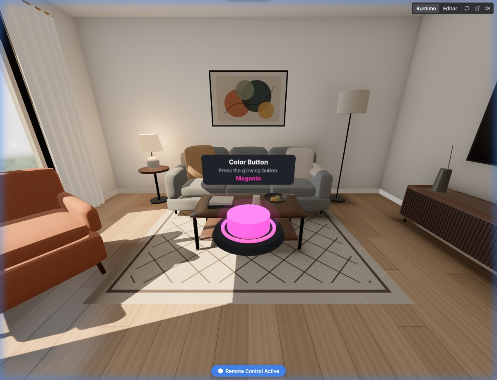</a> ✅ first try · 10 s · press ✓ · **4.8/5** A glowing magenta 3D push button on a dark base sits below a tidy label panel that names the current color 'Magenta' and prompts the user to press it, though the button visually overlaps the coffee table somewhat. | <a href="../run-4-fair/gallery/muse-spark-1.3__color-button__0.jpg">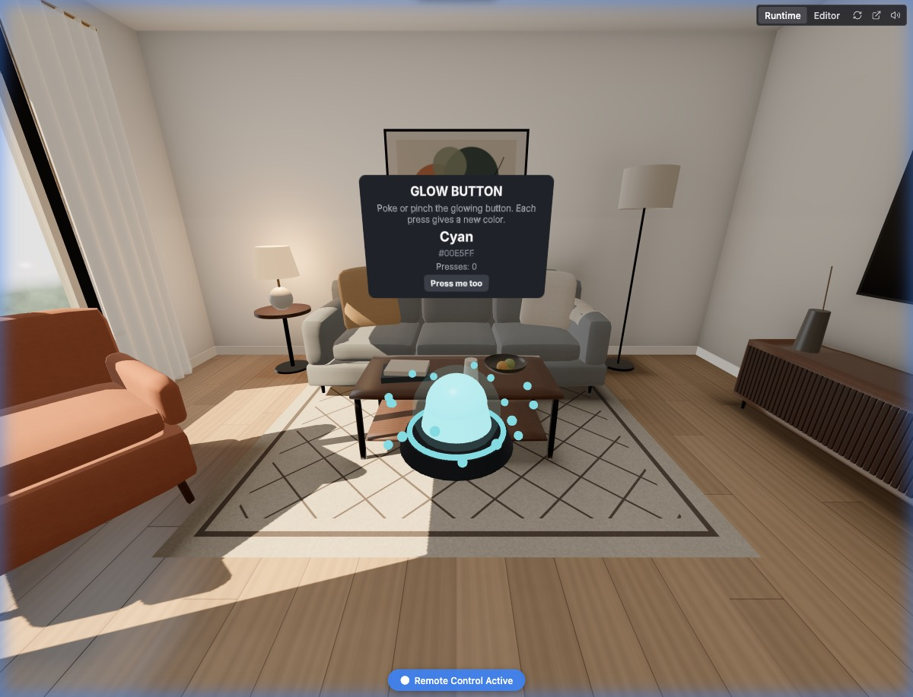</a> ✅ first try · 71 s · grab ✓ · press ✓ · buttons 0/1 · **4.8/5** A clear glowing cyan dome button with an orbiting particle ring sits in front of the user, and its info panel reads correctly (Cyan #00E5FF, Presses: 0) with a backup 'Press me too' button; the description text is somewhat small and low-contrast, and the panel overlaps the wall painting. | <a href="../run-4-fair/gallery/deepseek-v4.1-flash__color-button__0.jpg">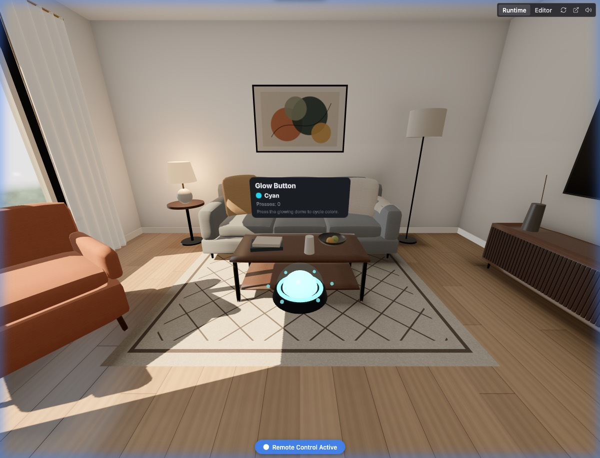</a> ✅ first try · 24 s · press ✓ · **4.8/5** A clearly glowing cyan dome button with orbiting particles sits below a tidy label panel showing the current color, press count and an instruction, though the hint text is small and faint. | <a href="../run-4-fair/gallery/kimi-k3.1-pro-fw__color-button__0.jpg">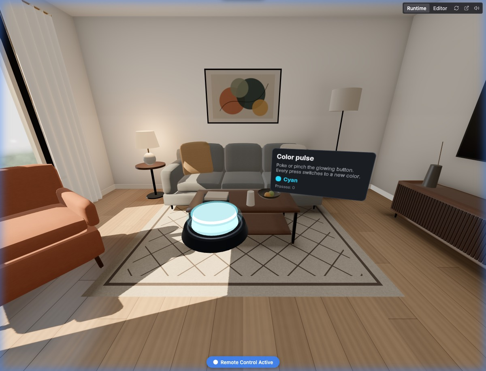</a> ✅ first try · 46 s · press ✓ · **4.8/5** A large glowing cyan button sits on a dark base with a tidy info panel that explains the poke/pinch interaction and shows the current color and press count, though the panel is slightly tilted and its small text is a bit faint. | <a href="../run-3-ember-max/gallery/muse-ember-1.0-max__color-button__0.jpg">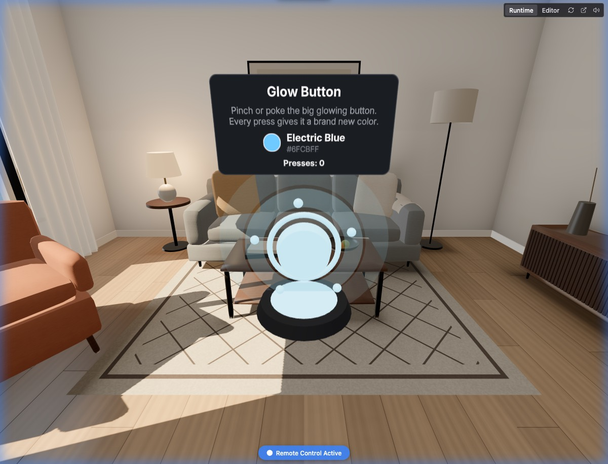</a> ✅ first try · 22 s · press ✓ · **4.0/5** A large pressable button on a dark base, with a halo, orbiting dots, and a panel showing the current color name, hex code and press count, fits the request well, though the button looks washed-out pale blue rather than vividly glowing, and the panel slightly overlaps the top of the halo. |
| **T1** · dna-helix “A DNA double helix I can pick up and turn around” | <a href="../run-4-fair/gallery/claude-sonnet-5-5__dna-helix__0.jpg">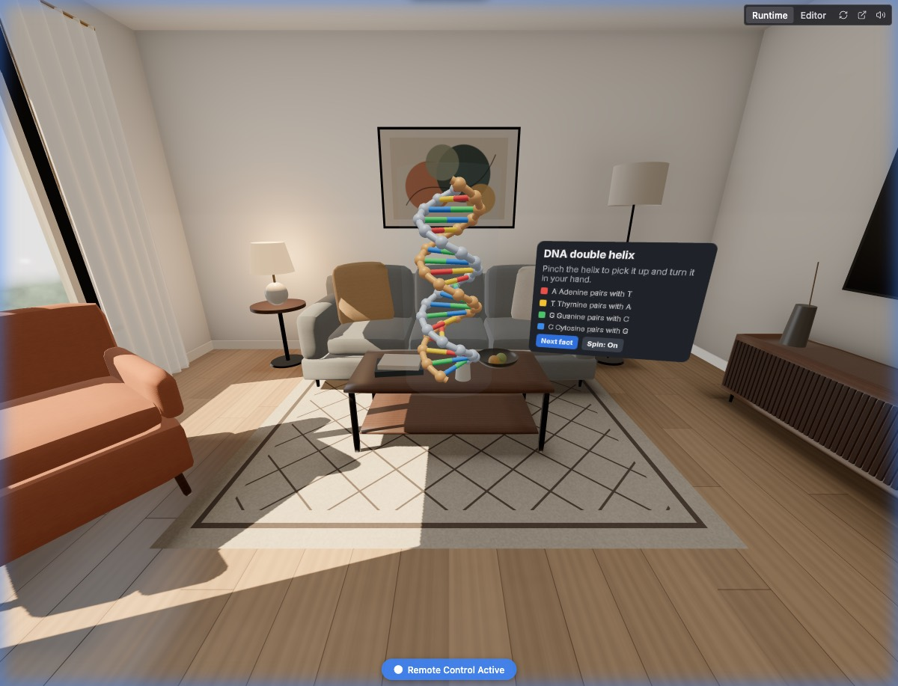</a> ✅ first try · 38 s · grab ✓ · buttons 2/2 · **4.5/5** A clear 3D double helix with two backbones and color-coded base-pair rungs floats above the coffee table, and a tidy side panel gives correct A–T/G–C pairing facts plus a pinch-to-grab hint; the panel text is a bit small and slightly angled, and nothing on the helix itself (no grab handle or highlig | <a href="../run-4-fair/gallery/muse-spark-1.3__dna-helix__0.jpg">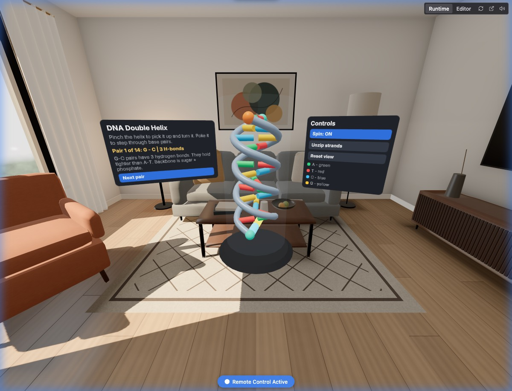</a> ✅ after 1 repair · 203 s · grab ✓ · press ✓ · buttons 0/3 · **4.8/5** A clear double helix on a pedestal with color-coded base pairs; it comes with a pinch-to-grab instruction, an info panel with accurate G-C hydrogen-bond and sugar-phosphate backbone facts, and obvious Spin, Unzip, Reset and Next pair buttons, though the info text crowds the Next pair button and the  | <a href="../run-4-fair/gallery/deepseek-v4.1-flash__dna-helix__0.jpg">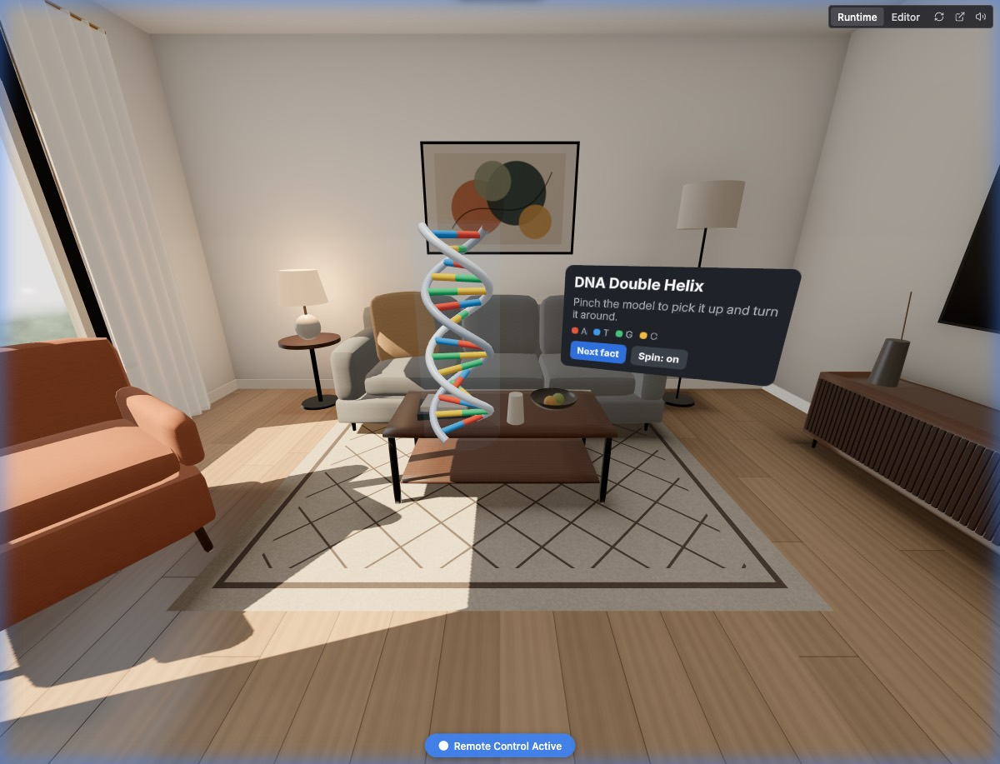</a> ✅ first try · 38 s · grab ✓ · buttons 2/2 · **4.0/5** A clear, colorful double helix with a base-pair legend (A-T and G-C pairings look consistent) and a tidy info panel with &quot;Next fact&quot; and &quot;Spin&quot; buttons; the legend text is small and the only grab cue is a faint bounding box plus a pinch instruction. | <a href="../run-4-fair/gallery/kimi-k3.1-pro-fw__dna-helix__0.jpg">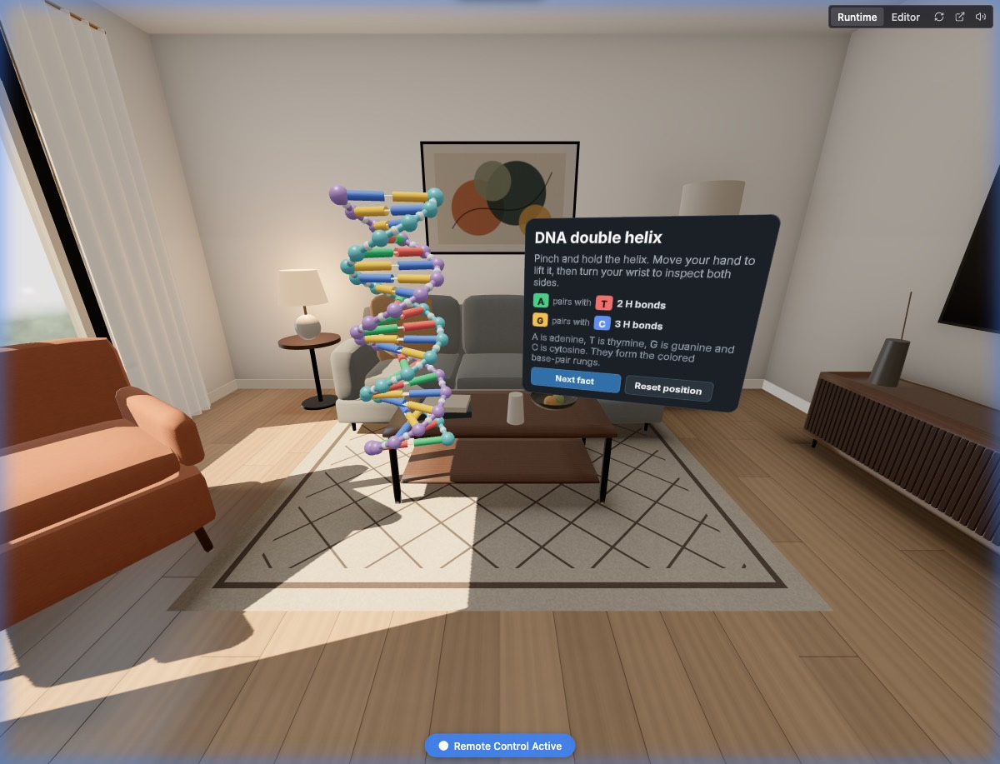</a> ✅ first try · 190 s · grab ✓ · buttons 2/2 · **4.5/5** A well-formed 3D double helix with colored base-pair rungs sits beside a tidy info panel giving correct A–T (2 H bonds) and G–C (3 H bonds) pairing, clear pinch-to-lift instructions and Next fact / Reset position buttons, though the helix has no visible grab handle or affordance of its own and the p | <a href="../run-3-ember-max/gallery/muse-ember-1.0-max__dna-helix__0.jpg">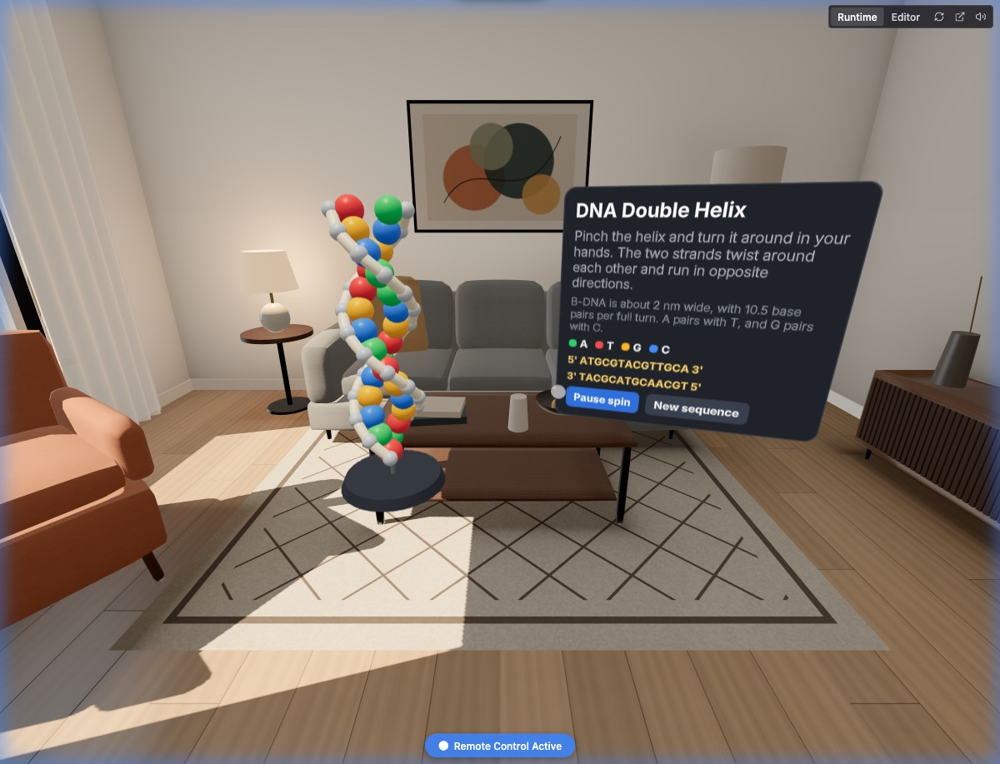</a> ✅ first try · 21 s · grab ✓ · buttons 2/2 · **4.3/5** A recognizable two-strand ball-and-stick helix on a stand, paired with a tidy info panel; the facts are correct (B-DNA ~2 nm wide, 10.5 bp per turn, A–T/G–C pairing, and the antiparallel sequences complement correctly), and the pinch-to-turn instruction plus Pause spin and New sequence buttons invit |
| **T1** · desk-clock “A small desk clock that shows the current hours and minutes” | <a href="../run-4-fair/gallery/claude-sonnet-5-5__desk-clock__0.jpg">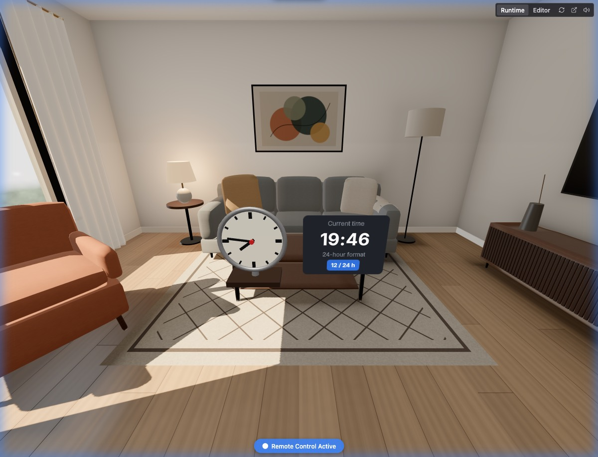</a> ✅ first try · 24 s · grab ✓ · buttons 1/1 · **4.3/5** An analog desk clock on a stand sits beside a legible digital readout of 19:46 that matches the hand positions; the only interactive cue is a small 12/24 h toggle button, so the clock itself doesn't clearly invite grabbing. |  ✅ after 1 repair · 111 s · grab ✓ · buttons 2/2 · **4.3/5** A 3D analog desk clock with a matching 19:49 digital readout, a date, and clear toggle buttons fully meets the request; the panel is slightly cramped, with the hint text nearly touching the first button, and the clock body is a plain block. | <a href="../run-4-fair/gallery/deepseek-v4.1-flash__desk-clock__0.jpg">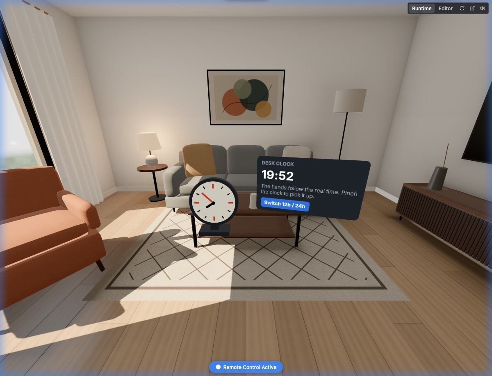</a> ✅ first try · 49 s · grab ✓ · buttons 1/1 · **4.5/5** A clear analog desk clock with a matching 19:52 digital readout and a 12h/24h toggle; the hands agree with the digital time, but the tilted info panel's text is crowded against its edges and the pinch-to-grab affordance is described in text rather than shown visually. | <a href="../run-4-fair/gallery/kimi-k3.1-pro-fw__desk-clock__0.jpg">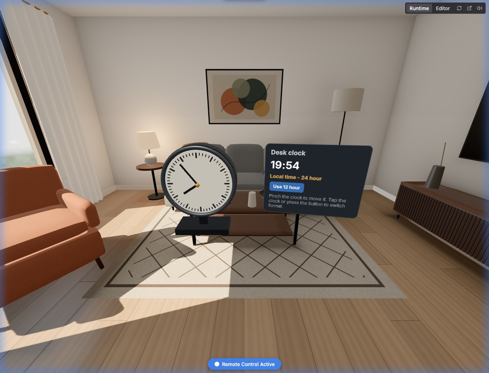</a> ✅ first try · 92 s · grab ✓ · press ✓ · buttons 1/1 · **4.5/5** A clear analog desk clock whose hands are consistent with the 19:54 digital readout, paired with a tidy info panel offering a 12/24-hour toggle; the instruction text is a bit small and the clock's grab affordance relies on that text. | <a href="../run-3-ember-max/gallery/muse-ember-1.0-max__desk-clock__0.jpg">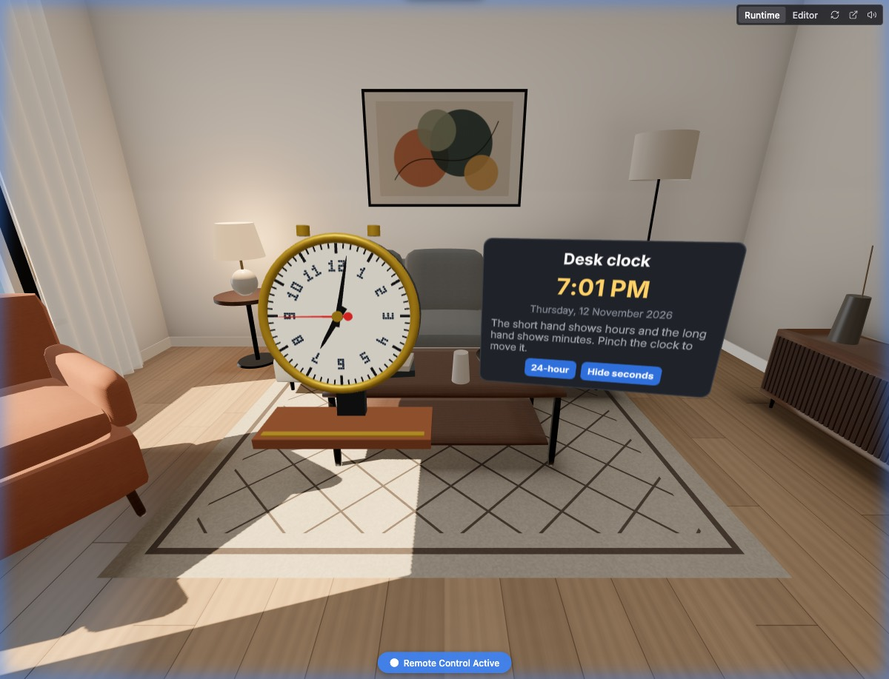</a> ✅ first try · 25 s · grab ✓ · buttons 0/2 · **3.8/5** An analog desk clock on a base with a matching digital readout (7:01 PM, hands agree, and Thursday 12 November 2026 is correct), but the radially rotated numerals are hard to read, with the lower ones upside down, and the info panel crowds the clock. |
| **T1** · desk-lamp “A desk lamp I can switch on and off by pressing it” | <a href="../run-4-fair/gallery/claude-sonnet-5-5__desk-lamp__0.jpg">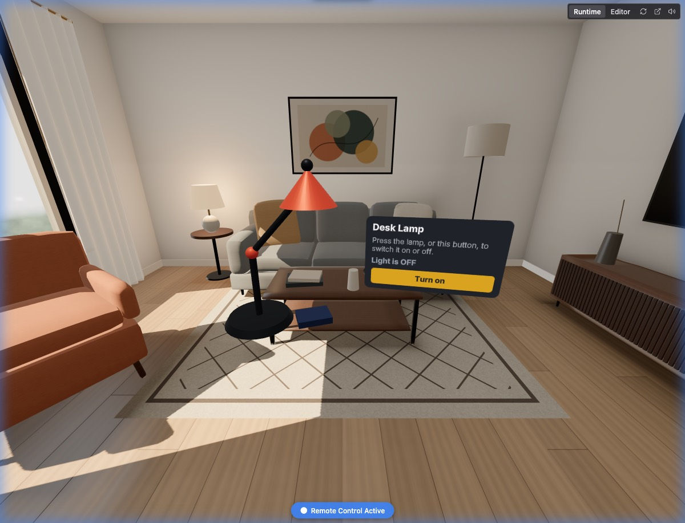</a> ✅ first try · 26 s · press ✓ · buttons 0/1 · **4.3/5** A recognizable articulated desk lamp with a red cone shade sits beside a tidy panel that shows the 'Light is OFF' state, a clear 'Turn on' button and instructions to press the lamp. The lamp is oversized and hovers awkwardly over the coffee table rather than resting on a surface. The panel's grey he | <a href="../run-4-fair/gallery/muse-spark-1.3__desk-lamp__0.jpg">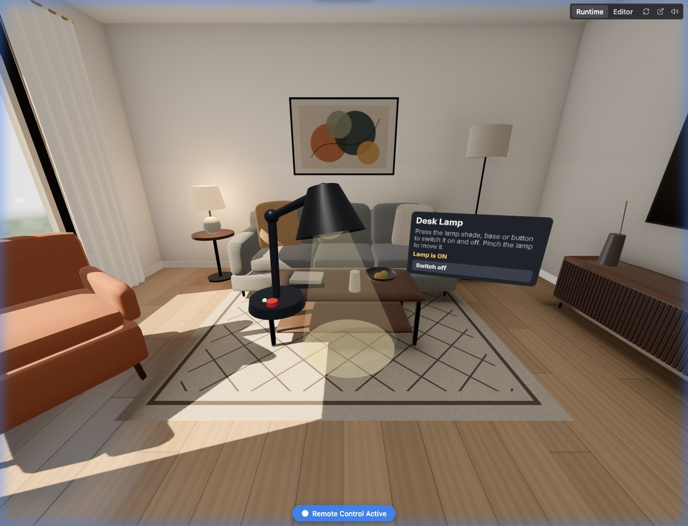</a> ✅ first try · 144 s · grab ✓ · press ✓ · buttons 0/1 · **4.0/5** A recognizable black articulated desk lamp casts a visible light cone and pool with an ON indicator, a red button on the base and an info panel offering a Switch off control, but the lamp floats unsupported in mid-air and the panel's small, dense text crowds its edges. | <a href="../run-4-fair/gallery/deepseek-v4.1-flash__desk-lamp__0.jpg">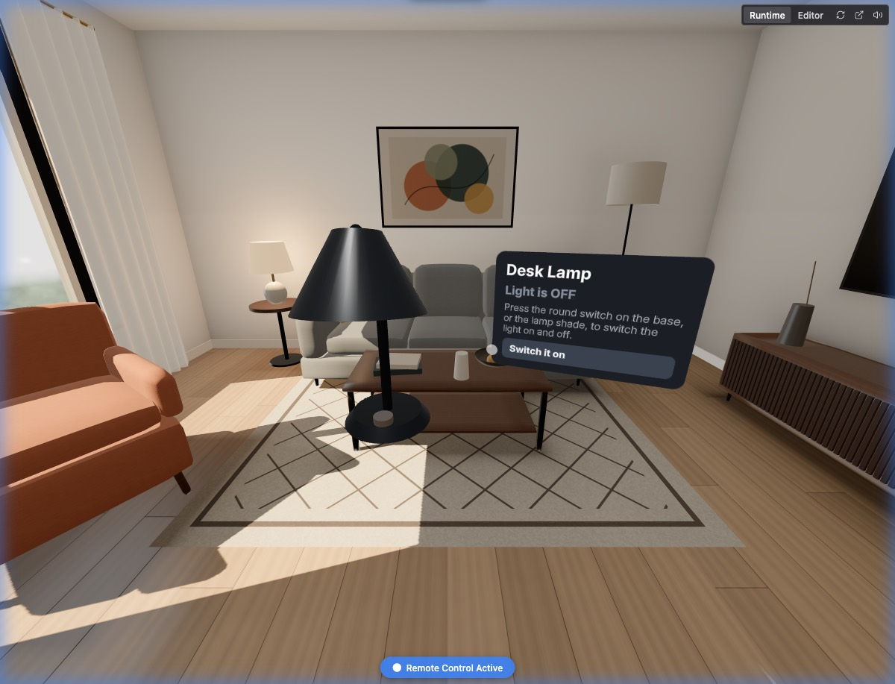</a> ✅ first try · 44 s · press ✓ · buttons 1/1 · **4.0/5** A recognizable black desk lamp with a round base switch and an info panel with a clear 'Switch it on' button, but the panel is tilted, its text sits close to the edges, and a stray dot overlaps the button edge, which hurts tidiness. | <a href="../run-4-fair/gallery/kimi-k3.1-pro-fw__desk-lamp__0.jpg">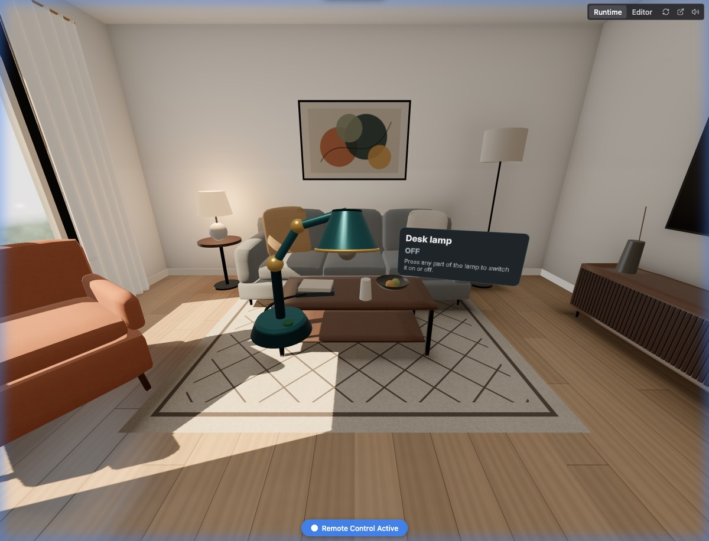</a> ✅ first try · 164 s · press ✗ · **4.3/5** A well-modeled articulated teal desk lamp with an OFF status label and a clear 'press any part' instruction; the lamp floats unsupported in mid-air and its info panel slightly crowds the shade, but the interaction is clearly explained. | <a href="../run-3-ember-max/gallery/muse-ember-1.0-max__desk-lamp__0.jpg">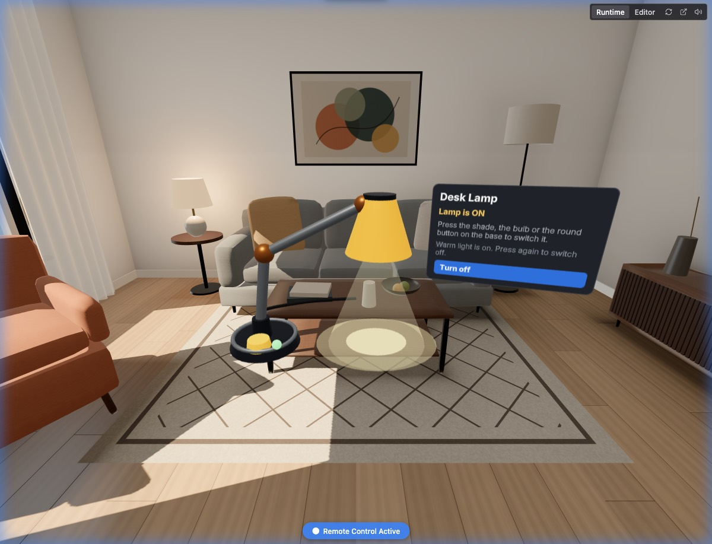</a> ✅ first try · 17 s · press ✓ · buttons 1/1 · **4.0/5** A recognizable articulated desk lamp in its ON state, with a glowing shade, a light cone, a yellow base button and a 'Turn off' panel, though the info panel overlaps the lamp shade, the 'Turn off' button is slightly clipped, and the lamp floats oddly above the coffee table. |
| **T2** · earth-layers “Show the layers of the Earth as a cut-away sphere with a label for each layer” | <a href="../run-4-fair/gallery/claude-sonnet-5-5__earth-layers__0.jpg">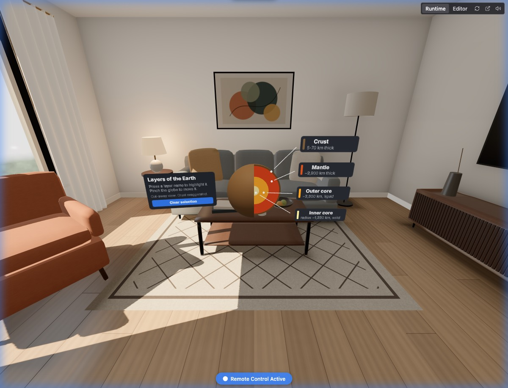</a> ✅ first try · 91 s · grab ✓ · buttons 3/3 · **4.0/5** A clean half-cut sphere shows all four layers with leader-lined labels and accurate thickness figures, but the outer surface is plain brown rather than recognisably Earth, the text is small, and the pressable layer labels look like static tags rather than buttons. | <a href="../run-4-fair/gallery/muse-spark-1.3__earth-layers__0.jpg">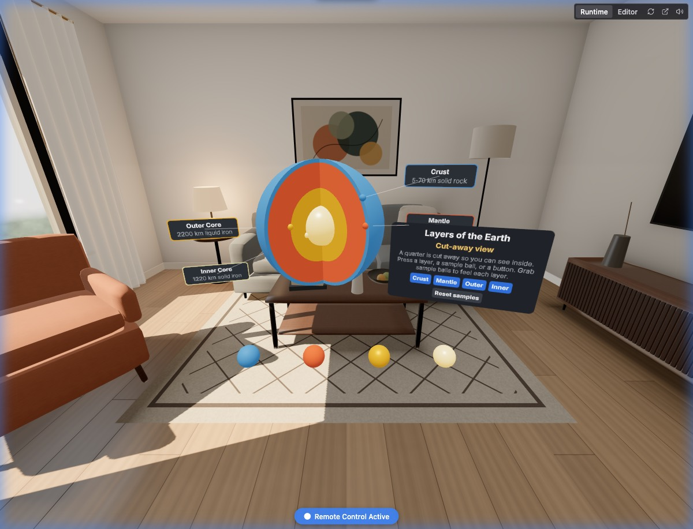</a> ✅ after 1 repair · 326 s · grab ✓ · press ✓ · buttons 1/3 · **4.0/5** A clear cut-away Earth with all four layers labeled and accurate figures (crust 5–70 km, outer core ~2200 km liquid iron, inner core 1220 km solid iron), but the info panel covers the Mantle label and its details, and leader lines cross the label text; the layer buttons and grabbable sample balls in | <a href="../run-4-fair/gallery/deepseek-v4.1-flash__earth-layers__0.jpg">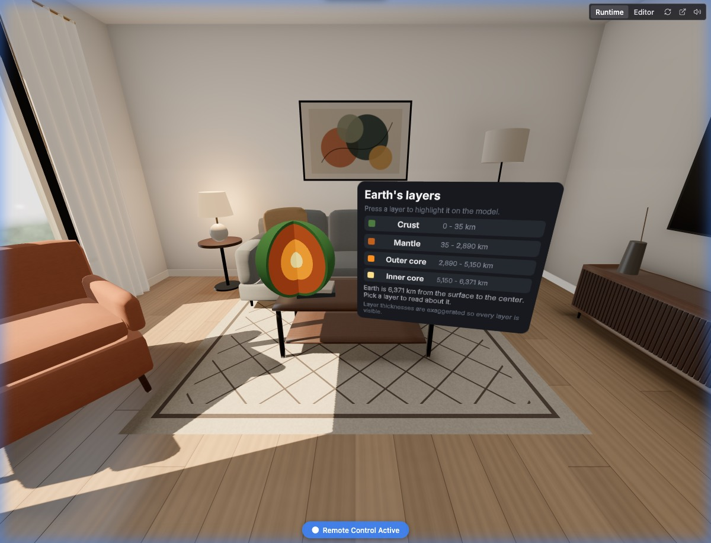</a> ✅ first try · 149 s · grab ✓ · press ✓ · buttons 3/3 · **4.3/5** A cut-away sphere shows all four layers with accurate depth ranges, but the labels sit in a separate legend panel rather than on the model, the model is small beside the panel, and the footer text is tiny; the layer rows clearly read as pressable. | <a href="../run-4-fair/gallery/kimi-k3.1-pro-fw__earth-layers__0.jpg">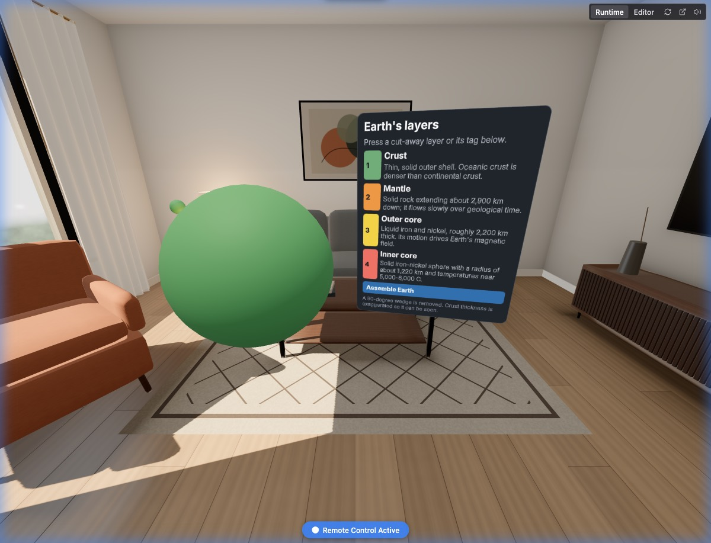</a> ✅ first try · 45 s · press ✓ · buttons 3/3 · **3.0/5** The sphere renders as a plain green ball with no visible cut-away wedge or internal layers, and there are no labels on the sphere itself, so the core visual request is unmet; the side panel lists the four layers with accurate facts and has numbered tags plus an 'Assemble Earth' button, but its small | <a href="../run-3-ember-max/gallery/muse-ember-1.0-max__earth-layers__0.jpg">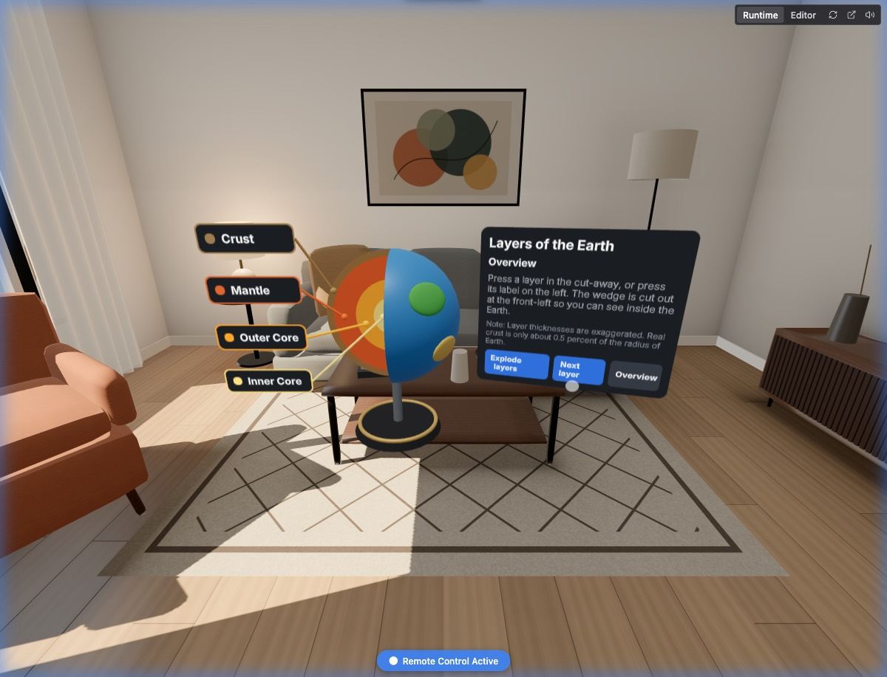</a> ✅ first try · 65 s · press ✓ · buttons 3/3 · **3.8/5** The globe shows a clear cross-section of crust, mantle, outer core and inner core, each with a leader-lined label, though the panel describes a front-left wedge while the model shows a half-sphere cut; the info panel's text is small and tilted, a cursor dot overlaps the 'Next layer' button, and the  |
| **T2** · photosynthesis “Explain photosynthesis with a small plant, the Sun, and labeled arrows for light, water, carbon dioxide and oxygen” | <a href="../run-4-fair/gallery/claude-sonnet-5-5__photosynthesis__0.jpg">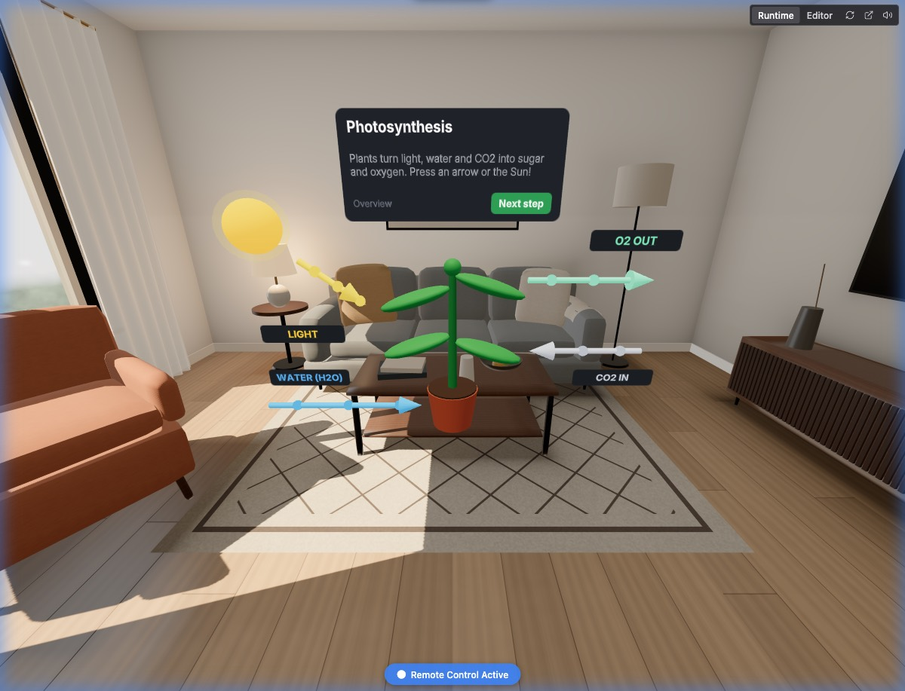</a> ✅ first try · 74 s · press ✓ · buttons 1/1 · **4.5/5** All requested elements are present: a potted plant, a glowing Sun, and colour-coded labeled arrows for light, water (H2O), CO2 in and O2 out with correct directions, plus an info panel with a Next step button and a prompt to press arrows or the Sun; the LIGHT label sits low near the side table and s | <a href="../run-4-fair/gallery/muse-spark-1.3__photosynthesis__0.jpg">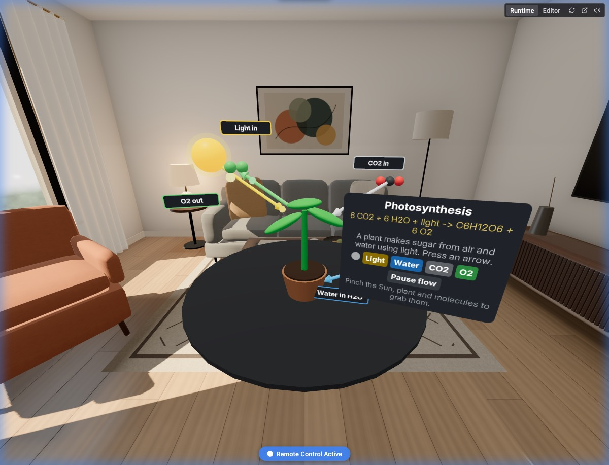</a> ✅ after 1 repair · 174 s · grab ✓ · press ✓ · buttons 3/3 · **4.0/5** Plant, Sun and labeled light/water/CO2/O2 arrows with molecule models are all present and the equation is correct, but the info panel overlaps the plant, the CO2 arrow and the 'Water in H2O' label, and the O2 molecules sit cluttered near the Sun; the toggle chips, Pause button and pinch hint invite  | <a href="../run-4-fair/gallery/deepseek-v4.1-flash__photosynthesis__0.jpg">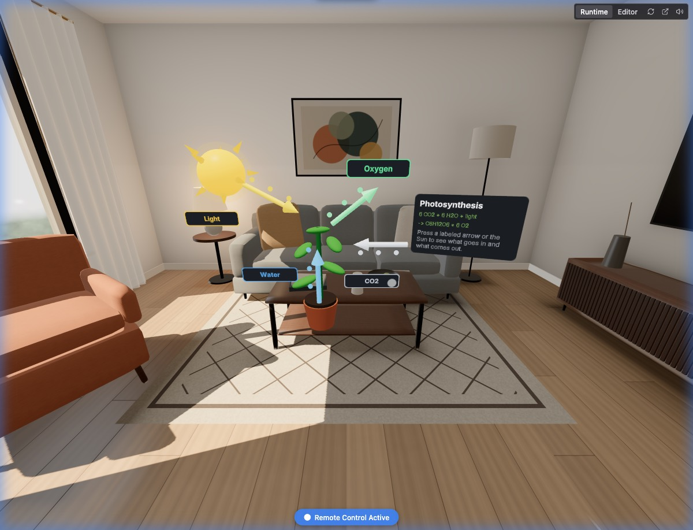</a> ✅ first try · 101 s · press ✓ · buttons 1/1 · **4.5/5** Sun, potted plant and four color-coded labeled arrows (light in, water up, CO2 in, oxygen out) plus a correct balanced equation panel fully cover the request, though the CO2 label partly overlaps the plant and has a stray circle icon, and the water label sits a bit apart from its arrow. | <a href="../run-4-fair/gallery/kimi-k3.1-pro-fw__photosynthesis__0.jpg">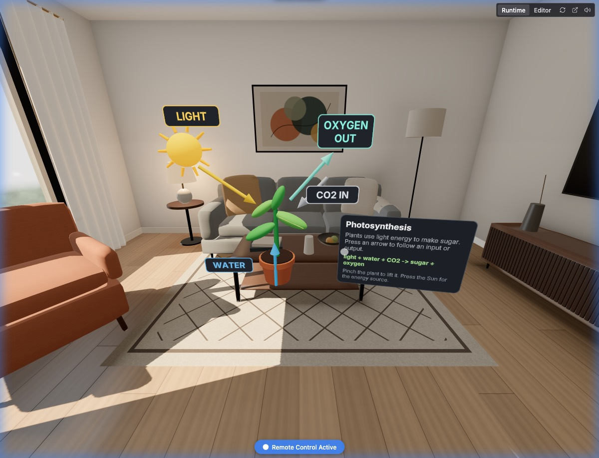</a> ✅ first try · 37 s · grab ✓ · press ✓ · **4.5/5** All requested elements are present: a potted plant, a Sun, and labeled arrows for light, water, CO2 in and oxygen out, plus an info panel with the correct equation; the panel is slightly tilted and its small text is a bit hard to read, the CO2 arrow is short and faint, and the interaction hints (pre | <a href="../run-3-ember-max/gallery/muse-ember-1.0-max__photosynthesis__0.jpg">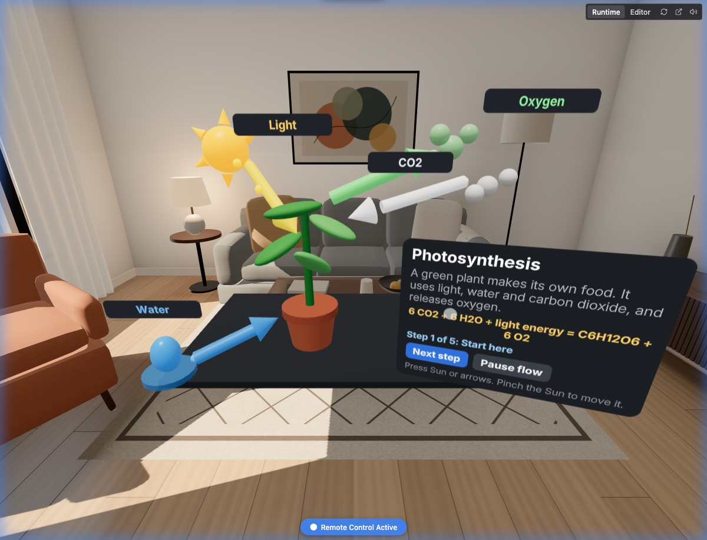</a> ✅ first try · 47 s · grab ✓ · press ✓ · buttons 2/2 · **3.8/5** The plant, Sun and labeled Light, Water, CO2 and Oxygen arrows are all present with a correct equation and clear Next step / Pause flow controls, but the CO2 label sits ambiguously between the green and white arrows and overlaps them, and a stray dot covers part of the equation. |
| **T2** · weather “A weather dashboard for three cities with an icon and the temperature for each” | <a href="../run-4-fair/gallery/claude-sonnet-5-5__weather__0.jpg">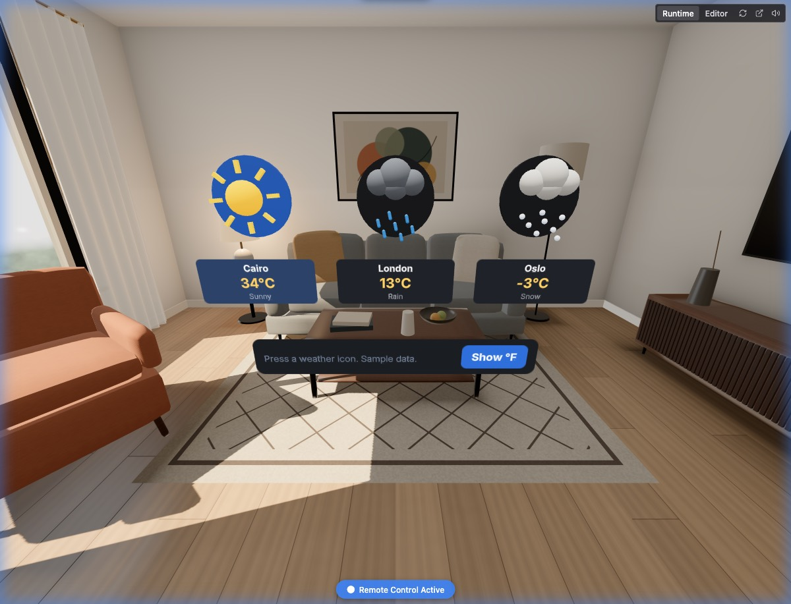</a> ✅ first try · 69 s · grab ✓ · press ✓ · buttons 0/1 · **4.5/5** Three clear city cards (Cairo, London, Oslo) with distinct sun, rain and snow icons and plausible temperatures, plus a °F toggle and a press hint; the small condition labels sit tight against the card bottoms and look slightly clipped. | <a href="../run-4-fair/gallery/muse-spark-1.3__weather__0.jpg">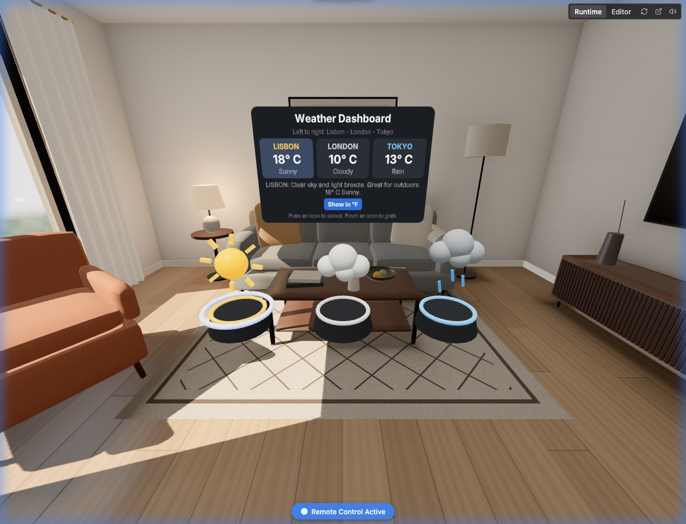</a> ✅ first try · 94 s · grab ✓ · press ✓ · buttons 0/1 · **4.8/5** The dashboard shows Lisbon, London and Tokyo, each with a temperature card and a matching 3D icon (sun, cloud, rain cloud) on a pedestal, plus a °F toggle and clear poke/pinch hints; the text is legible, though the small hint and subtitle text is faint and the floating icons sit somewhat apart from  | <a href="../run-4-fair/gallery/deepseek-v4.1-flash__weather__0.jpg">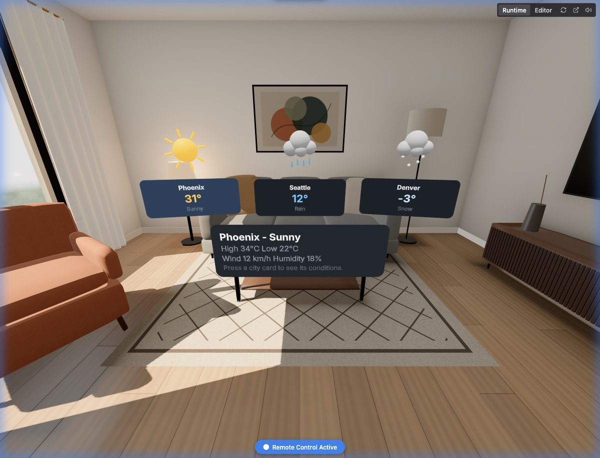</a> ✅ first try · 69 s · press ✓ · **4.5/5** Three curved city cards (Phoenix, Seattle, Denver) each have a fitting 3D weather icon and a plausible temperature, and the detail panel for the selected city is a nice extra; the small gray secondary text is somewhat faint, though the hint text and the highlighted card make the press interaction cl | <a href="../run-4-fair/gallery/kimi-k3.1-pro-fw__weather__0.jpg">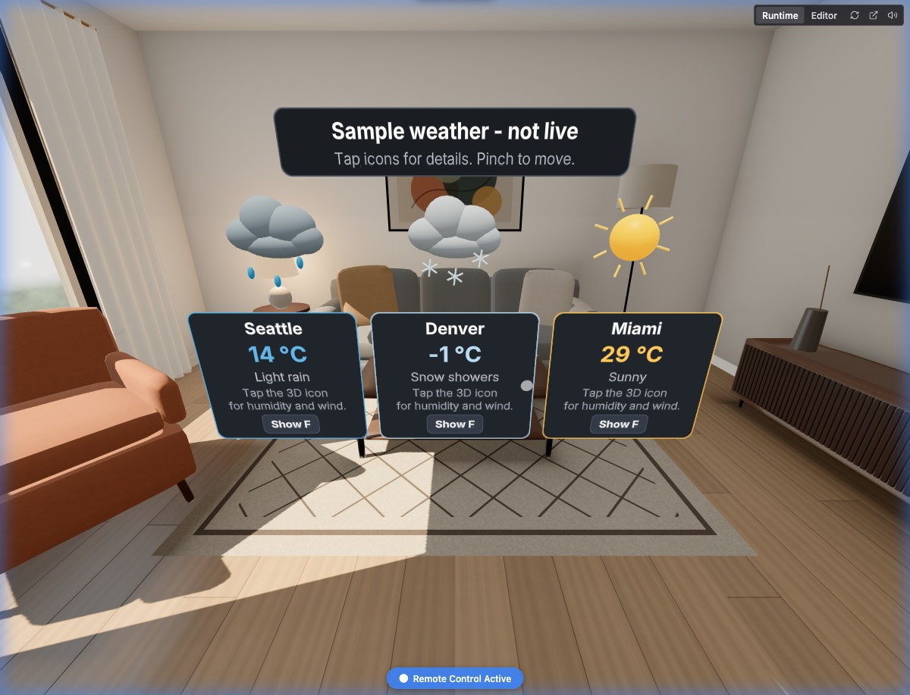</a> ✅ first try · 177 s · grab ✓ · press ✓ · buttons 1/1 · **4.5/5** Three city cards (Seattle, Denver, Miami) each pair a fitting 3D weather icon with a plausible temperature, under a header honestly marking the data as sample; the side cards are angled, Miami's text is italic and slightly skewed, and a small stray grey dot sits between the Denver and Miami cards, b | <a href="../run-3-ember-max/gallery/muse-ember-1.0-max__weather__0.jpg">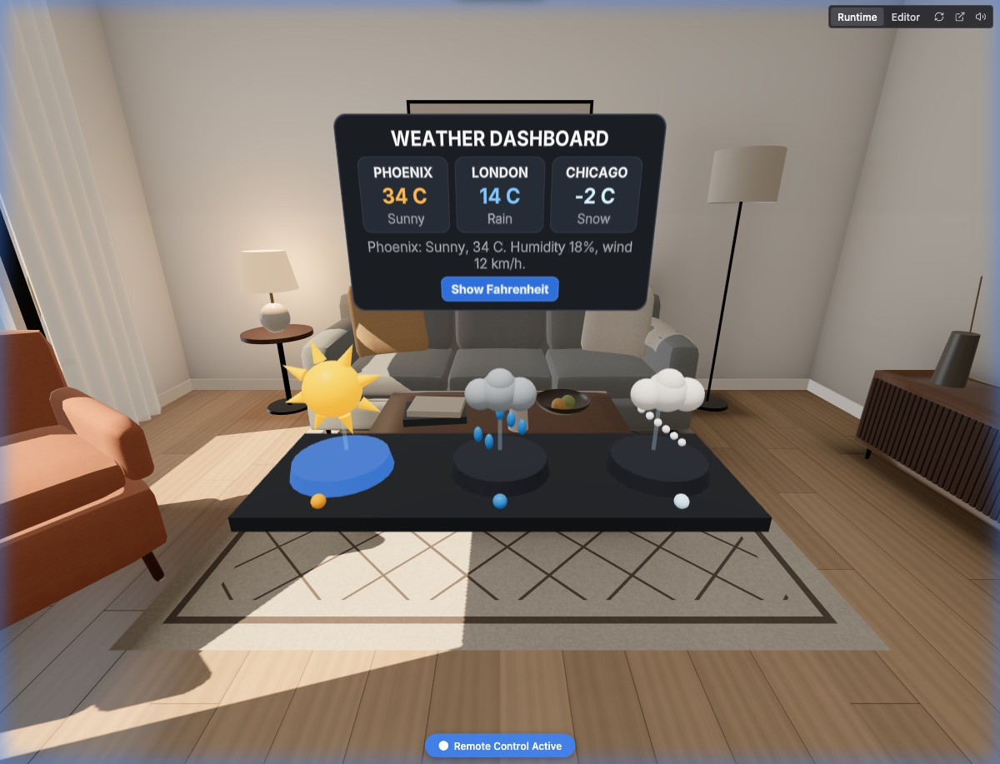</a> ✅ first try · 33 s · press ✓ · buttons 1/1 · **4.5/5** Three cities each get a 3D weather icon on a pedestal and a clear temperature card, with plausible values and a highlighted selected Phoenix pedestal; the temperatures read '34 C' without a degree sign, and the Fahrenheit toggle and selectable pedestals invite interaction, though the small colored d |
| **T2** · coffee-mug “A coffee mug I can pick up, with a card showing its price and what it is made of” |  ✅ first try · 12 s · grab ✓ · buttons 1/1 · **3.8/5** A mug on a saucer comes with a card showing the price ($14.00) and material (glazed stoneware), but a steam-puff element overlaps the material text, and apart from the 'Next detail' button nothing signals that the mug can be grabbed. | <a href="../run-4-fair/gallery/muse-spark-1.3__coffee-mug__0.jpg">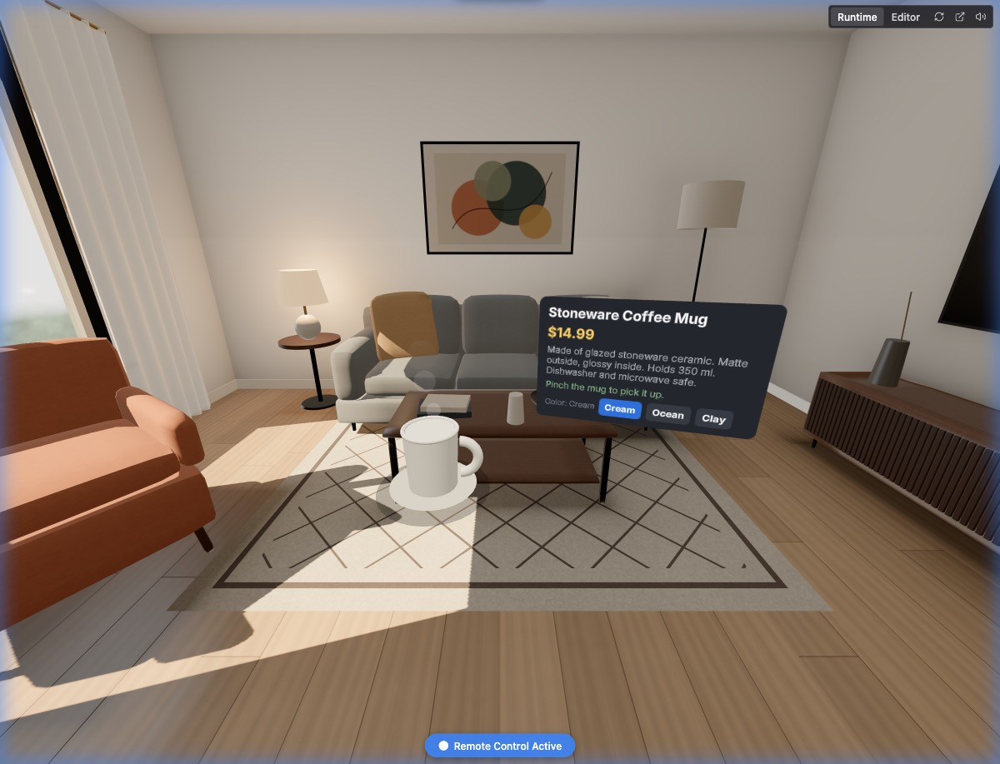</a> ✅ first try · 64 s · grab ✓ · press ✓ · buttons 3/3 · **4.5/5** A cream mug on a saucer sits beside a tidy, legible card that gives the name, a $14.99 price, a stoneware material description and color buttons; the card floats slightly away from the mug and the small gray 'Color: Cream' label is low-contrast, but a 'Pinch the mug to pick it up' hint and clear but | <a href="../run-4-fair/gallery/deepseek-v4.1-flash__coffee-mug__0.jpg">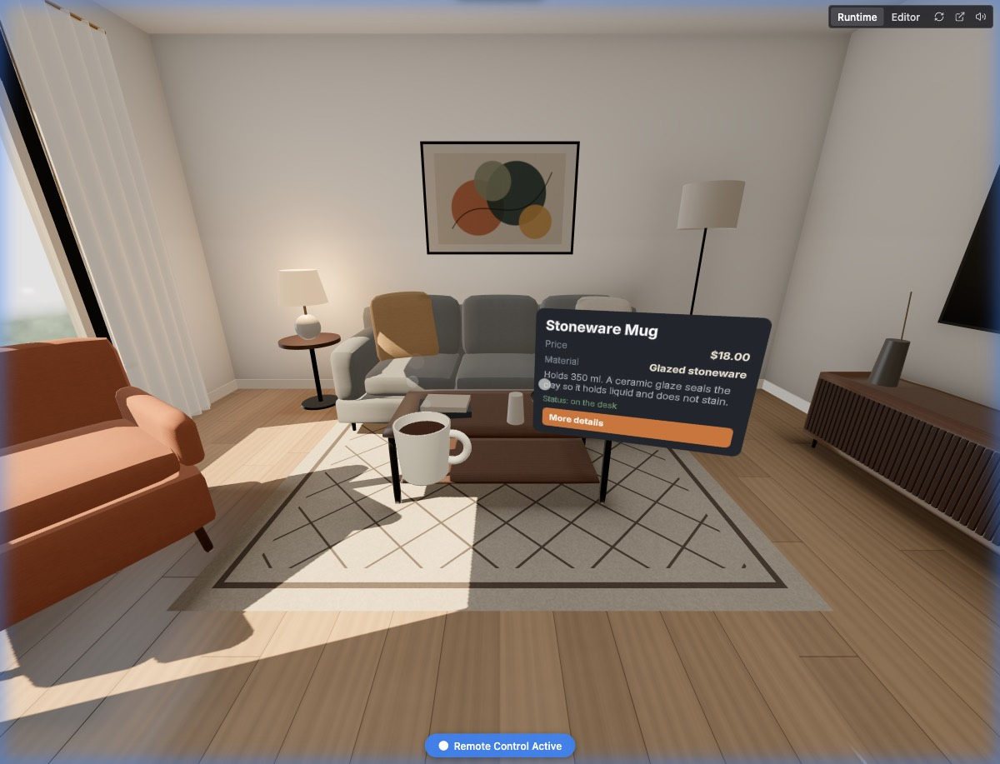</a> ✅ first try · 30 s · grab ✓ · buttons 1/1 · **3.5/5** A mug and a tilted info card show the price and material as requested, but a stray dot covers part of the description text, the status reads 'on the desk' though the mug sits on a coffee table, and the mug has no visible grab cue beyond the 'More details' button. | <a href="../run-4-fair/gallery/kimi-k3.1-pro-fw__coffee-mug__0.jpg">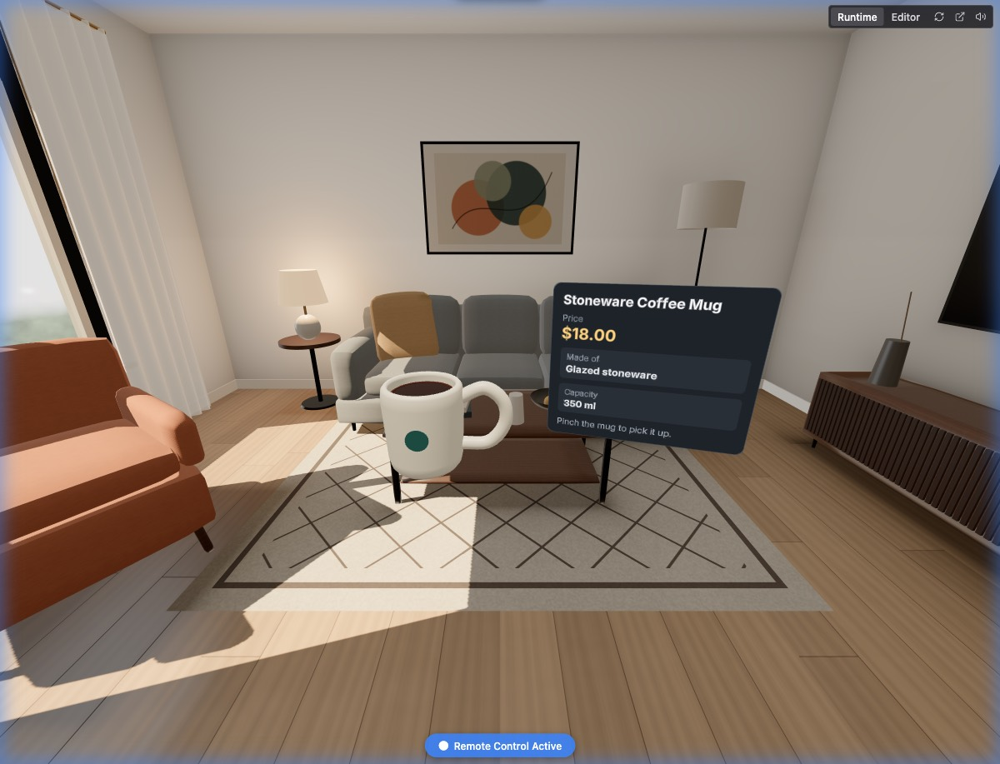</a> ✅ first try · 85 s · grab ✓ · **4.5/5** A clear mug model sits beside a legible card showing the price, material and capacity with a pinch hint, though the card is slightly tilted and partly overlaps the room furniture, and the mug itself has no visible grab affordance beyond the text. | <a href="../run-3-ember-max/gallery/muse-ember-1.0-max__coffee-mug__0.jpg">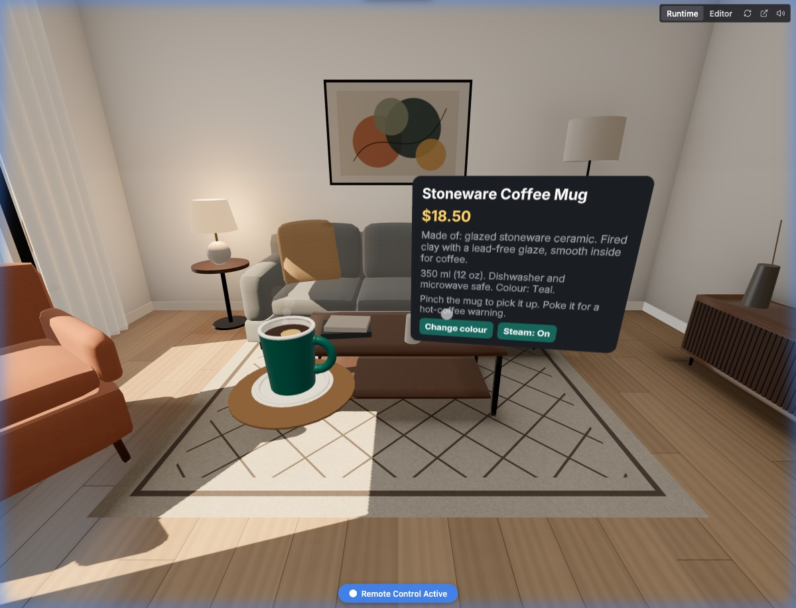</a> ✅ first try · 15 s · grab ✓ · press ✓ · buttons 2/2 · **4.5/5** A teal mug on a saucer comes with a legible info card giving the price, the stoneware material, capacity and pinch-to-pick-up instructions, plus colour and steam buttons; the card is slightly tilted, a pointer dot overlaps its text, and the mug itself has no grab affordance beyond the written hint. |
| **T3** · times-tables “A multiplication quiz with 5 questions, answer buttons, and a running score” | <a href="../run-4-fair/gallery/claude-sonnet-5-5__times-tables__0.jpg">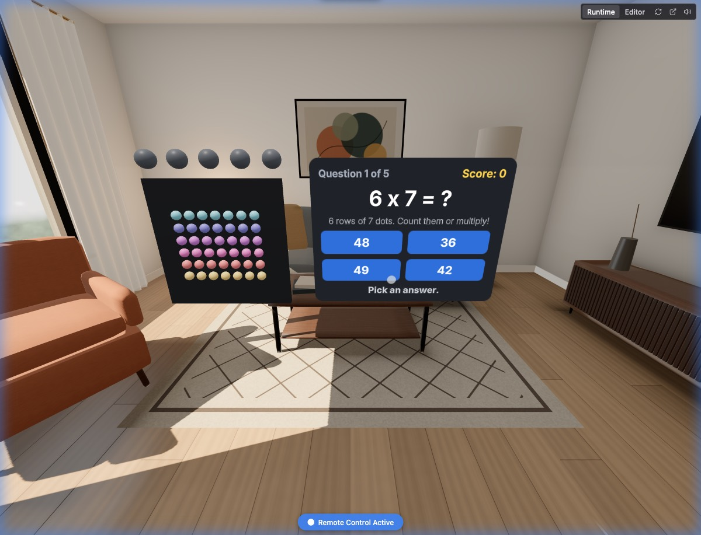</a> ✅ first try · 42 s · grab ✓ · buttons 3/3 · **4.8/5** A clean multiplication quiz showing 'Question 1 of 5', a running score, four large blue answer buttons including the correct 42, a matching 6×7 dot array and five progress orbs; the slightly skewed perspective is the only minor blemish. | <a href="../run-4-fair/gallery/muse-spark-1.3__times-tables__0.jpg">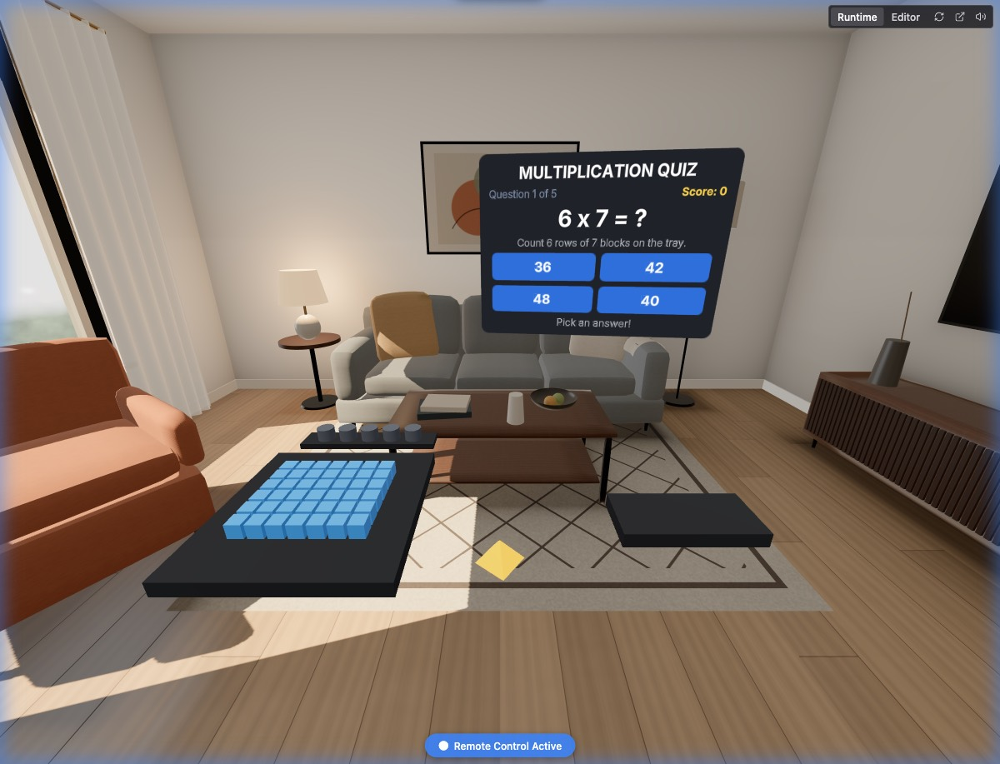</a> ✅ first try · 142 s · grab ✓ · buttons 3/3 · **4.5/5** A clean quiz panel shows 'Question 1 of 5', a running score, the 6x7 problem with four clear answer buttons including the correct 42, and a hint tied to a block tray; however, the purpose of the extra dark slab and the cylinder row is unclear. | <a href="../run-4-fair/gallery/deepseek-v4.1-flash__times-tables__0.jpg">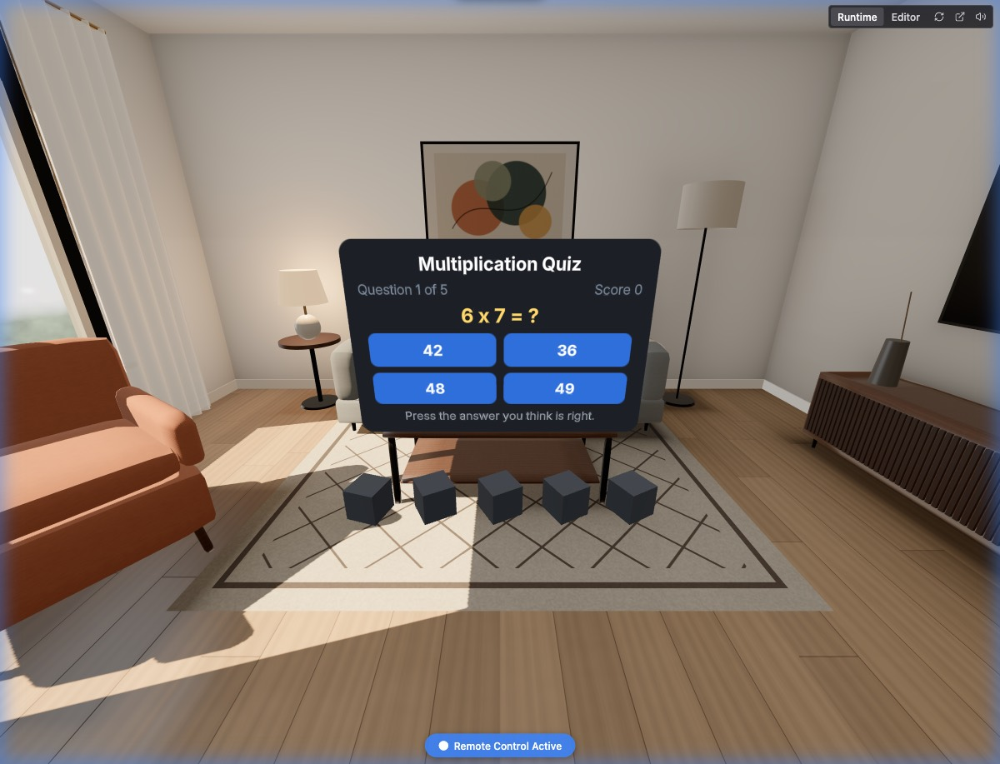</a> ✅ first try · 45 s · buttons 3/3 · **4.3/5** A clean quiz panel shows question 1 of 5, the correct answer option 42 for 6x7, four clear blue answer buttons and a score counter, though the five unlabeled dark cubes below (likely progress markers) are ambiguous and the button grid is slightly misaligned. | <a href="../run-4-fair/gallery/kimi-k3.1-pro-fw__times-tables__0.jpg">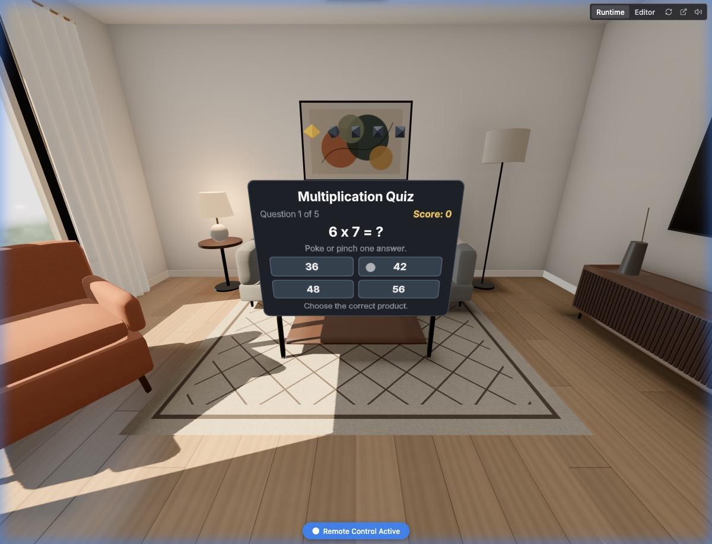</a> ✅ first try · 79 s · buttons 3/3 · **4.5/5** A clean quiz panel shows question 1 of 5, a running score and four answer buttons with a correct option (42 for 6 x 7). A small grey dot overlaps the 42 button, which is slightly ambiguous: it could be a cursor or a selection marker. | <a href="../run-3-ember-max/gallery/muse-ember-1.0-max__times-tables__0.jpg">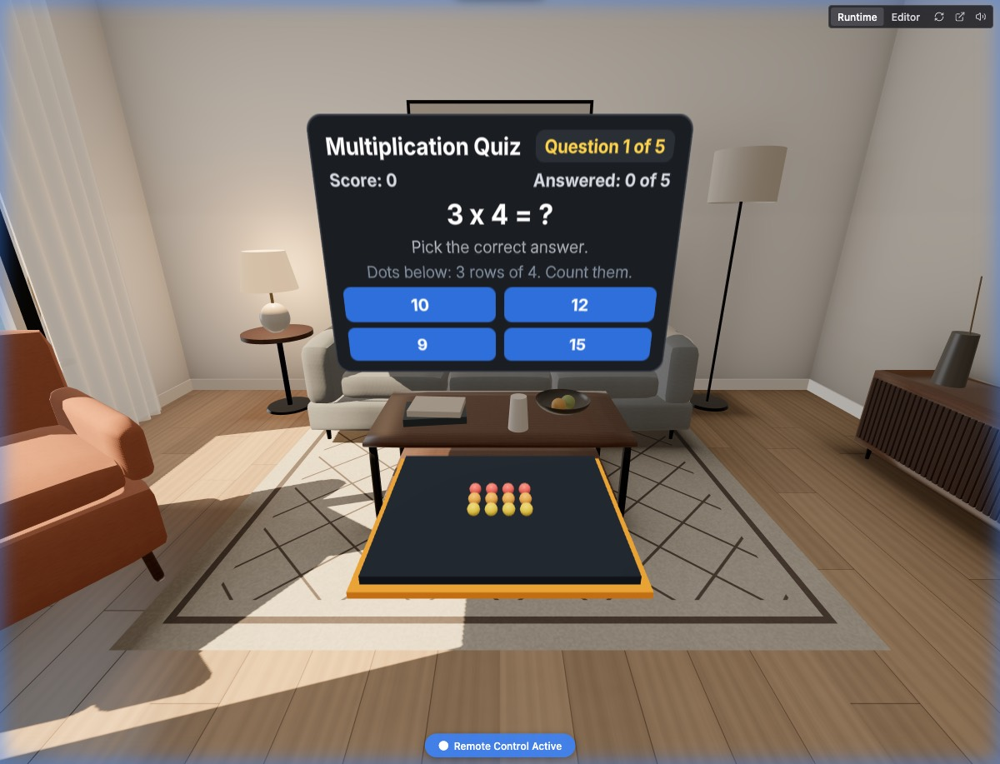</a> ✅ first try · 27 s · grab ✓ · buttons 3/3 · **4.5/5** The quiz panel clearly shows the title, a Question 1 of 5 badge, the score, the question 3 x 4 = ? and four large answer buttons, with a correct 3x4 dot-array aid on the table below; the panel is slightly tilted and the dot tray is detached from the main card, but text is legible and the buttons cle |
| **T3** · habit-tracker “A habit tracker for this week: 3 habits, tap a day to check it off, and show each habit's streak” | <a href="../run-4-fair/gallery/claude-sonnet-5-5__habit-tracker__0.jpg">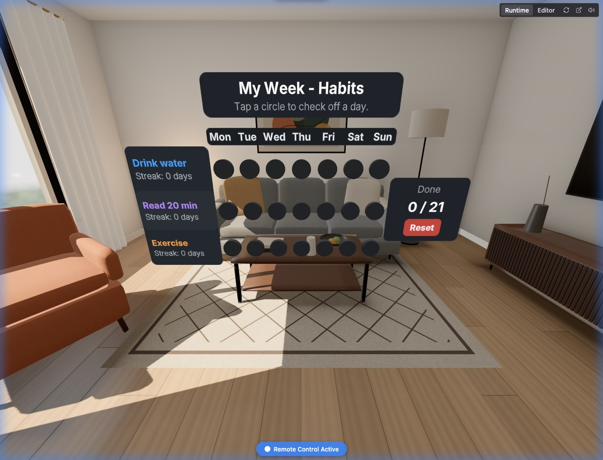</a> ✅ first try · 67 s · press ✓ · buttons 1/1 · **3.8/5** All requested parts are present: three habits, a Mon–Sun grid of tappable circles, per-habit streaks and a 0/21 counter. However, the circles float with no backing panel, sit over the busy sofa and table, and only loosely line up with the day headers and habit rows. The dark unfilled circles also gi | <a href="../run-4-fair/gallery/muse-spark-1.3__habit-tracker__0.jpg">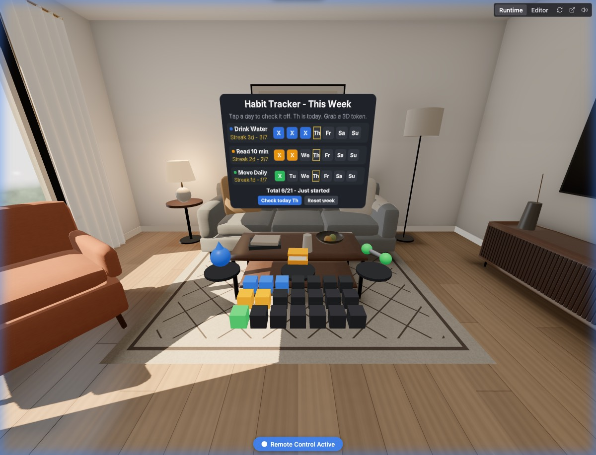</a> ✅ first try · 126 s · grab ✓ · press ✓ · buttons 3/3 · **4.5/5** All three habits appear with tappable day buttons (today Th highlighted) and correct streak and total counts (3d, 2d, 1d; 6/21), mirrored by a matching 3×7 cube grid and grabbable 3D tokens; the panel text is small, and checked days show 'X' instead of their day label. | <a href="../run-4-fair/gallery/deepseek-v4.1-flash__habit-tracker__0.jpg">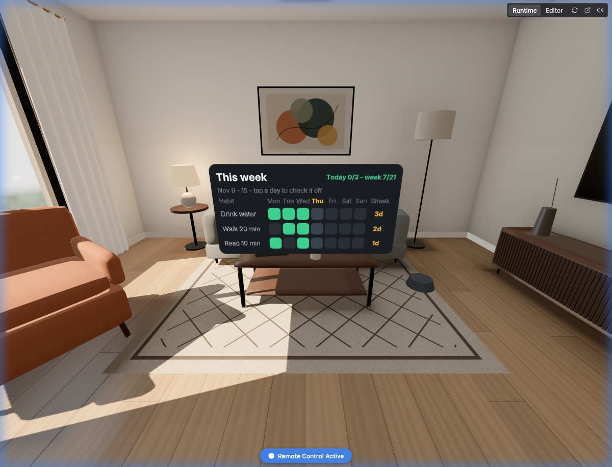</a> ✅ first try · 63 s · buttons 3/3 · **4.5/5** Shows three habits with a Mon–Sun grid, today (Thu) highlighted, and per-habit streaks that match the checked days (3d, 2d, 1d), plus correct totals (0/3 today, 7/21 week); the panel is tidy but small with fairly tiny text, and the unchecked cells read as tappable only thanks to the 'tap a day' hint | <a href="../run-4-fair/gallery/kimi-k3.1-pro-fw__habit-tracker__0.jpg">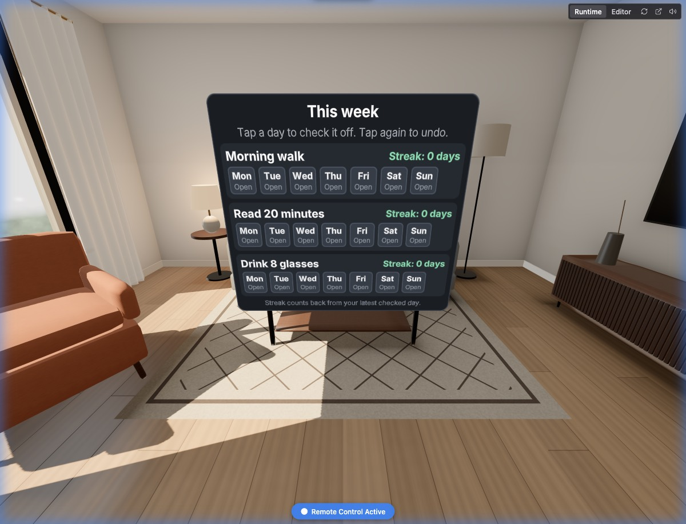</a> ✅ first try · 94 s · buttons 3/3 · **4.0/5** Three habits with seven tappable day buttons and streak labels match the request, but the panel tapers oddly toward the bottom so the day rows sit at uneven widths, the 'Open' sublabels and footer text are small and low-contrast, and every day is unchecked, so no checked state is shown. | <a href="../run-3-ember-max/gallery/muse-ember-1.0-max__habit-tracker__0.jpg">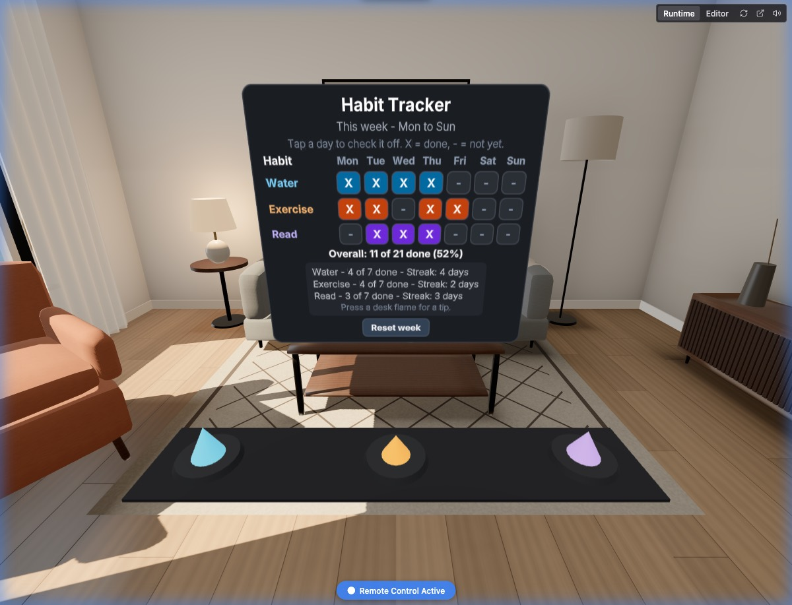</a> ✅ first try · 32 s · press ✓ · buttons 3/3 · **4.5/5** Shows all three habits with a tappable Mon–Sun grid and accurate per-habit counts, streaks and the 11/21 (52%) total, though the summary lines are slightly misaligned and the extra desk 'flame' objects are ambiguous as controls. |
| **T3** · build-water “Build a molecule: hydrogen and oxygen atoms I can grab, and a check button that tells me whether I built water” | <a href="../run-4-fair/gallery/claude-sonnet-5-5__build-water__0.jpg">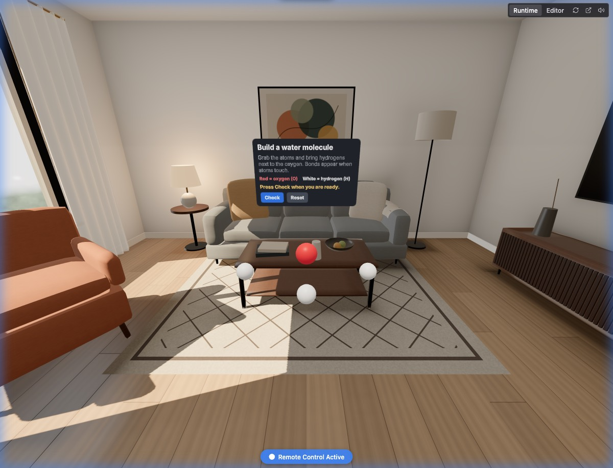</a> ✅ first try · 51 s · grab ✓ · buttons 2/2 · **4.0/5** A red oxygen sphere and three white hydrogen spheres float near the coffee table, with a legible instruction panel holding Check and Reset buttons; the spare hydrogen makes the task non-trivial, but the atoms are small, unlabeled and have no grab affordance, and the panel text is a bit small. | <a href="../run-4-fair/gallery/muse-spark-1.3__build-water__0.jpg">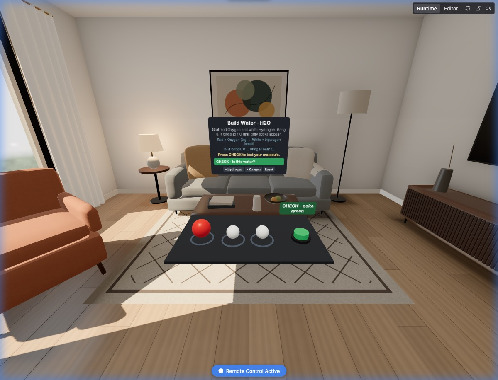</a> ✅ first try · 169 s · grab ✓ · press ✓ · buttons 3/3 · **4.0/5** A red oxygen sphere, two white hydrogen spheres on rings and a green 3D check button cover the request, but the instruction panel's text is small and dense with low-contrast blue lines, and its floating placement overlaps the wall art. |  ✅ first try · 63 s · grab ✓ · buttons 2/2 · **4.0/5** A red oxygen, two white hydrogens, two bond-target rings and a panel with Check and Reset buttons cover the request, but the objects are small and far away, the panel text is tiny and slightly skewed, and the rings are faint against the rug. |  ✅ first try · 230 s · grab ✗ · buttons 2/2 · **4.5/5** Delivers the request: a tray with three white H and two red O spheres, a translucent blue build-zone cylinder, and a panel with accurate water facts (2 H + 1 O, bent near 104.5°) plus Check molecule and Reset buttons; the panel's small text is slightly hard to read and the atoms carry no grab afford |  ✅ first try · 23 s · grab ✓ · buttons 2/2 · **3.5/5** Grabbable red oxygen and white hydrogen spheres sit beside a faint target ring with ghost dots, and the panel has Check molecule and Reset atoms buttons, but the intro line is garbled where the colored 'oxygen (O)' / '2 hydrogens (H)' spans overlap the sentence, the atoms float scattered in front of |
| **T3** · fruit-basket “Three fruits I can pick up and drop into a basket, with a running total price of what is in the basket” |  ✅ first try · 62 s · grab ✓ · buttons 1/1 · **4.5/5** Three recognizable 3D fruits, a basket and a price panel showing per-item prices, status and a $0.00 total are all present and consistent, though the fruits float somewhat oddly over the rug, the panel's small grey 'on table' text is faint, and there are no grab affordances on the fruits themselves  |  ✅ first try · 75 s · grab ✓ · buttons 1/1 · **4.5/5** Three recognizable fruits, a basket on the table and a panel listing prices with a $0.00 total and reset button all match the request; the panel's small text is a bit dense and the fruits floating near the floor have no grab cues beyond their 3D presence. |  ✅ first try · 76 s · grab ✓ · buttons 1/1 · **4.5/5** Three well-modeled fruits, a woven basket and a price panel with a $0.00 total and an Empty basket button cover the request with plausible prices, though the panel text is small and the instruction line is faint at this distance. |  ✅ first try · 169 s · grab ✓ · buttons 1/1 · **4.5/5** Three recognizable fruits (apple, orange, banana), a woven basket, and a panel with prices, a running total of $0.00 and an empty-basket button all match the request; the panel text is small but legible, and while the fruits look grabbable there are no hover or affordance cues beyond the written ins |  ✅ first try · 24 s · grab ✓ · buttons 1/1 · **4.5/5** Three recognizable 3D fruits on a tray, an open crate basket, and a panel with prices, basket contents and a $0.00 total match the request well, though the price line wraps awkwardly, the panel partly occludes the sofa area, and the fruits lack per-item price labels or grab affordances beyond the in |

<b>Repetition 2</b> (same requests, run again)

| Request | claude-sonnet-5-5 | muse-spark-1.3 | deepseek-v4.1-flash | kimi-k3.1-pro-fw | muse-ember-1.0-max |
|---|---|---|---|---|---|
| **T1** · color-button “A glowing button that changes to a new color each time I press it” |  ✅ first try · 10 s · press ✓ · **4.8/5** A glowing pink 3D push button on a dark base sits in front of the user, with a small panel showing the title, a press instruction and the current color name 'Magenta', which matches the button; the panel is legible but slightly overlaps the sofa backdrop and the button partly hides the coffee table. |  ✅ first try · 49 s · press ✓ · buttons 1/1 · **4.5/5** A 3D glowing red button on a dark base with a red ring sits in front of the user, and a tidy panel shows the current color, a press count and a Reset control. The Reset button is a flat, left-aligned label that reads more like text than a pressable button. The glow is subtle, and the button floats s |  ✅ first try · 17 s · press ✓ · **4.3/5** A large red physical-style button sits near the coffee table with a panel showing the color name 'Crimson', the press count and the instructions, though the glow effect is subtle and the button partly overlaps the table edge. |  ✅ first try · 92 s · press ✓ · **4.3/5** A cyan dome button on a pedestal with a dark info panel naming the current color and the press count clearly matches the request, though the glow is subtle and the panel sits slightly close to the button. |  ✅ first try · 14 s · press ✓ · buttons 0/1 · **4.8/5** A large, glowing sky-blue dome button with a halo and particles sits in front of the user, with a tidy panel showing the current color, press count and a fallback Change color button; the dome slightly overlaps the coffee table, and the panel's top edge covers part of the wall art. |
| **T1** · dna-helix “A DNA double helix I can pick up and turn around” |  ✅ first try · 37 s · grab ✓ · buttons 2/2 · **4.3/5** A clear, colorful double helix with backbones and color-coded base pairs floats above the table, and a tidy side panel gives a correct A–T/G–C explanation, pinch-to-grab instructions and Next fact / Spin buttons; however, the helix lacks a visible grab handle or affordance, and the panel's small tex |  ✅ first try · 115 s · grab ✓ · buttons 2/2 · **4.3/5** A clear 3D double helix with two beaded backbones, color-coded base pairs and a highlighted selected pair, paired with an accurate info panel (A–T with 2 H-bonds, about 10 pairs per turn, a color legend) and Spin and Next pair buttons; the pinch-to-lift hint is small and the helix has no visible gra |  ✅ first try · 57 s · grab ✓ · buttons 0/2 · **4.0/5** A recognizable double helix with colored base-pair rungs, accurate facts and an A/T/G/C legend, plus a pinch-to-lift hint and Next fact / Spin buttons; it lacks a visible grab affordance on the helix itself, the panel's small subtitle text is low-contrast, and the rungs don't clearly show complement |  ✅ first try · 178 s · grab ✓ · buttons 0/3 · **4.5/5** A colorful 3D double helix with base-pair rungs comes with a tidy, legible info panel offering pinch-to-grab instructions, a color key, filter buttons, Next fact and Reset pose; the backbones look a bit chunky and the helix handedness is hard to verify, and the panel text is slightly small. |  ✅ first try · 28 s · grab ✓ · buttons 3/3 · **4.8/5** A clear double helix with white backbones and colored base-pair rungs sits on a pedestal with a selection ring, and an info panel explains the pinch-to-grab interaction with accurate base-pairing facts and clear buttons; the small text on the angled panel is slightly dense, and the yellow cone on to |
| **T1** · desk-clock “A small desk clock that shows the current hours and minutes” |  ✅ first try · 24 s · grab ✓ · buttons 1/1 · **4.3/5** A desk-style analog clock on a stand sits beside a digital 'Local time 7:46' panel whose reading matches the hands, but the panel crowds the clock face and the small 'Show 24 h' button is the only obvious interactive element. |  ✅ first try · 109 s · grab ✓ · press ✓ · buttons 2/2 · **4.3/5** A boxy analog desk clock with a tilted digital panel showing 7:48:55 PM, the date, and 24H/hide-seconds buttons fully covers the request, though the analog hands (especially the red second hand) don't clearly match the digital time, the panel crowds the clock's edge, and the hint text is small. |  ✅ first try · 44 s · grab ✓ · buttons 1/1 · **4.5/5** A clean analog desk clock on a stand whose hands match the 19:52 digital readout, with a correct date and a clear 12-hour toggle button; the angled info panel's small hint text is slightly hard to read, and the clock's grab affordance relies only on that text hint. |  ✅ first try · 172 s · press ✓ · buttons 1/1 · **4.5/5** A clear analog desk clock with a digital 19:55 readout whose hands correctly agree; it offers a visible 12/24-hour toggle button with an instruction line, though the clock's dark base slab awkwardly intersects the coffee table and the hint text is small. |  ✅ first try · 18 s · grab ✓ · press ✓ · buttons 1/1 · **4.0/5** A 3D analog desk clock with a matching digital panel (7:01 PM, correct weekday for the date) fulfills the request, though the hour hand is hard to distinguish from the red second hand, the pointer dot slightly covers the button label, and the clock's grabbability relies on the instruction text. |
| **T1** · desk-lamp “A desk lamp I can switch on and off by pressing it” |  ✅ first try · 34 s · press ✓ · buttons 0/1 · **4.3/5** A recognizable green-shaded articulated desk lamp with a red switch block and a tidy status panel showing 'Light is OFF' and a clear 'Turn on' button, though the lamp floats oddly in front of the coffee table with no desk under it, and the panel slightly overlaps the room scene. |  ✅ first try · 92 s · grab ✗ · press ✓ · buttons 0/1 · **4.3/5** A recognizable desk lamp with a translucent warm light cone, a green switch nub, and an info panel showing an ON status with a Switch OFF button fully covers the request; the lamp looks somewhat crude and floats over the coffee table, the panel slightly overlaps scene furniture, and the Switch OFF b |  ✅ first try · 36 s · press ✓ · buttons 1/1 · **4.0/5** A recognizable desk lamp with a highlighted round base switch and a companion panel showing an OFF state and a 'Switch on' button clearly invites pressing, but the lamp floats awkwardly over the coffee table, its shade clips into the sofa behind it, and the panel's button text sits tight against its |  ✅ first try · 106 s · press ✓ · buttons 0/1 · **4.0/5** A recognizable green desk lamp with a lit bulb, light cone, base switch and an info panel showing 'Light: ON' with a 'Switch off' button fulfills the request, but the panel is tilted and its instruction text is slightly clipped by the button, and the lamp floats ambiguously in front of the coffee ta |  ✅ first try · 23 s · press ✓ · buttons 3/3 · **4.3/5** A recognizable articulated desk lamp sits on a desk with an orange switch button and a clear info panel with Turn on, Turn off and Brightness buttons; the panel slightly overlaps the lamp shade area, and the orange base button reads more like a ball than a switch. |
| **T2** · earth-layers “Show the layers of the Earth as a cut-away sphere with a label for each layer” |  ✅ first try · 52 s · grab ✓ · buttons 3/3 · **4.3/5** A cut-away globe clearly shows crust, mantle, outer core and inner core, and the layer facts are accurate (crust 5–70 km), but the labels sit in a separate colour-keyed side panel rather than on the sphere. The panel's detail text is small, and the globe offers only the pinch-to-turn hint and no vis |  ✅ after 1 repair · 298 s · grab ✓ · buttons 3/3 · **3.8/5** A well-made cut-away sphere with five labeled layers, leader lines, plausible depth ranges and an info panel with Prev/Next/Spin buttons, but the info panel overlaps and clips the Inner Core label, the exterior shell is a plain beige with no Earth surface, and the crust's 0-400 C temperature is a bi |  ✅ first try · 150 s · grab ✓ · buttons 3/3 · **4.0/5** A cut-away sphere with nested core and mantle layers sits beside a panel listing five color-keyed layers (inner core, outer core, lower and upper mantle, crust) and a correct 6,371 km radius; however, the labels are a legend panel rather than labels on the sphere itself, the panel's footer text is s |  ✅ first try · 586 s · grab ✓ · buttons 1/1 · **4.0/5** A cut-away globe with crust, mantle, outer core and inner core labels connected by leader lines in the correct order, plus an instruction panel inviting the user to press labels and pinch-drag the globe; the crust is barely visible as a thin edge, the globe is a plain green with no continents, and t |  ✅ first try · 62 s · grab ✓ · press ✓ · buttons 3/3 · **4.8/5** A clear cut-away globe on a stand with four labelled layers carrying accurate depth ranges, Show buttons and Show all / Reset view controls; however, stray leader lines run up through the title panel to the top of the view, and the labels are slightly tilted and crowded. |
| **T2** · photosynthesis “Explain photosynthesis with a small plant, the Sun, and labeled arrows for light, water, carbon dioxide and oxygen” |  ✅ first try · 79 s · press ✓ · buttons 3/3 · **4.3/5** Plant, Sun, and four colored labeled arrows are all present with an info panel and buttons; however, the labels sit somewhat detached from their arrows (Water label far left, CO2 label below its arrow), the equation shows unbalanced water (6 H2O on the left but no water product, which is the common  |  ✅ first try · 132 s · grab ✓ · press ✓ · buttons 0/2 · **3.8/5** The plant, Sun and four labeled arrows are all present, and the balanced equation is correct, but the oxygen and CO2 molecule models overlap the info panel, hiding part of the title and the instruction text, and an odd brown block sits behind the light arrow; the Light toggle, Next fact button and p |  ✅ first try · 108 s · press ✓ · buttons 2/2 · **4.5/5** Includes the plant, Sun, and all four labeled arrows pointing the correct ways (light, water and CO2 in, O2 out), plus an info panel with a clear 'Show equation' button; the floating labels are a bit small and the CO2 label partly overlaps the room's lamp, and the arrows' tappability is stated in te |  ✅ first try · 291 s · press ✓ · buttons 1/1 · **4.5/5** All requested elements are present: a potted plant with roots, the Sun, and colored arrows labeled light energy, water, carbon dioxide and oxygen, plus a panel with the correct balanced equation; the labels are slightly small and the tilted panel crowds the plant, but the 'press an arrow, the Sun or |  ✅ first try · 31 s · grab ✓ · press ✓ · buttons 3/3 · **4.0/5** The plant, Sun and labeled arrows for light, water, CO2 and oxygen are all present, along with a correct simplified equation panel and Back/Next/Pause buttons plus a press hint; however, the CO2 arrow is mostly hidden behind its label and the leaves, and the labels float somewhat loosely around the  |
| **T2** · weather “A weather dashboard for three cities with an icon and the temperature for each” |  ✅ first try · 42 s · press ✓ · buttons 2/2 · **4.5/5** Three cities each get a clear 3D weather icon on a pedestal and a temperature label, with a highlighted London selection, a consistent detail panel and a °F toggle; the condition sub-labels are small and low-contrast, and the pedestals' pressability relies mainly on the blue selected state. |  ✅ first try · 80 s · grab ✓ · press ✓ · buttons 0/2 · **4.3/5** Three city stations with sun, rain-cloud and snow-cloud icons plus temperatures and a detail panel deliver the request, and 32°C ≈ 90°F is correct, but the support poles and rain streaks cut through the small city labels (London's '14°C' and 'RAIN' are partly hidden), while the glowing bases, button |  ✅ first try · 71 s · press ✓ · buttons 1/1 · **4.5/5** Three city cards (Lisbon, Seattle, Tokyo) each show a fitting 3D weather icon and temperature, with a detail panel and °F toggle; text is legible and the layout tidy, though the small condition labels are faint and the cards' pressability relies mostly on the hint text and the highlighted selection. |  ✅ first try · 155 s · press ✓ · buttons 3/3 · **4.0/5** All three cities have a matching 3D weather icon, temperature and condition, with a selectable highlighted card, a unit toggle and a tap hint; however, the icons float well above the panel, so they read as detached from their cards, and the sun sits directly over the wall painting, making it visuall |  ✅ first try · 42 s · press ✓ · buttons 1/1 · **4.5/5** Three cities each have a clear 3D weather icon and a plausible temperature with conditions, plus a prominent Fahrenheit toggle; the main info panel slightly overlaps the base slab and stands, and the icons' pressability relies on the instruction text rather than visual affordances. |
| **T2** · coffee-mug “A coffee mug I can pick up, with a card showing its price and what it is made of” |  ✅ first try · 14 s · grab ✓ · buttons 3/3 · **4.5/5** A mug filled with coffee sits on a round base next to a legible card showing the name, $14.90 price and a stoneware material description with Material/Size/Care tabs, though the mug has no visible grab cue and the card's description text is somewhat small. |  ✅ first try · 42 s · grab ✓ · buttons 3/3 · **4.5/5** A clean 3D cream mug on a wooden coaster is paired with a legible card showing the name, price, stoneware material, capacity and a 'Pinch the mug to pick it up' hint, but the card is tilted, floats somewhat far from the mug, and its small secondary text is low contrast. |  ✅ first try · 38 s · grab ✓ · press ✓ · buttons 1/1 · **4.0/5** A believable coffee mug sits beside a card showing the name, price ($14.00), stoneware material and a correct 350 ml (12 oz) capacity, with a Next detail button and a pinch hint; however, the card is strongly skewed, its small grey labels and hint are faint, and a cursor dot overlaps the 'Detail' la |  ✅ first try · 96 s · grab ✓ · buttons 1/1 · **4.5/5** A teal mug with saucer and steam sits beside a clean card showing the $18.00 price, glazed stoneware material, a care-details button and a pinch-to-lift hint. The mug floats somewhat oddly in front of the coffee table rather than resting on it, and the card's small hint text is a bit faint. |  ✅ first try · 19 s · grab ✓ · buttons 3/3 · **4.8/5** A detailed mug with saucer and steam sits on a wooden tray next to a legible product card showing name, $18.50 price and stoneware material, with pick-up instructions and clear buttons; the card is slightly tilted and densely packed, and the text sits close to its edges. |
| **T3** · times-tables “A multiplication quiz with 5 questions, answer buttons, and a running score” |  ✅ first try · 32 s · buttons 3/3 · **4.8/5** A clean times-tables quiz panel shows the correct 6x7 question with four clear blue answer buttons, a 'Question 1 of 5' indicator, a running score, an interaction hint and five progress spheres, though the spheres sit low and overlap the coffee table, which slightly hurts tidiness. |  ✅ first try · 124 s · grab ✓ · press ✓ · buttons 3/3 · **4.5/5** Shows a clear 'Question 1 of 5' panel with 3 x 4, four blue answer buttons, a running score, a 3x4 block array and five progress spheres; the buttons are slightly uneven and the small text is skewed, and the orange hint cube's X icon reads more like 'close' than 'hint'. |  ✅ first try · 32 s · buttons 3/3 · **4.3/5** Clean quiz panel with a correct 7x8 question, four clear answer buttons, a Score 0/5 counter, a 'Question 1 of 5' label and a Next button; however, five unlabeled dark cubes float detached above the panel (likely progress markers) with unclear meaning, and the footer text is small. |  ✅ first try · 181 s · buttons 3/3 · **4.3/5** A clean quiz panel shows question 1 of 5 (6 x 7) with four clearly pressable answer buttons, a running score, and five progress dots, but the large empty dark slab below the panel is unexplained and the 'Show groups' hint area appears to render nothing. |  ✅ first try · 37 s · grab ✓ · press ✓ · buttons 3/3 · **4.5/5** The panel delivers everything requested: 'Question 1 of 5', a running score, 6×7 with four answer buttons including the correct 42, and a 6×7 bead tray hint plus a five-tab progress block. The answer buttons are slightly misaligned with left-justified labels, and the link between the hint tray and t |
| **T3** · habit-tracker “A habit tracker for this week: 3 habits, tap a day to check it off, and show each habit's streak” |  ✅ first try · 78 s · press ✓ · buttons 1/1 · **4.3/5** All three habits have tappable day squares, streak labels and a done total, and the 12-of-21 count and streaks all match the checked days; however, the rows are staggered so columns don't line up with the day header, and the footer text wraps awkwardly. |  ✅ first try · 140 s · grab ✓ · press ✓ · buttons 3/3 · **4.3/5** Shows all three habits with tappable day chips, correct streaks and a 7/21 weekly total that matches the 3D progress stacks, and the grabbable shapes invite interaction; however, the panel text is small and some labels like 'Read 20 min' and '0 days' wrap awkwardly. |  ✅ first try · 48 s · press ✓ · buttons 3/3 · **4.5/5** Shows all three habits with a Mon–Sun tappable grid, today highlighted, and streaks (4, 3, 0) plus a 7-of-21 total that all match the checked cells; the text and cells are small, and the three colored spheres below are unlabeled, so their purpose and interactivity are unclear. |  ✅ first try · 119 s · buttons 3/3 · **4.3/5** All requested parts are present: 3 habits, a full week grid, per-habit streaks, a done counter and a clear button, but the layout is cramped, with the 'Open' labels filling their cells edge to edge, 'Move 20 min' wrapping into its streak line, uneven cell alignment between rows, and the footer text  |  ✅ first try · 31 s · grab ✓ · press ✓ · buttons 0/3 · **4.8/5** All three habits have a full week of tappable day cells, streaks and done counts that tally correctly (7 of 21), and colour-matched 3D pinch balls plus action buttons that invite interaction; minor layout issues include the Sun/Streak headers crowding, rows slightly misaligned and 'Move 20 min' wrap |
| **T3** · build-water “Build a molecule: hydrogen and oxygen atoms I can grab, and a check button that tells me whether I built water” |  ✅ first try · 54 s · grab ✓ · buttons 2/2 · **3.3/5** Red oxygen and white hydrogen spheres, a build ring and a panel with a green check button and a reset button are all present on the coffee table, but everything is very small and far away, so the panel text is barely legible and the atoms are tiny grab targets. |  ✅ first try · 131 s · grab ✓ · press ✓ · buttons 0/2 · **3.8/5** Grabbable red oxygen and white hydrogen spheres, a central build ring, green check and red reset blocks, and a panel with Check water and Reset buttons all deliver the request; however, the panel's instruction text is small and low-contrast, it overlaps the wall painting, and the oxygen spheres are  |  ✅ first try · 47 s · grab ✗ · buttons 1/1 · **4.0/5** Grabbable white hydrogen and red oxygen spheres, a blue assembly ring, and a panel with a 'Check molecule' button and an 'In the ring: 0 H, 0 O' counter cover the request, but the panel is small with tiny text, a cursor dot sits over the button label, and the ring is placed low on the floor away fro |  ✅ first try · 202 s · grab ✓ · buttons 2/2 · **4.0/5** Grabbable red O and two white H atoms sit on a tray with faint blue target rings, and a panel offers Check and Reset buttons; the panel text is small and the footer about the 104.5° bond angle is cramped and partly clipped, while the atoms are small and the H labels are slightly cut off. |  ✅ first try · 35 s · grab ✓ · press ✓ · buttons 3/3 · **4.0/5** Grabbable red O and white H spheres sit on a dark tray with a clear Check button and instructions, but the instruction text is small with low-contrast grey lines, the 'Ghost' button is unexplained, and the faint ghost guide molecule overlaps the atoms and is hard to read. |
| **T3** · fruit-basket “Three fruits I can pick up and drop into a basket, with a running total price of what is in the basket” |  ✅ first try · 61 s · grab ✓ · buttons 1/1 · **4.3/5** All three fruits, a basket and a priced Fruit Stand panel with a correct $0.00 empty-basket total are present and readable, though the apple looks somewhat like a tomato, the 'on table' status text is faint, and the fruits have no visible grab affordance beyond the panel's instruction. |  ✅ first try · 108 s · grab ✓ · buttons 1/1 · **4.5/5** Three recognizable fruits sit on pads beside a basket, and a readable panel lists the prices, an empty-basket status, a $0.00 total and an empty-basket button; the panel's price text is small and slightly cramped, and the banana is partly cut off on its pad. |  ✅ first try · 105 s · grab ✓ · buttons 1/1 · **3.5/5** A basket, grabbable-looking fruits and a $0.00 total panel with an Empty basket button are present, but six fruits (two each of apple, orange and banana) appear instead of three, no per-fruit prices are shown, and the panel's subtitle is small and low-contrast. |  ✅ after 1 repair · 207 s · grab ✓ · buttons 1/1 · **4.5/5** Three recognizable 3D fruits (apple, orange, banana) and an open basket are shown, alongside a legible panel with per-item prices, a $0.00 running total, instructions and an 'Empty basket' button. A stray dark frame outline pokes above the panel, and the fruits themselves have no grab affordance bey |  ✅ first try · 35 s · grab ✓ · press ✓ · buttons 0/1 · **4.8/5** Three distinct 3D fruits sit on highlighted spots beside a woven basket, and a clear panel lists per-fruit status and prices, a $0.00 (0 of 3) running total, pinch-and-drop instructions and a reset button; the panel's text is slightly soft but legible, and nothing overlaps or is clipped. |

