# Which model built what: run-2-kimi

Each column is one model; each row is one request from the held-out test set. Every model saw the same
system prompt and the same checks, and each scene was mounted in Meta's Quest emulator (the living room is the
emulator's simulated room; the toolbars are emulator controls, not part of the scene). Click a picture for full size.

- ✅ passed all checks (first try, or after the agent repaired its own code) · time to a working scene
- grab / press: an emulated hand tried to pick up one grabbable object and press one pressable object
- **score**: quality 1-5 from claude-opus-5-5, an independent judge that is not a contestant, averaging fidelity, clarity, correctness and hands-on; its one-line reason is under each score. Scenes that failed or crashed count as 1/5 in the overall averages

| Model | Quality | Median time |
|---|---|---|
| kimi-k3.1-pro-fw | 4.05 | 149 s |

Full numbers: [summary.md](summary.md).

## Repetition 1

| Request | kimi-k3.1-pro-fw |
|---|---|
| **T1** · color-button “A glowing button that changes to a new color each time I press it” | <a href="gallery/kimi-k3.1-pro-fw__color-button__0.jpg">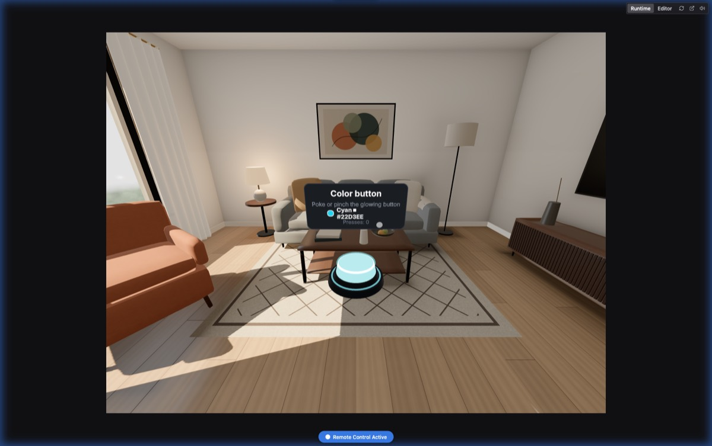</a> ✅ first try · 94 s · press ✓ · **4.0/5** A large cyan button with a glowing ring sits clearly in front of the user beside a 'Color button' panel showing the current color name, hex code and press count, but the panel's text lines are cramped and the 'Cyan', hex and 'Presses' lines crowd together with a stray square glyph and a floating gre |
| **T1** · dna-helix “A DNA double helix I can pick up and turn around” | <a href="gallery/kimi-k3.1-pro-fw__dna-helix__0.jpg">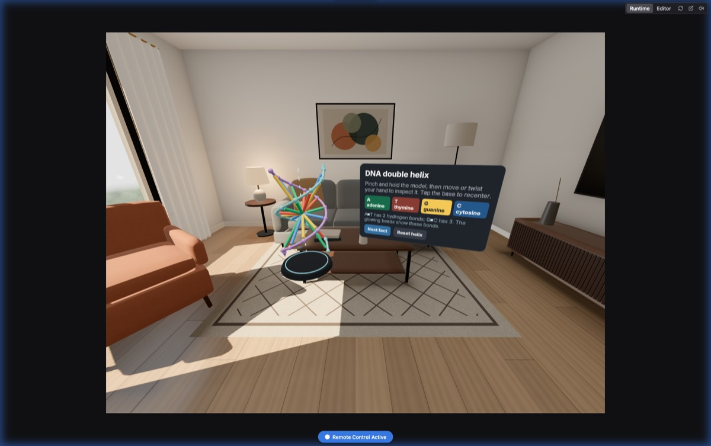</a> ✅ first try · 200 s · grab ✓ · press ✓ · **3.8/5** A colorful grabbable helix sits on a glowing base beside an info panel with a base-pair legend and buttons, but the helix reads as a tangled, jumbled shape rather than a clean double helix, and the panel text has broken glyphs (A■T, G■C) and a fact sentence that is cut off. |
| **T1** · desk-clock “A small desk clock that shows the current hours and minutes” | <a href="gallery/kimi-k3.1-pro-fw__desk-clock__0.jpg">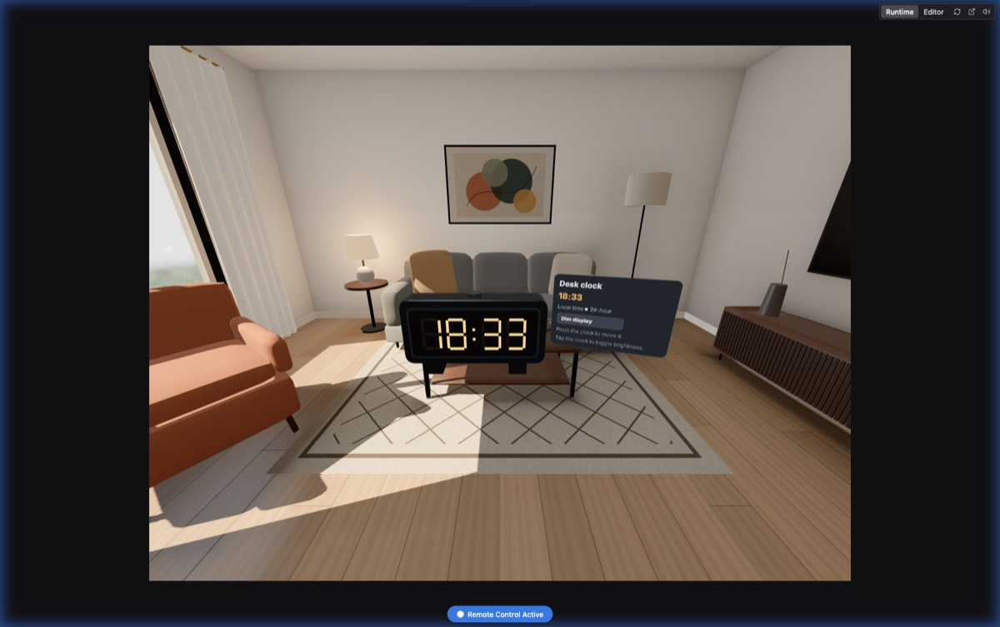</a> ✅ first try · 195 s · grab ✓ · press ✓ · **4.5/5** A clean seven-segment desk clock shows 18:33 with a matching info panel that has a Dim display button and pinch/tap hints; the panel is slightly angled and its small text is a bit hard to read. |
| **T1** · desk-lamp “A desk lamp I can switch on and off by pressing it” | <a href="gallery/kimi-k3.1-pro-fw__desk-lamp__0.jpg">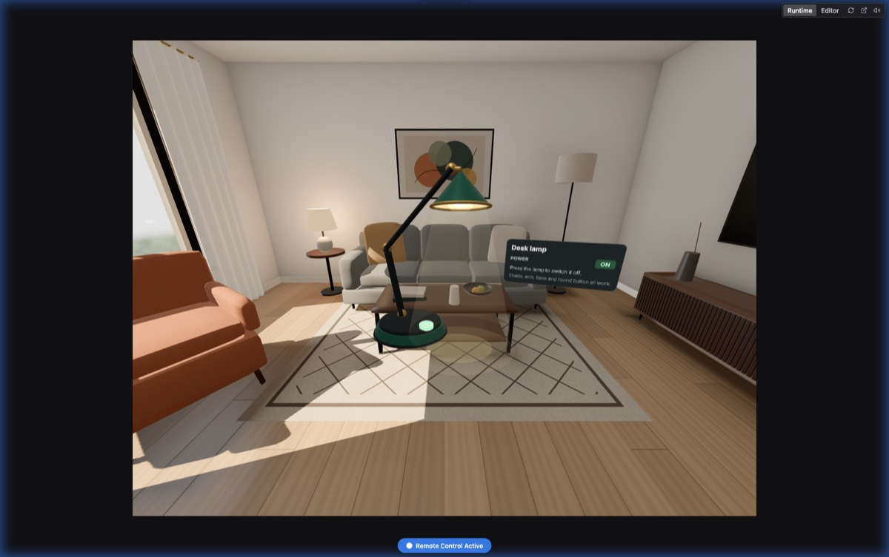</a> ✅ first try · 199 s · press ✓ · **4.8/5** A well-modeled articulated desk lamp with a glowing shade, a light cone, a glowing round button on the base, and a status panel showing ON with clear press instructions; the panel is slightly tilted, its small text is a bit hard to read, and the lamp floats over the coffee table rather than resting  |
| **T2** · earth-layers “Show the layers of the Earth as a cut-away sphere with a label for each layer” | <a href="gallery/kimi-k3.1-pro-fw__earth-layers__0.jpg">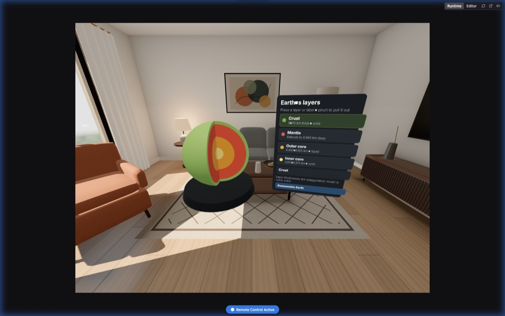</a> ✅ first try · 195 s · grab ✗ · press ✓ · **3.8/5** A cut-away sphere on a pedestal shows crust, mantle, outer and inner core next to a side panel of labelled layer cards with largely accurate depths, but the labels are not attached to the sphere itself, glyph-substitution boxes replace apostrophes, en-dashes and bullets throughout, and the panel bot |
| **T2** · photosynthesis “Explain photosynthesis with a small plant, the Sun, and labeled arrows for light, water, carbon dioxide and oxygen” | <a href="gallery/kimi-k3.1-pro-fw__photosynthesis__0.jpg">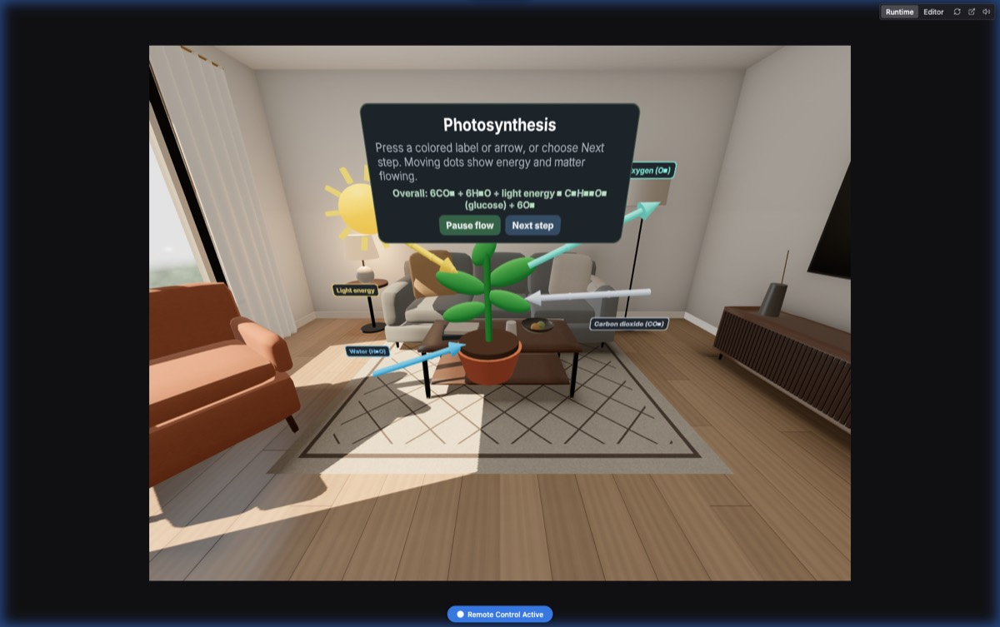</a> ✅ first try · 293 s · press ✓ · **3.3/5** The plant, Sun, and colored labeled arrows for light, water, CO2 and O2 are all present, with clear Pause/Next buttons and instructions. However, the info panel covers the Sun and clips the Oxygen label, the labels are small, and the subscript and arrow glyphs render as boxes, garbling the formulas  |
| **T2** · weather “A weather dashboard for three cities with an icon and the temperature for each” | <a href="gallery/kimi-k3.1-pro-fw__weather__0.jpg">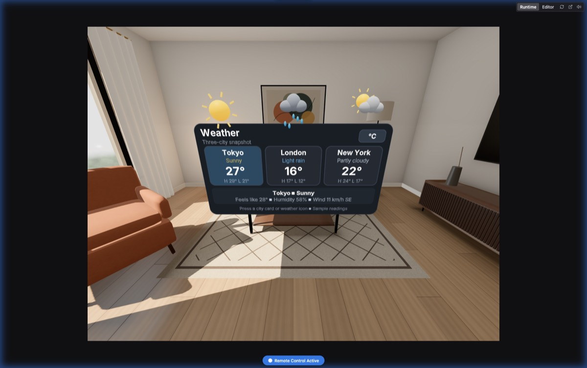</a> ✅ first try · 145 s · press ✓ · **4.5/5** Three city cards show conditions, temperatures and highs/lows with matching 3D weather icons, a selected Tokyo detail strip and a °C toggle; the floating icons slightly crowd the panel's top edge and title, and the footer hint text is small. |
| **T2** · coffee-mug “A coffee mug I can pick up, with a card showing its price and what it is made of” | <a href="gallery/kimi-k3.1-pro-fw__coffee-mug__0.jpg">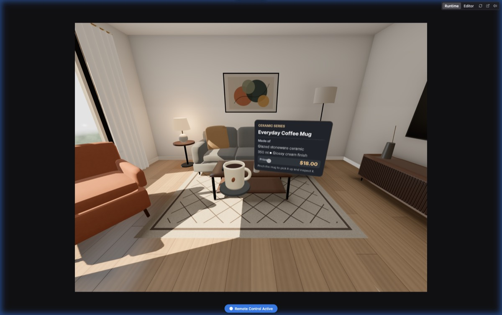</a> ✅ first try · 95 s · grab ✓ · press ✓ · **4.3/5** A clean 3D mug on a dark base sits beside a well-structured card showing the material, capacity and $18.00 price with a pinch hint, but a stray white dot overlaps the 'Price' label and the mug's glossy cream finish is not obviously glossy. |
| **T3** · times-tables “A multiplication quiz with 5 questions, answer buttons, and a running score” | <a href="gallery/kimi-k3.1-pro-fw__times-tables__0.jpg">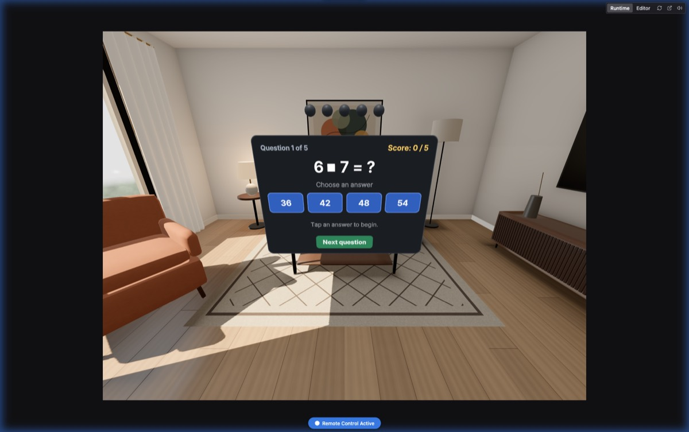</a> ✅ first try · 30 s · **3.5/5** The quiz panel has a question counter, a running score, four clear answer buttons and a Next button, but the multiplication sign renders as a missing-glyph square ('6 ■ 7') and the five dark spheres above the panel are unexplained. |
| **T3** · habit-tracker “A habit tracker for this week: 3 habits, tap a day to check it off, and show each habit's streak” | <a href="gallery/kimi-k3.1-pro-fw__habit-tracker__0.jpg">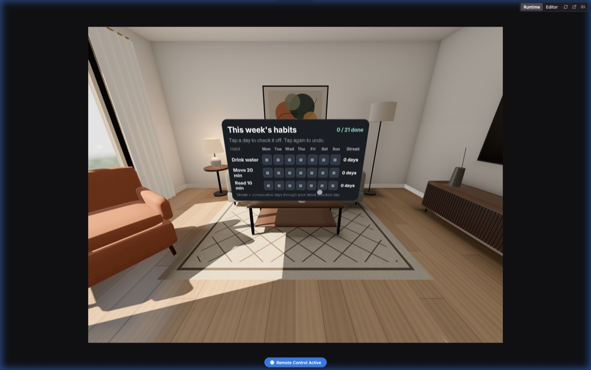</a> ✅ first try · 93 s · **4.5/5** All requested pieces are present: 3 habits, Mon–Sun tappable cells, a streak column per habit and a 0/21 progress counter, and the numbers are consistent; text is small with some habit names wrapping and a slight row skew, and the empty day boxes look fairly subdued as tap targets despite the instru |
| **T3** · build-water “Build a molecule: hydrogen and oxygen atoms I can grab, and a check button that tells me whether I built water” | <a href="gallery/kimi-k3.1-pro-fw__build-water__0.jpg">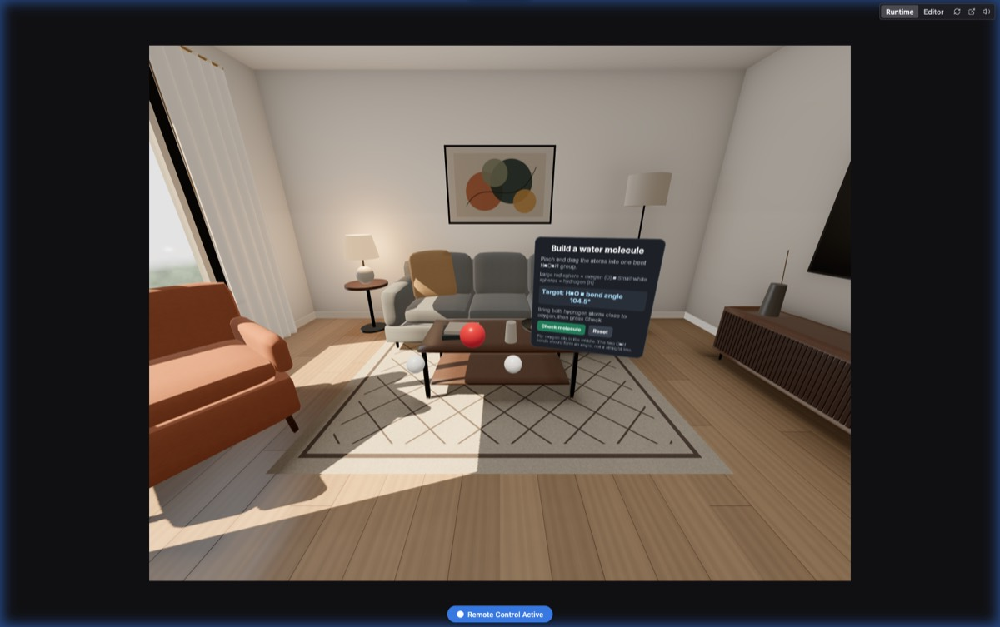</a> ✅ first try · 137 s · grab ✓ · **3.8/5** One red oxygen and two white hydrogen spheres sit near the coffee table beside a panel with Check molecule and Reset buttons, matching the request; however, the panel's small text is hard to read, some symbols render as boxes (e.g. 'H■O■H'), and the panel is tilted and overlaps the table. |
| **T3** · fruit-basket “Three fruits I can pick up and drop into a basket, with a running total price of what is in the basket” | <a href="gallery/kimi-k3.1-pro-fw__fruit-basket__0.jpg">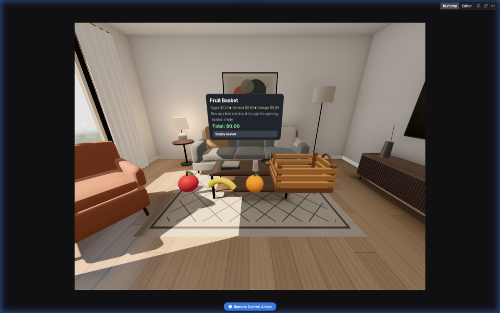</a> ✅ first try · 153 s · grab ✓ · **4.5/5** Apple, banana and orange sit beside a wooden basket under a tidy panel listing prices, pick-and-drop instructions, a $0.00 total and an Empty basket button, though the panel's small text is a bit hard to read and the fruits have no grab cues. |

<b>Repetition 2</b> (same requests, run again)

| Request | kimi-k3.1-pro-fw |
|---|---|
| **T1** · color-button “A glowing button that changes to a new color each time I press it” | <a href="gallery/kimi-k3.1-pro-fw__color-button__1.jpg">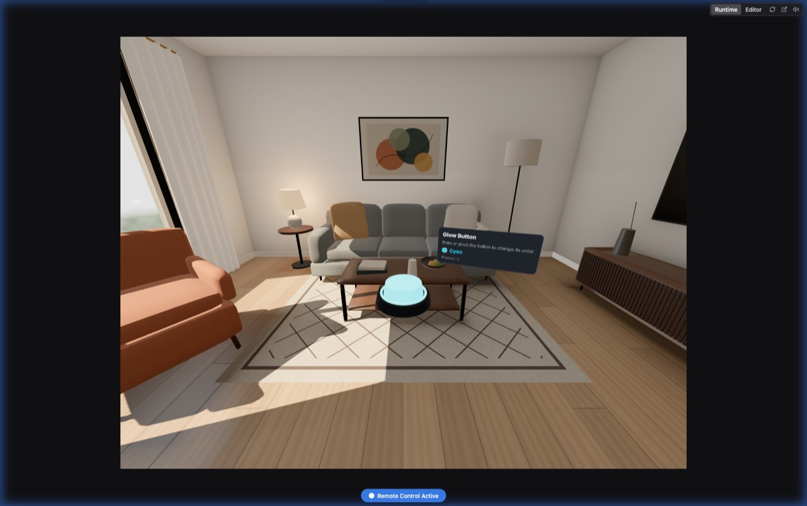</a> ✅ first try · 62 s · press ✓ · **4.0/5** A clear cyan 3D push button with a dark base sits over the coffee table, alongside an info panel giving the current color name and a press count, though the glow is subtle, the panel is tilted, and its small text ("Presses: 0") is hard to read. |
| **T1** · dna-helix “A DNA double helix I can pick up and turn around” | <a href="gallery/kimi-k3.1-pro-fw__dna-helix__1.jpg">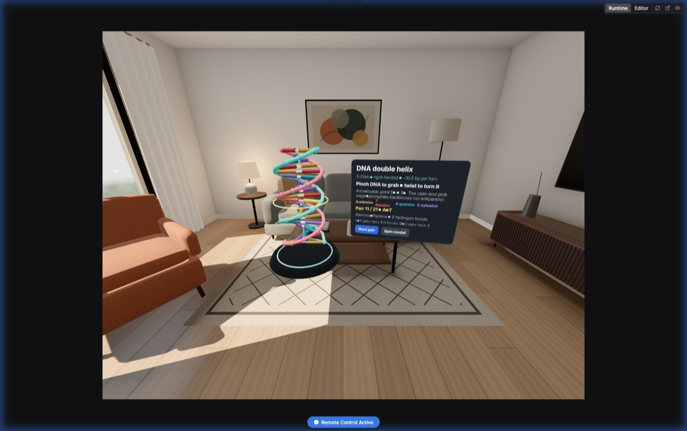</a> ✅ first try · 206 s · grab ✓ · press ✓ · **3.8/5** A colorful double helix on a stand with an info panel, accurate B-DNA facts, and clear grab instructions plus Next pair and Spin model buttons; however, missing-glyph boxes replace arrows and dashes and the base legend overlaps awkwardly, hurting legibility. |
| **T1** · desk-clock “A small desk clock that shows the current hours and minutes” | <a href="gallery/kimi-k3.1-pro-fw__desk-clock__1.jpg">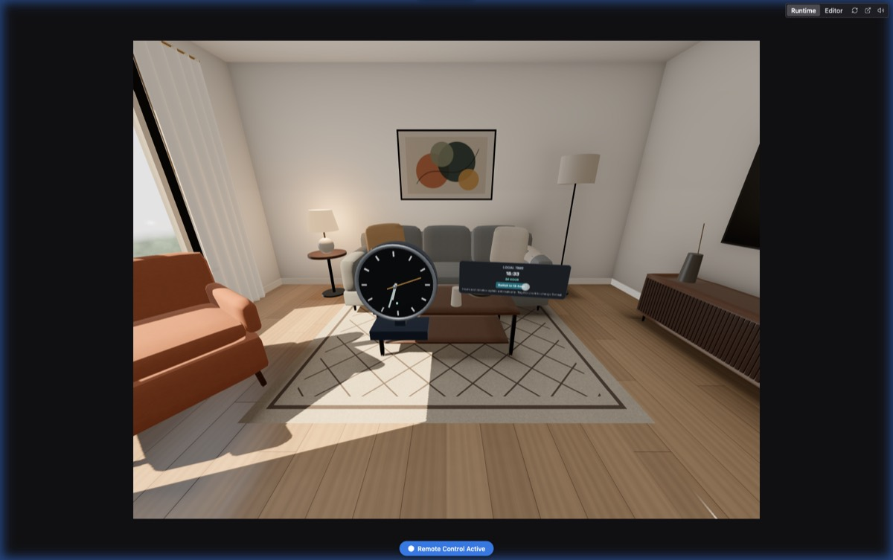</a> ✅ first try · 130 s · press ✓ · **3.8/5** An analog desk clock on a stand, paired with a digital panel reading 18:33 whose hands agree with the readout, fulfils the request, though the clock is fairly large and the side panel's text is tiny with the 12-hour toggle crowding the caption. |
| **T1** · desk-lamp “A desk lamp I can switch on and off by pressing it” |  ✅ first try · 115 s · press ✓ · **4.3/5** A recognizable green desk lamp with a glowing shade, light cone and a yellow base button is shown, with a tidy side panel giving instructions, ON status and a Turn off button; the lamp floats without a desk and the panel is slightly tilted, but the pressable parts are clear. |
| **T2** · earth-layers “Show the layers of the Earth as a cut-away sphere with a label for each layer” | <a href="gallery/kimi-k3.1-pro-fw__earth-layers__1.jpg">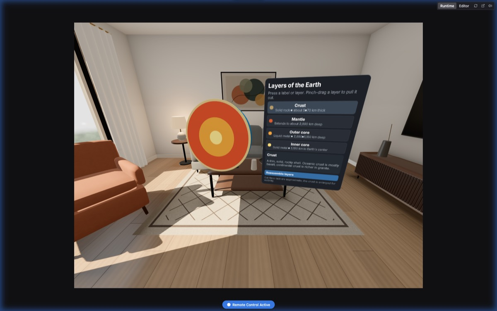</a> ✅ first try · 291 s · grab ✗ · press ✓ · **3.5/5** The model reads more as a flat concentric disc than a cut-away sphere, and its labels sit in a separate side panel rather than on the layers. The layer depths are accurate, but missing glyphs show as boxes (e.g. '5■70 km'), the panel is steeply tilted and its footnote is tiny. The pressable layer ro |
| **T2** · photosynthesis “Explain photosynthesis with a small plant, the Sun, and labeled arrows for light, water, carbon dioxide and oxygen” | <a href="gallery/kimi-k3.1-pro-fw__photosynthesis__1.jpg">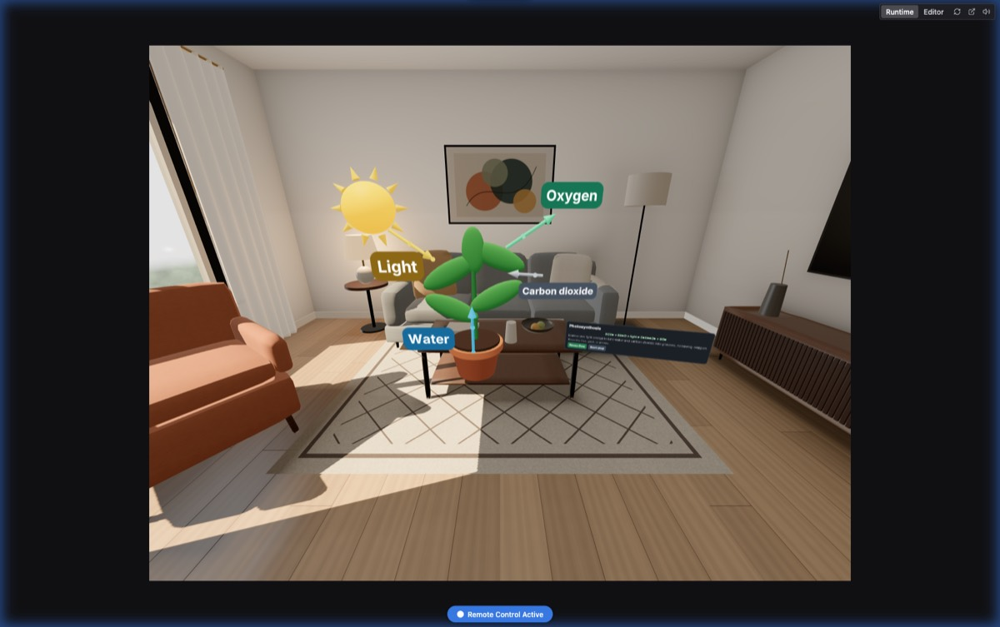</a> ✅ first try · 47 s · grab ✓ · press ✓ · **3.5/5** The scene has every requested element: a potted plant, a Sun, and labeled arrows with sensible directions (light and CO2 in, water up from the pot, oxygen out), but the info panel with the equation and buttons is tiny, angled away from the user and partly sunk behind the sofa, so its text and small  |
| **T2** · weather “A weather dashboard for three cities with an icon and the temperature for each” | <a href="gallery/kimi-k3.1-pro-fw__weather__1.jpg">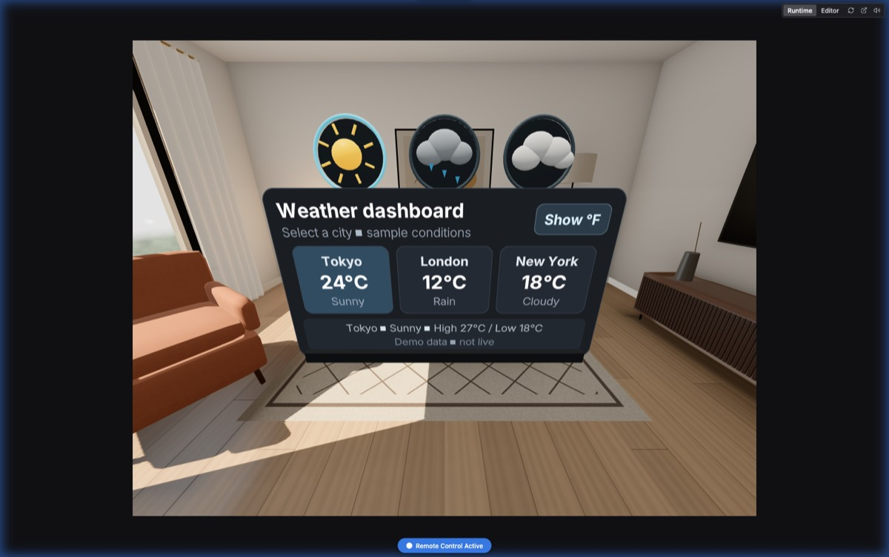</a> ✅ first try · 203 s · press ✓ · **4.5/5** Three cities each have a matching 3D weather icon (sun, rain cloud, cloud) and a temperature, with a °F toggle, a selected-city detail row and a demo-data label; the icons sit behind the panel's top edge and are slightly cropped, and the city tiles read as selectable but only modestly afford pressin |
| **T2** · coffee-mug “A coffee mug I can pick up, with a card showing its price and what it is made of” | <a href="gallery/kimi-k3.1-pro-fw__coffee-mug__1.jpg">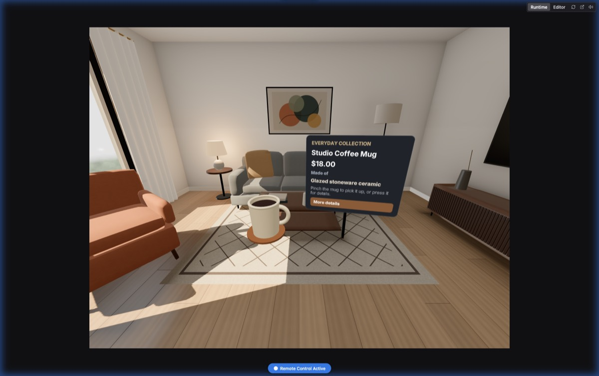</a> ✅ first try · 80 s · grab ✓ · press ✓ · **4.5/5** A well-modeled mug on a coaster sits beside a legible card showing the $18.00 price, the glazed stoneware material, a pinch hint and a More details button, though the card is slightly skewed, its hint text is small and cramped, and the mug has no visible grab affordance. |
| **T3** · times-tables “A multiplication quiz with 5 questions, answer buttons, and a running score” | <a href="gallery/kimi-k3.1-pro-fw__times-tables__1.jpg">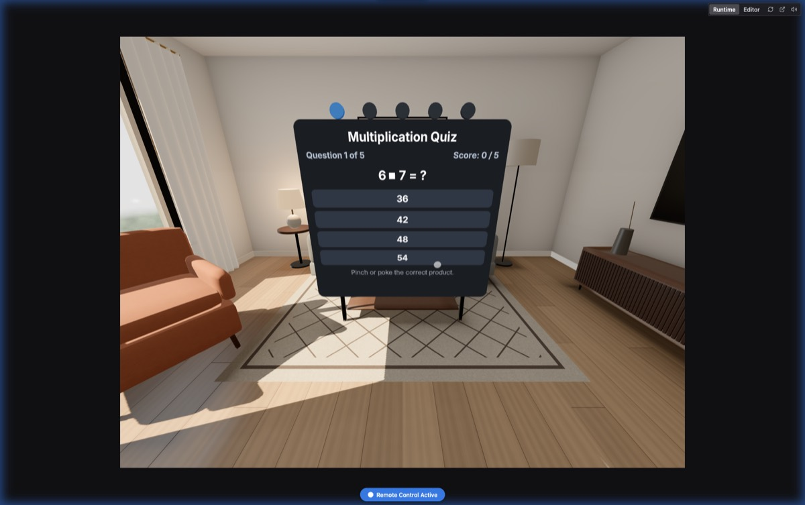</a> ✅ first try · 116 s · **4.0/5** Complete quiz panel with question counter, running score, four answer buttons and progress dots, but the multiplication sign renders as a square box (missing glyph), the progress dots poke above the panel, and a stray grey dot sits over the last button. |
| **T3** · habit-tracker “A habit tracker for this week: 3 habits, tap a day to check it off, and show each habit's streak” | <a href="gallery/kimi-k3.1-pro-fw__habit-tracker__1.jpg">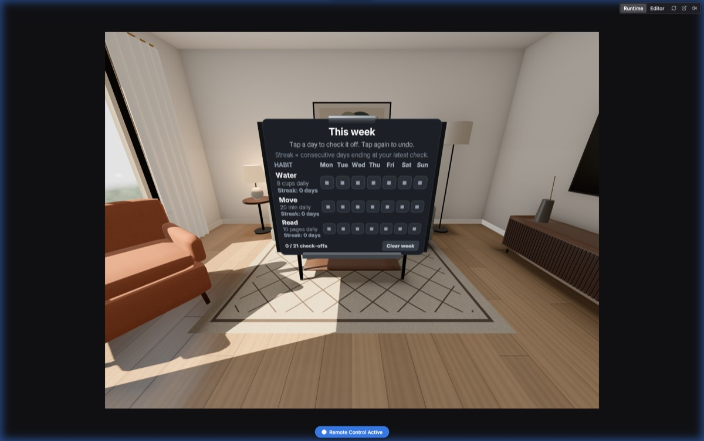</a> ✅ first try · 165 s · **4.5/5** A complete 3-habit by 7-day grid with streaks, a check-off count and a clear button; text is legible though the panel tapers slightly and the small, gray empty checkboxes look somewhat inert. |
| **T3** · build-water “Build a molecule: hydrogen and oxygen atoms I can grab, and a check button that tells me whether I built water” | <a href="gallery/kimi-k3.1-pro-fw__build-water__1.jpg">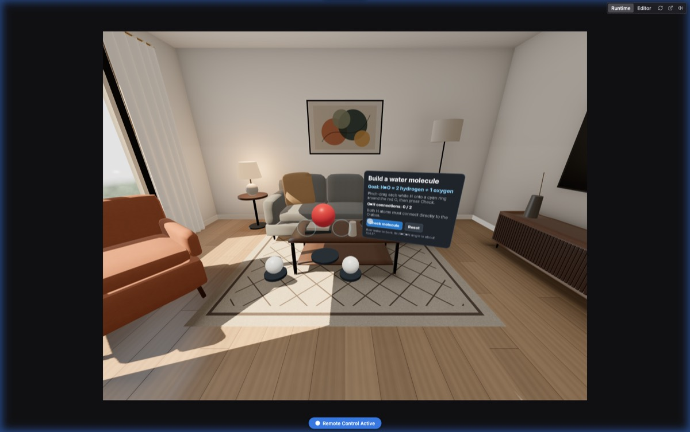</a> ✅ first try · 225 s · grab ✓ · press ✓ · **3.5/5** Red O and two white H spheres on pedestals with cyan snap rings, a Check button and an instruction panel are all present, but the panel's small text is hard to read, the subscript '2' and bond dashes render as broken glyphs ('H■O', 'O■H'), the hint footer is cramped and partly cut off, and an extra  |
| **T3** · fruit-basket “Three fruits I can pick up and drop into a basket, with a running total price of what is in the basket” | <a href="gallery/kimi-k3.1-pro-fw__fruit-basket__1.jpg">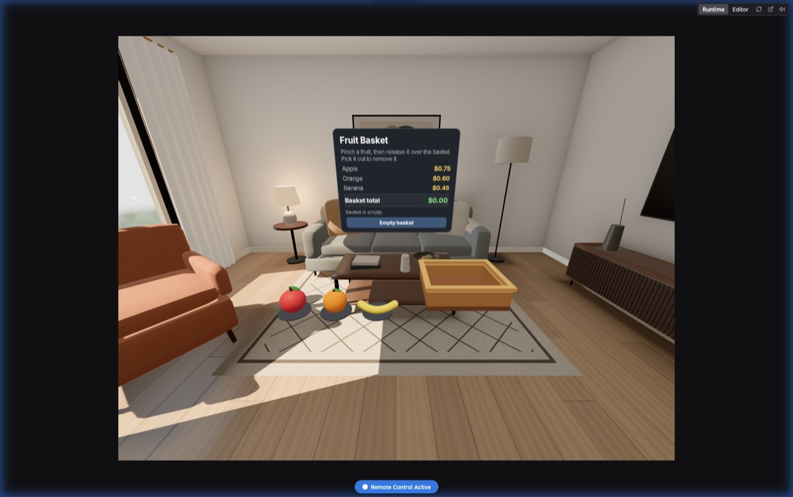</a> ✅ first try · 213 s · grab ✓ · **4.5/5** Three recognizable fruits sit on pedestals beside an open basket, with a clear price list, a $0.00 total and an Empty basket button; the panel is slightly small and the text is a bit fine, and the pedestals help but there are no explicit grab cues on the fruits. |

