# Which model built what: run-3-ember-max

Each column is one model; each row is one request from the held-out test set. Every model saw the same
system prompt and the same checks, and each scene was mounted in Meta's Quest emulator (the living room is the
emulator's simulated room; the toolbars are emulator controls, not part of the scene). Click a picture for full size.

- ✅ passed all checks (first try, or after the agent repaired its own code) · time to a working scene
- grab / press: an emulated hand tried to pick up one grabbable object and press one pressable object
- **score**: quality 1-5 from claude-opus-5-5, an independent judge that is not a contestant, averaging fidelity, clarity, correctness and hands-on; its one-line reason is under each score. Scenes that failed or crashed count as 1/5 in the overall averages

| Model | Quality | Median time |
|---|---|---|
| muse-ember-1.0-max | 4.30 | 28 s |

Full numbers: [summary.md](summary.md).

## Repetition 1

| Request | muse-ember-1.0-max |
|---|---|
| **T1** · color-button “A glowing button that changes to a new color each time I press it” | <a href="gallery/muse-ember-1.0-max__color-button__0.jpg">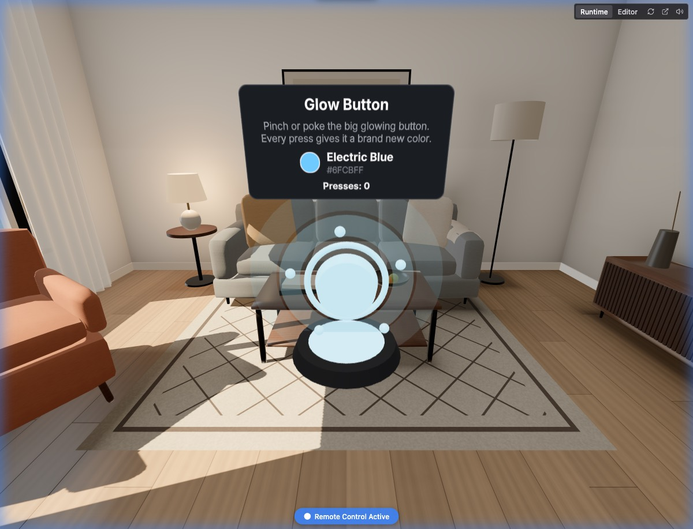</a> ✅ first try · 22 s · press ✓ · **4.0/5** A large pressable button on a dark base, with a halo, orbiting dots, and a panel showing the current color name, hex code and press count, fits the request well, though the button looks washed-out pale blue rather than vividly glowing, and the panel slightly overlaps the top of the halo. |
| **T1** · dna-helix “A DNA double helix I can pick up and turn around” | <a href="gallery/muse-ember-1.0-max__dna-helix__0.jpg">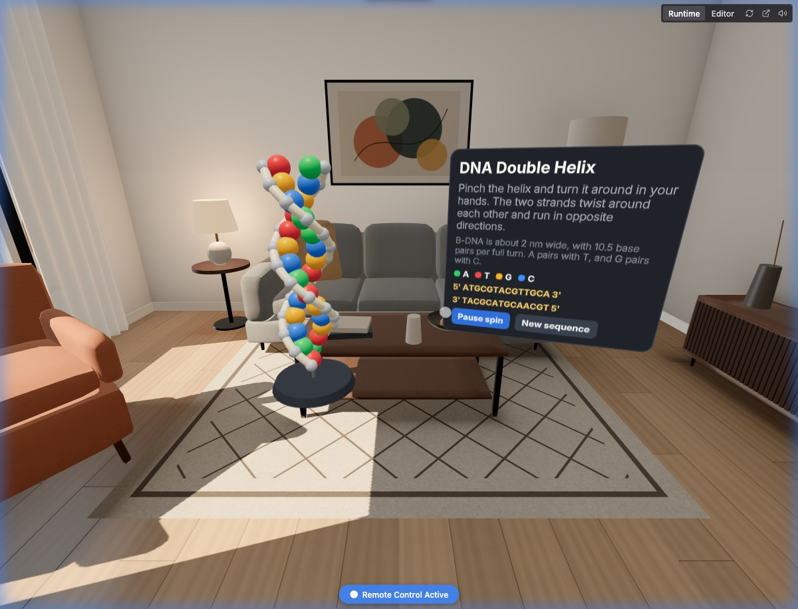</a> ✅ first try · 21 s · grab ✓ · **4.3/5** A recognizable two-strand ball-and-stick helix on a stand, paired with a tidy info panel; the facts are correct (B-DNA ~2 nm wide, 10.5 bp per turn, A–T/G–C pairing, and the antiparallel sequences complement correctly), and the pinch-to-turn instruction plus Pause spin and New sequence buttons invit |
| **T1** · desk-clock “A small desk clock that shows the current hours and minutes” | <a href="gallery/muse-ember-1.0-max__desk-clock__0.jpg">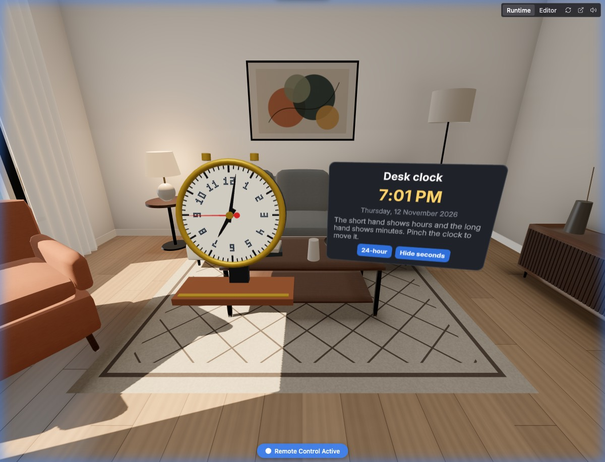</a> ✅ first try · 25 s · grab ✓ · **3.8/5** An analog desk clock on a base with a matching digital readout (7:01 PM, hands agree, and Thursday 12 November 2026 is correct), but the radially rotated numerals are hard to read, with the lower ones upside down, and the info panel crowds the clock. |
| **T1** · desk-lamp “A desk lamp I can switch on and off by pressing it” | <a href="gallery/muse-ember-1.0-max__desk-lamp__0.jpg">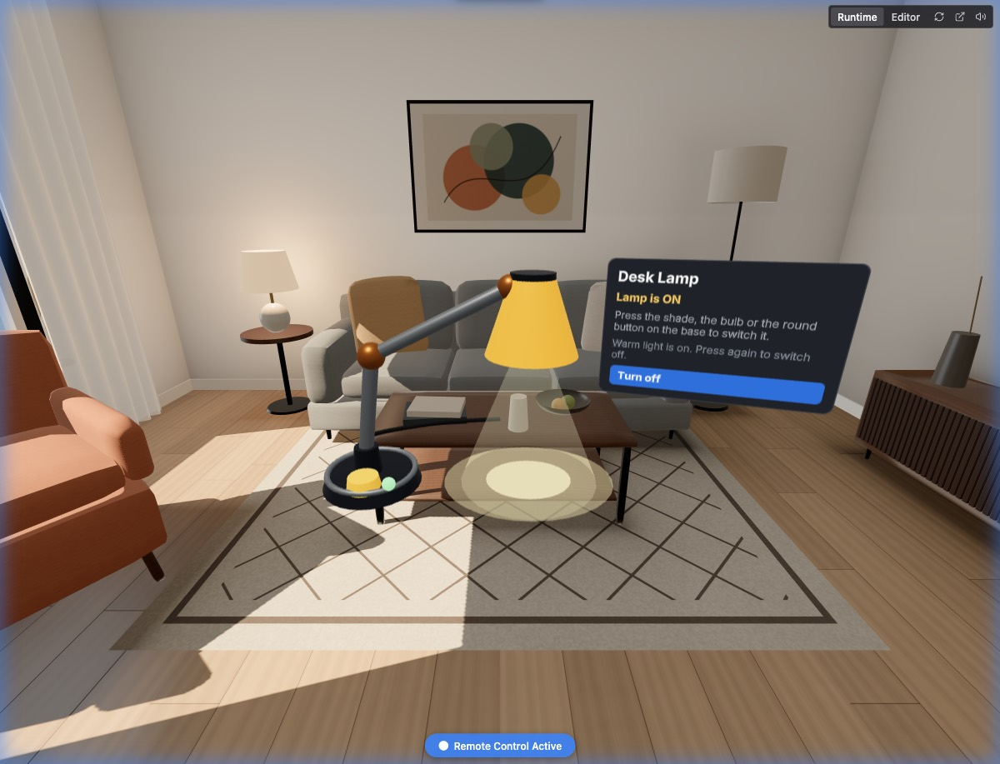</a> ✅ first try · 17 s · press ✓ · **4.0/5** A recognizable articulated desk lamp in its ON state, with a glowing shade, a light cone, a yellow base button and a 'Turn off' panel, though the info panel overlaps the lamp shade, the 'Turn off' button is slightly clipped, and the lamp floats oddly above the coffee table. |
| **T2** · earth-layers “Show the layers of the Earth as a cut-away sphere with a label for each layer” | <a href="gallery/muse-ember-1.0-max__earth-layers__0.jpg">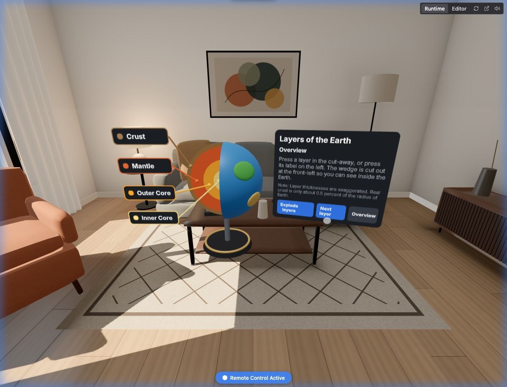</a> ✅ first try · 65 s · press ✓ · **3.8/5** The globe shows a clear cross-section of crust, mantle, outer core and inner core, each with a leader-lined label, though the panel describes a front-left wedge while the model shows a half-sphere cut; the info panel's text is small and tilted, a cursor dot overlaps the 'Next layer' button, and the  |
| **T2** · photosynthesis “Explain photosynthesis with a small plant, the Sun, and labeled arrows for light, water, carbon dioxide and oxygen” | <a href="gallery/muse-ember-1.0-max__photosynthesis__0.jpg">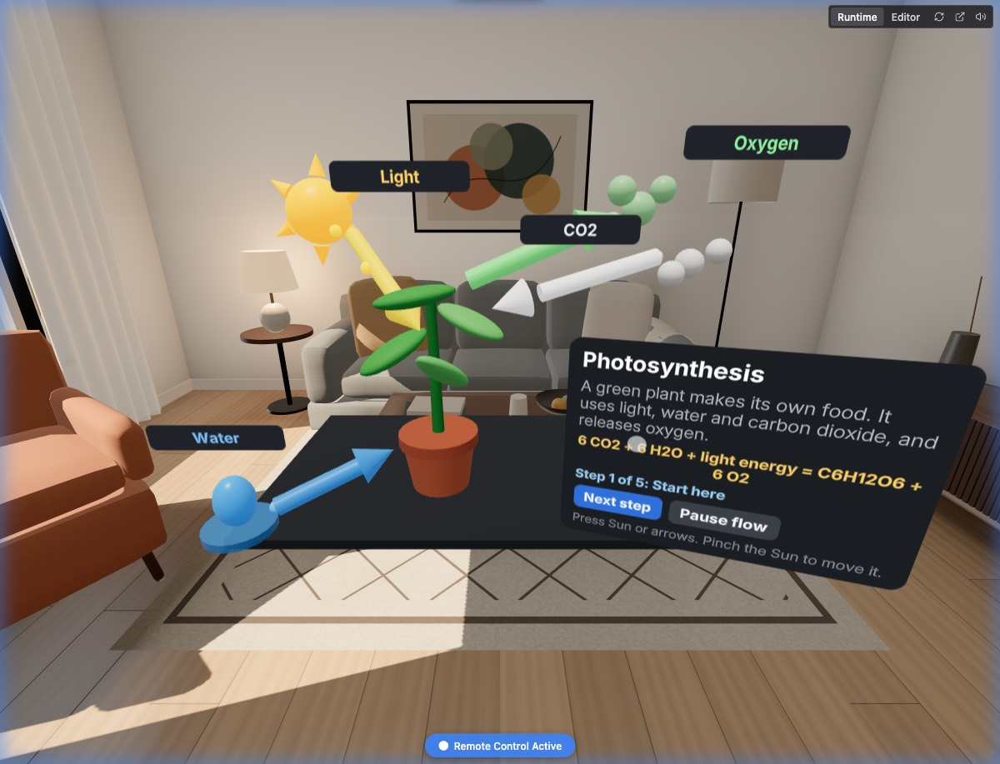</a> ✅ first try · 47 s · grab ✓ · press ✓ · **3.8/5** The plant, Sun and labeled Light, Water, CO2 and Oxygen arrows are all present with a correct equation and clear Next step / Pause flow controls, but the CO2 label sits ambiguously between the green and white arrows and overlaps them, and a stray dot covers part of the equation. |
| **T2** · weather “A weather dashboard for three cities with an icon and the temperature for each” | <a href="gallery/muse-ember-1.0-max__weather__0.jpg">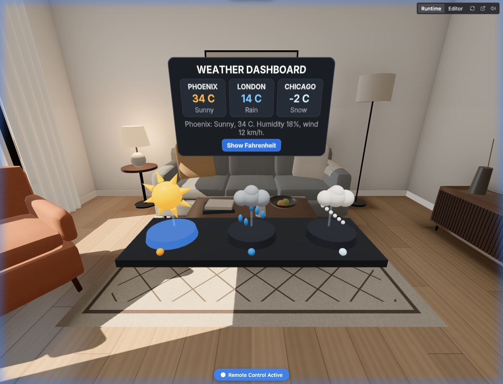</a> ✅ first try · 33 s · press ✓ · **4.5/5** Three cities each get a 3D weather icon on a pedestal and a clear temperature card, with plausible values and a highlighted selected Phoenix pedestal; the temperatures read '34 C' without a degree sign, and the Fahrenheit toggle and selectable pedestals invite interaction, though the small colored d |
| **T2** · coffee-mug “A coffee mug I can pick up, with a card showing its price and what it is made of” | <a href="gallery/muse-ember-1.0-max__coffee-mug__0.jpg">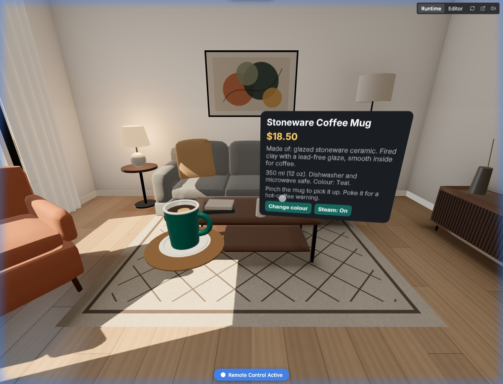</a> ✅ first try · 15 s · grab ✓ · press ✓ · **4.5/5** A teal mug on a saucer comes with a legible info card giving the price, the stoneware material, capacity and pinch-to-pick-up instructions, plus colour and steam buttons; the card is slightly tilted, a pointer dot overlaps its text, and the mug itself has no grab affordance beyond the written hint. |
| **T3** · times-tables “A multiplication quiz with 5 questions, answer buttons, and a running score” | <a href="gallery/muse-ember-1.0-max__times-tables__0.jpg">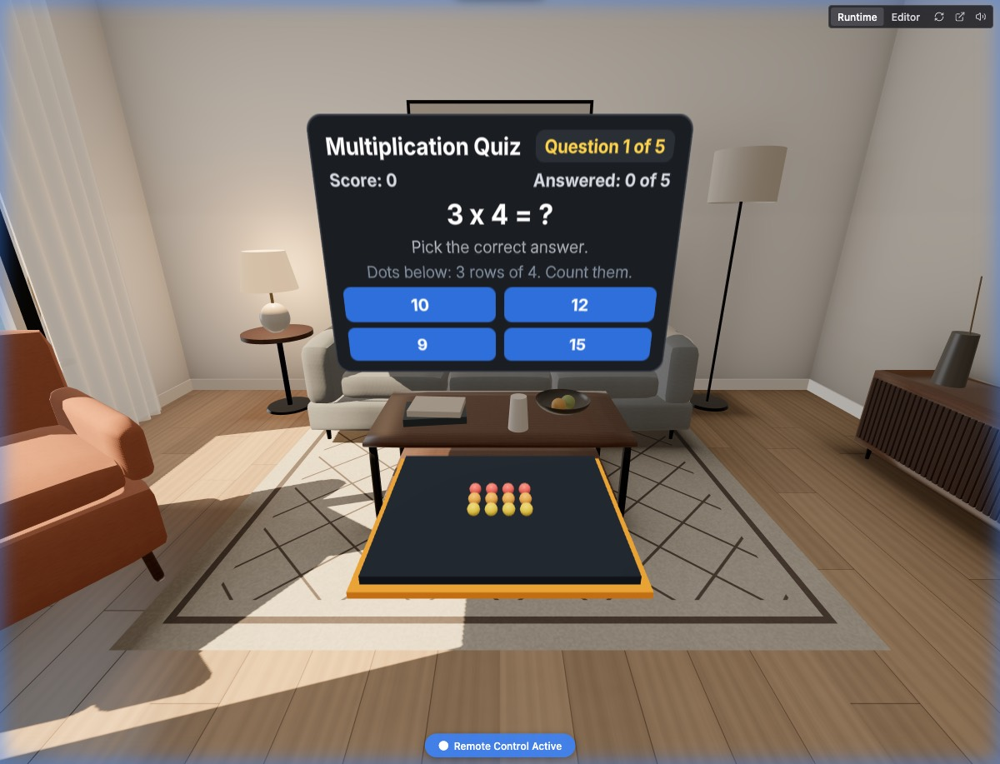</a> ✅ first try · 27 s · grab ✓ · **4.5/5** The quiz panel clearly shows the title, a Question 1 of 5 badge, the score, the question 3 x 4 = ? and four large answer buttons, with a correct 3x4 dot-array aid on the table below; the panel is slightly tilted and the dot tray is detached from the main card, but text is legible and the buttons cle |
| **T3** · habit-tracker “A habit tracker for this week: 3 habits, tap a day to check it off, and show each habit's streak” | <a href="gallery/muse-ember-1.0-max__habit-tracker__0.jpg">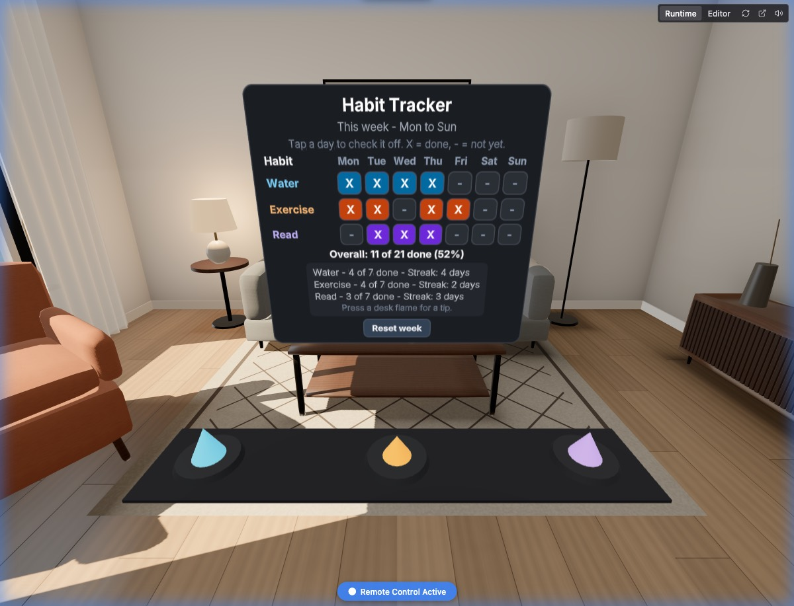</a> ✅ first try · 32 s · press ✓ · **4.5/5** Shows all three habits with a tappable Mon–Sun grid and accurate per-habit counts, streaks and the 11/21 (52%) total, though the summary lines are slightly misaligned and the extra desk 'flame' objects are ambiguous as controls. |
| **T3** · build-water “Build a molecule: hydrogen and oxygen atoms I can grab, and a check button that tells me whether I built water” | <a href="gallery/muse-ember-1.0-max__build-water__0.jpg">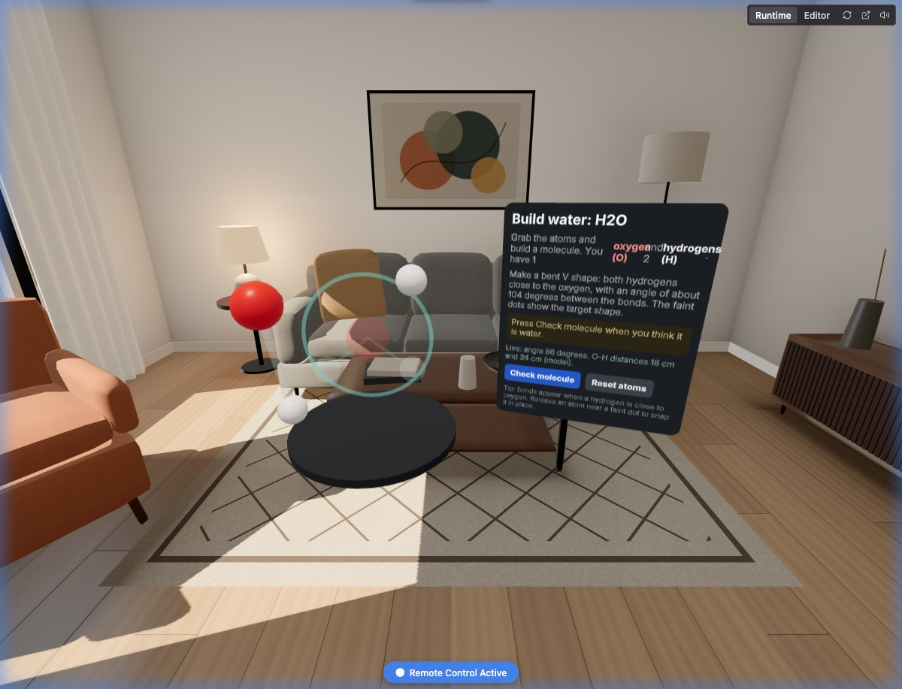</a> ✅ first try · 23 s · grab ✓ · **3.5/5** Grabbable red oxygen and white hydrogen spheres sit beside a faint target ring with ghost dots, and the panel has Check molecule and Reset atoms buttons, but the intro line is garbled where the colored 'oxygen (O)' / '2 hydrogens (H)' spans overlap the sentence, the atoms float scattered in front of |
| **T3** · fruit-basket “Three fruits I can pick up and drop into a basket, with a running total price of what is in the basket” | <a href="gallery/muse-ember-1.0-max__fruit-basket__0.jpg">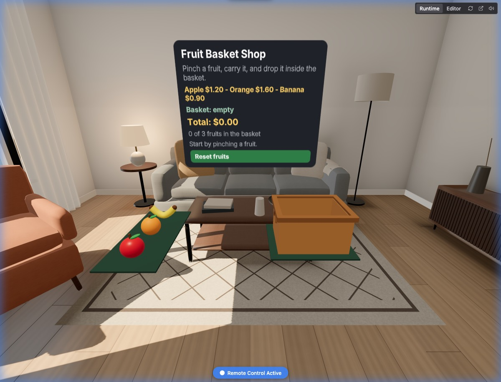</a> ✅ first try · 24 s · grab ✓ · **4.5/5** Three recognizable 3D fruits on a tray, an open crate basket, and a panel with prices, basket contents and a $0.00 total match the request well, though the price line wraps awkwardly, the panel partly occludes the sofa area, and the fruits lack per-item price labels or grab affordances beyond the in |

<b>Repetition 2</b> (same requests, run again)

| Request | muse-ember-1.0-max |
|---|---|
| **T1** · color-button “A glowing button that changes to a new color each time I press it” | <a href="gallery/muse-ember-1.0-max__color-button__1.jpg">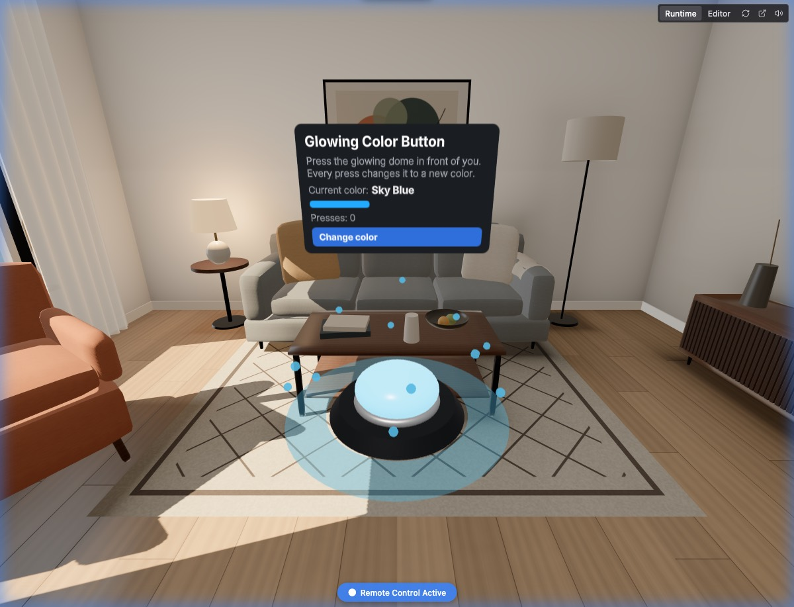</a> ✅ first try · 14 s · press ✓ · **4.8/5** A large, glowing sky-blue dome button with a halo and particles sits in front of the user, with a tidy panel showing the current color, press count and a fallback Change color button; the dome slightly overlaps the coffee table, and the panel's top edge covers part of the wall art. |
| **T1** · dna-helix “A DNA double helix I can pick up and turn around” | <a href="gallery/muse-ember-1.0-max__dna-helix__1.jpg">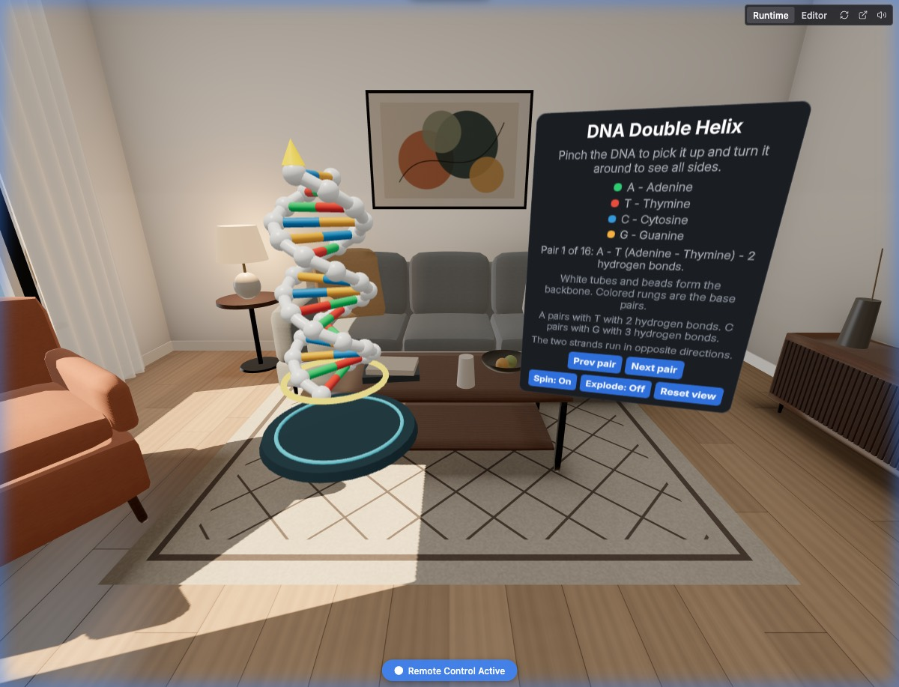</a> ✅ first try · 28 s · grab ✓ · **4.8/5** A clear double helix with white backbones and colored base-pair rungs sits on a pedestal with a selection ring, and an info panel explains the pinch-to-grab interaction with accurate base-pairing facts and clear buttons; the small text on the angled panel is slightly dense, and the yellow cone on to |
| **T1** · desk-clock “A small desk clock that shows the current hours and minutes” | <a href="gallery/muse-ember-1.0-max__desk-clock__1.jpg">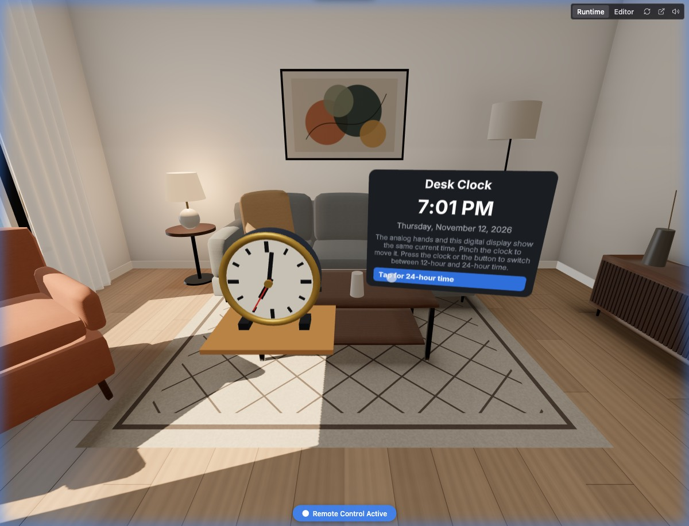</a> ✅ first try · 18 s · grab ✓ · press ✓ · **4.0/5** A 3D analog desk clock with a matching digital panel (7:01 PM, correct weekday for the date) fulfills the request, though the hour hand is hard to distinguish from the red second hand, the pointer dot slightly covers the button label, and the clock's grabbability relies on the instruction text. |
| **T1** · desk-lamp “A desk lamp I can switch on and off by pressing it” | <a href="gallery/muse-ember-1.0-max__desk-lamp__1.jpg">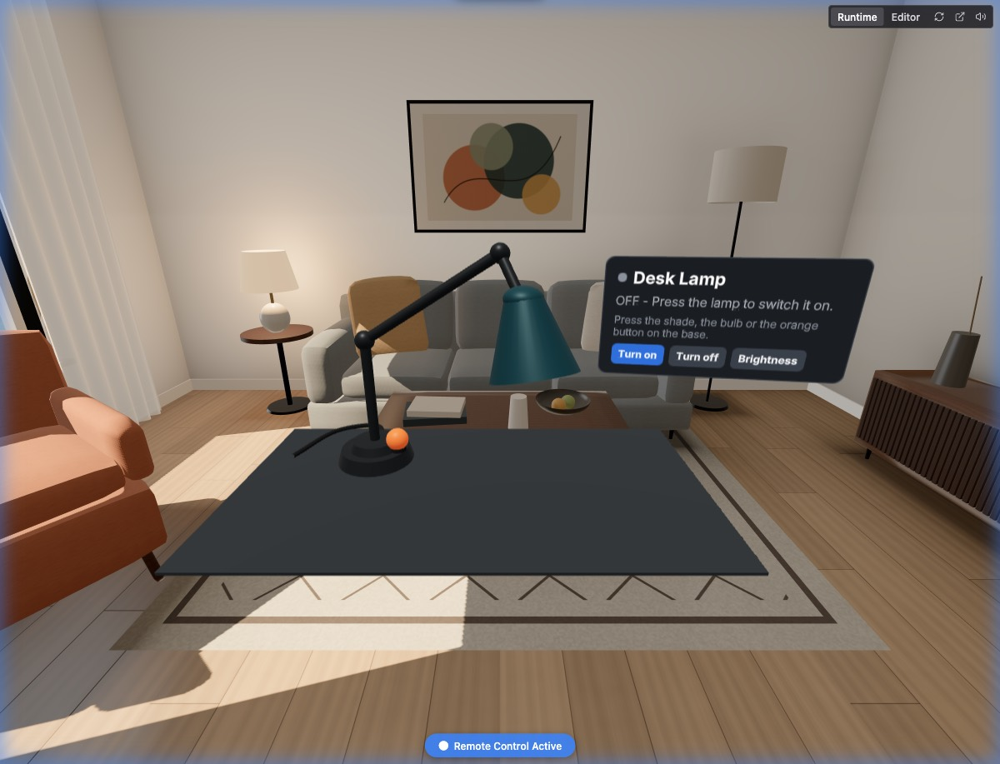</a> ✅ first try · 23 s · press ✓ · **4.3/5** A recognizable articulated desk lamp sits on a desk with an orange switch button and a clear info panel with Turn on, Turn off and Brightness buttons; the panel slightly overlaps the lamp shade area, and the orange base button reads more like a ball than a switch. |
| **T2** · earth-layers “Show the layers of the Earth as a cut-away sphere with a label for each layer” | <a href="gallery/muse-ember-1.0-max__earth-layers__1.jpg">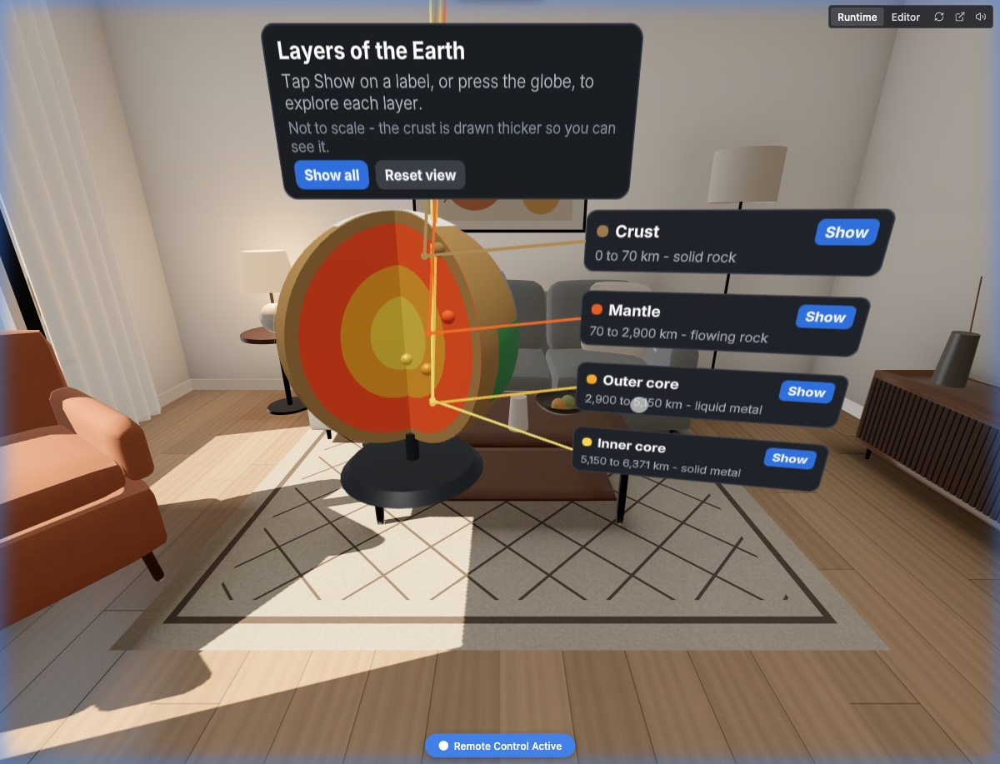</a> ✅ first try · 62 s · grab ✓ · press ✓ · **4.8/5** A clear cut-away globe on a stand with four labelled layers carrying accurate depth ranges, Show buttons and Show all / Reset view controls; however, stray leader lines run up through the title panel to the top of the view, and the labels are slightly tilted and crowded. |
| **T2** · photosynthesis “Explain photosynthesis with a small plant, the Sun, and labeled arrows for light, water, carbon dioxide and oxygen” | <a href="gallery/muse-ember-1.0-max__photosynthesis__1.jpg">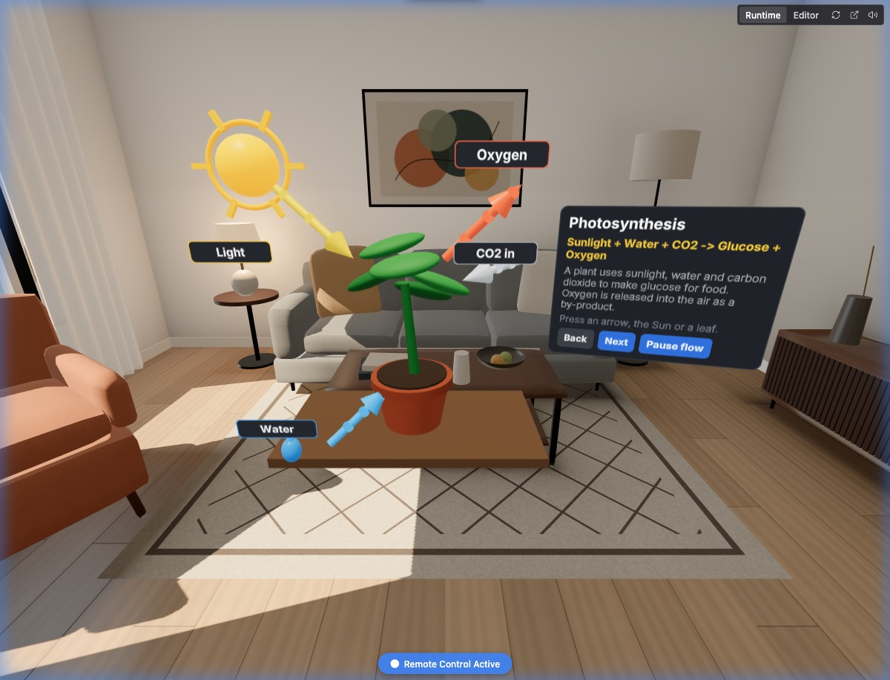</a> ✅ first try · 31 s · grab ✓ · press ✓ · **4.0/5** The plant, Sun and labeled arrows for light, water, CO2 and oxygen are all present, along with a correct simplified equation panel and Back/Next/Pause buttons plus a press hint; however, the CO2 arrow is mostly hidden behind its label and the leaves, and the labels float somewhat loosely around the  |
| **T2** · weather “A weather dashboard for three cities with an icon and the temperature for each” | <a href="gallery/muse-ember-1.0-max__weather__1.jpg">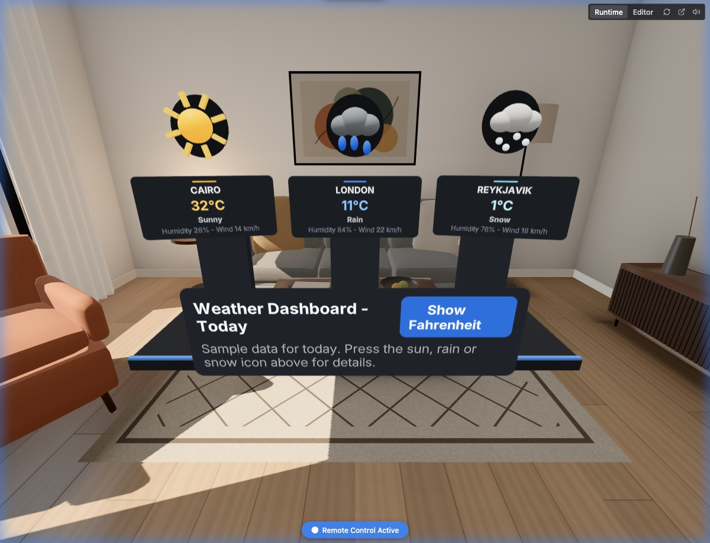</a> ✅ first try · 42 s · press ✓ · **4.5/5** Three cities each have a clear 3D weather icon and a plausible temperature with conditions, plus a prominent Fahrenheit toggle; the main info panel slightly overlaps the base slab and stands, and the icons' pressability relies on the instruction text rather than visual affordances. |
| **T2** · coffee-mug “A coffee mug I can pick up, with a card showing its price and what it is made of” | <a href="gallery/muse-ember-1.0-max__coffee-mug__1.jpg">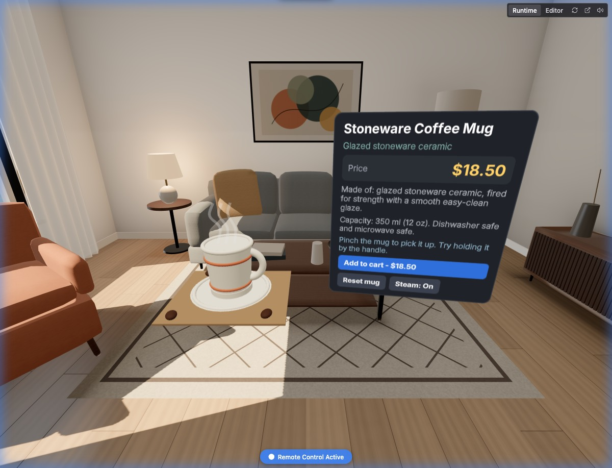</a> ✅ first try · 19 s · grab ✓ · **4.8/5** A detailed mug with saucer and steam sits on a wooden tray next to a legible product card showing name, $18.50 price and stoneware material, with pick-up instructions and clear buttons; the card is slightly tilted and densely packed, and the text sits close to its edges. |
| **T3** · times-tables “A multiplication quiz with 5 questions, answer buttons, and a running score” | <a href="gallery/muse-ember-1.0-max__times-tables__1.jpg">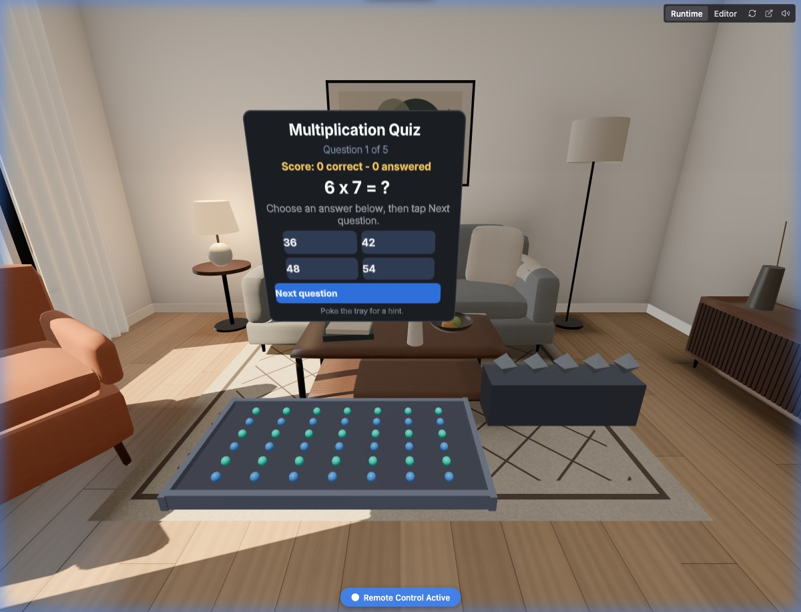</a> ✅ first try · 37 s · grab ✓ · press ✓ · **4.5/5** The panel delivers everything requested: 'Question 1 of 5', a running score, 6×7 with four answer buttons including the correct 42, and a 6×7 bead tray hint plus a five-tab progress block. The answer buttons are slightly misaligned with left-justified labels, and the link between the hint tray and t |
| **T3** · habit-tracker “A habit tracker for this week: 3 habits, tap a day to check it off, and show each habit's streak” | <a href="gallery/muse-ember-1.0-max__habit-tracker__1.jpg">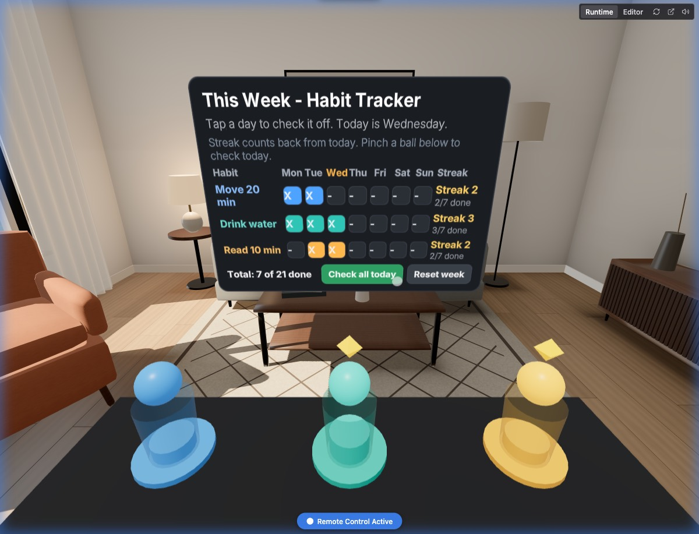</a> ✅ first try · 31 s · grab ✓ · press ✓ · **4.8/5** All three habits have a full week of tappable day cells, streaks and done counts that tally correctly (7 of 21), and colour-matched 3D pinch balls plus action buttons that invite interaction; minor layout issues include the Sun/Streak headers crowding, rows slightly misaligned and 'Move 20 min' wrap |
| **T3** · build-water “Build a molecule: hydrogen and oxygen atoms I can grab, and a check button that tells me whether I built water” | <a href="gallery/muse-ember-1.0-max__build-water__1.jpg">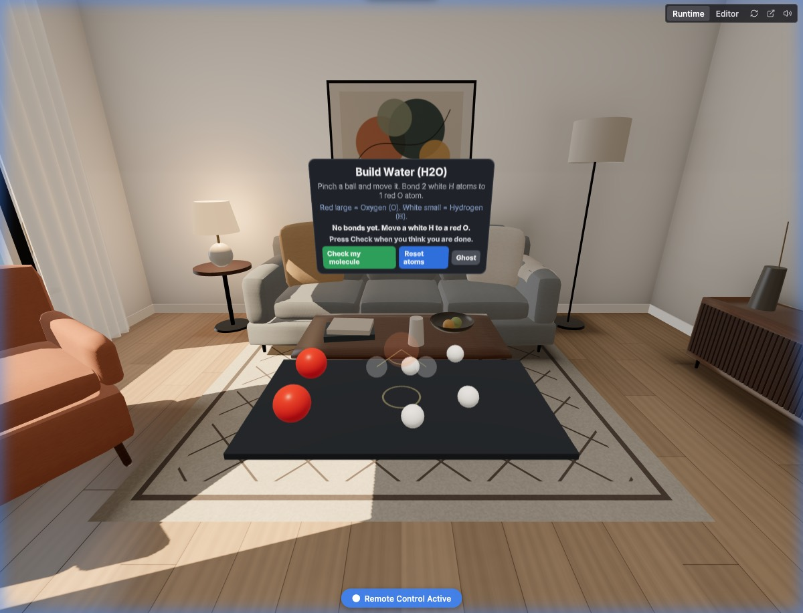</a> ✅ first try · 35 s · grab ✓ · press ✓ · **4.0/5** Grabbable red O and white H spheres sit on a dark tray with a clear Check button and instructions, but the instruction text is small with low-contrast grey lines, the 'Ghost' button is unexplained, and the faint ghost guide molecule overlaps the atoms and is hard to read. |
| **T3** · fruit-basket “Three fruits I can pick up and drop into a basket, with a running total price of what is in the basket” | <a href="gallery/muse-ember-1.0-max__fruit-basket__1.jpg">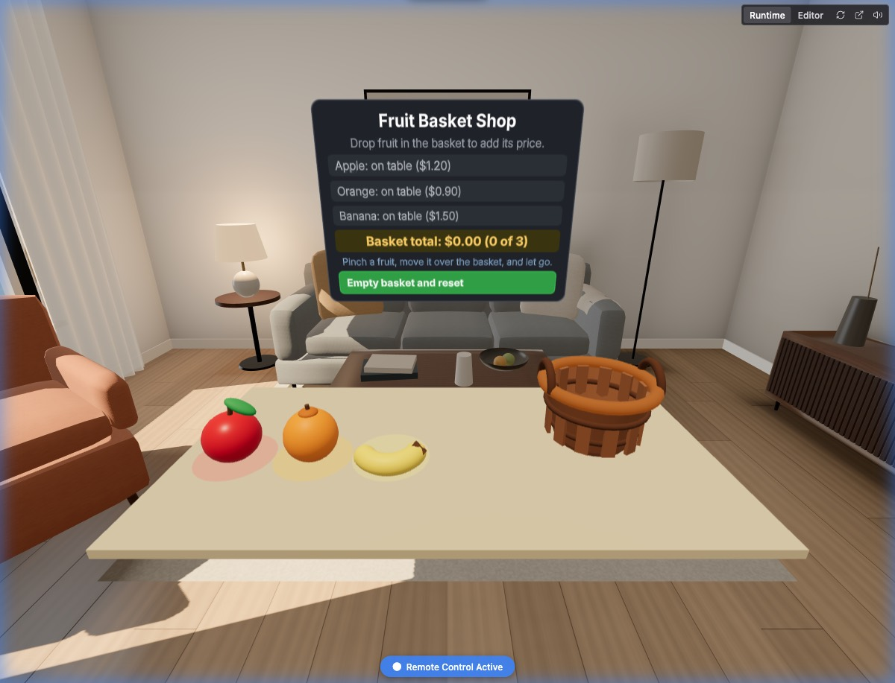</a> ✅ first try · 35 s · grab ✓ · press ✓ · **4.8/5** Three distinct 3D fruits sit on highlighted spots beside a woven basket, and a clear panel lists per-fruit status and prices, a $0.00 (0 of 3) running total, pinch-and-drop instructions and a reset button; the panel's text is slightly soft but legible, and nothing overlaps or is clipped. |

