# Which model built what: run-5-hard

Each column is one model; each row is one request from the held-out test set. Every model saw the same
system prompt and the same checks, and each scene was mounted in Meta's Quest emulator (the living room is the
emulator's simulated room; the toolbars are emulator controls, not part of the scene). Click a picture for full size.

- ✅ passed all checks (first try, or after the agent repaired its own code) · time to a working scene
- grab / press: an emulated hand tried to pick up one grabbable object and press one pressable object
- **score**: quality 1-5 from claude-opus-5-5, an independent judge that is not a contestant, averaging fidelity, clarity, correctness and hands-on; its one-line reason is under each score. Scenes that failed or crashed count as 1/5 in the overall averages

| Model | Quality | Median time |
|---|---|---|
| claude-sonnet-5-5 | 4.00 | 187 s |
| muse-spark-1.3 | 3.67 | 270 s |
| deepseek-v4.1-flash | 3.63 | 110 s |
| muse-ember-1.0-max | 3.92 | 47 s |
| kimi-k3.1-pro-fw | 3.98 | 296 s |

Full numbers: [summary.md](summary.md).

## Repetition 1

| Request | claude-sonnet-5-5 | muse-spark-1.3 | deepseek-v4.1-flash | muse-ember-1.0-max | kimi-k3.1-pro-fw |
|---|---|---|---|---|---|
| **T4** · recipe-coach “A step-by-step cooking coach for pancakes: an ingredient checklist I can tick off, numbered steps with Back and Next buttons, a countdown timer for the current step that I can start and pause, and a progress bar for the whole recipe” | <a href="gallery/claude-sonnet-5-5__recipe-coach__0.jpg">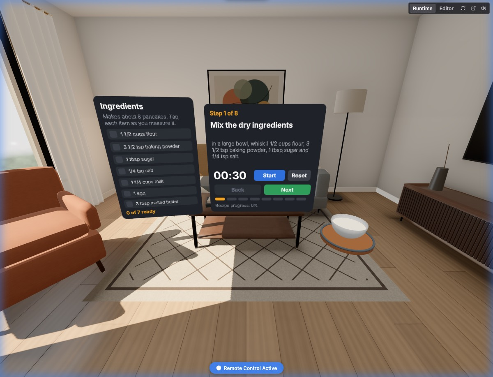</a> ✅ first try · 131 s · grab ✓ · buttons 3/3 · **4.5/5** Delivers everything requested (ingredient checklist with a 0-of-7 counter, Step 1 of 8 with Back/Next, a 00:30 timer with Start and Reset, and a segmented recipe progress bar) using a sensible classic pancake recipe, though the angled ingredients panel makes its rows slightly skewed, the step text i | <a href="gallery/muse-spark-1.3__recipe-coach__0.jpg">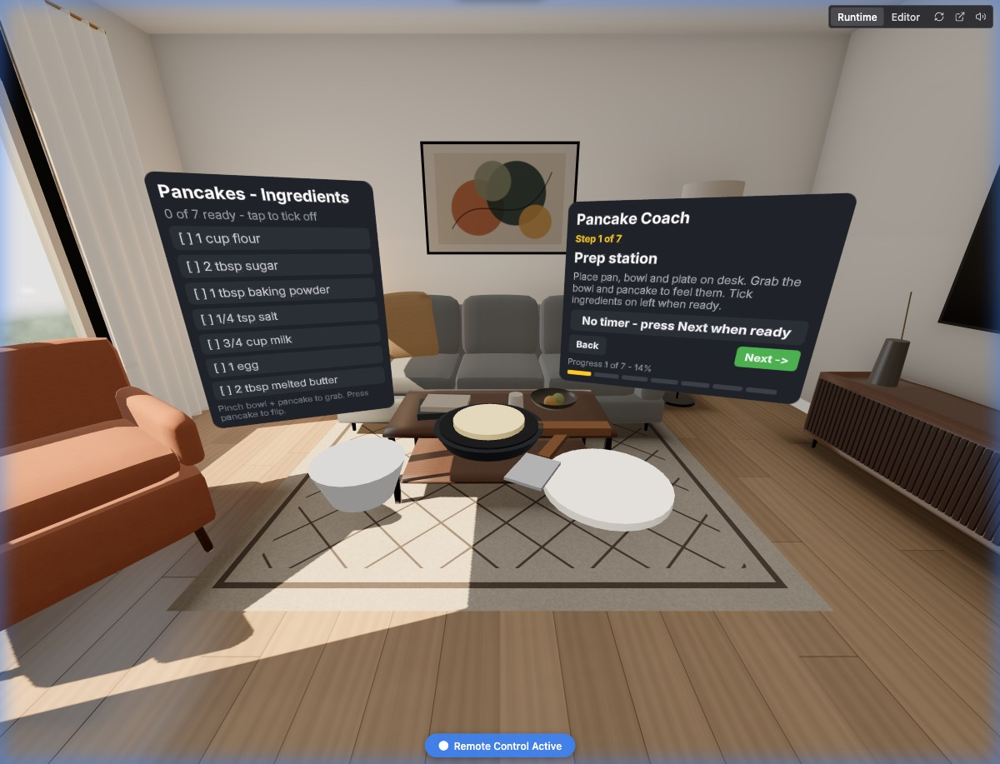</a> ✅ first try · 286 s · grab ✓ · press ✓ · buttons 3/3 · **4.0/5** Ingredient checklist, step card with Back/Next, a segmented progress bar and grabbable bowl/pan/plate props are all present, but the timer can't be verified because step 1 shows 'No timer' with no start/pause control visible; the left panel's footer text is cramped and partly clipped, and the Back b | <a href="gallery/deepseek-v4.1-flash__recipe-coach__0.jpg">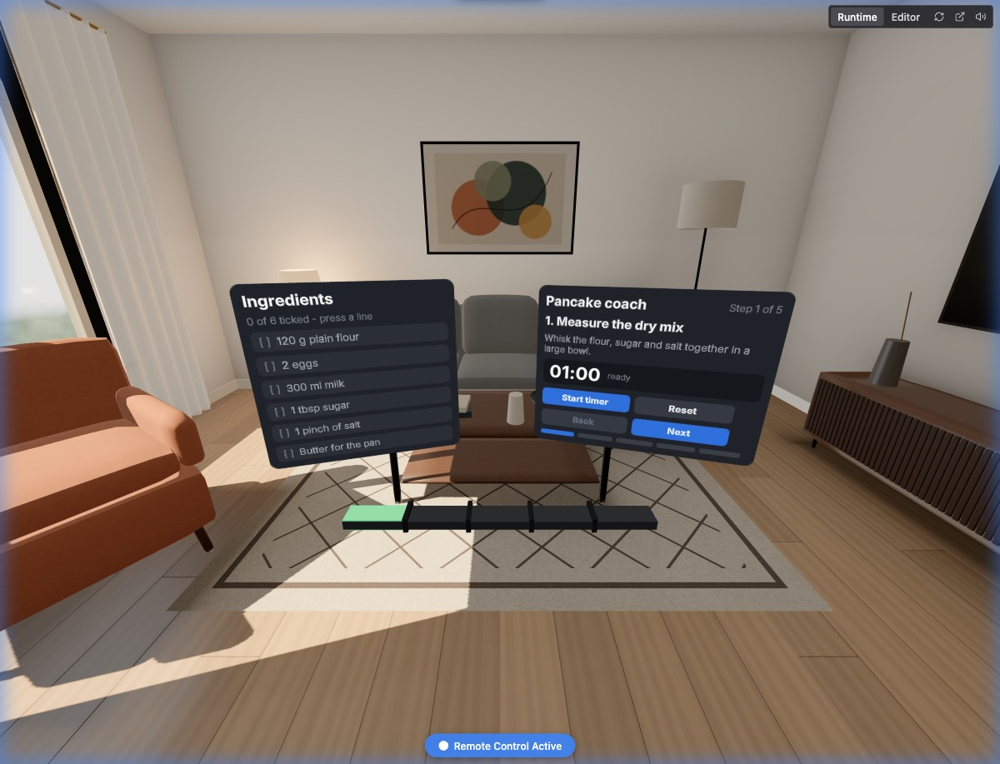</a> ✅ first try · 89 s · buttons 3/3 · **4.5/5** Covers every requested part: a tickable six-item ingredient checklist, a numbered step with Back/Next, a 01:00 timer with Start and Reset, and both a segmented in-panel progress bar and a 3D floor progress bar; the panels are slightly tilted, the bottom ingredient row is crowded near the panel edge, | <a href="gallery/muse-ember-1.0-max__recipe-coach__0.jpg">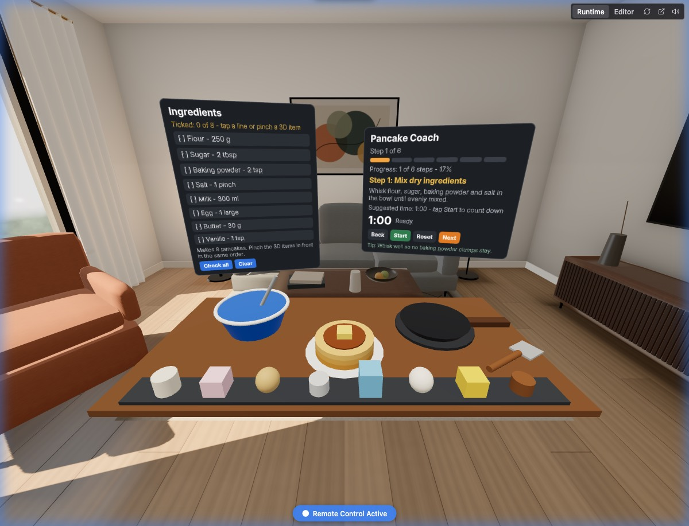</a> ✅ first try · 36 s · grab ✓ · press ✓ · buttons 3/3 · **4.5/5** Every requested feature is present: an 8-item ingredient checklist, a numbered 'Step 1 of 6' with Back/Next, a 1:00 timer with Start (a separate Pause control isn't visible but may toggle from Start), and a segmented progress bar, plus a 3D kitchen counter; the text is small and the checklist uses p | <a href="gallery/kimi-k3.1-pro-fw__recipe-coach__0.jpg">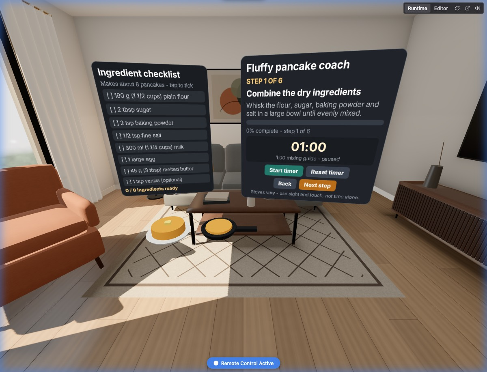</a> ✅ first try · 46 s · buttons 3/3 · **4.5/5** All requested parts are present: a tickable 8-item ingredient checklist with a ready counter, step 1 of 6 with Back and Next, a 01:00 timer with Start and Reset, a progress bar, and decorative pancakes. The text is legible and the quantities are sensible, though the checklist uses plain-text '[ ]' b |
| **T4** · pendulum-lab “A pendulum physics lab: a swinging pendulum, controls to change the string length and the gravity (Earth, Moon and Mars presets), a live readout of the period, and a small chart of the last 10 periods that updates as I change things” | <a href="gallery/claude-sonnet-5-5__pendulum-lab__0.jpg">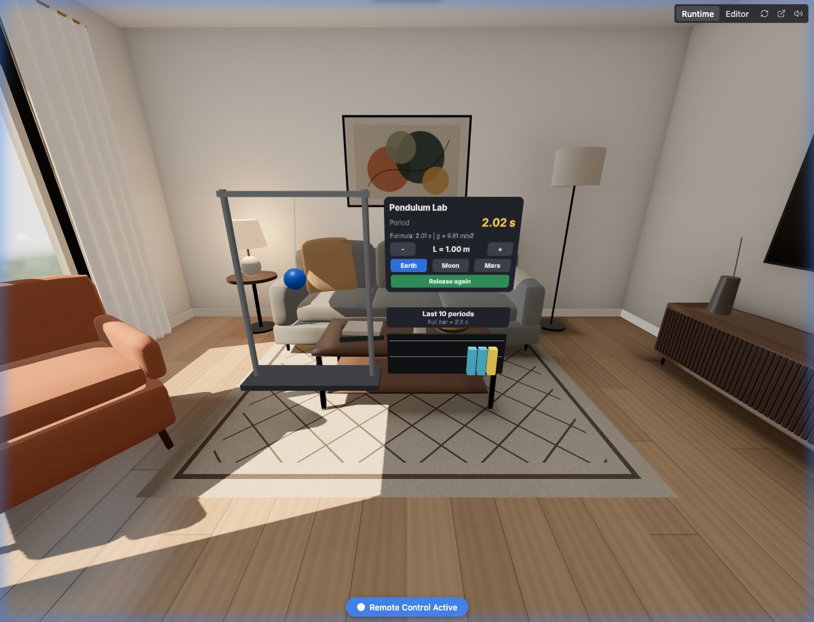</a> ✅ first try · 120 s · buttons 3/3 · **4.0/5** The pendulum rig, length stepper, Earth/Moon/Mars presets, period readout (2.02 s vs. the formula's 2.01 s for L=1 m, g=9.81, which is correct) and a last-10-periods bar chart are all present, but the string is nearly invisible, the panel overlaps the frame's top corner, the text is small and the ch | <a href="gallery/muse-spark-1.3__pendulum-lab__0.jpg">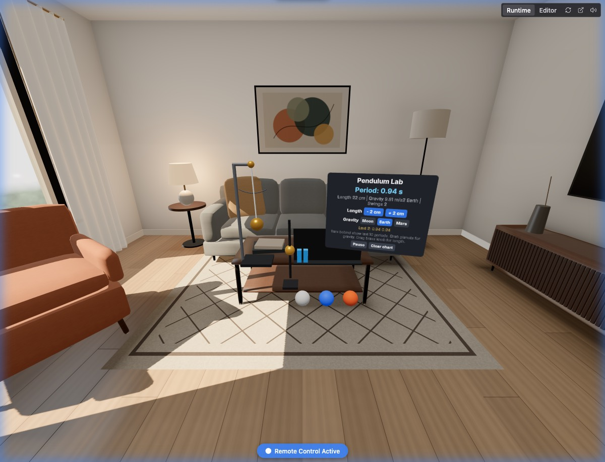</a> ✅ first try · 280 s · grab ✓ · press ✓ · buttons 3/3 · **4.0/5** Shows a swinging pendulum on a stand, length buttons, Moon/Earth/Mars presets with grabbable planet spheres, and a correct period readout (22 cm on Earth gives 0.94 s), but the 'chart' is just two tiny unlabeled blue bars on the table and the panel's small help text is hard to read. | <a href="gallery/deepseek-v4.1-flash__pendulum-lab__0.jpg">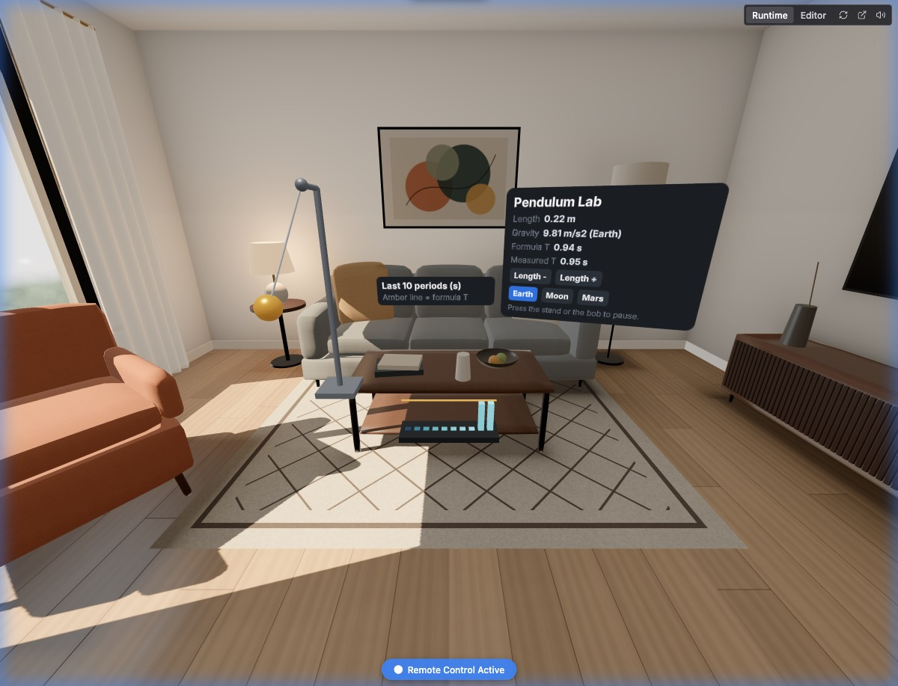</a> ✅ first try · 92 s · press ✓ · buttons 3/3 · **3.8/5** All requested parts are present: a pendulum on a stand, length −/+ buttons, Earth/Moon/Mars presets, and period readouts, where formula T ≈ 0.94 s correctly matches L = 0.22 m on Earth. However, the 'Last 10 periods' label floats far above its small, axis-less bar chart sitting by the coffee table,  | <a href="gallery/muse-ember-1.0-max__pendulum-lab__0.jpg">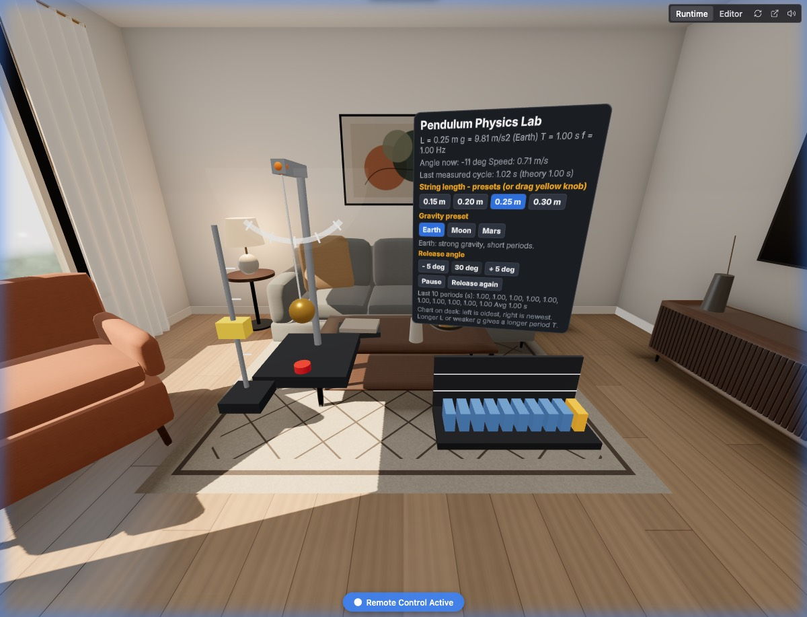</a> ✅ first try · 57 s · grab ✓ · press ✓ · buttons 3/3 · **4.5/5** It delivers everything requested: a 3D pendulum with a protractor arc, string-length presets plus a draggable yellow knob, Earth/Moon/Mars gravity buttons, a live period readout, and a 10-bar desk chart with the newest bar highlighted; the period is correct (T≈1.00 s for L=0.25 m on Earth), but the  | <a href="gallery/kimi-k3.1-pro-fw__pendulum-lab__0.jpg">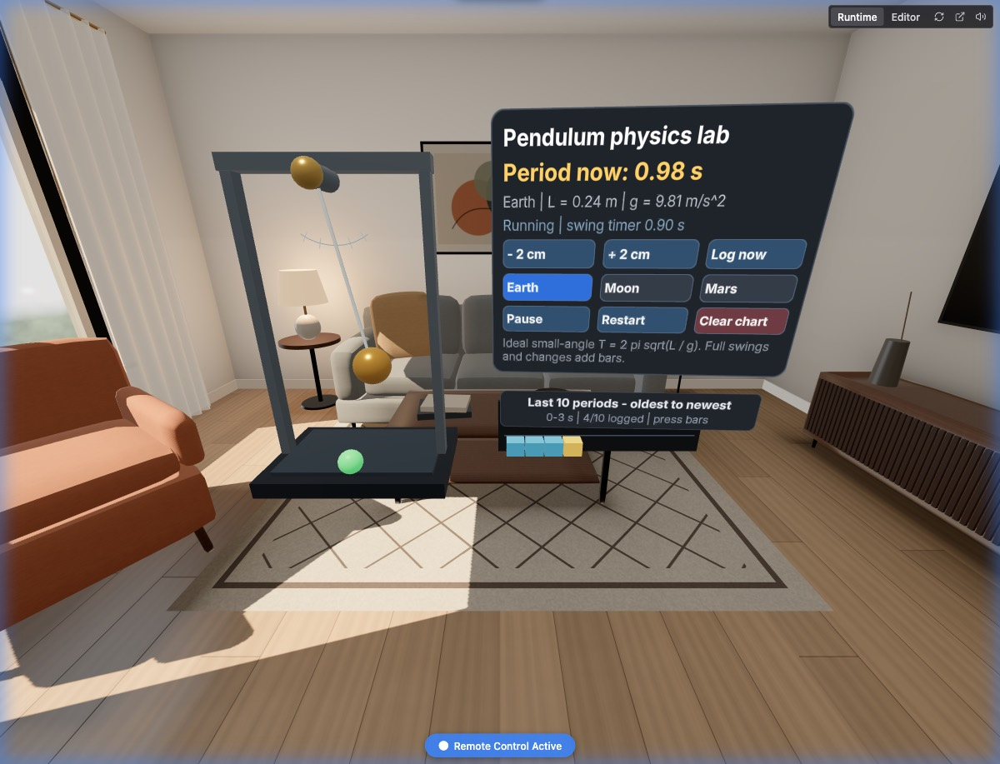</a> ✅ after 1 repair · 340 s · press ✓ · buttons 3/3 · **4.0/5** All requested pieces are present: a swinging pendulum in a frame, length buttons (±2 cm), Earth/Moon/Mars presets, a live period readout and a last-10-periods chart; the 0.98 s period matches 2π√(0.24/9.81). However, the chart is tiny with nearly uniform, hard-to-read bars, and the green ball on the |
| **T4** · headphone-shop “A shop for three headphones: browse them on a turntable carousel, pick a color and a size for the selected one, add it to a cart, see a cart panel with quantities I can change, and a checkout summary with subtotal, tax and total” | <a href="gallery/claude-sonnet-5-5__headphone-shop__0.jpg">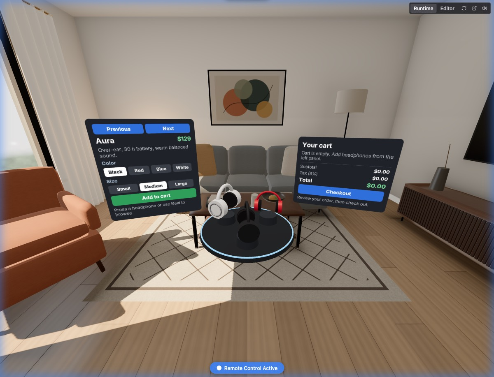</a> ✅ first try · 160 s · press ✓ · buttons 3/3 · **4.3/5** Turntable with three headphones, color/size chips, Add to cart, and a cart panel with subtotal, 8% tax and total are all present, but the cart starts empty so the quantity controls aren't visible, and the black headphone nearly disappears against the dark turntable; panels are legible though the lef | <a href="gallery/muse-spark-1.3__headphone-shop__0.jpg">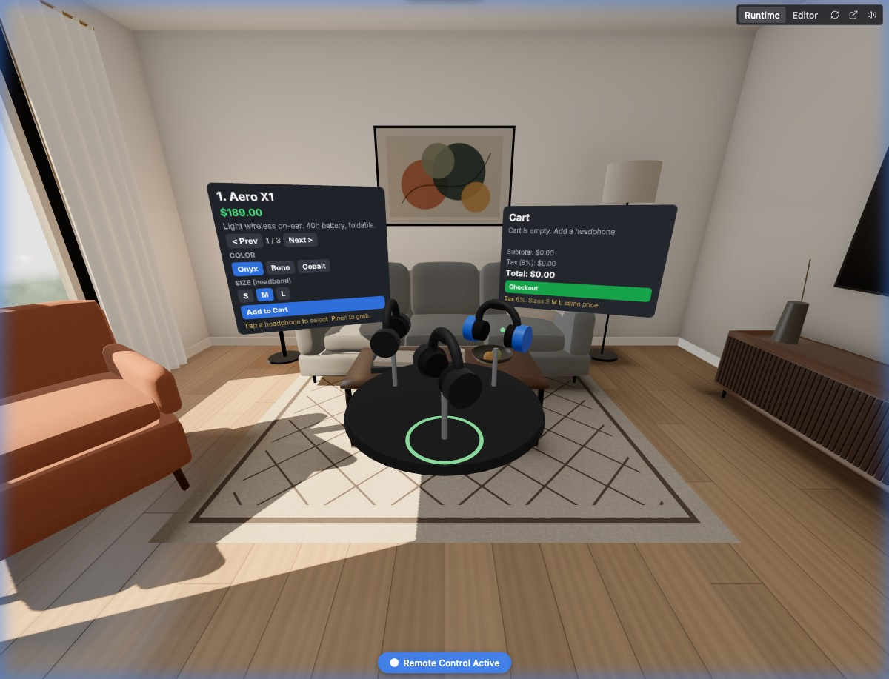</a> ✅ first try · 182 s · grab ✗ · press ✓ · buttons 1/3 · **4.0/5** Turntable with three headphones, a product panel with Prev/Next, color and size buttons and Add to Cart, and a cart panel with subtotal, tax, total and Checkout are all present (quantity controls can't be seen while the cart is empty), but a headphone on the turntable overlaps the bottom of the prod | <a href="gallery/deepseek-v4.1-flash__headphone-shop__0.jpg">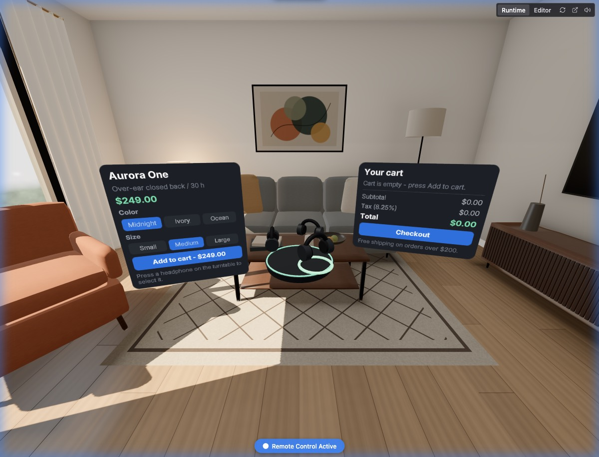</a> ✅ first try · 103 s · press ✓ · buttons 3/3 · **4.3/5** Shows a turntable with three headphone models, a product panel with color and size chips and an Add to cart button, and a cart/checkout panel with subtotal, 8.25% tax and total; quantity controls are not visible because the cart is empty, the headphones are small and slightly cluttered on the turnta | <a href="gallery/muse-ember-1.0-max__headphone-shop__0.jpg">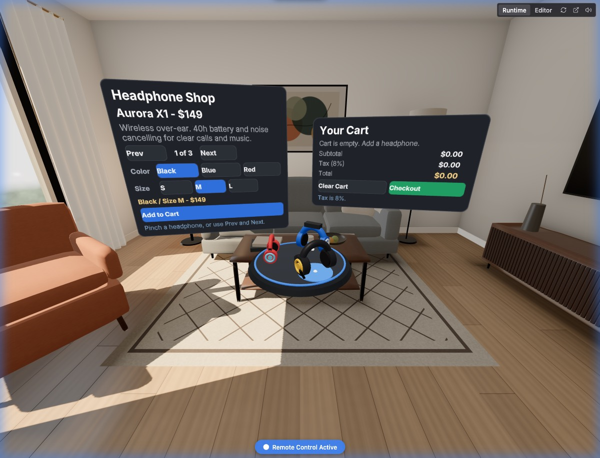</a> ✅ first try · 44 s · press ✓ · buttons 3/3 · **4.3/5** A turntable with three headphones, a product panel with Prev/Next, color and size selectors, Add to Cart, and a cart with subtotal, tax and total all cover the request; quantity controls aren't visible because the cart is empty, the button labels sit left-aligned and slightly cramped, and the headph | <a href="gallery/kimi-k3.1-pro-fw__headphone-shop__0.jpg">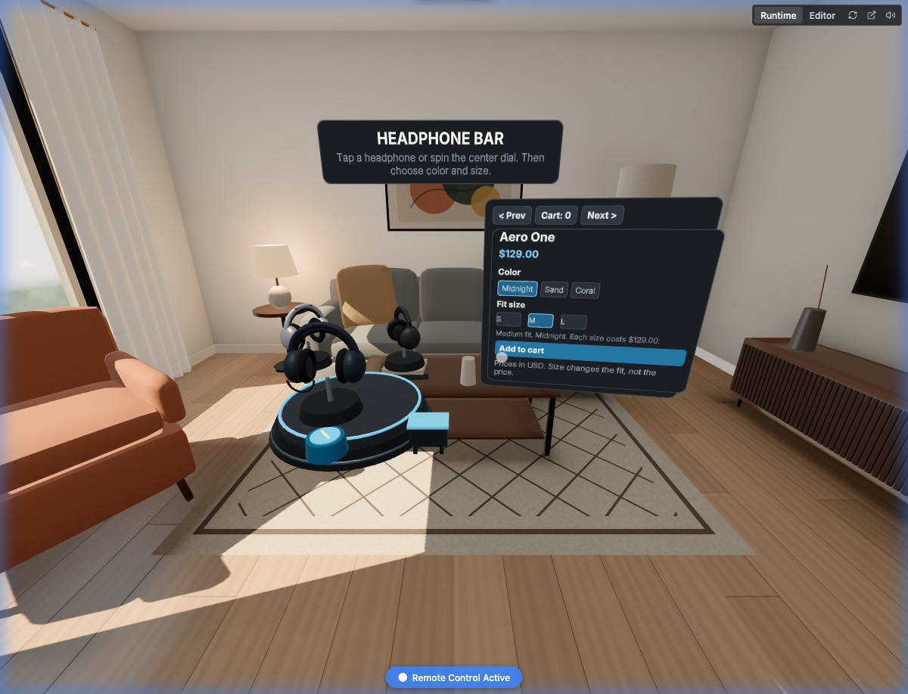</a> ✅ first try · 99 s · press ✓ · buttons 0/3 · **3.3/5** The turntable carousel holding three headphones, the color and size options, and the Add to cart button are all present, but no cart panel with changeable quantities or checkout summary (subtotal, tax, total) is visible; the product panel is cramped, with size-button labels misaligned, a slider hand |
| **T4** · sprint-board “A sprint board with To do, In progress, Review and Done columns, six task cards with priority colors that I can move between columns with arrow buttons, a filter to show only high priority, and a burndown chart that updates when cards reach Done” | <a href="gallery/claude-sonnet-5-5__sprint-board__0.jpg">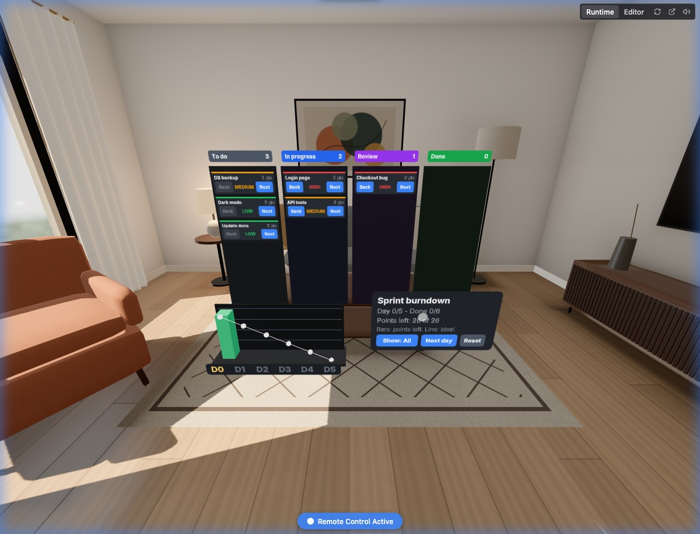</a> ✅ after 1 repair · 213 s · buttons 2/3 · **4.3/5** All requested pieces are present: four columns, six priority-colored cards whose points total 26, Back/Next arrows, a Show: All filter, and a burndown chart with an ideal line; however, the chart and control panel overlap the bottoms of the columns, and the card text is quite small. | <a href="gallery/muse-spark-1.3__sprint-board__0.jpg">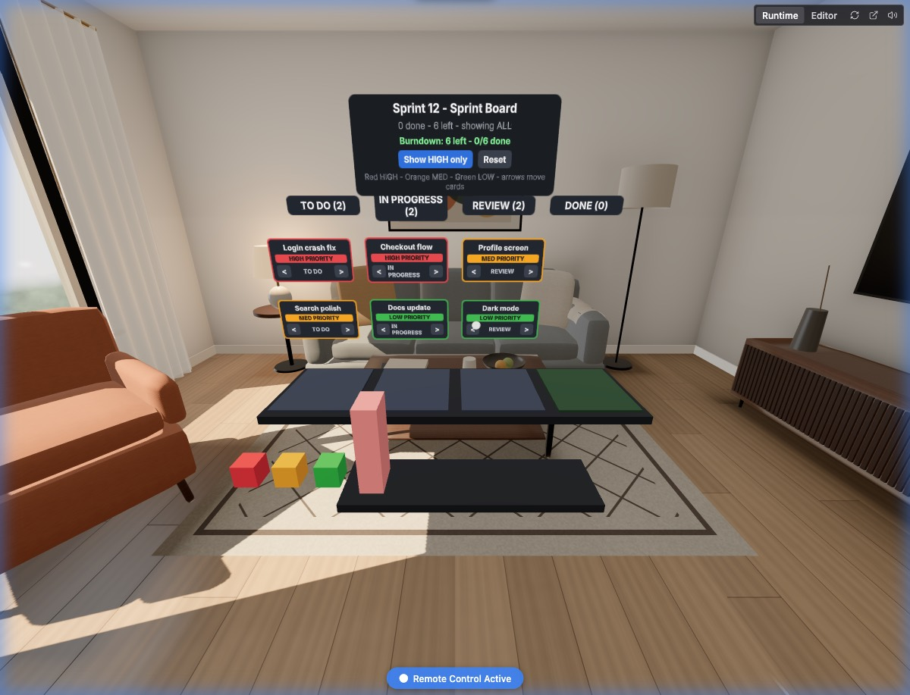</a> ✅ first try · 831 s · grab ✓ · buttons 2/3 · **3.8/5** All requested parts are present: four columns, six priority-colored cards with arrow buttons, a HIGH-only filter, Reset, and a burndown readout. The burndown 'chart' is only a single bar on a slab, column headers are misaligned with the cards, and the 'In progress' header overlaps the board panel. C | <a href="gallery/deepseek-v4.1-flash__sprint-board__0.jpg">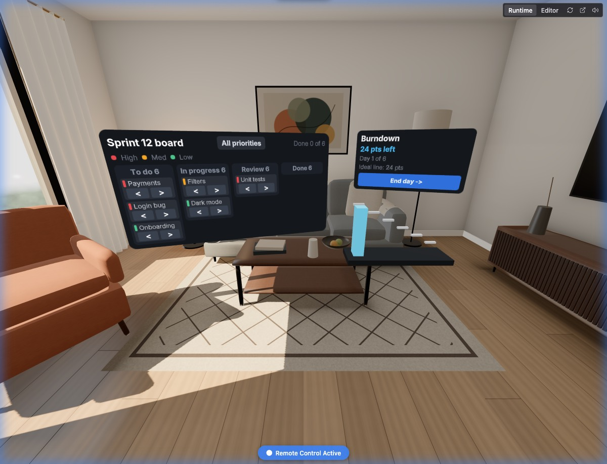</a> ✅ first try · 144 s · buttons 3/3 · **3.5/5** All requested parts are present: four columns, six priority-colored cards with arrow buttons, a priority filter toggle and a 3D burndown with an End day button, but every column header wrongly reads 6 (To do 6, In progress 6, Review 6, Done 6) when the cards are split 3/2/1/0, and the arrow buttons  | <a href="gallery/muse-ember-1.0-max__sprint-board__0.jpg">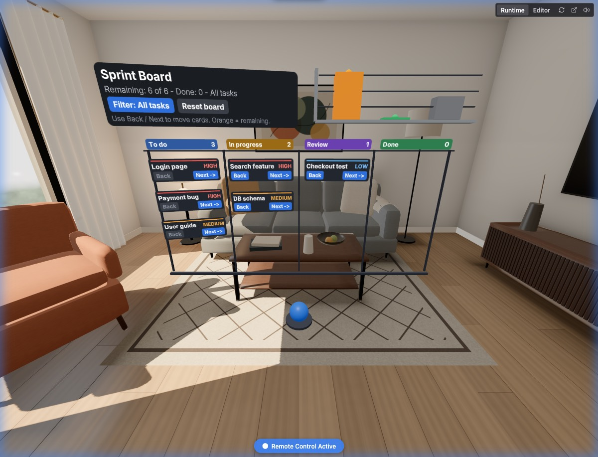</a> ✅ first try · 60 s · grab ✓ · press ✓ · buttons 3/3 · **3.8/5** All four columns, six priority-colored cards with Back/Next buttons, a filter toggle, and reset are present, and the column counts match 'Remaining 6 of 6'; however, the burndown chart is an unlabeled set of 3D bars with no axes, partly crowded behind the header panel, and the card text is small and | <a href="gallery/kimi-k3.1-pro-fw__sprint-board__0.jpg">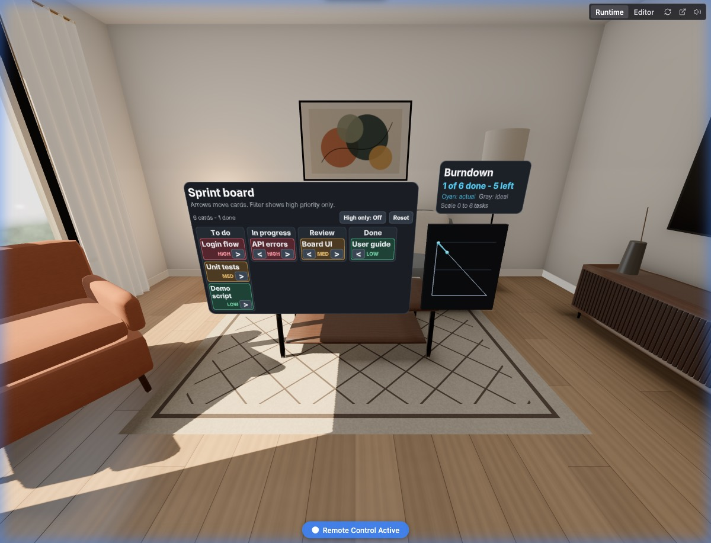</a> ✅ first try · 291 s · buttons 1/3 · **4.3/5** All requested parts are present: four columns, six priority-colored cards with arrow buttons, a high-only filter, reset, and a burndown chart whose '1 of 6 done' matches the board; however, the To do cards are staggered and the last one nearly spills off the panel, the burndown pieces float as disjo |
| **T4** · smart-home “A smart-home controller with a small 3D model of an apartment: dim the lights per room, a thermostat I can turn up and down, scene buttons (Movie, Dinner, Away) that change several settings at once, and an energy-use chart for today” | <a href="gallery/claude-sonnet-5-5__smart-home__0.jpg">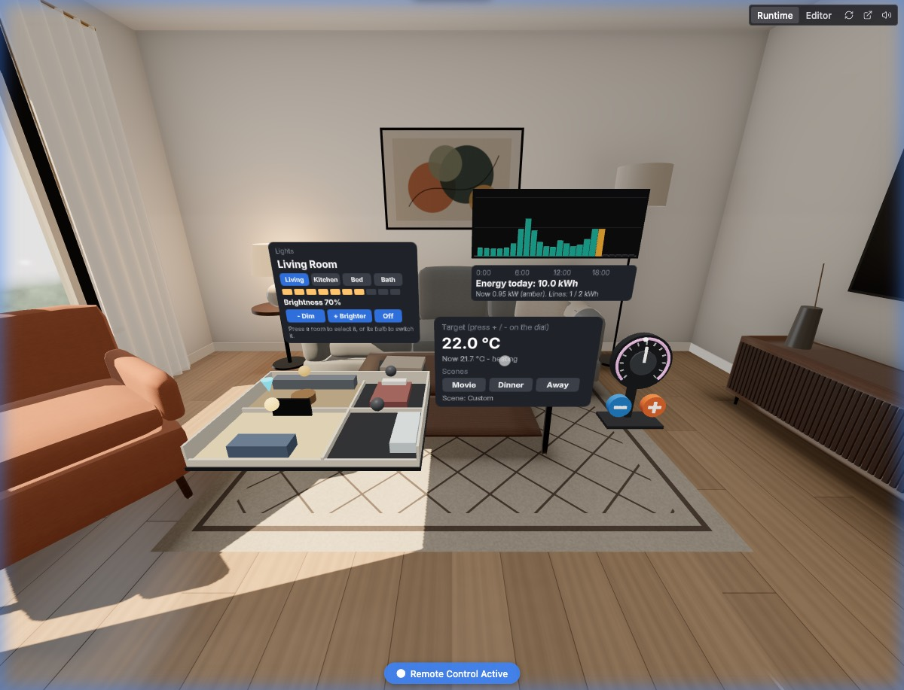</a> ✅ first try · 600 s · press ✓ · buttons 0/3 · **4.0/5** All requested parts are present: a 3D apartment model with room bulbs, a lights panel with per-room selection, Dim/Brighter/Off and a brightness bar, a thermostat dial with +/- buttons, Movie/Dinner/Away scene buttons and an energy chart for today; however the panels are small and some text is tiny, | <a href="gallery/muse-spark-1.3__smart-home__0.jpg">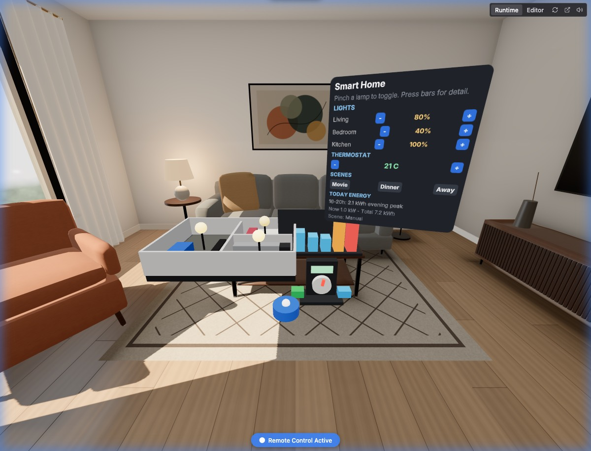</a> ✅ first try · 282 s · grab ✓ · press ✓ · buttons 3/3 · **3.8/5** Delivers a 3D apartment model with lamps, a thermostat dial, energy bars, and a panel with per-room light +/- controls, a thermostat, Movie/Dinner/Away scenes and today's energy summary; however, the energy text at the panel's bottom edge is cramped and partly clipped, the energy chart is partly hid | <a href="gallery/deepseek-v4.1-flash__smart-home__0.jpg">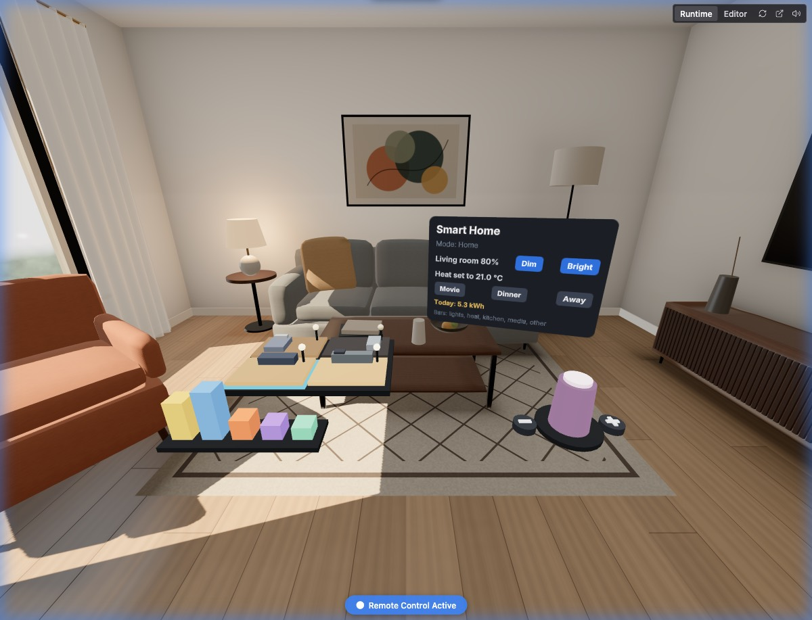</a> ✅ first try · 117 s · press ✓ · buttons 3/3 · **3.5/5** Every requested element is present: a small 3D apartment model with light-post markers, a dial thermostat with −/+ buttons, Movie/Dinner/Away scene buttons, and a kWh bar chart; however, dimming only covers the living room, the energy chart has no labels or axis and is not clearly 'today', and the f | <a href="gallery/muse-ember-1.0-max__smart-home__0.jpg">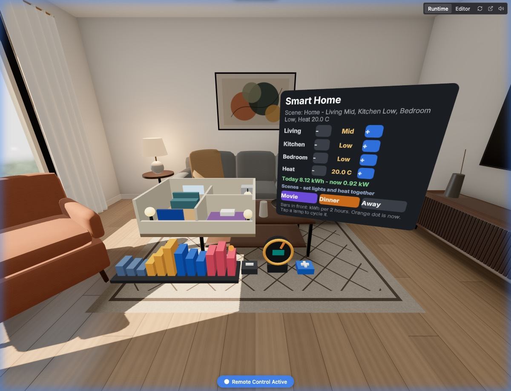</a> ✅ first try · 40 s · grab ✓ · press ✓ · buttons 3/3 · **3.8/5** Everything requested is present: a 3D apartment cutaway with lamps, per-room light controls, a heat stepper with a 3D dial, Movie/Dinner/Away scene buttons and a 3D energy bar chart. However, the panel is tilted and its text is small and somewhat cramped, the minus buttons are faint, and the energy  | <a href="gallery/kimi-k3.1-pro-fw__smart-home__0.jpg">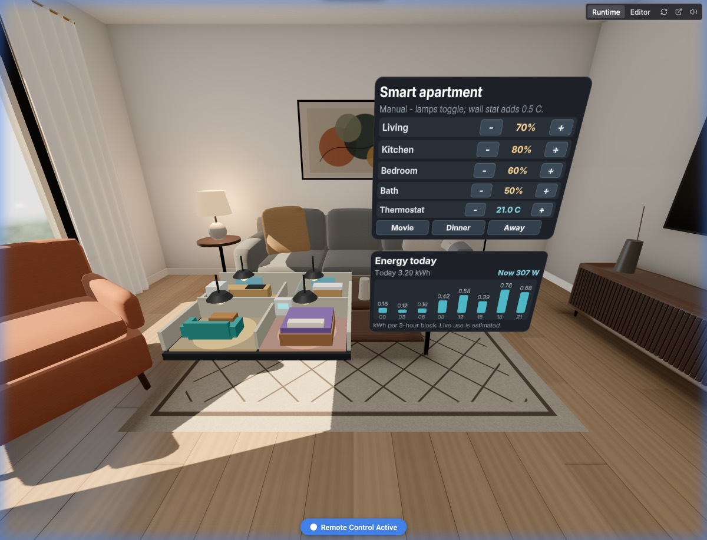</a> ✅ first try · 301 s · press ✓ · buttons 3/3 · **4.3/5** Everything requested is present: a 3D apartment model with lamps, per-room dimmers, a thermostat with +/- buttons, Movie/Dinner/Away scene buttons and a 3-hour energy bar chart. The panels are legible, though the chart labels are small and the 'Manual - lamps toggle' subtitle is cryptic. The bars su |
| **T4** · arm-bones “An interactive model of the bones of the human arm: grab bones to pull them apart and a button to reassemble them, tap a bone to see its name and what it does, and a 5-question quiz with a score and feedback after each answer” | <a href="gallery/claude-sonnet-5-5__arm-bones__0.jpg">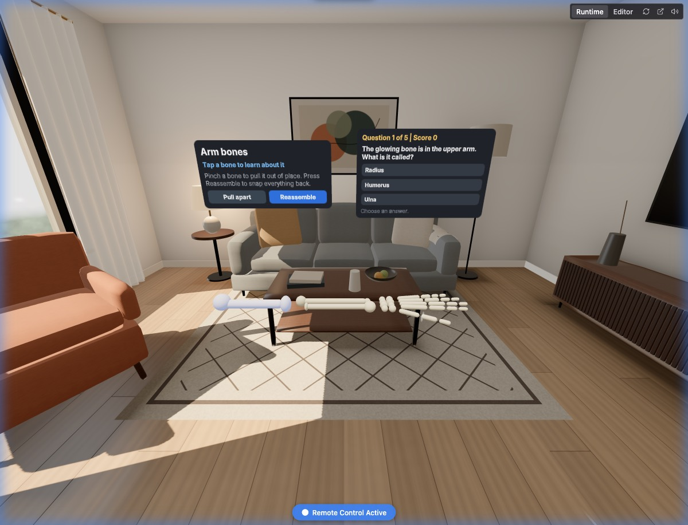</a> ✅ first try · 160 s · grab ✓ · press ✓ · buttons 2/3 · **4.0/5** Includes the arm bone model (humerus highlighted, forearm, carpals, metacarpals, phalanges), pull-apart and reassemble buttons, a tap-to-learn hint, and a 5-question quiz with score and answer buttons; however, the radius and ulna look merged into a single forearm bone, the model is small and laid f | <a href="gallery/muse-spark-1.3__arm-bones__0.jpg">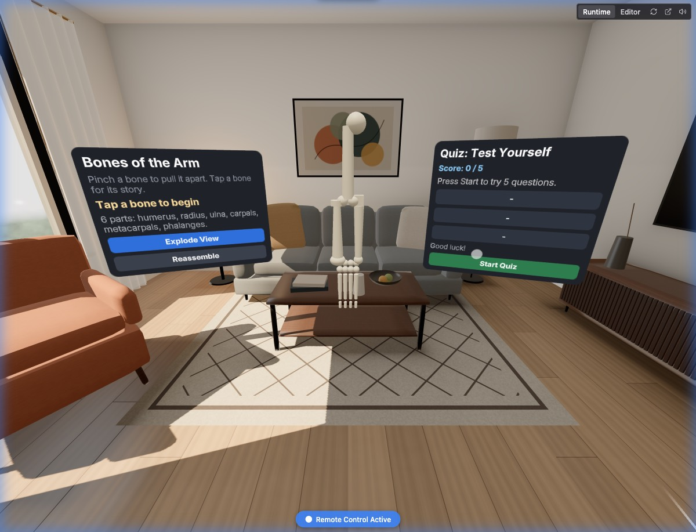</a> ✅ first try · 240 s · grab ✓ · press ✓ · buttons 3/3 · **4.0/5** Delivers a vertical arm model of humerus, radius/ulna, carpals, metacarpals and phalanges, plus an info panel with Explode and Reassemble buttons and a quiz panel with score and a Start button; the bones are schematic cylinders with only four phalanx columns and look a bit thin, and a small white do | <a href="gallery/deepseek-v4.1-flash__arm-bones__0.jpg">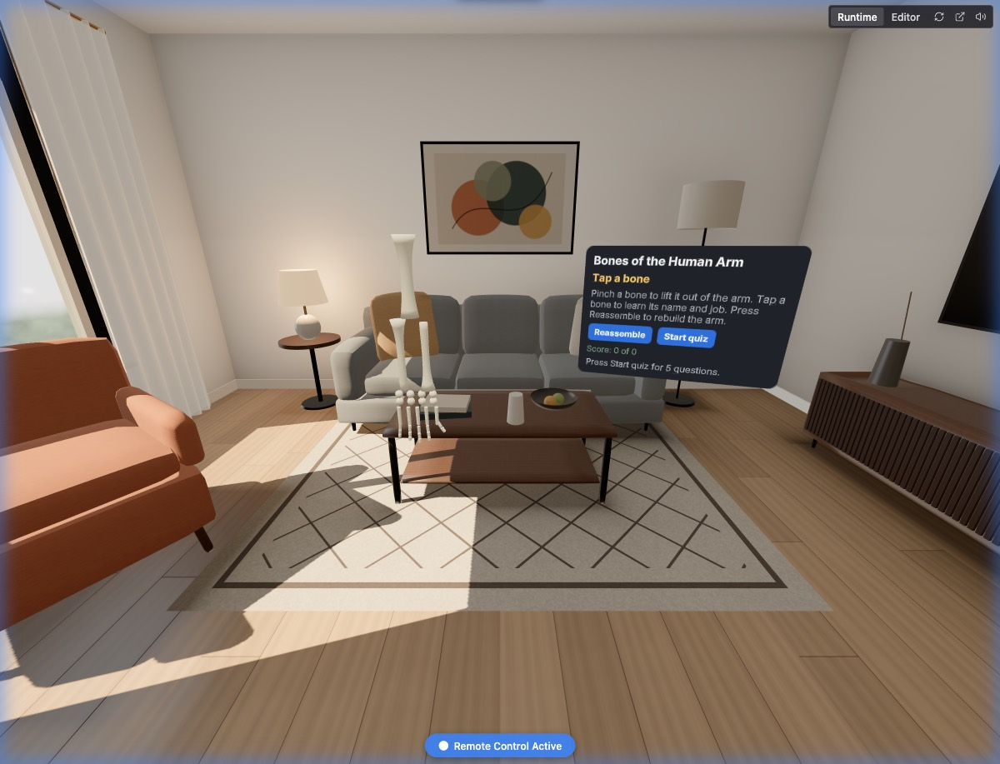</a> ✅ first try · 103 s · grab ✓ · press ✓ · buttons 2/2 · **3.5/5** A simplified arm skeleton with a humerus, two forearm bones and finger bones stands beside a panel with instructions, a Reassemble button, a Start quiz button and a score, which covers the request, but the model is small, plain white and partly lost against the sofa, and nothing on the bones themsel | <a href="gallery/muse-ember-1.0-max__arm-bones__0.jpg">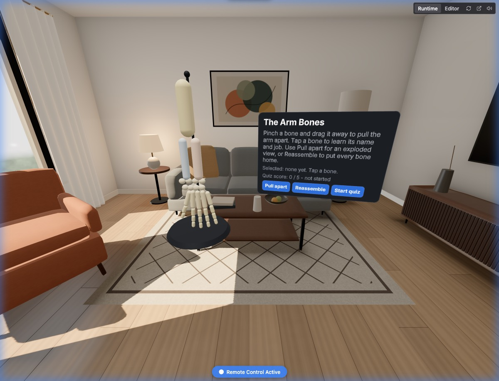</a> ✅ first try · 54 s · grab ✓ · press ✓ · buttons 3/3 · **4.0/5** A stylized arm (humerus, two forearm bones, carpals and finger bones on a base) sits beside a legible panel with instructions, a selection readout, a 0/5 quiz score and Pull apart / Reassemble / Start quiz buttons, though the bones are simple capsules with no visible grab affordances, and the quiz c | <a href="gallery/kimi-k3.1-pro-fw__arm-bones__0.jpg">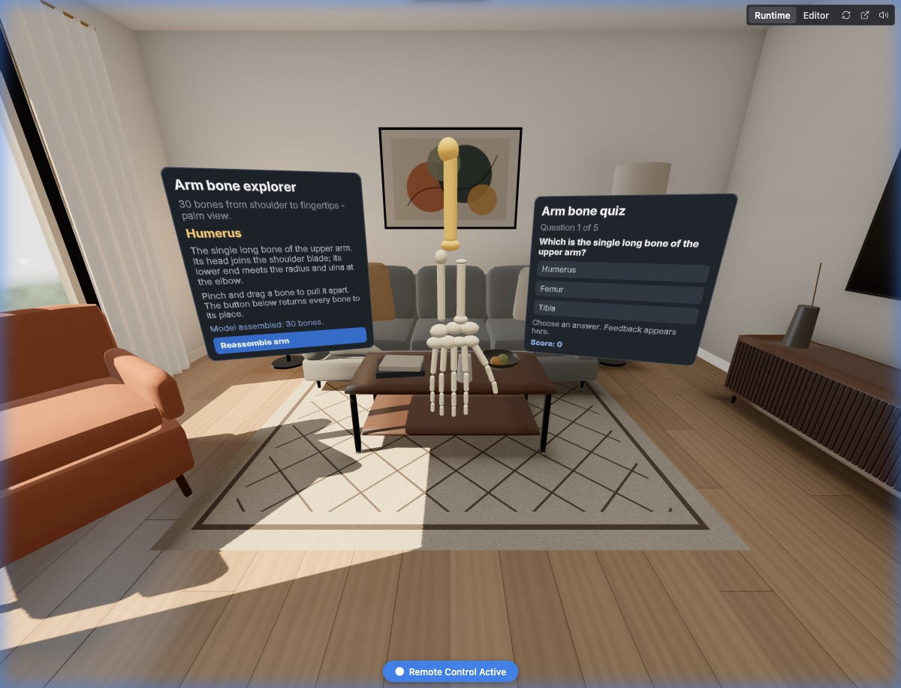</a> ✅ first try · 570 s · grab ✓ · press ✓ · buttons 3/3 · **4.3/5** Includes the 30-bone arm model with the humerus highlighted, an accurate info panel with a Reassemble button, and a 5-question quiz showing a score; the bone model is fairly crude (sphere carpals, simple cylinders) and the bones themselves have no strong grab cue beyond the text instructions. |
| **T4** · trip-planner “A 3-day trip planner for Paris: a 3D map table with six landmark pins, tap a pin for details and buttons to add it to day 1, 2 or 3, an itinerary panel per day with buttons to reorder or remove stops, and the total walking time per day” | <a href="gallery/claude-sonnet-5-5__trip-planner__0.jpg">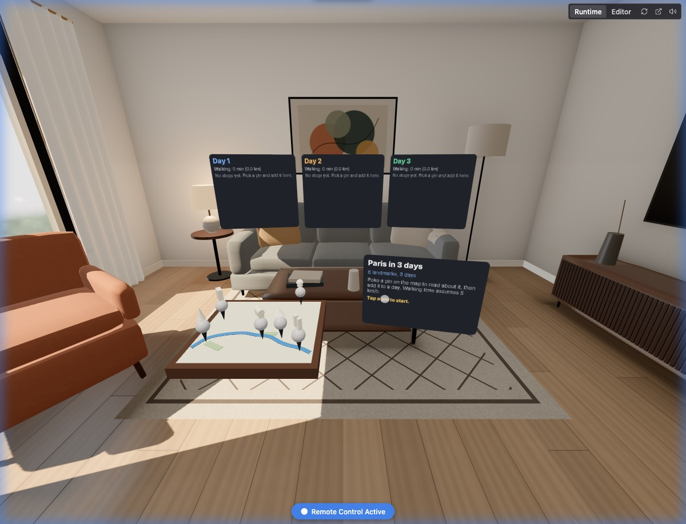</a> ✅ first try · 235 s · press ✓ · **3.3/5** A map table with a Seine-like river, landmark pins, three day panels showing 0-minute walking totals and an intro panel are all present, but the pins are unlabeled, one pin appears to float off the map edge, the panel text is small, and no add, reorder or remove buttons are visible yet, so the main  | <a href="gallery/muse-spark-1.3__trip-planner__0.jpg">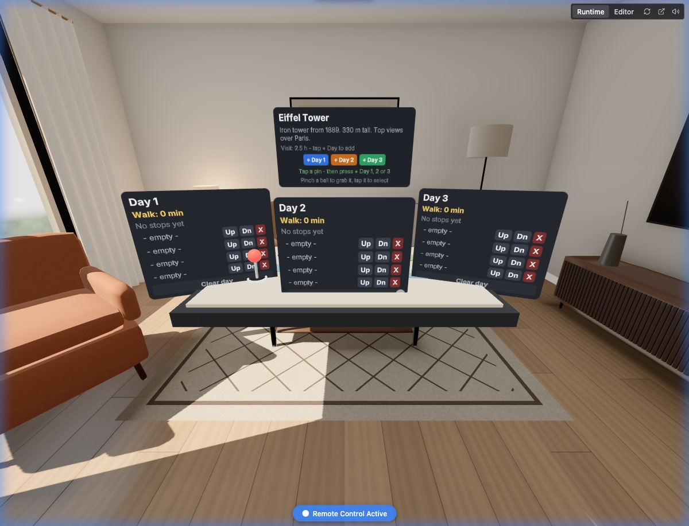</a> ✅ after 1 repair · 259 s · grab ✓ · press ✓ · buttons 0/3 · **2.8/5** The detail card for the Eiffel Tower (1889, 330 m, accurate) and the three day panels with Up/Dn/X buttons and walk times are present, but the map table is almost entirely hidden behind the itinerary panels, only one pin is visible (poking through Day 1's buttons), and the Day 2 panel overlaps its n | <a href="gallery/deepseek-v4.1-flash__trip-planner__0.jpg">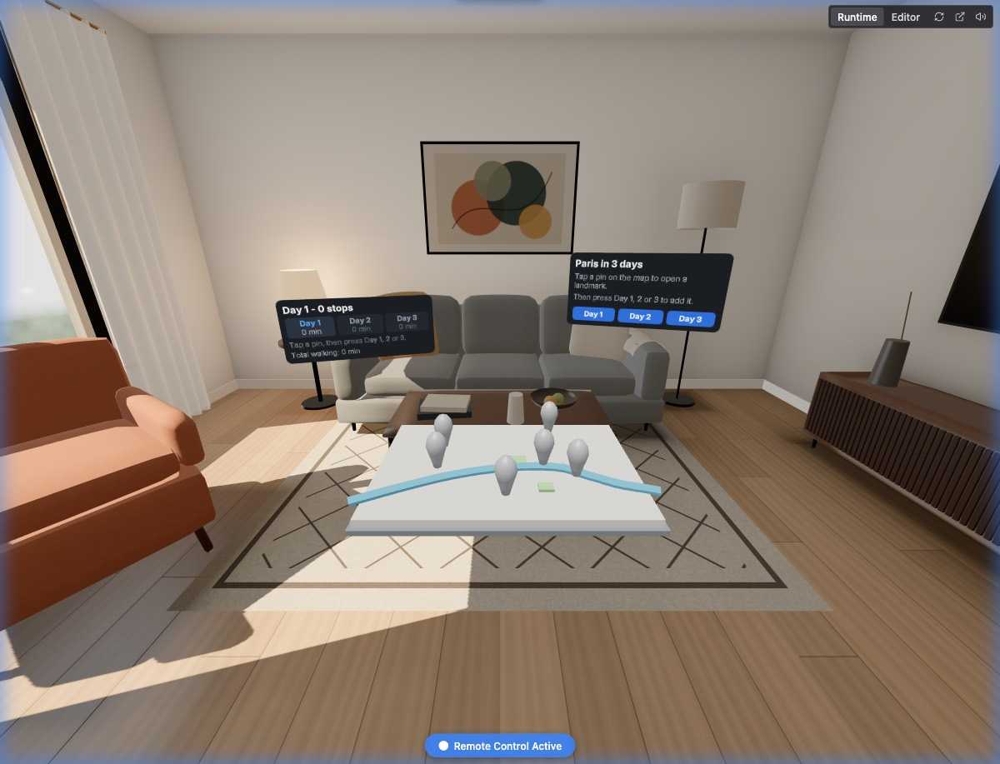</a> ✅ first try · 132 s · press ✓ · buttons 0/3 · **3.8/5** Shows a 3D map table with six identical unlabeled pins and a Seine-like river, an itinerary panel with Day 1/2/3 tabs and a walking-time readout, and a details panel with add-to-day buttons; reorder/remove controls aren't visible in the empty state and the pins have no landmark labels, while the pan | <a href="gallery/muse-ember-1.0-max__trip-planner__0.jpg">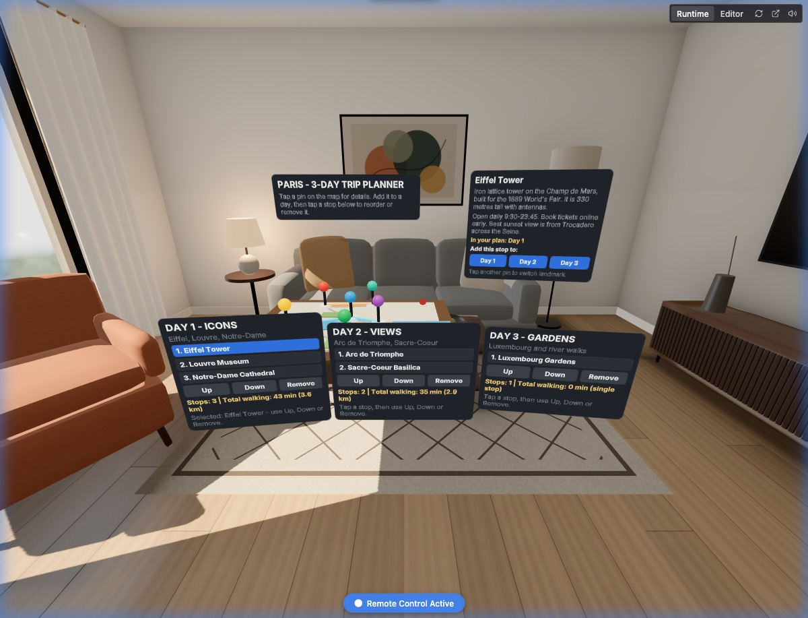</a> ✅ first try · 51 s · press ✓ · buttons 0/3 · **3.8/5** Every requested element is present: a map table with six or seven pins, a details panel with Day 1/2/3 buttons, three itinerary panels with Up/Down/Remove, and a walking time per day, but the itinerary panels cover most of the map table so the pins and map are hard to see. The Eiffel Tower facts are | <a href="gallery/kimi-k3.1-pro-fw__trip-planner__0.jpg">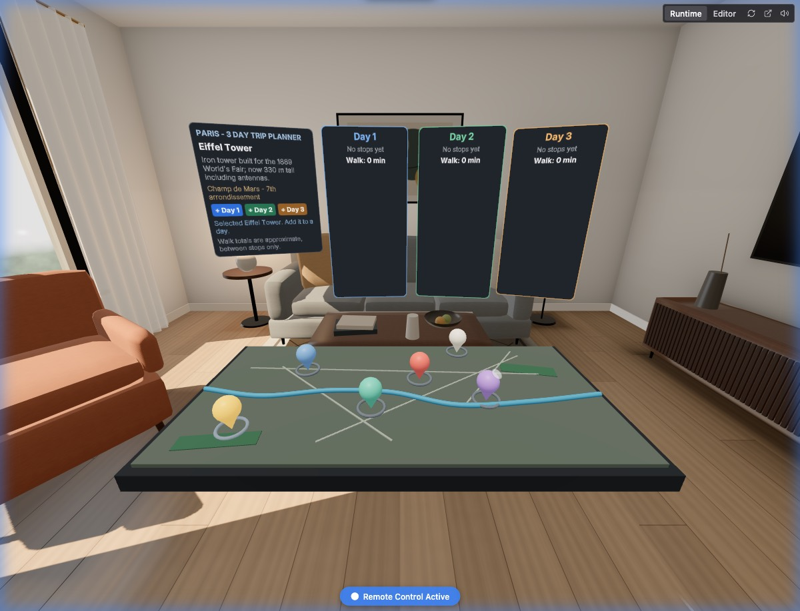</a> ✅ after 1 repair · 338 s · press ✓ · buttons 3/3 · **4.3/5** The 3D map table with six pins and a river, the Eiffel Tower detail panel with +Day 1/2/3 buttons, and three day panels with walk totals all match the request, and the Eiffel Tower facts are accurate; however, the pins are unlabeled, the reorder and remove controls are not visible because all days a |
| **T4** · chess-puzzle “A mate-in-one chess puzzle on a 3D board: select a piece to highlight its legal moves, move it by pressing a highlighted square, a hint button, an undo button, and a clear success or try-again message” | <a href="gallery/claude-sonnet-5-5__chess-puzzle__0.jpg">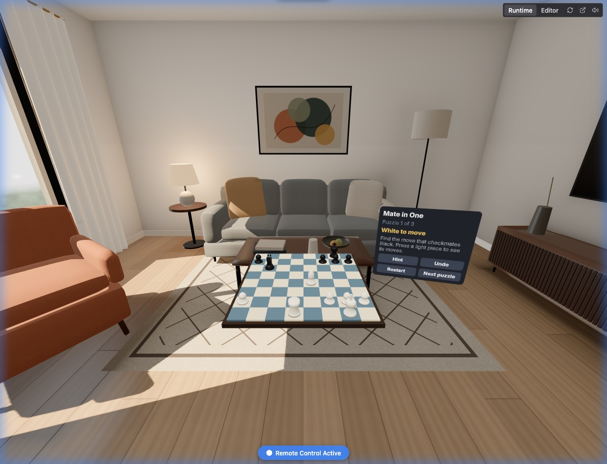</a> ✅ first try · 232 s · press ✓ · buttons 0/3 · **3.8/5** A 3D board sits on the coffee table beside a tidy panel with the title, 'White to move', instructions, and Hint/Undo/Restart/Next puzzle buttons, though no move highlights or result message are visible in this state; the pieces are small and hard to tell apart, the board spills slightly past the tab | <a href="gallery/muse-spark-1.3__chess-puzzle__0.jpg">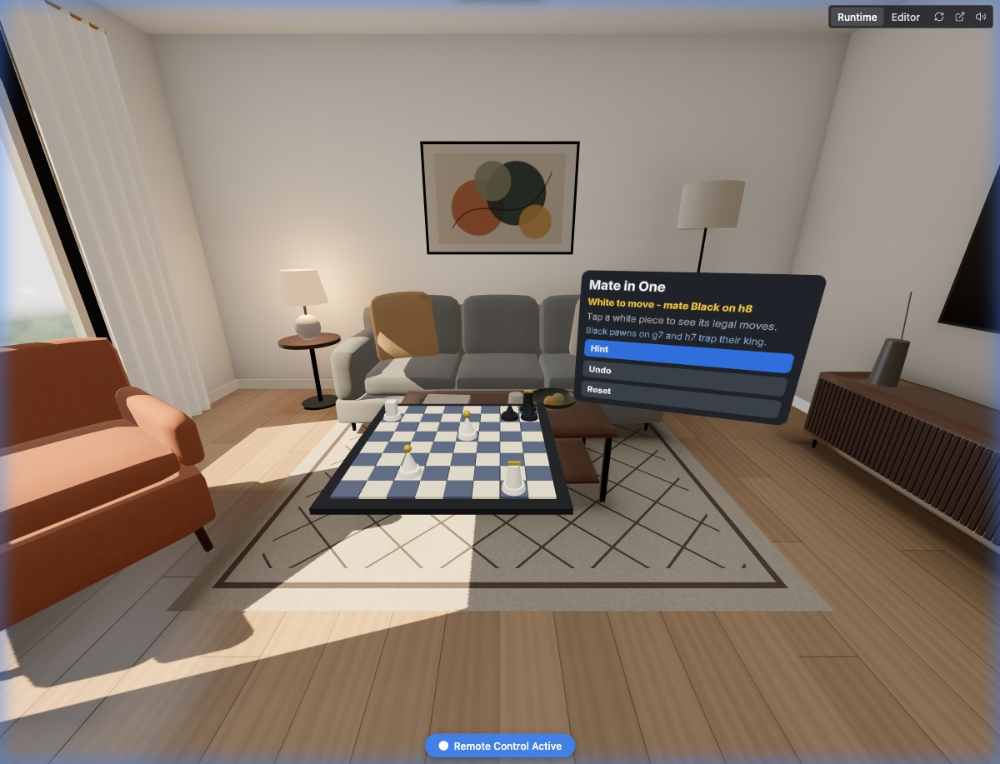</a> ✅ first try · 608 s · press ✓ · buttons 3/3 · **3.5/5** A 3D board with a plausible back-rank mate-in-one setup (black king on h8 hemmed in by its g7/h7 pawns) sits beside a panel with a clear instruction and Hint/Undo/Reset buttons; however, the pieces are small and hard to tell apart, no square highlighting or success/try-again feedback is visible yet, | <a href="gallery/deepseek-v4.1-flash__chess-puzzle__0.jpg">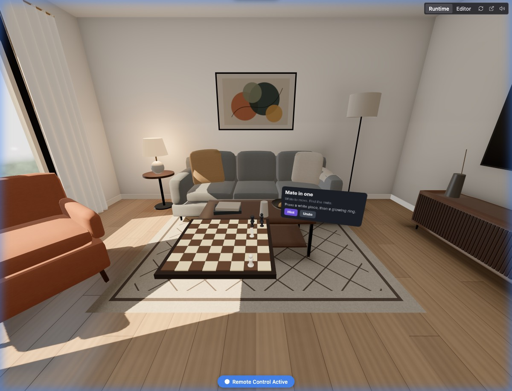</a> ✅ first try · 143 s · press ✓ · buttons 2/2 · **3.3/5** A 3D board with a few pieces and a panel offering a 'Mate in one' prompt, Hint and Undo buttons is present, but the pieces are tiny and hard to identify, the panel text is small, no legal-move highlights or result message are visible yet, and the puzzle's validity can't be confirmed. | <a href="gallery/muse-ember-1.0-max__chess-puzzle__0.jpg">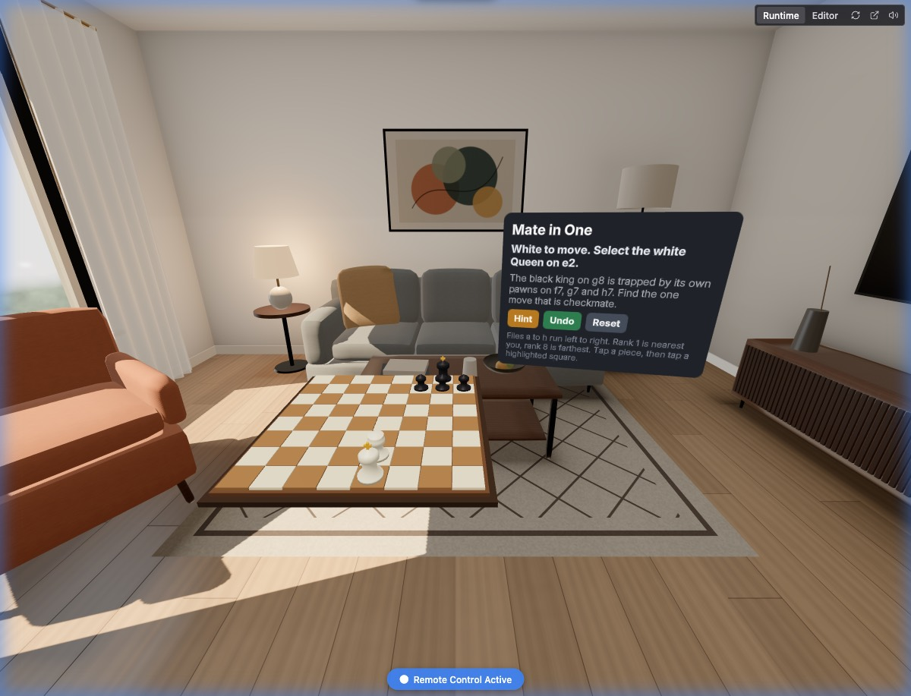</a> ✅ first try · 50 s · press ✗ · buttons 3/3 · **3.5/5** The 3D board shows a plausible back-rank mate setup (black king g8 boxed in by its f7/g7/h7 pawns, white queen on e2, so Qe8# works), and the panel has Hint, Undo and Reset buttons. The pieces are small and partly occlude each other, the panel is tilted with small text, and no highlighted squares or | <a href="gallery/kimi-k3.1-pro-fw__chess-puzzle__0.jpg">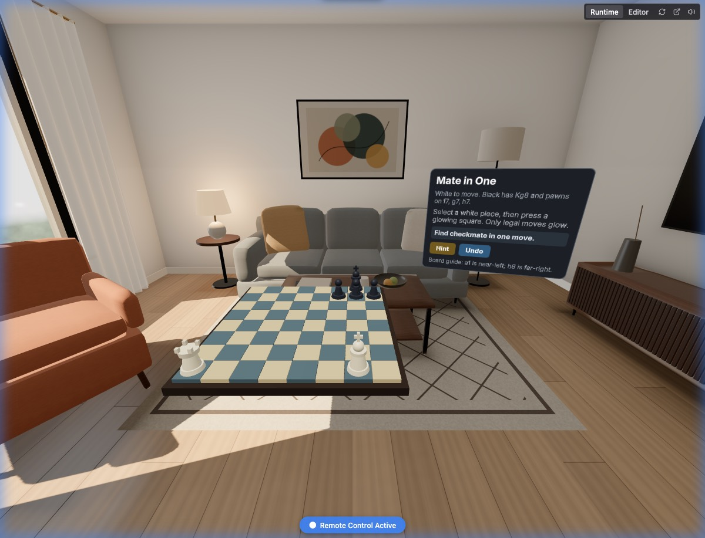</a> ✅ first try · 606 s · press ✓ · buttons 2/2 · **4.3/5** A valid back-rank mate-in-one (Ra1–a8 vs Kg8 with f7/g7/h7 pawns) is set on a 3D board with clear instructions and Hint/Undo buttons. The far-side black pieces are small and the panel text is fairly small. No selection or success/try-again state is visible yet, though the feedback line is present. |
| **T4** · budget-dashboard “A personal budget dashboard: a donut chart of spending by category, a bar chart of the last six months, tapping a category filters the bar chart to that category, and a savings goal progress ring with a button to log a deposit” | <a href="gallery/claude-sonnet-5-5__budget-dashboard__0.jpg">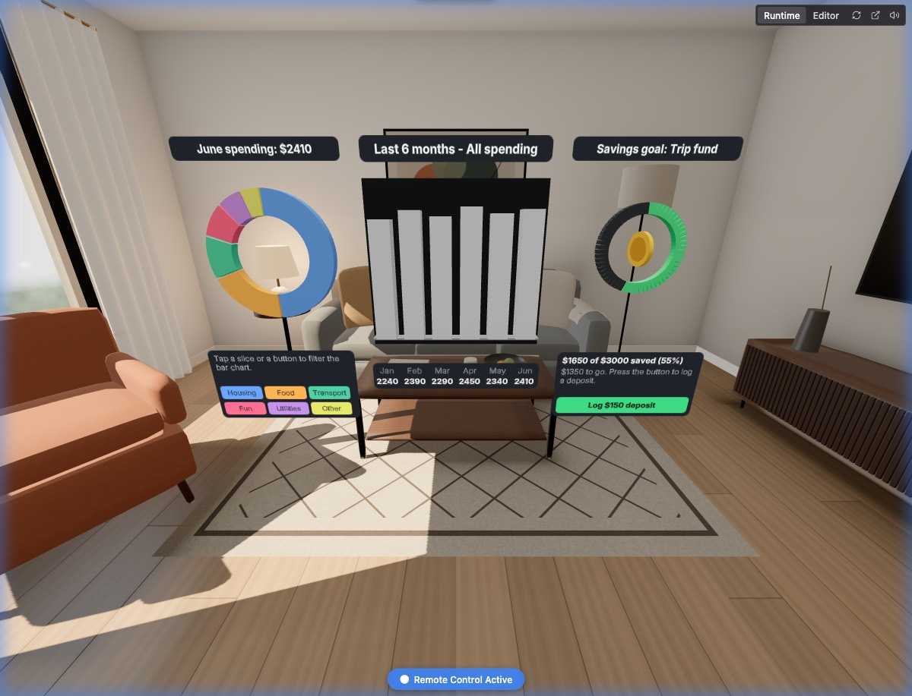</a> ✅ first try · 175 s · press ✗ · buttons 3/3 · **4.5/5** All requested parts are present: a category donut, a six-month bar chart with monthly values, colour-matched category filter buttons and a savings ring with a log-deposit button, and the figures are consistent (June $2410 matches the Jun bar, 1650/3000 = 55%, $1350 to go); the panel text is small, t | <a href="gallery/muse-spark-1.3__budget-dashboard__0.jpg">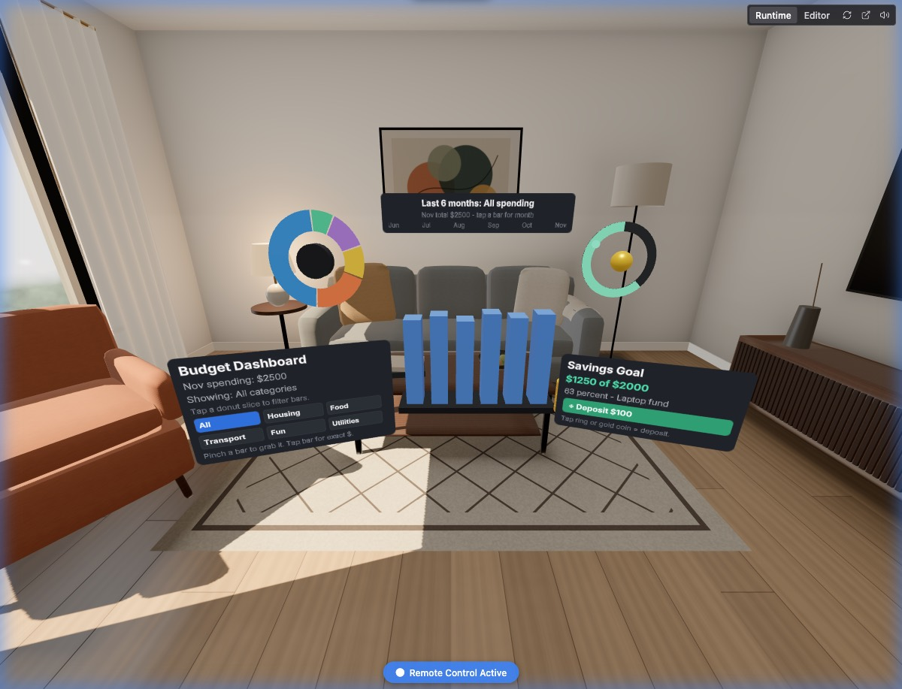</a> ✅ first try · 257 s · grab ✓ · press ✓ · buttons 3/3 · **3.8/5** Every requested piece is present: a donut chart, a six-bar chart, category filter chips, a savings ring and a Deposit button. However, the month labels float in a separate header panel well above the bars, the bars have no value labels, and the donut has no color legend linking slices to categories, | <a href="gallery/deepseek-v4.1-flash__budget-dashboard__0.jpg">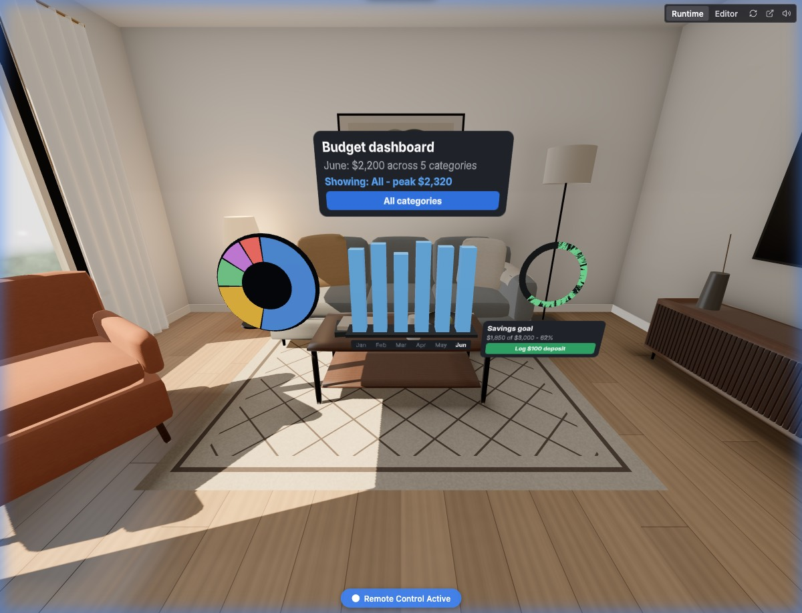</a> ✅ first try · 89 s · press ✓ · buttons 2/2 · **3.5/5** All requested parts are present: a five-slice donut, a Jan–Jun bar chart, a savings ring with a 'Log $100 deposit' button, and a filter header; however, the donut slices have no category labels or legend, the bars have no value axis, the savings ring shows z-fighting artifacts that make its progress | <a href="gallery/muse-ember-1.0-max__budget-dashboard__0.jpg">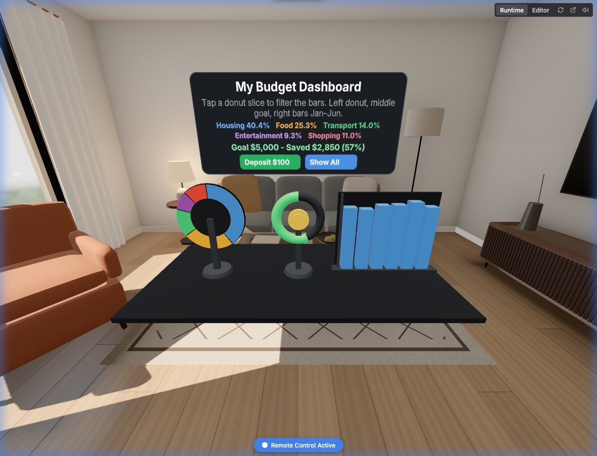</a> ✅ first try · 43 s · press ✓ · buttons 2/2 · **3.5/5** The donut, savings ring, six-month bar chart, Deposit button and Show All button are all present, and the category percentages (summing to 100%) and the 57% savings figure are consistent, but the 3D bar chart has no month labels, axis or values, the charts carry no on-object labels, and the tappable | <a href="gallery/kimi-k3.1-pro-fw__budget-dashboard__0.jpg">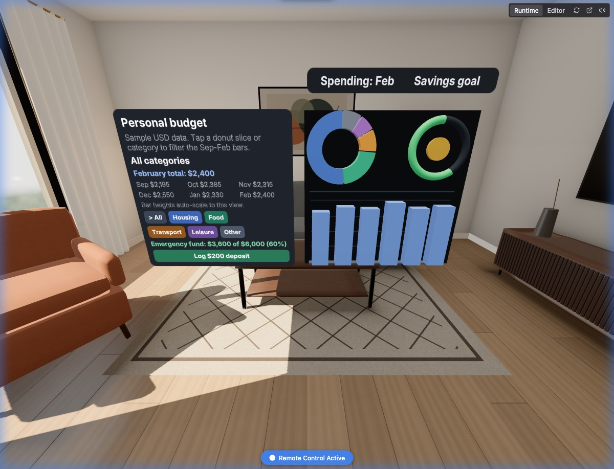</a> ✅ first try · 281 s · press ✗ · buttons 3/3 · **3.8/5** The donut, six-month bar chart, category filter chips, savings ring and 'Log $200 deposit' button are all present, and the figures are consistent ($3,600 of $6,000 is 60%), but the text panel overlaps the chart panel, the bars have no month labels or axis, and the floating 'Spending: Feb / Savings g |
| **T4** · solar-sim “A solar system simulator with play and pause, a control for time speed, planet info cards when I tap a planet, toggles for orbit lines and labels, and a 'compare sizes' mode that lines the planets up side by side at true relative size” |  ✅ first try · 1147 s · press ✓ · buttons 3/3 · **3.3/5** A tabletop solar system with orbit rings and planet labels, plus a control panel offering pause, a time speed stepper and orbit, label and compare toggles, covers most of the request, but the planet info card is not shown and everything is rendered so small that the labels and panel text are nearly  | <a href="gallery/muse-spark-1.3__solar-sim__0.jpg">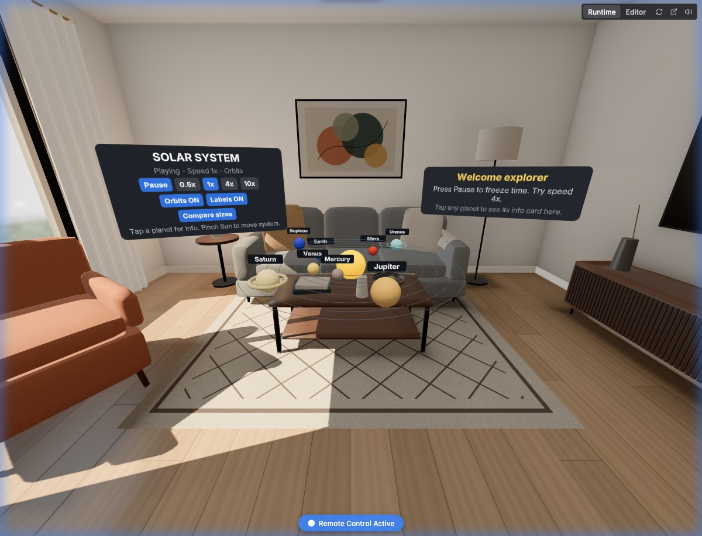</a> ✅ first try · 288 s · grab ✓ · press ✓ · buttons 3/3 · **3.5/5** Every requested control is present (pause, speed presets, orbit and label toggles, compare sizes) along with a 3D orrery and an info-card panel, but the planet labels crowd and overlap around the sun, Earth is hard to find, and the status line reads a truncated 'Orbits'; there are also visual odditi | <a href="gallery/deepseek-v4.1-flash__solar-sim__0.jpg">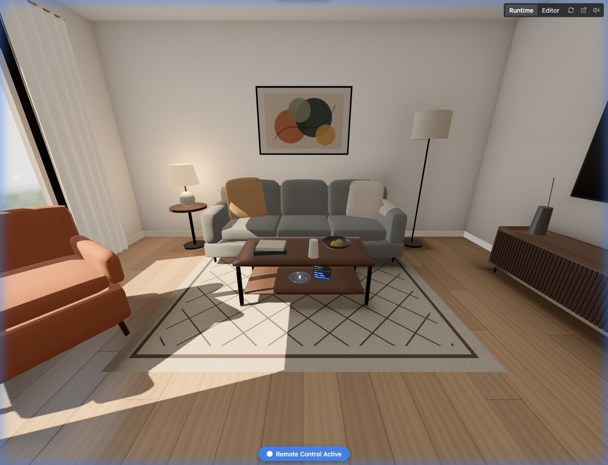</a> ✅ first try · 147 s · press ✓ · buttons 3/3 · **2.0/5** A tiny solar system with orbit rings and a small control panel sits on the coffee table's lower shelf, so far away and so small that no text, buttons, toggles or compare-sizes mode can be made out or reached, though the visible orbit layout shows nothing wrong. | <a href="gallery/muse-ember-1.0-max__solar-sim__0.jpg">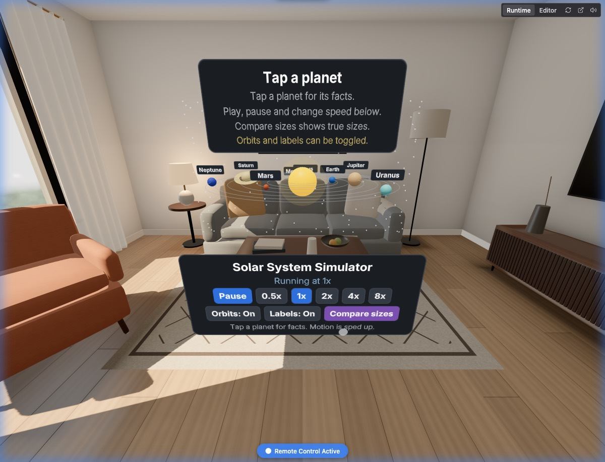</a> ✅ first try · 64 s · press ✗ · buttons 3/3 · **3.8/5** Shows the requested features (pause, speed buttons, orbit/label toggles, compare sizes, tappable planets with an instruction card), but the planets are packed together with overlapping labels (Mercury/Venus collide with the Sun), the top info card hides part of the orbit field, and a small handle ov | <a href="gallery/kimi-k3.1-pro-fw__solar-sim__0.jpg">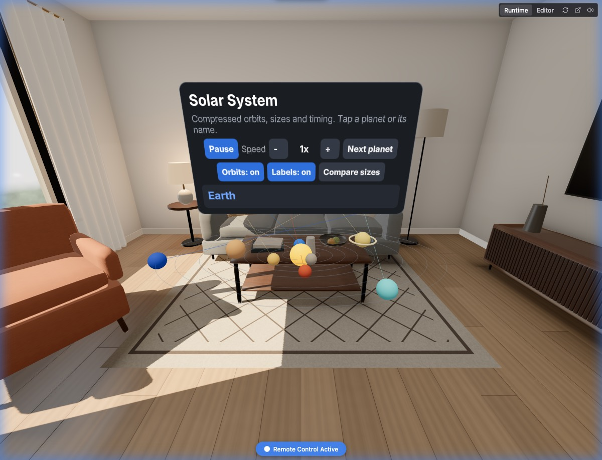</a> ✅ first try · 422 s · grab ✓ · press ✓ · buttons 0/3 · **3.5/5** Play/pause, speed, orbit and label toggles, and compare-sizes controls are all clear buttons and the orbiting planets render, but the selected-planet card shows only 'Earth' with no info, no planet labels are visible despite 'Labels: on', and the small planets crowd against the coffee table clutter. |
| **T4** · registration-wizard “A 3-step conference registration without a keyboard: choose a ticket type, pick up to two workshops with checkboxes (tell me if I pick too many), choose a t-shirt size with a stepper, then a review screen with Edit buttons for each step and a Confirm button” | <a href="gallery/claude-sonnet-5-5__registration-wizard__0.jpg">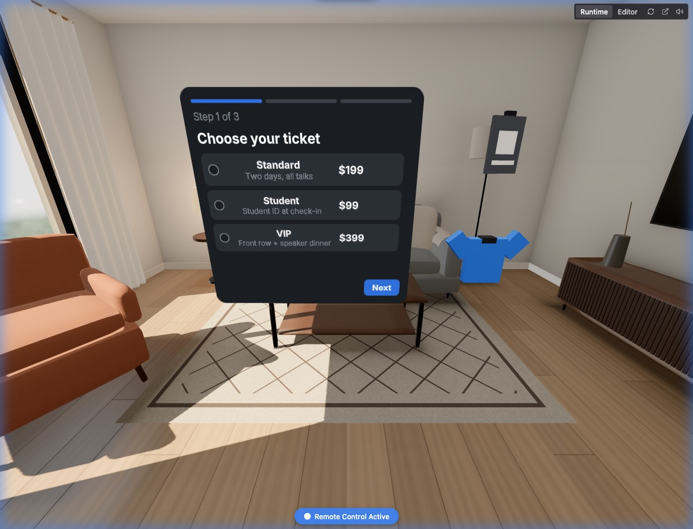</a> ✅ first try · 79 s · grab ✓ · buttons 3/3 · **4.0/5** Only the ticket step is visible: a clean, curved panel with a step indicator, three radio-style ticket rows with prices and a clear Next button; the workshop checkboxes, t-shirt stepper and review screen can't be verified, and the floating 3D t-shirt beside the panel feels disconnected from the flow |  ✅ first try · 234 s · grab ✓ · press ✓ · buttons 0/3 · **3.3/5** Only the ticket step is visible: a skewed panel with Standard/Premium/VIP options and a Next button, plus three unlabeled colored 3D ticket blocks on a dark slab that are hard to map to the options; the workshop checkboxes, t-shirt stepper and review screen can't be verified from this view. |  ✅ first try · 74 s · grab ✗ · buttons 0/3 · **4.0/5** Only step 1 is visible: a clean ticket chooser with three priced options and a Next button, but no ticket appears selected, and the workshop checkboxes, over-limit warning, t-shirt stepper and review screen with Edit and Confirm buttons cannot be checked from this view. |  ✅ first try · 32 s · grab ✓ · press ✓ · buttons 3/3 · **3.8/5** Only step 1 is visible: a legible ticket-type panel with three priced options and a Next button, though the option buttons are slightly misaligned and uneven in width, and the colored pucks on the table have no labels or clear purpose, which makes it confusing what to interact with. |  ✅ first try · 221 s · grab ✓ · buttons 3/3 · **3.3/5** Step 1 shows a clear ticket chooser with prices, a 3-segment progress bar and a Continue button, but the workshop, t-shirt stepper and review steps aren't visible; the ticket cards are oddly staggered in width, the '[ ]' text selectors look crude, a stray grey dot floats beside Continue, and 'STEP 1 |
| **T4** · escape-box “A mini escape-room puzzle on my desk: a locked box with a 4-digit combination lock I can change digit by digit, three clue objects I can pick up and inspect, a hint button that gives up to three increasingly direct hints, and an opening animation when the code is right” |  ✅ first try · 200 s · grab ✓ · press ✓ · buttons 0/2 · **4.3/5** A locked box with a padlock, a 4-digit 0000 dial with gold up/down cone arrows, three clue objects (clock, coins, flower), a Hint (0/3) button and a Relock button are all present; the opening animation can't be verified from a still, the panel text is small, and the clue objects are spread loosely a |  ✅ first try · 252 s · grab ✓ · press ✓ · buttons 3/3 · **3.8/5** The component delivers the locked chest, three clue objects (book, clock, plant), a 4-digit lock panel with +/- controls and an UNLOCK button, and a hint panel, but the panel text is small and hard to read, some lines like the hint and status text are nearly illegible, and the opening animation can' |  ✅ first try · 119 s · grab ✓ · press ✓ · buttons 3/3 · **4.0/5** Shows a locked wooden box with a lid, a four-wheel combination panel with up/down arrows, UNLOCK and HINT (3 left) buttons, and three clue objects (note, key, clock); however, the panel overlaps the box and sofa, its text is small, the first down-arrow is rendered inconsistently, and the clue object |  ✅ first try · 43 s · grab ✓ · press ✓ · buttons 3/3 · **4.0/5** Shows a wooden locked box with four dial knobs, three clue objects (a color card, a book, a clock) on the desk, and a panel with 4-digit tappable code slots plus Unlock, Hint (0/3) and Reset buttons; the panel overlaps the top of the box, the subtitle wraps awkwardly, the clues are small, and the op |  ✅ first try · 270 s · grab ✓ · press ✓ · buttons 2/2 · **4.3/5** Shows the locked box with four 0000 digit wheels and small down-triangles, three clue objects (a domino, a brass key and an ambiguous pink shell-like object), and a panel with status, instructions, 'Hint 1 of 3' and 'Reset box' buttons; the opening animation can't be verified from a still, the box a |
